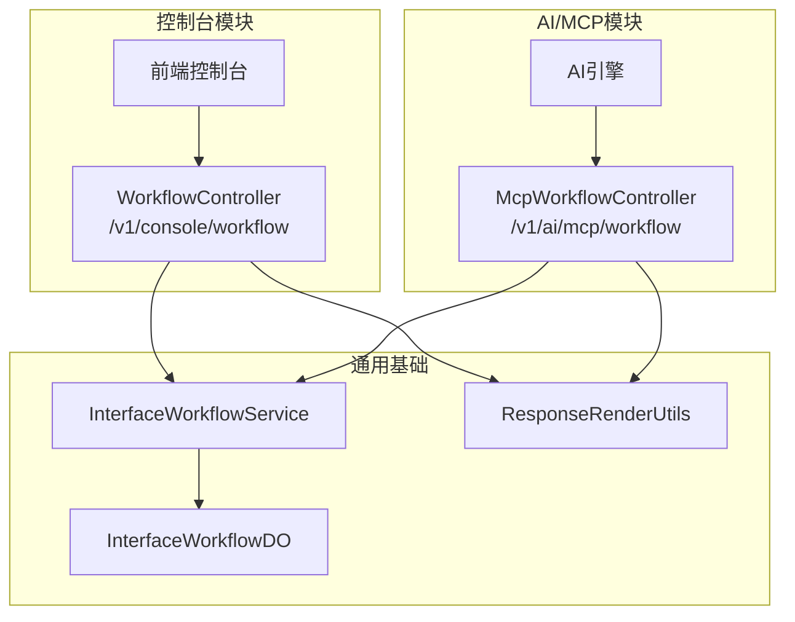
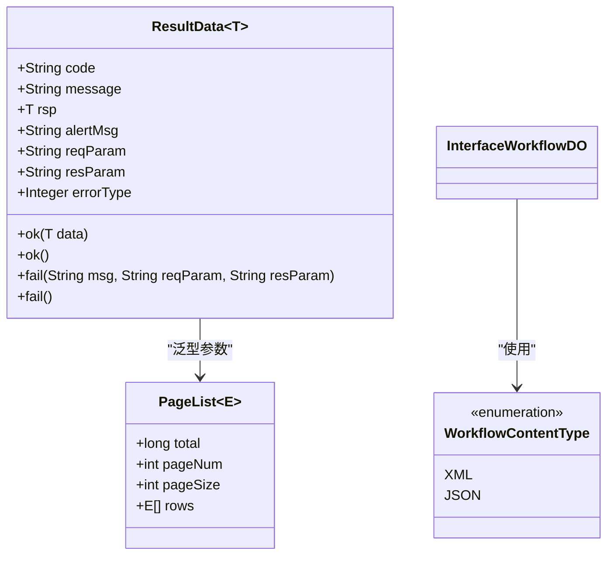
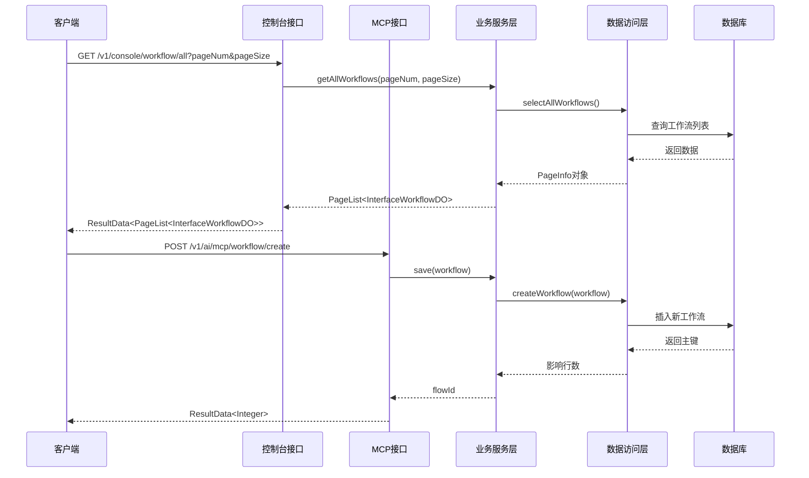
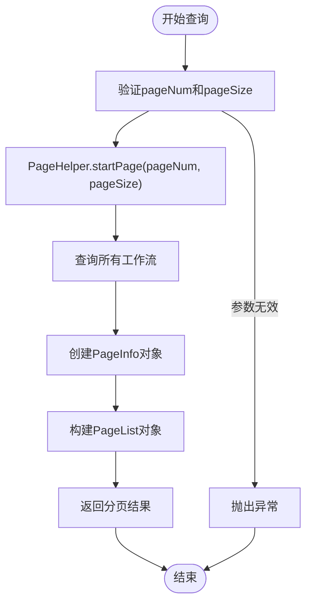
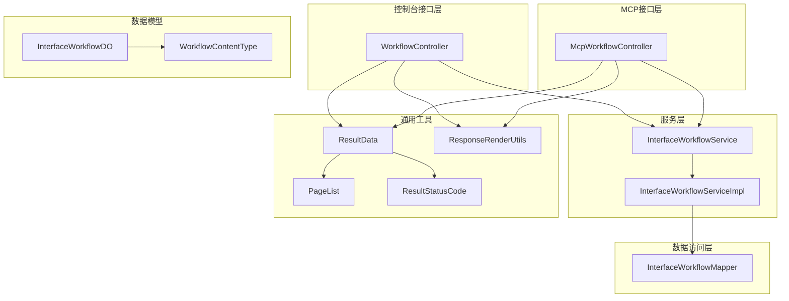
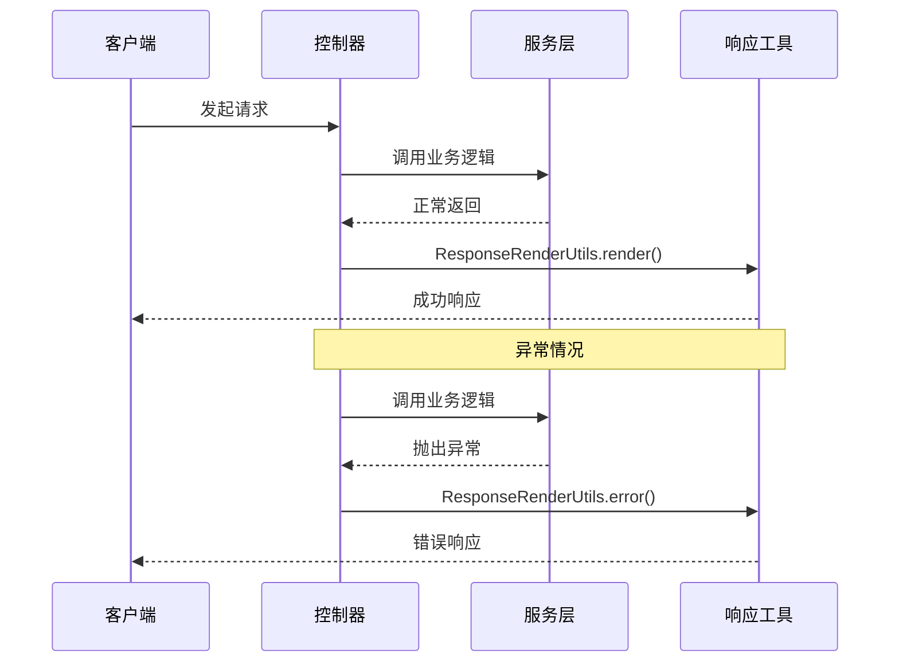

# 工作流管理API

<cite>
**本文档引用的文件**
- [WorkflowController.java](file://agent-workflow/src/main/java/com/helianhealth/agent/workflow/controller/WorkflowController.java)
- [McpWorkflowController.java](file://agent-ai/src/main/java/com/helianhealth/agent/ai/controller/McpWorkflowController.java)
- [InterfaceWorkflowDO.java](file://agent-workflow/src/main/java/com/helianhealth/agent/workflow/model/domain/InterfaceWorkflowDO.java)
- [ResultData.java](file://agent-common/src/main/java/com/helianhealth/agent/common/base/ResultData.java)
- [PageList.java](file://agent-common/src/main/java/com/helianhealth/agent/common/base/PageList.java)
- [ResultStatusCode.java](file://agent-common/src/main/java/com/helianhealth/agent/common/base/ResultStatusCode.java)
- [ResponseRenderUtils.java](file://agent-common/src/main/java/com/helianhealth/agent/common/utils/ResponseRenderUtils.java)
- [InterfaceWorkflowService.java](file://agent-workflow/src/main/java/com/helianhealth/agent/workflow/service/InterfaceWorkflowService.java)
- [InterfaceWorkflowServiceImpl.java](file://agent-workflow/src/main/java/com/helianhealth/agent/workflow/service/impl/InterfaceWorkflowServiceImpl.java)
- [WorkflowContentType.java](file://agent-common/src/main/java/com/helianhealth/agent/common/enums/WorkflowContentType.java)
- [workflow.js](file://console-ui/src/api/workflow.js)
</cite>

## 目录
1. [简介](#简介)
2. [项目结构](#项目结构)
3. [核心组件](#核心组件)
4. [架构概览](#架构概览)
5. [详细组件分析](#详细组件分析)
6. [依赖关系分析](#依赖关系分析)
7. [性能考虑](#性能考虑)
8. [故障排除指南](#故障排除指南)
9. [结论](#结论)

## 简介

本文档详细介绍了接口代理系统中的工作流管理API，涵盖控制台工作流管理和MCP专用工作流接口。该系统提供了完整的RESTful接口来管理接口工作流，包括创建、查询、更新和删除操作。文档特别强调了分页查询与非分页查询的区别，以及控制台接口与MCP接口的差异。

## 项目结构

工作流管理API分布在两个主要模块中：



**图表来源**
- [WorkflowController.java](file://agent-workflow/src/main/java/com/helianhealth/agent/workflow/controller/WorkflowController.java#L24-L28)
- [McpWorkflowController.java](file://agent-ai/src/main/java/com/helianhealth/agent/ai/controller/McpWorkflowController.java#L20-L24)

## 核心组件

### 数据模型：InterfaceWorkflowDO

工作流数据模型包含以下关键字段：

| 字段名 | 类型 | 描述 | 必填 |
|--------|------|------|------|
| flowId | Integer | 工作流唯一标识符 | 否 |
| flowName | String | 工作流名称 | 是 |
| interfaceUri | String | 接口URI路径 | 是 |
| contentType | WorkflowContentType | 内容类型（XML/JSON） | 是 |
| contentMetaInfo | String | 内容元数据信息 | 否 |
| firstFlowNodes | List<Integer> | 首节点列表 | 否 |
| status | Integer | 状态（1-启用，0-禁用） | 是 |

**章节来源**
- [InterfaceWorkflowDO.java](file://agent-workflow/src/main/java/com/helianhealth/agent/workflow/model/domain/InterfaceWorkflowDO.java#L31-L73)

### 响应格式：ResultData<T>

统一的响应格式包含以下结构：



**图表来源**
- [ResultData.java](file://agent-common/src/main/java/com/helianhealth/agent/common/base/ResultData.java#L8-L49)
- [PageList.java](file://agent-common/src/main/java/com/helianhealth/agent/common/base/PageList.java#L15-L26)
- [WorkflowContentType.java](file://agent-common/src/main/java/com/helianhealth/agent/common/enums/WorkflowContentType.java#L9-L14)

## 架构概览

系统采用分层架构设计，清晰分离控制台接口和MCP专用接口：



**图表来源**
- [WorkflowController.java](file://agent-workflow/src/main/java/com/helianhealth/agent/workflow/controller/WorkflowController.java#L35-L46)
- [McpWorkflowController.java](file://agent-ai/src/main/java/com/helianhealth/agent/ai/controller/McpWorkflowController.java#L31-L41)

## 详细组件分析

### 控制台工作流管理接口

#### GET /v1/console/workflow/all

**功能**：获取分页的工作流列表

**请求参数**：
- pageNum: int, 默认值1
- pageSize: int, 默认值10

**响应格式**：`ResultData<PageList<InterfaceWorkflowDO>>`

**响应示例**：
```json
{
  "code": "200",
  "message": "OK",
  "rsp": {
    "total": 100,
    "pageNum": 1,
    "pageSize": 10,
    "rows": [
      {
        "flowId": 1,
        "flowName": "示例工作流",
        "interfaceUri": "/api/example",
        "contentType": "JSON",
        "status": 1
      }
    ]
  }
}
```

#### GET /v1/console/workflow/all-unpaged

**功能**：获取所有工作流（不分页）

**请求参数**：无

**响应格式**：`ResultData<List<InterfaceWorkflowDO>>`

**使用场景**：
- 前端需要显示所有工作流
- 导出功能
- 配置同步

#### POST /v1/console/workflow/create

**功能**：创建新的工作流

**请求体**：`InterfaceWorkflowDO`

**响应格式**：`ResultData<Integer>`（返回新创建的工作流ID）

**curl示例**：
```bash
curl -X POST "http://localhost:8805/v1/console/workflow/create" \
  -H "Content-Type: application/json" \
  -d '{
    "flowName": "测试工作流",
    "interfaceUri": "/api/test",
    "contentType": "JSON",
    "status": 1
  }'
```

#### POST /v1/console/workflow/update

**功能**：更新现有工作流

**请求体**：`InterfaceWorkflowDO`（必须包含flowId）

**响应格式**：`ResultData<Integer>`（返回影响的行数）

#### DELETE /v1/console/workflow/delete/{flowId}

**功能**：删除指定的工作流

**路径参数**：flowId (Integer)

**响应格式**：`ResultData<String>`

**错误处理**：删除不存在的工作流时返回错误响应

**章节来源**
- [WorkflowController.java](file://agent-workflow/src/main/java/com/helianhealth/agent/workflow/controller/WorkflowController.java#L35-L102)

### MCP专用工作流管理接口

#### POST /v1/ai/mcp/workflow/create

**功能**：MCP专用创建工作流接口

**特点**：
- 与控制台接口相同的功能
- 更严格的日志记录
- 参数验证

**响应格式**：`ResultData<Integer>`

#### POST /v1/ai/mcp/workflow/update

**功能**：MCP专用更新工作流接口

**特点**：
- 强制要求flowId不为空
- 详细的日志记录

**响应格式**：`ResultData<Integer>`

#### DELETE /v1/ai/mcp/workflow/delete/{flowId}

**功能**：MCP专用删除工作流接口

**特点**：
- 详细的删除日志
- 统一的错误处理

**章节来源**
- [McpWorkflowController.java](file://agent-ai/src/main/java/com/helianhealth/agent/ai/controller/McpWorkflowController.java#L20-L74)

### 分页查询对比分析

#### getAllWorkflows（分页查询）

**实现逻辑**：


**图表来源**
- [InterfaceWorkflowServiceImpl.java](file://agent-workflow/src/main/java/com/helianhealth/agent/workflow/service/impl/InterfaceWorkflowServiceImpl.java#L39-L57)

#### getAllWorkflowsWithoutPaged（非分页查询）

**实现逻辑**：
- 直接查询所有工作流记录
- 不进行分页处理
- 返回完整列表

**使用场景对比**：
- **分页查询**：大数据量场景，前端分页显示
- **非分页查询**：小数据量场景，一次性获取所有数据

**章节来源**
- [InterfaceWorkflowServiceImpl.java](file://agent-workflow/src/main/java/com/helianhealth/agent/workflow/service/impl/InterfaceWorkflowServiceImpl.java#L59-L62)

## 依赖关系分析



**图表来源**
- [WorkflowController.java](file://agent-workflow/src/main/java/com/helianhealth/agent/workflow/controller/WorkflowController.java#L30-L31)
- [McpWorkflowController.java](file://agent-ai/src/main/java/com/helianhealth/agent/ai/controller/McpWorkflowController.java#L26-L27)

**章节来源**
- [InterfaceWorkflowService.java](file://agent-workflow/src/main/java/com/helianhealth/agent/workflow/service/InterfaceWorkflowService.java#L9-L24)
- [InterfaceWorkflowServiceImpl.java](file://agent-workflow/src/main/java/com/helianhealth/agent/workflow/service/impl/InterfaceWorkflowServiceImpl.java#L19-L21)

## 性能考虑

### 分页查询优化

1. **数据库索引**：建议在`interface_workflow`表上建立适当的索引
2. **查询优化**：使用`PageHelper`进行高效的分页查询
3. **缓存策略**：对于频繁访问的工作流列表可以考虑缓存

### 错误处理机制

系统实现了统一的错误处理机制：



**图表来源**
- [ResponseRenderUtils.java](file://agent-common/src/main/java/com/helianhealth/agent/common/utils/ResponseRenderUtils.java#L12-L18)

## 故障排除指南

### 常见问题及解决方案

#### 1. 删除不存在的工作流

**现象**：删除接口返回错误

**原因**：数据库中不存在指定ID的工作流

**解决方案**：
- 先查询确认工作流是否存在
- 使用事务确保数据一致性

#### 2. 分页参数无效

**现象**：分页查询返回异常

**原因**：pageNum或pageSize参数不合法

**解决方案**：
- 确保pageNum >= 1
- 确保pageSize在合理范围内（通常1-100）

#### 3. 更新工作流失败

**现象**：更新接口返回错误

**原因**：
- 缺少flowId参数
- 数据库约束冲突

**解决方案**：
- 确保请求体包含有效的flowId
- 检查数据库约束条件

### 错误响应格式

所有错误响应都遵循统一格式：
- `code`: 错误码（-1表示通用错误）
- `message`: 错误描述信息
- `rsp`: 响应数据（通常为null）

**章节来源**
- [ResultData.java](file://agent-common/src/main/java/com/helianhealth/agent/common/base/ResultData.java#L68-L74)
- [ResponseRenderUtils.java](file://agent-common/src/main/java/com/helianhealth/agent/common/utils/ResponseRenderUtils.java#L16-L18)

## 结论

工作流管理API提供了完整的企业级接口解决方案，具有以下特点：

1. **双接口设计**：同时支持控制台和MCP专用接口，满足不同使用场景
2. **统一响应格式**：所有接口返回一致的JSON格式，便于客户端处理
3. **完善的分页支持**：既支持分页查询也支持全量查询
4. **健壮的错误处理**：统一的错误处理机制和详细的日志记录
5. **清晰的架构分层**：控制器、服务层、数据访问层职责明确

开发者可以根据具体需求选择合适的接口：
- **控制台开发**：使用`/v1/console/workflow/*`接口
- **AI集成**：使用`/v1/ai/mcp/workflow/*`接口
- **批量操作**：结合MCP的批量操作接口进行高效管理