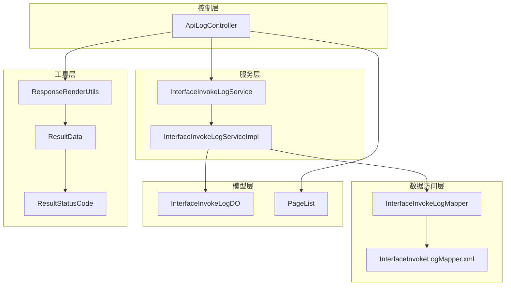
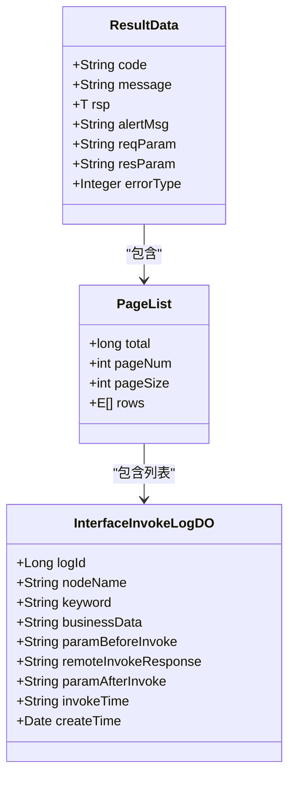
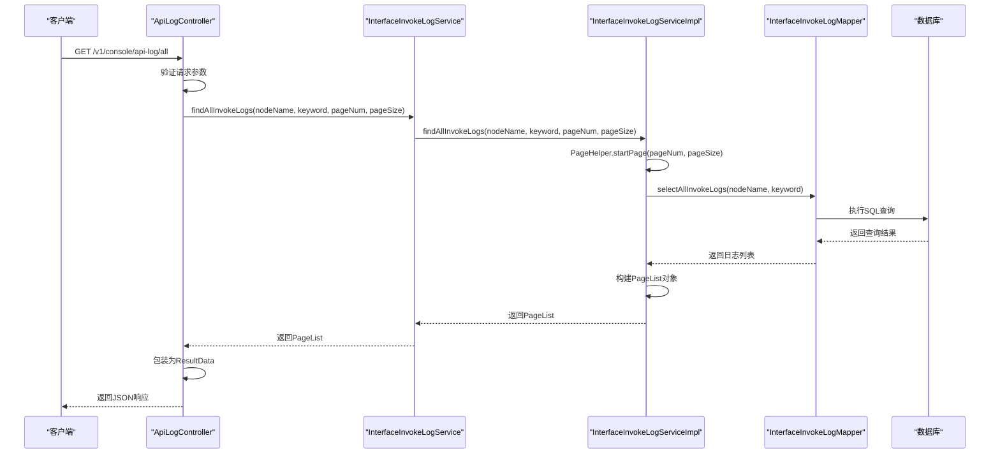
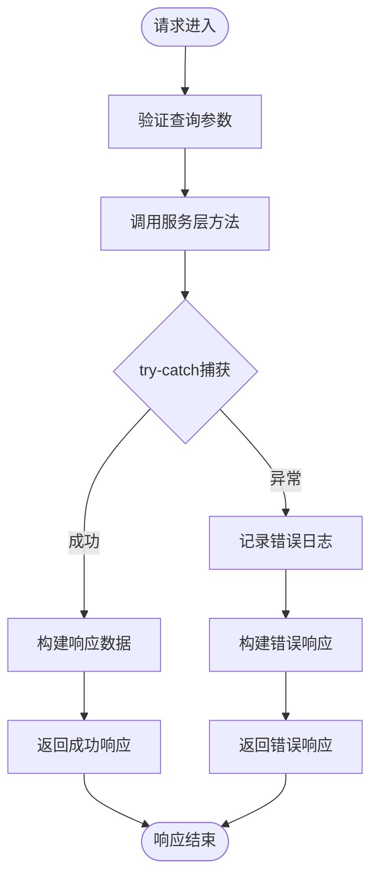
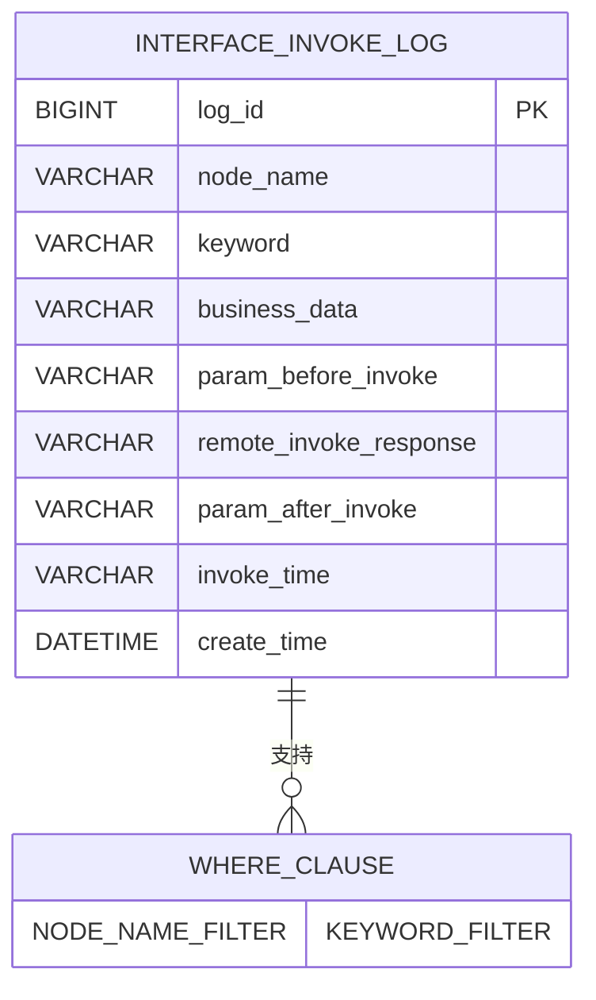
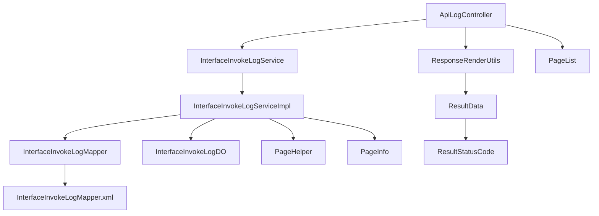
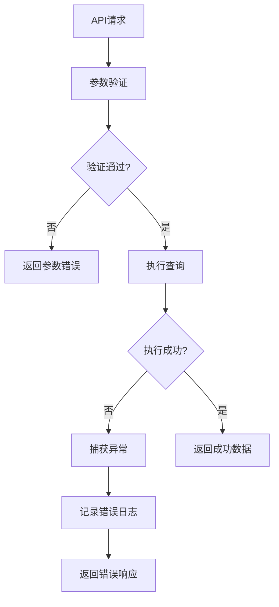

# 日志查询API

<cite>
**本文档引用的文件**
- [ApiLogController.java](file://agent-log/src/main/java/com/helianhealth/agent/log/controller/ApiLogController.java)
- [InterfaceInvokeLogDO.java](file://agent-log/src/main/java/com/helianhealth/agent/log/model/InterfaceInvokeLogDO.java)
- [PageList.java](file://agent-common/src/main/java/com/helianhealth/agent/common/base/PageList.java)
- [InterfaceInvokeLogServiceImpl.java](file://agent-log/src/main/java/com/helianhealth/agent/log/service/impl/InterfaceInvokeLogServiceImpl.java)
- [InterfaceInvokeLogMapper.xml](file://agent-log/src/main/resources/mapper/agent/InterfaceInvokeLogMapper.xml)
- [ResponseRenderUtils.java](file://agent-common/src/main/java/com/helianhealth/agent/common/utils/ResponseRenderUtils.java)
- [ResultData.java](file://agent-common/src/main/java/com/helianhealth/agent/common/base/ResultData.java)
- [ResultStatusCode.java](file://agent-common/src/main/java/com/helianhealth/agent/common/base/ResultStatusCode.java)
- [invokeLog.js](file://console-ui/src/api/invokeLog.js)
</cite>

## 目录
1. [简介](#简介)
2. [项目结构](#项目结构)
3. [核心组件](#核心组件)
4. [架构概览](#架构概览)
5. [详细组件分析](#详细组件分析)
6. [依赖关系分析](#依赖关系分析)
7. [性能考虑](#性能考虑)
8. [故障排除指南](#故障排除指南)
9. [结论](#结论)

## 简介

本文档详细介绍了接口代理系统中的调用日志查询API，重点分析/v1/console/api-log/all端点。该API允许用户查询接口调用历史记录，支持按节点名称过滤、关键字搜索以及分页控制功能。通过该API，用户可以监控系统的运行状态，排查接口调用问题，并进行性能分析。

## 项目结构

调用日志查询功能主要分布在以下模块中：

**图表来源**
- [ApiLogController.java](file://agent-log/src/main/java/com/helianhealth/agent/log/controller/ApiLogController.java#L15-L41)
- [InterfaceInvokeLogServiceImpl.java](file://agent-log/src/main/java/com/helianhealth/agent/log/service/impl/InterfaceInvokeLogServiceImpl.java#L16-L69)
- [InterfaceInvokeLogMapper.xml](file://agent-log/src/main/resources/mapper/agent/InterfaceInvokeLogMapper.xml#L1-L89)

**章节来源**
- [ApiLogController.java](file://agent-log/src/main/java/com/helianhealth/agent/log/controller/ApiLogController.java#L1-L41)
- [InterfaceInvokeLogServiceImpl.java](file://agent-log/src/main/java/com/helianhealth/agent/log/service/impl/InterfaceInvokeLogServiceImpl.java#L1-L69)

## 核心组件

### API端点定义

/v1/console/api-log/all 是一个GET请求端点，提供以下功能：
- 查询所有接口调用日志
- 支持节点名称过滤
- 支持关键字搜索
- 支持分页控制

### 查询参数说明

| 参数名 | 类型 | 必填 | 默认值 | 描述 |
|--------|------|------|--------|------|
| nodeName | String | 否 | 无 | 节点名称过滤条件 |
| keyword | String | 否 | 无 | 关键字搜索条件 |
| pageNum | Integer | 否 | 1 | 页码，默认第1页 |
| pageSize | Integer | 否 | 10 | 每页记录数，默认10条 |

### 返回数据结构

API返回的数据结构为 `ResultData<PageList<InterfaceInvokeLogDO>>`，其中：

**图表来源**
- [ResultData.java](file://agent-common/src/main/java/com/helianhealth/agent/common/base/ResultData.java#L8-L40)
- [PageList.java](file://agent-common/src/main/java/com/helianhealth/agent/common/base/PageList.java#L15-L26)
- [InterfaceInvokeLogDO.java](file://agent-log/src/main/java/com/helianhealth/agent/log/model/InterfaceInvokeLogDO.java#L23-L80)

**章节来源**
- [ApiLogController.java](file://agent-log/src/main/java/com/helianhealth/agent/log/controller/ApiLogController.java#L26-L31)
- [ResultData.java](file://agent-common/src/main/java/com/helianhealth/agent/common/base/ResultData.java#L8-L40)
- [PageList.java](file://agent-common/src/main/java/com/helianhealth/agent/common/base/PageList.java#L15-L26)

## 架构概览

调用日志查询API采用经典的三层架构设计：

**图表来源**
- [ApiLogController.java](file://agent-log/src/main/java/com/helianhealth/agent/log/controller/ApiLogController.java#L26-L39)
- [InterfaceInvokeLogServiceImpl.java](file://agent-log/src/main/java/com/helianhealth/agent/log/service/impl/InterfaceInvokeLogServiceImpl.java#L49-L67)
- [InterfaceInvokeLogMapper.xml](file://agent-log/src/main/resources/mapper/agent/InterfaceInvokeLogMapper.xml#L74-L86)

## 详细组件分析

### 控制器层分析

ApiLogController负责处理HTTP请求和响应：

**图表来源**
- [ApiLogController.java](file://agent-log/src/main/java/com/helianhealth/agent/log/controller/ApiLogController.java#L26-L39)

### 服务层实现

服务层实现了完整的业务逻辑：

| 方法名 | 功能描述 | 输入参数 | 输出 |
|--------|----------|----------|------|
| findAllInvokeLogs | 查询所有调用日志 | nodeName, keyword, pageNum, pageSize | PageList<InterfaceInvokeLogDO> |
| saveInvokeLog | 保存调用日志 | 多种重载形式 | void |

### 数据访问层设计

MyBatis映射器提供了灵活的查询能力：

**图表来源**
- [InterfaceInvokeLogMapper.xml](file://agent-log/src/main/resources/mapper/agent/InterfaceInvokeLogMapper.xml#L6-L16)
- [InterfaceInvokeLogMapper.xml](file://agent-log/src/main/resources/mapper/agent/InterfaceInvokeLogMapper.xml#L74-L86)

**章节来源**
- [ApiLogController.java](file://agent-log/src/main/java/com/helianhealth/agent/log/controller/ApiLogController.java#L1-L41)
- [InterfaceInvokeLogServiceImpl.java](file://agent-log/src/main/java/com/helianhealth/agent/log/service/impl/InterfaceInvokeLogServiceImpl.java#L1-L69)
- [InterfaceInvokeLogMapper.xml](file://agent-log/src/main/resources/mapper/agent/InterfaceInvokeLogMapper.xml#L1-L89)

## 依赖关系分析

### 组件依赖图

**图表来源**
- [ApiLogController.java](file://agent-log/src/main/java/com/helianhealth/agent/log/controller/ApiLogController.java#L3-L21)
- [InterfaceInvokeLogServiceImpl.java](file://agent-log/src/main/java/com/helianhealth/agent/log/service/impl/InterfaceInvokeLogServiceImpl.java#L3-L21)

### 外部依赖

系统依赖以下关键组件：
- **PageHelper**: 提供分页功能
- **MyBatis**: 数据持久化框架
- **Spring Boot**: 应用框架
- **Lombok**: 代码简化工具

**章节来源**
- [pom.xml](file://pom.xml#L92-L97)

## 性能考虑

### 分页策略

系统采用PageHelper实现高效分页：

1. **内存优化**: 使用PageHelper.startPage()进行物理分页，避免一次性加载大量数据
2. **默认限制**: pageSize默认值为10，防止意外的大批量查询
3. **合理配置**: 建议根据业务需求调整pageSize，避免超过100条

### 查询优化

1. **索引设计**: 建议在node_name和create_time字段上建立索引
2. **模糊查询**: 当前实现使用精确匹配，如需模糊搜索可考虑添加LIKE查询
3. **缓存策略**: 对于频繁查询的节点，可考虑添加Redis缓存

### 性能建议

| 场景 | 建议 | 说明 |
|------|------|------|
| 大量数据查询 | 设置pageSize ≤ 50 | 避免内存溢出 |
| 频繁查询 | 添加create_time范围过滤 | 减少查询范围 |
| 复杂筛选 | 使用组合索引 | 提高查询效率 |
| 实时监控 | 使用WebSocket推送 | 减少轮询频率 |

## 故障排除指南

### 常见错误场景

1. **数据库连接失败**
   - 错误码: `-1`
   - 触发条件: 数据库连接池不可用
   - 解决方案: 检查数据库连接配置和网络连通性

2. **查询参数异常**
   - 错误码: `-1`
   - 触发条件: pageNum或pageSize格式不正确
   - 解决方案: 确保传入正整数参数

3. **SQL执行异常**
   - 错误码: `-1`
   - 触发条件: MyBatis执行SQL时发生错误
   - 解决方案: 检查表结构和SQL语法

### 错误处理机制

**图表来源**
- [ApiLogController.java](file://agent-log/src/main/java/com/helianhealth/agent/log/controller/ApiLogController.java#L32-L39)
- [InterfaceInvokeLogServiceImpl.java](file://agent-log/src/main/java/com/helianhealth/agent/log/service/impl/InterfaceInvokeLogServiceImpl.java#L63-L66)

### 调试建议

1. **启用日志**: 在开发环境中启用DEBUG级别日志
2. **监控指标**: 使用APM工具监控API响应时间和错误率
3. **数据库监控**: 监控慢查询和连接池使用情况
4. **前端调试**: 使用浏览器开发者工具查看API响应

**章节来源**
- [ApiLogController.java](file://agent-log/src/main/java/com/helianhealth/agent/log/controller/ApiLogController.java#L32-L39)
- [InterfaceInvokeLogServiceImpl.java](file://agent-log/src/main/java/com/helianhealth/agent/log/service/impl/InterfaceInvokeLogServiceImpl.java#L38-L41)

## 结论

调用日志查询API提供了完整的接口调用监控解决方案。通过合理的参数设计、分页机制和错误处理，该API能够满足大多数日志查询需求。建议在生产环境中：

1. **合理设置分页大小**: 根据业务需求调整pageSize，避免过大导致性能问题
2. **添加适当的索引**: 在常用查询字段上建立索引提升查询性能
3. **监控API性能**: 建立完善的监控体系，及时发现和解决问题
4. **定期清理日志**: 建立日志清理策略，避免数据量无限增长

该API为接口代理系统的可观测性提供了重要支撑，有助于提高系统的稳定性和可维护性。