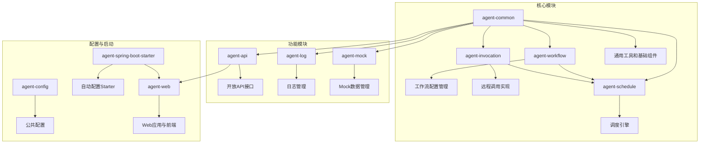
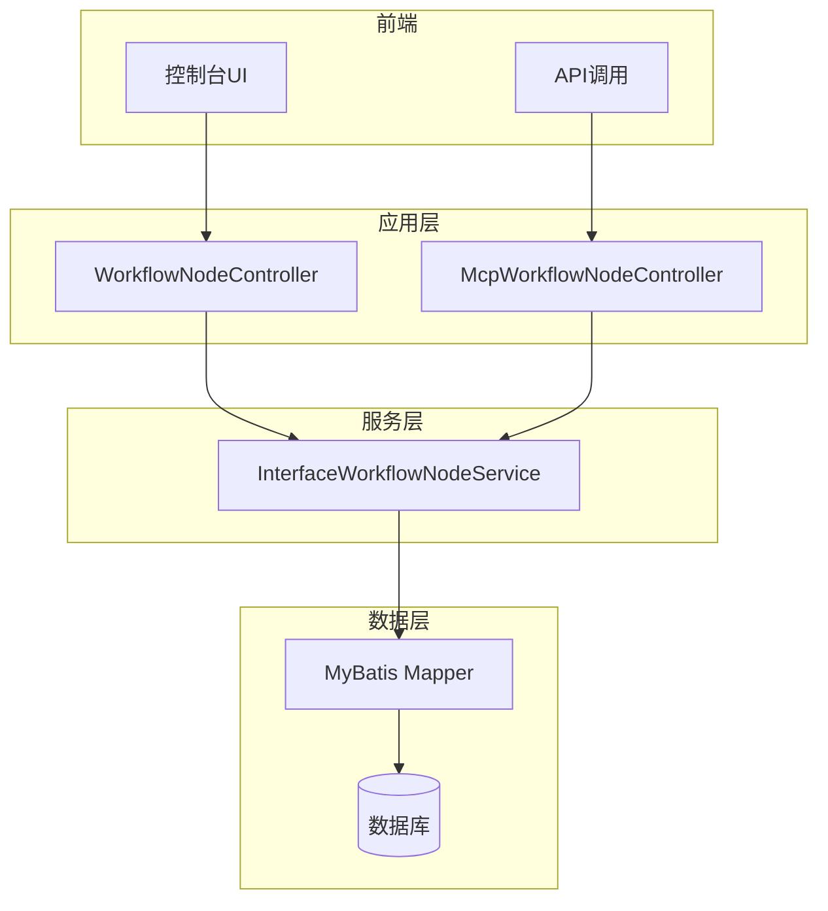
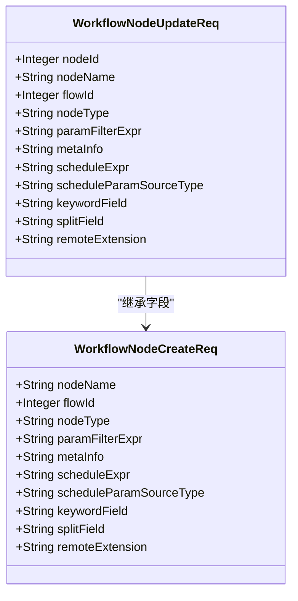
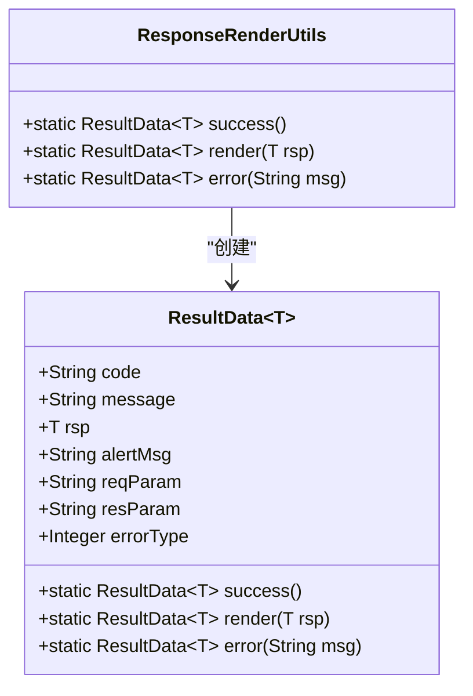
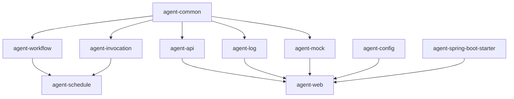
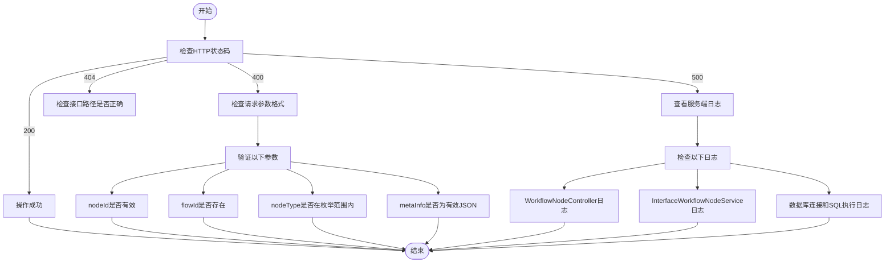

# 节点基础操作API

<cite>
**本文档引用文件**  
- [WorkflowNodeController.java](file://agent-workflow/src/main/java/com/helianhealth/agent/workflow/controller/WorkflowNodeController.java)
- [McpWorkflowNodeController.java](file://agent-ai/src/main/java/com/helianhealth/agent/ai/controller/McpWorkflowNodeController.java)
- [WorkflowNodeCreateReq.java](file://agent-workflow/src/main/java/com/helianhealth/agent/workflow/controller/request/WorkflowNodeCreateReq.java)
- [WorkflowNodeUpdateReq.java](file://agent-workflow/src/main/java/com/helianhealth/agent/workflow/controller/request/WorkflowNodeUpdateReq.java)
- [InterfaceWorkflowNodeView.java](file://agent-workflow/src/main/java/com/helianhealth/agent/workflow/controller/reponse/InterfaceWorkflowNodeView.java)
- [InterfaceWorkflowNodeService.java](file://agent-workflow/src/main/java/com/helianhealth/agent/workflow/service/InterfaceWorkflowNodeService.java)
- [NodeType.java](file://agent-common/src/main/java/com/helianhealth/agent/common/enums/NodeType.java)
- [ScheduleParamSourceType.java](file://agent-common/src/main/java/com/helianhealth/agent/common/enums/ScheduleParamSourceType.java)
- [ResultData.java](file://agent-common/src/main/java/com/helianhealth/agent/common/base/ResultData.java)
- [ResponseRenderUtils.java](file://agent-common/src/main/java/com/helianhealth/agent/common/utils/ResponseRenderUtils.java)
- [README_MCP.md](file://agent-ai/README_MCP.md)
- [README.md](file://README.md)
</cite>

## 目录
1. [简介](#简介)
2. [项目结构](#项目结构)
3. [核心组件](#核心组件)
4. [架构概述](#架构概述)
5. [详细组件分析](#详细组件分析)
6. [依赖分析](#依赖分析)
7. [性能考虑](#性能考虑)
8. [故障排除指南](#故障排除指南)
9. [结论](#结论)

## 简介
本文档详细说明了工作流节点的基础操作API，涵盖 `/v1/console/node/*` 和 `/v1/ai/mcp/workflow-node/*` 路径下的CRUD接口。重点介绍节点的创建、查询、更新和删除操作，以及 `WorkflowNodeCreateReq` 和 `WorkflowNodeUpdateReq` 数据结构中的关键字段。文档还解释了AI专用接口与通用接口的功能差异，并提供错误处理机制、状态码说明和最佳实践建议。

## 项目结构
本项目采用模块化架构设计，各模块职责清晰，层次分明。核心功能模块包括工作流管理、远程调用、调度引擎等，支持通过Starter方式集成到其他Spring Boot项目中。



**图示来源**
- [README.md](file://README.md#L16-L30)

## 核心组件
核心组件包括工作流节点控制器、服务接口、请求/响应数据模型等。这些组件共同实现了节点的全生命周期管理功能，支持通过RESTful API进行操作。

**组件来源**
- [WorkflowNodeController.java](file://agent-workflow/src/main/java/com/helianhealth/agent/workflow/controller/WorkflowNodeController.java#L1-L208)
- [InterfaceWorkflowNodeService.java](file://agent-workflow/src/main/java/com/helianhealth/agent/workflow/service/InterfaceWorkflowNodeService.java#L1-L40)

## 架构概述
系统采用分层架构设计，从前端UI到后端服务再到数据存储，各层之间通过明确定义的接口进行通信。工作流节点操作API位于应用层，通过服务层与数据访问层交互。



**图示来源**
- [WorkflowNodeController.java](file://agent-workflow/src/main/java/com/helianhealth/agent/workflow/controller/WorkflowNodeController.java#L30-L208)
- [InterfaceWorkflowNodeService.java](file://agent-workflow/src/main/java/com/helianhealth/agent/workflow/service/InterfaceWorkflowNodeService.java#L13-L40)

## 详细组件分析

### 节点创建与更新请求分析
`WorkflowNodeCreateReq` 和 `WorkflowNodeUpdateReq` 类定义了节点创建和更新操作的请求参数结构。这两个类包含相同的字段，但更新请求额外包含节点ID。



**图示来源**
- [WorkflowNodeCreateReq.java](file://agent-workflow/src/main/java/com/helianhealth/agent/workflow/controller/request/WorkflowNodeCreateReq.java#L8-L63)
- [WorkflowNodeUpdateReq.java](file://agent-workflow/src/main/java/com/helianhealth/agent/workflow/controller/request/WorkflowNodeUpdateReq.java#L8-L68)

### 节点类型枚举分析
`NodeType` 枚举定义了支持的节点类型，包括HTTP、WebService、数据库和无调用四种模式。这些类型决定了节点的调用方式和元数据配置。

```mermaid
classDiagram
class NodeType {
+DATABASE
+WEBSERVICE
+HTTP
+NONE
}
note right of NodeType
三方接口调用方式枚举
- DATABASE : 数据库,存储过程&视图
- WEBSERVICE : webservice,入参通常为xml格式
- HTTP : http,入参通常为json
- NONE : 无三方接口调用
end note
```

**图示来源**
- [NodeType.java](file://agent-common/src/main/java/com/helianhealth/agent/common/enums/NodeType.java#L8-L30)

### 调度参数来源类型分析
`ScheduleParamSourceType` 枚举定义了调度参数的来源类型，包括原始入参和上个节点响应两种模式。这决定了工作流执行时参数的获取方式。

```mermaid
classDiagram
class ScheduleParamSourceType {
+ORIGINAL
+PRE_RESPONSE
}
note right of ScheduleParamSourceType
调度节点参数来源类型
- ORIGINAL : 原始入参
- PRE_RESPONSE : 上个节点响应
end note
```

**图示来源**
- [ScheduleParamSourceType.java](file://agent-common/src/main/java/com/helianhealth/agent/common/enums/ScheduleParamSourceType.java#L8-L21)

### 接口响应数据结构分析
`ResultData` 类是所有API接口的统一响应结构，包含状态码、消息、响应数据等字段。`ResponseRenderUtils` 工具类提供了便捷的方法来创建标准化的响应。



**图示来源**
- [ResultData.java](file://agent-common/src/main/java/com/helianhealth/agent/common/base/ResultData.java#L6-L84)
- [ResponseRenderUtils.java](file://agent-common/src/main/java/com/helianhealth/agent/common/utils/ResponseRenderUtils.java#L6-L20)

### 通用与AI专用接口对比分析
系统提供了两套相似的节点操作接口：通用控制台接口和AI专用MCP接口。两者功能相似，但使用场景和路径不同。

```mermaid
flowchart TD
subgraph "通用控制台接口 /v1/console/node/*"
A[POST /create] --> B[创建工作流节点]
C[GET /all] --> D[获取所有节点]
E[GET /{nodeId}] --> F[获取节点详情]
G[POST /update] --> H[更新节点]
I[DELETE /{nodeId}] --> J[删除节点]
end
subgraph "AI专用MCP接口 /v1/ai/mcp/workflow-node/*"
K[POST /create] --> L[创建工作流节点]
M[POST /update] --> N[更新节点]
O[DELETE /{nodeId}] --> P[删除节点]
Q[DELETE /batch-delete] --> R[批量删除节点]
S[POST /batch-import] --> T[批量导入节点]
end
note right of "AI专用MCP接口 /v1/ai/mcp/workflow-node/*"
特点：
- 提供批量操作功能
- 专为AI集成设计
- 支持文件导入导出
- 日志记录更详细
end note
```

**图示来源**
- [WorkflowNodeController.java](file://agent-workflow/src/main/java/com/helianhealth/agent/workflow/controller/WorkflowNodeController.java#L30-L208)
- [McpWorkflowNodeController.java](file://agent-ai/src/main/java/com/helianhealth/agent/ai/controller/McpWorkflowNodeController.java#L29-L110)

## 依赖分析
各模块之间的依赖关系清晰，遵循分层架构原则。基础模块不依赖其他模块，上层模块依赖下层模块。



**图示来源**
- [README.md](file://README.md#L220-L238)

## 性能考虑
在设计和使用节点操作API时，需要考虑以下性能因素：
- 批量操作接口（如批量导入、批量删除）可以显著提高大规模节点管理的效率
- 分页查询接口（/all）适用于节点数量较多的场景，避免一次性加载过多数据
- 元数据（metaInfo）的JSON序列化和反序列化可能成为性能瓶颈，建议保持结构简洁
- 频繁的节点创建和删除操作可能影响数据库性能，建议在非高峰时段进行大规模配置变更

## 故障排除指南
当使用节点操作API遇到问题时，可以参考以下常见错误和解决方案：



**组件来源**
- [WorkflowNodeController.java](file://agent-workflow/src/main/java/com/helianhealth/agent/workflow/controller/WorkflowNodeController.java#L48-L51)
- [WorkflowNodeController.java](file://agent-workflow/src/main/java/com/helianhealth/agent/workflow/controller/WorkflowNodeController.java#L77-L79)
- [McpWorkflowNodeController.java](file://agent-ai/src/main/java/com/helianhealth/agent/ai/controller/McpWorkflowNodeController.java#L43-L45)

## 结论
本文档详细介绍了工作流节点的基础操作API，涵盖了创建、查询、更新和删除等核心功能。系统提供了两套接口：通用控制台接口和AI专用MCP接口，满足不同场景的需求。通过理解 `WorkflowNodeCreateReq` 和 `WorkflowNodeUpdateReq` 数据结构中的各个字段含义，以及不同类型节点的配置方式，开发者可以有效地管理和配置工作流节点。建议在实际使用中遵循最佳实践，合理利用批量操作功能，并注意性能和错误处理。