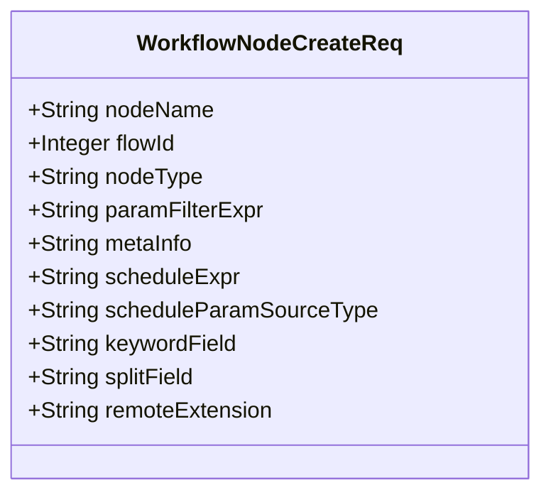
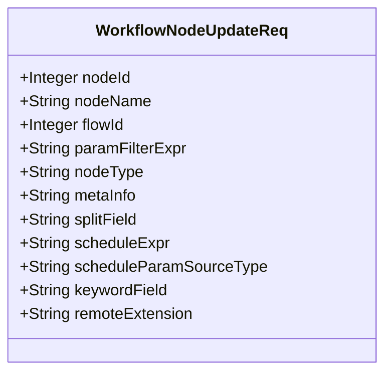
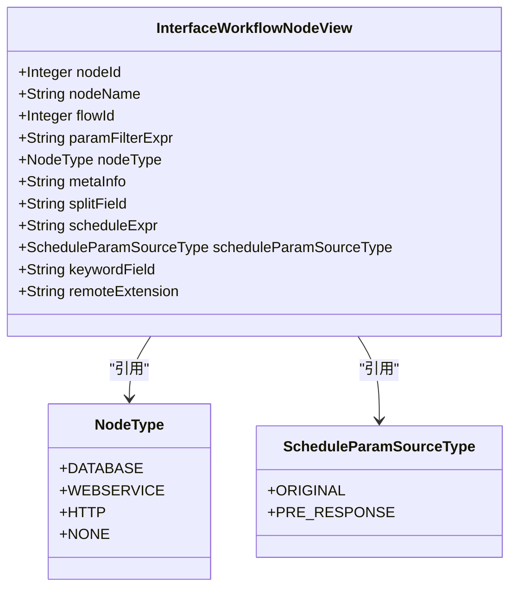
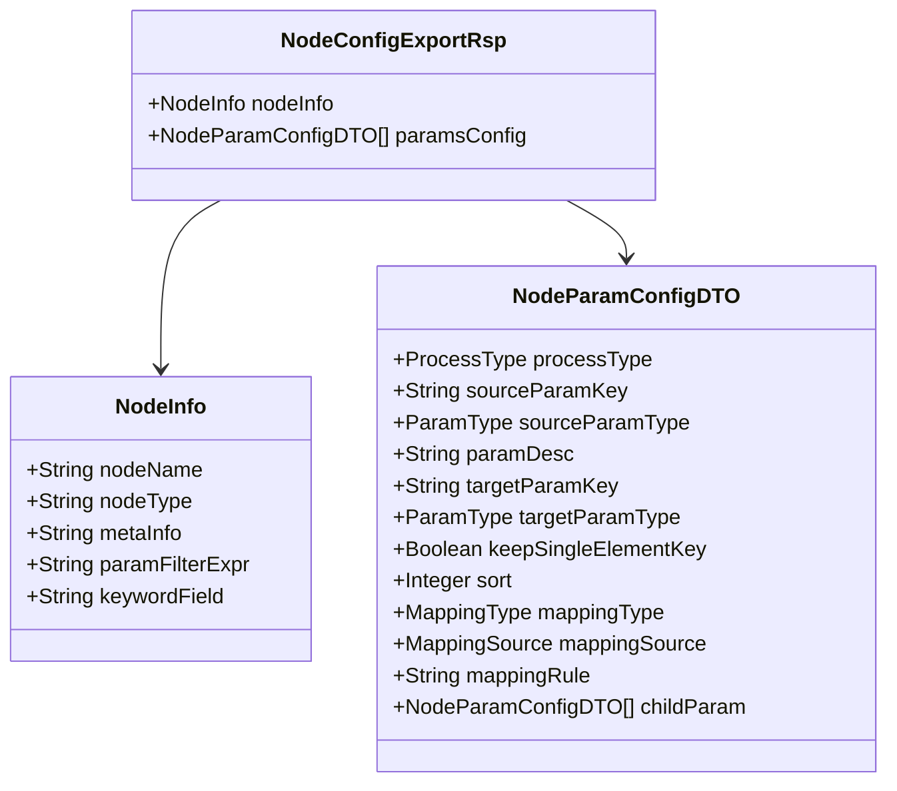

# 节点管理API

<cite>
**本文档中引用的文件**
- [McpWorkflowNodeController.java](file://agent-ai/src/main/java/com/helianhealth/agent/ai/controller/McpWorkflowNodeController.java)
- [WorkflowNodeController.java](file://agent-workflow/src/main/java/com/helianhealth/agent/workflow/controller/WorkflowNodeController.java)
- [WorkflowNodeCreateReq.java](file://agent-workflow/src/main/java/com/helianhealth/agent/workflow/controller/request/WorkflowNodeCreateReq.java)
- [WorkflowNodeUpdateReq.java](file://agent-workflow/src/main/java/com/helianhealth/agent/workflow/controller/request/WorkflowNodeUpdateReq.java)
- [NodeConfigExportRsp.java](file://agent-workflow/src/main/java/com/helianhealth/agent/workflow/controller/reponse/NodeConfigExportRsp.java)
- [NodeParamConfigExportRsp.java](file://agent-workflow/src/main/java/com/helianhealth/agent/workflow/controller/reponse/NodeParamConfigExportRsp.java)
- [InterfaceWorkflowNodeView.java](file://agent-workflow/src/main/java/com/helianhealth/agent/workflow/controller/reponse/InterfaceWorkflowNodeView.java)
- [InterfaceWorkflowNodeService.java](file://agent-workflow/src/main/java/com/helianhealth/agent/workflow/service/InterfaceWorkflowNodeService.java)
- [batch_import_example.json](file://agent-ai/batch_import_example.json)
- [NodeType.java](file://agent-common/src/main/java/com/helianhealth/agent/common/enums/NodeType.java)
- [ScheduleParamSourceType.java](file://agent-common/src/main/java/com/helianhealth/agent/common/enums/ScheduleParamSourceType.java)
</cite>

## 目录
1. [简介](#简介)
2. [API端点概览](#api端点概览)
3. [核心数据结构](#核心数据结构)
4. [节点创建与更新](#节点创建与更新)
5. [节点查询](#节点查询)
6. [节点删除](#节点删除)
7. [批量操作](#批量操作)
8. [配置导入导出](#配置导入导出)
9. [实际应用示例](#实际应用示例)

## 简介
节点管理API提供了对工作流节点的完整生命周期管理功能，涵盖创建、查询、更新和删除操作。API分为两个主要路径：`/v1/console/node/*` 用于控制台管理，`/v1/ai/mcp/workflow-node/*` 用于AI系统集成。本API支持HTTP、WebService、数据库等多种节点类型，通过灵活的参数配置实现复杂的工作流编排。

## API端点概览
节点管理API提供了一套完整的RESTful接口，支持对工作流节点的CRUD操作以及批量处理和配置导入导出功能。

```mermaid
graph TB
subgraph "控制台API /v1/console/node"
A1[GET /all] --> A2[获取所有节点]
A3[GET /{nodeId}] --> A4[获取单个节点]
A5[POST /create] --> A6[创建节点]
A7[POST /update] --> A8[更新节点]
A9[DELETE /{nodeId}] --> A10[删除节点]
A11[DELETE /{nodeId}/delete-all-config] --> A12[删除节点所有配置]
A13[GET /export/{nodeId}] --> A14[导出节点参数配置]
A15[GET /export-node/{nodeId}] --> A16[导出节点完整配置]
A17[POST /import] --> A18[导入节点参数配置]
A19[POST /import-node] --> A20[导入节点完整配置]
end
subgraph "AI/MCP API /v1/ai/mcp/workflow-node"
B1[POST /create] --> B2[创建节点]
B3[POST /update] --> B4[更新节点]
B5[DELETE /delete/{nodeId}] --> B6[删除节点]
B7[DELETE /batch-delete] --> B8[批量删除节点]
B9[POST /batch-import] --> B10[批量导入节点]
end
A1 --> B1
A5 --> B1
A7 --> B3
A9 --> B5
```

**图示来源**
- [WorkflowNodeController.java](file://agent-workflow/src/main/java/com/helianhealth/agent/workflow/controller/WorkflowNodeController.java)
- [McpWorkflowNodeController.java](file://agent-ai/src/main/java/com/helianhealth/agent/ai/controller/McpWorkflowNodeController.java)

## 核心数据结构

### WorkflowNodeCreateReq
创建工作流节点请求参数的数据结构定义。



**图示来源**
- [WorkflowNodeCreateReq.java](file://agent-workflow/src/main/java/com/helianhealth/agent/workflow/controller/request/WorkflowNodeCreateReq.java)

### WorkflowNodeUpdateReq
更新工作流节点请求参数的数据结构定义。



**图示来源**
- [WorkflowNodeUpdateReq.java](file://agent-workflow/src/main/java/com/helianhealth/agent/workflow/controller/request/WorkflowNodeUpdateReq.java)

### InterfaceWorkflowNodeView
工作流节点视图模型，用于返回节点查询结果。



**图示来源**
- [InterfaceWorkflowNodeView.java](file://agent-workflow/src/main/java/com/helianhealth/agent/workflow/controller/reponse/InterfaceWorkflowNodeView.java)
- [NodeType.java](file://agent-common/src/main/java/com/helianhealth/agent/common/enums/NodeType.java)
- [ScheduleParamSourceType.java](file://agent-common/src/main/java/com/helianhealth/agent/common/enums/ScheduleParamSourceType.java)

## 节点创建与更新

### 创建节点
通过POST请求创建新的工作流节点。

**端点**: `POST /v1/console/node/create` 或 `POST /v1/ai/mcp/workflow-node/create`

**请求体**: `WorkflowNodeCreateReq` 对象

**成功响应**: 返回新创建节点的ID

**错误处理**:
- 参数验证失败返回400错误
- 数据库操作异常返回500错误
- 节点名称重复返回409错误

**节点类型枚举**:
- **HTTP**: HTTP接口调用节点
- **WEBSERVICE**: WebService接口调用节点
- **DATABASE**: 数据库操作节点
- **NONE**: 无三方接口调用节点

**调度参数来源类型**:
- **ORIGINAL**: 原始入参
- **PRE_RESPONSE**: 上个节点响应

**节段来源**
- [WorkflowNodeController.java](file://agent-workflow/src/main/java/com/helianhealth/agent/workflow/controller/WorkflowNodeController.java#L71-L80)
- [McpWorkflowNodeController.java](file://agent-ai/src/main/java/com/helianhealth/agent/ai/controller/McpWorkflowNodeController.java#L36-L46)

### 更新节点
通过POST请求更新现有工作流节点。

**端点**: `POST /v1/console/node/update` 或 `POST /v1/ai/mcp/workflow-node/update`

**请求体**: `WorkflowNodeUpdateReq` 对象

**验证规则**:
- `nodeId` 必须提供且不为空
- 节点必须存在
- 更新后的节点配置必须通过验证

**更新策略**:
- 仅更新提供的字段，未提供的字段保持原值
- 节点类型变更时，会进行兼容性检查
- 元信息(metaInfo)完全替换，不进行合并

**节段来源**
- [WorkflowNodeController.java](file://agent-workflow/src/main/java/com/helianhealth/agent/workflow/controller/WorkflowNodeController.java#L102-L111)
- [McpWorkflowNodeController.java](file://agent-ai/src/main/java/com/helianhealth/agent/ai/controller/McpWorkflowNodeController.java#L51-L64)

## 节点查询

### 获取所有节点
分页获取工作流节点列表。

**端点**: `GET /v1/console/node/all`

**查询参数**:
- `flowId`: 工作流ID，可选
- `pageNum`: 页码，默认为1
- `pageSize`: 每页大小，默认为10

**响应结构**: `ResultData<PageList<InterfaceWorkflowNodeView>>`

**节段来源**
- [WorkflowNodeController.java](file://agent-workflow/src/main/java/com/helianhealth/agent/workflow/controller/WorkflowNodeController.java#L39-L52)

### 获取所有节点（无分页）
获取所有工作流节点，不进行分页。

**端点**: `GET /v1/console/node/all-unpaged`

**响应结构**: `ResultData<List<InterfaceWorkflowNodeView>>`

**使用场景**:
- 前端下拉框数据加载
- 批量操作前的数据准备
- 报表生成

**节段来源**
- [WorkflowNodeController.java](file://agent-workflow/src/main/java/com/helianhealth/agent/workflow/controller/WorkflowNodeController.java#L54-L64)

### 获取单个节点
根据节点ID获取特定工作流节点。

**端点**: `GET /v1/console/node/{nodeId}`

**路径参数**:
- `nodeId`: 节点ID

**响应处理**:
- 节点存在：返回 `InterfaceWorkflowNodeView`
- 节点不存在：返回错误信息 "工作流节点不存在"

**节段来源**
- [WorkflowNodeController.java](file://agent-workflow/src/main/java/com/helianhealth/agent/workflow/controller/WorkflowNodeController.java#L85-L97)

## 节点删除

### 删除单个节点
删除指定ID的工作流节点。

**端点**: `DELETE /v1/console/node/{nodeId}` 或 `DELETE /v1/ai/mcp/workflow-node/delete/{nodeId}`

**删除逻辑**:
- 删除节点基本信息
- 删除节点相关参数配置
- 清理节点调度任务
- 更新工作流节点关系

**级联删除**: 自动删除与该节点相关的所有配置和参数映射

**节段来源**
- [WorkflowNodeController.java](file://agent-workflow/src/main/java/com/helianhealth/agent/workflow/controller/WorkflowNodeController.java#L116-L125)
- [McpWorkflowNodeController.java](file://agent-ai/src/main/java/com/helianhealth/agent/ai/controller/McpWorkflowNodeController.java#L69-L79)

### 删除节点所有配置
仅删除节点的配置信息，保留节点基本信息。

**端点**: `DELETE /v1/console/node/{nodeId}/delete-all-config`

**使用场景**:
- 节点配置重置
- 故障排查时清理配置
- 节点迁移前的准备

**节段来源**
- [WorkflowNodeController.java](file://agent-workflow/src/main/java/com/helianhealth/agent/workflow/controller/WorkflowNodeController.java#L127-L136)

## 批量操作

### 批量删除
批量删除多个工作流节点。

**端点**: `DELETE /v1/ai/mcp/workflow-node/batch-delete`

**请求体**: 节点ID列表 `[1, 2, 3, ...]`

**处理逻辑**:
- 事务性处理，确保数据一致性
- 统计成功删除的节点数量
- 返回操作摘要信息

**响应示例**: `"成功删除3个节点，共尝试删除5个节点"`

**节段来源**
- [McpWorkflowNodeController.java](file://agent-ai/src/main/java/com/helianhealth/agent/ai/controller/McpWorkflowNodeController.java#L84-L94)

### 批量导入
从文件批量导入工作流节点配置。

**端点**: `POST /v1/ai/mcp/workflow-node/batch-import`

**请求参数**:
- `file`: MultipartFile，包含节点配置的JSON文件

**文件格式**: 符合 `NodeConfigExportRsp` 结构的JSON数组

**处理流程**:
1. 文件解析
2. 配置验证
3. 事务性批量保存
4. 错误处理与回滚

**节段来源**
- [McpWorkflowNodeController.java](file://agent-ai/src/main/java/com/helianhealth/agent/ai/controller/McpWorkflowNodeController.java#L99-L109)

## 配置导入导出

### 导出节点配置
导出指定节点的完整配置。

**端点**: `GET /v1/console/node/export-node/{nodeId}`

**响应结构**: `NodeConfigExportRsp`



**图示来源**
- [NodeConfigExportRsp.java](file://agent-workflow/src/main/java/com/helianhealth/agent/workflow/controller/reponse/NodeConfigExportRsp.java)

### 导入节点配置
从文件导入节点配置。

**端点**: `POST /v1/console/node/import-node`

**请求参数**:
- `file`: MultipartFile，包含节点配置的JSON文件

**验证规则**:
- 文件不能为空
- JSON格式必须正确
- 必需字段必须存在

**节段来源**
- [WorkflowNodeController.java](file://agent-workflow/src/main/java/com/helianhealth/agent/workflow/controller/WorkflowNodeController.java#L177-L191)

### 导入节点参数配置
导入指定节点的参数配置。

**端点**: `POST /v1/console/node/import`

**请求参数**:
- `nodeId`: 节点ID
- `file`: MultipartFile，包含参数配置的JSON文件

**应用场景**:
- 参数配置模板应用
- 开发环境到生产环境的配置迁移
- 配置版本回滚

**节段来源**
- [WorkflowNodeController.java](file://agent-workflow/src/main/java/com/helianhealth/agent/workflow/controller/WorkflowNodeController.java#L153-L172)

## 实际应用示例

### HTTP调用节点创建示例
创建一个HTTP类型的调用节点，用于调用外部API。

**请求示例**:
```json
{
  "nodeName": "用户信息查询",
  "flowId": 1001,
  "nodeType": "HTTP",
  "paramFilterExpr": "input.userId != null",
  "metaInfo": "{\"url\":\"https://api.example.com/users/{userId}\",\"method\":\"GET\",\"headers\":{\"Authorization\":\"Bearer {token}\"},\"timeout\":30000}",
  "scheduleExpr": "0 0/5 * * * ?",
  "scheduleParamSourceType": "ORIGINAL",
  "keywordField": "userId",
  "splitField": "userList",
  "remoteExtension": "{\"pluginId\":\"http-client-v2\"}"
}
```

**字段说明**:
- `metaInfo`: 包含HTTP请求的URL、方法、头部和超时设置
- `scheduleExpr`: 每5分钟执行一次的Cron表达式
- `paramFilterExpr`: 只有当输入参数中的userId不为空时才执行
- `remoteExtension`: 指定使用的HTTP客户端插件版本

**节段来源**
- [WorkflowNodeCreateReq.java](file://agent-workflow/src/main/java/com/helianhealth/agent/workflow/controller/request/WorkflowNodeCreateReq.java)

### 批量导入文件示例
批量导入多个工作流节点的JSON文件格式。

```json
[
  {
    "nodeInfo": {
      "nodeName": "订单创建",
      "nodeType": "HTTP",
      "metaInfo": "{\"url\":\"https://api.example.com/orders\",\"method\":\"POST\",\"headers\":{\"Content-Type\":\"application/json\"}}",
      "paramFilterExpr": null,
      "keywordField": "orderId"
    },
    "paramsConfig": [
      {
        "processType": "PRE_PROCESS",
        "sourceParamKey": "orderData",
        "sourceParamType": "STRING",
        "paramDesc": "订单数据",
        "targetParamKey": "requestBody",
        "targetParamType": "STRING",
        "sort": 1,
        "mappingType": "DIRECT",
        "mappingSource": "CONSTANT",
        "mappingRule": "value"
      }
    ]
  },
  {
    "nodeInfo": {
      "nodeName": "库存更新",
      "nodeType": "DATABASE",
      "metaInfo": "{\"connection\":\"prod-db\",\"table\":\"inventory\",\"operation\":\"UPDATE\"}",
      "paramFilterExpr": "order.status == 'PAID'",
      "keywordField": "productId"
    },
    "paramsConfig": [
      {
        "processType": "PRE_PROCESS",
        "sourceParamKey": "quantity",
        "sourceParamType": "INTEGER",
        "paramDesc": "更新数量",
        "targetParamKey": "set.quantity",
        "targetParamType": "INTEGER",
        "sort": 1,
        "mappingType": "DIRECT",
        "mappingSource": "ORIGINAL",
        "mappingRule": "input.quantity"
      }
    ]
  }
]
```

**文件要求**:
- 必须是有效的JSON数组
- 每个元素必须包含`nodeInfo`和`paramsConfig`字段
- `nodeInfo`中的字段必须符合`NodeInfo`类定义
- `paramsConfig`中的参数映射必须符合业务逻辑

**节段来源**
- [batch_import_example.json](file://agent-ai/batch_import_example.json)