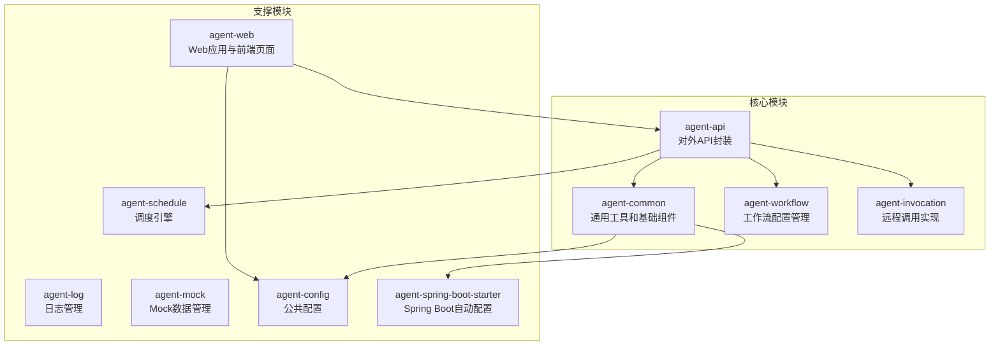
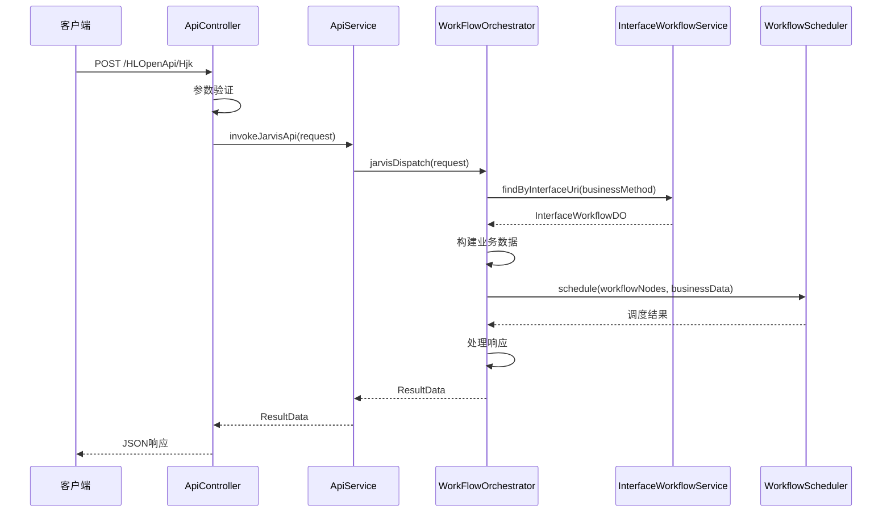
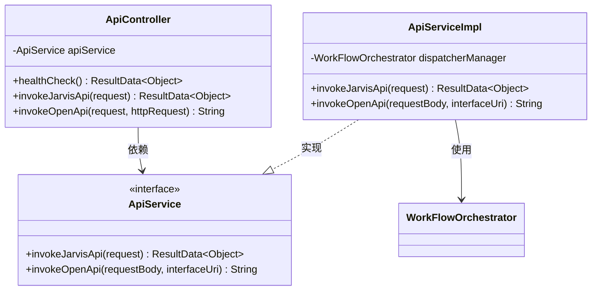
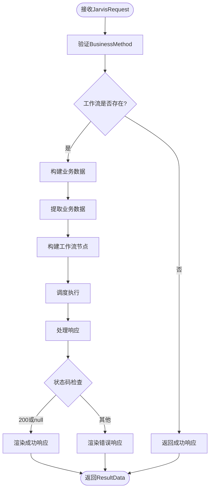
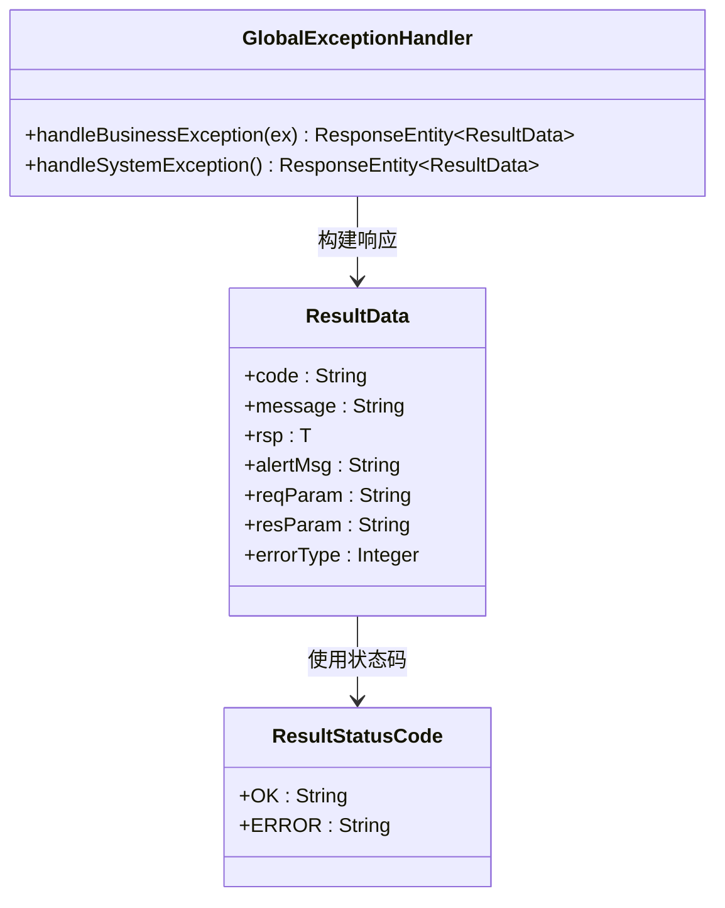
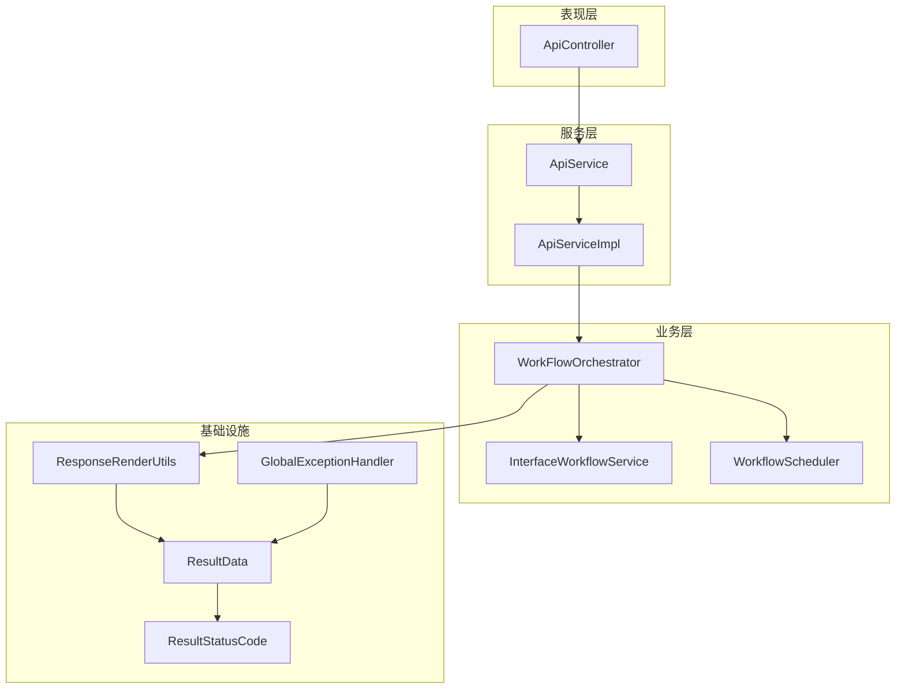

# Jarvis集成API

<cite>
**本文档引用的文件**
- [ApiController.java](file://agent-api/src/main/java/com/helianhealth/agent/api/controller/ApiController.java)
- [JarvisRequest.java](file://agent-api/src/main/java/com/helianhealth/agent/api/model/request/JarvisRequest.java)
- [ApiService.java](file://agent-api/src/main/java/com/helianhealth/agent/api/service/ApiService.java)
- [ApiServiceImpl.java](file://agent-api/src/main/java/com/helianhealth/agent/api/service/impl/ApiServiceImpl.java)
- [WorkFlowOrchestrator.java](file://agent-api/src/main/java/com/helianhealth/agent/api/WorkFlowOrchestrator.java)
- [ResultData.java](file://agent-common/src/main/java/com/helianhealth/agent/common/base/ResultData.java)
- [ResultStatusCode.java](file://agent-common/src/main/java/com/helianhealth/agent/common/base/ResultStatusCode.java)
- [ResponseRenderUtils.java](file://agent-common/src/main/java/com/helianhealth/agent/common/utils/ResponseRenderUtils.java)
- [GlobalExceptionHandler.java](file://agent-config/src/main/java/com/helianhealth/agent/config/GlobalExceptionHandler.java)
</cite>

## 目录
1. [简介](#简介)
2. [项目结构](#项目结构)
3. [核心组件](#核心组件)
4. [架构概览](#架构概览)
5. [详细组件分析](#详细组件分析)
6. [依赖关系分析](#依赖关系分析)
7. [性能考虑](#性能考虑)
8. [故障排除指南](#故障排除指南)
9. [结论](#结论)

## 简介

Jarvis集成API是Helian Health公司开发的一个专门用于与Jarvis系统集成的RESTful API接口。该接口通过`/HLOpenApi/Hjk`端点接收结构化的JarvisRequest对象，为企业内部系统提供统一的接口调用能力。

该API的核心优势在于使用强类型请求体，提供了更好的类型安全、自动的JSON反序列化和清晰的API契约。相比传统的统一调用API，Jarvis集成API通过明确的数据结构定义，确保了接口调用的可靠性和可维护性。

## 项目结构

Interface Agent是一个基于Spring Boot的可插拔工作流引擎，采用模块化架构设计：

**图表来源**
- [README.md](file://README.md#L16-L30)
- [README.md](file://README.md#L202-L238)

**章节来源**
- [README.md](file://README.md#L1-L284)

## 核心组件

### JarvisRequest数据模型

JarvisRequest是专门为Jarvis系统设计的强类型请求对象，包含了完整的业务参数结构：

| 字段名 | 类型 | 必填 | 描述 |
|--------|------|------|------|
| BusinessMethod | String | 是 | 业务方法标识，对应工作流接口名称 |
| BusinessCode | String | 否 | 业务代码标识 |
| data | JSONObject | 否 | 主要业务数据载体 |
| ServiceProviderType | String | 否 | 服务提供商类型 |
| PatientCode | String | 否 | 患者唯一标识 |
| OutFeeItemIdList | List<String> | 否 | 外费项目ID列表 |
| ApplyNoList | List<String> | 否 | 申请单号列表 |
| BarCodeList | List<String> | 否 | 条形码列表 |
| AuditTime | String | 否 | 审核时间 |
| QueryType | Integer | 否 | 查询类型 |

### ResultData响应模型

ResultData是统一的响应数据结构，提供标准化的响应格式：

| 字段名 | 类型 | 描述 |
|--------|------|------|
| code | String | 响应状态码 |
| message | String | 响应消息 |
| rsp | T | 业务响应数据 |
| alertMsg | String | 警告消息 |
| reqParam | String | 请求参数 |
| resParam | String | 响应参数 |
| errorType | Integer | 错误类型 |

**章节来源**
- [JarvisRequest.java](file://agent-api/src/main/java/com/helianhealth/agent/api/model/request/JarvisRequest.java#L10-L44)
- [ResultData.java](file://agent-common/src/main/java/com/helianhealth/agent/common/base/ResultData.java#L8-L83)

## 架构概览

Jarvis集成API采用分层架构设计，通过清晰的职责分离实现了高内聚低耦合的系统结构：

**图表来源**
- [ApiController.java](file://agent-api/src/main/java/com/helianhealth/agent/api/controller/ApiController.java#L32-L35)
- [ApiServiceImpl.java](file://agent-api/src/main/java/com/helianhealth/agent/api/service/impl/ApiServiceImpl.java#L22-L30)
- [WorkFlowOrchestrator.java](file://agent-api/src/main/java/com/helianhealth/agent/api/WorkFlowOrchestrator.java#L39-L60)

## 详细组件分析

### ApiController控制器层

ApiController是Jarvis集成API的入口控制器，负责HTTP请求的接收和响应的返回：

**图表来源**
- [ApiController.java](file://agent-api/src/main/java/com/helianhealth/agent/api/controller/ApiController.java#L20-L49)
- [ApiService.java](file://agent-api/src/main/java/com/helianhealth/agent/api/service/ApiService.java#L9-L27)
- [ApiServiceImpl.java](file://agent-api/src/main/java/com/helianhealth/agent/api/service/impl/ApiServiceImpl.java#L15-L41)

### WorkFlowOrchestrator工作流编排

WorkFlowOrchestrator是核心的业务编排组件，负责将Jarvis请求转换为工作流执行：

**图表来源**
- [WorkFlowOrchestrator.java](file://agent-api/src/main/java/com/helianhealth/agent/api/WorkFlowOrchestrator.java#L39-L73)

### 错误处理机制

系统采用统一的异常处理机制，确保错误信息的一致性和可预测性：

**图表来源**
- [GlobalExceptionHandler.java](file://agent-config/src/main/java/com/helianhealth/agent/config/GlobalExceptionHandler.java#L10-L34)
- [ResultData.java](file://agent-common/src/main/java/com/helianhealth/agent/common/base/ResultData.java#L8-L83)
- [ResultStatusCode.java](file://agent-common/src/main/java/com/helianhealth/agent/common/base/ResultStatusCode.java#L7-L21)

**章节来源**
- [ApiController.java](file://agent-api/src/main/java/com/helianhealth/agent/api/controller/ApiController.java#L20-L49)
- [ApiServiceImpl.java](file://agent-api/src/main/java/com/helianhealth/agent/api/service/impl/ApiServiceImpl.java#L15-L41)
- [WorkFlowOrchestrator.java](file://agent-api/src/main/java/com/helianhealth/agent/api/WorkFlowOrchestrator.java#L26-L103)
- [GlobalExceptionHandler.java](file://agent-config/src/main/java/com/helianhealth/agent/config/GlobalExceptionHandler.java#L10-L34)

## 依赖关系分析

Jarvis集成API的依赖关系体现了清晰的分层架构：

**图表来源**
- [ApiController.java](file://agent-api/src/main/java/com/helianhealth/agent/api/controller/ApiController.java#L3-L25)
- [ApiService.java](file://agent-api/src/main/java/com/helianhealth/agent/api/service/ApiService.java#L3-L27)
- [ApiServiceImpl.java](file://agent-api/src/main/java/com/helianhealth/agent/api/service/impl/ApiServiceImpl.java#L3-L20)
- [WorkFlowOrchestrator.java](file://agent-api/src/main/java/com/helianhealth/agent/api/WorkFlowOrchestrator.java#L3-L34)

**章节来源**
- [ApiController.java](file://agent-api/src/main/java/com/helianhealth/agent/api/controller/ApiController.java#L1-L50)
- [ApiService.java](file://agent-api/src/main/java/com/helianhealth/agent/api/service/ApiService.java#L1-L28)
- [ApiServiceImpl.java](file://agent-api/src/main/java/com/helianhealth/agent/api/service/impl/ApiServiceImpl.java#L1-L42)

## 性能考虑

### 类型安全优势

Jarvis集成API相比传统统一调用API具有以下性能优势：

1. **编译时类型检查**：强类型定义在编译阶段就能发现类型不匹配问题
2. **减少运行时错误**：避免了字符串键值查找的潜在错误
3. **更好的IDE支持**：提供智能提示和自动补全功能
4. **内存效率**：直接的对象映射减少了中间转换开销

### 异步处理能力

系统支持异步工作流执行，通过以下机制提升性能：

- **非阻塞I/O**：利用Spring Boot的异步特性
- **连接池优化**：合理配置数据库和HTTP连接池
- **缓存策略**：对常用工作流配置进行缓存

## 故障排除指南

### 常见错误及解决方案

| 错误类型 | 错误码 | 描述 | 解决方案 |
|----------|--------|------|----------|
| 参数验证失败 | -1 | 请求参数缺失或格式不正确 | 检查BusinessMethod和必需参数 |
| 工作流不存在 | -1 | 业务方法对应的接口未配置 | 在控制台创建对应的工作流 |
| 业务异常 | 业务码 | 业务逻辑执行失败 | 查看业务异常的具体原因 |
| 系统异常 | 500 | 服务器内部错误 | 检查服务日志和依赖服务状态 |

### 调试建议

1. **启用详细日志**：检查MDC上下文中的method信息
2. **验证数据格式**：确保JSON格式符合JarvisRequest要求
3. **检查工作流配置**：确认业务方法与工作流映射正确
4. **监控依赖服务**：验证数据库和外部API的可用性

**章节来源**
- [GlobalExceptionHandler.java](file://agent-config/src/main/java/com/helianhealth/agent/config/GlobalExceptionHandler.java#L13-L34)
- [WorkFlowOrchestrator.java](file://agent-api/src/main/java/com/helianhealth/agent/api/WorkFlowOrchestrator.java#L56-L59)

## 结论

Jarvis集成API通过强类型设计和清晰的架构分层，为企业内部系统集成提供了可靠的解决方案。其核心优势包括：

1. **类型安全**：编译时检查确保了接口调用的可靠性
2. **易于维护**：清晰的代码结构和职责分离便于长期维护
3. **扩展性强**：模块化设计支持功能的灵活扩展
4. **错误处理完善**：统一的异常处理机制提升了系统的稳定性

该API特别适用于需要与Jarvis系统进行深度集成的企业应用场景，通过标准化的接口设计和强大的工作流编排能力，能够有效提升系统集成的效率和质量。