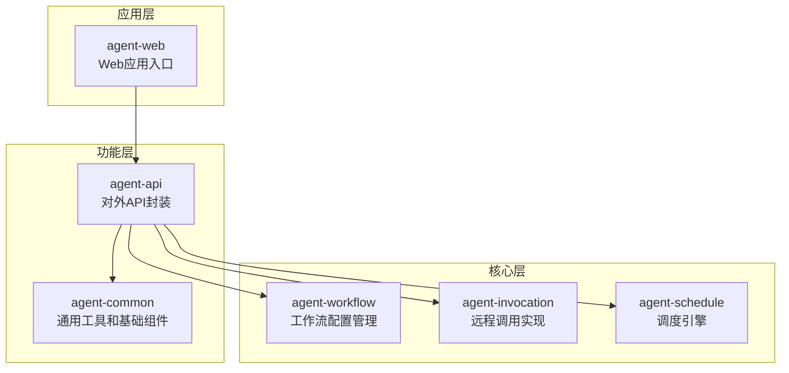
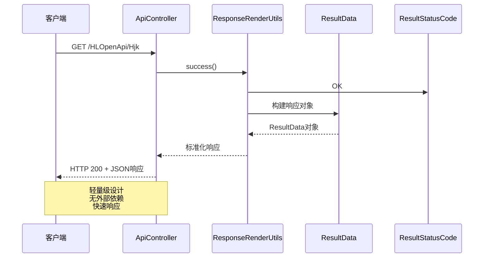
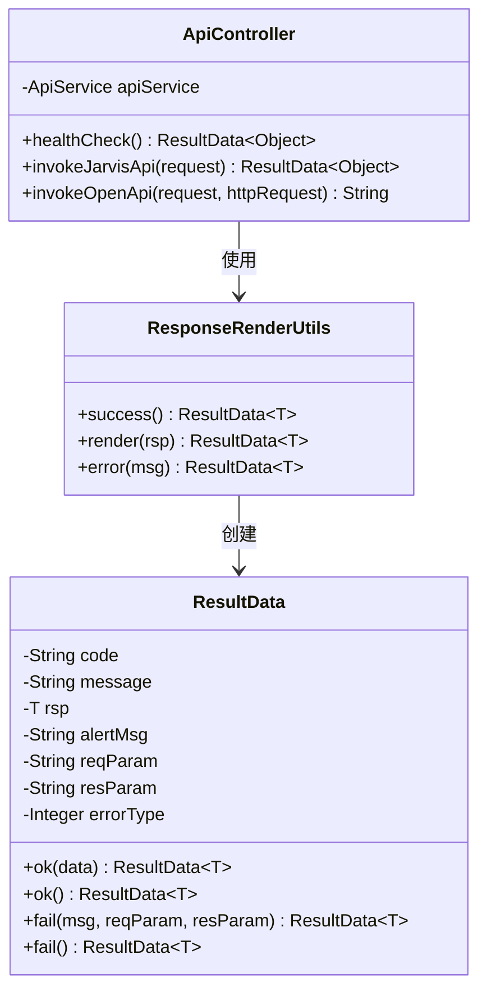
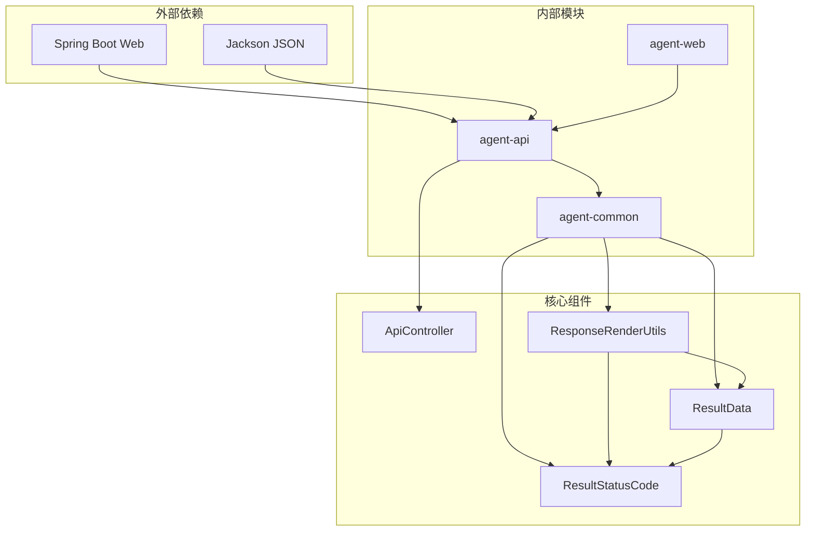

# 健康检查API

<cite>
**本文档引用的文件**
- [ApiController.java](file://agent-api/src/main/java/com/helianhealth/agent/api/controller/ApiController.java)
- [ResultData.java](file://agent-common/src/main/java/com/helianhealth/agent/common/base/ResultData.java)
- [ResponseRenderUtils.java](file://agent-common/src/main/java/com/helianhealth/agent/common/utils/ResponseRenderUtils.java)
- [ResultStatusCode.java](file://agent-common/src/main/java/com/helianhealth/agent/common/base/ResultStatusCode.java)
- [InterfaceAgentApplication.java](file://agent-web/src/main/java/com/helianhealth/agent/InterfaceAgentApplication.java)
- [application.yml](file://agent-web/src/main/resources/application.yml)
- [pom.xml](file://pom.xml)
- [README.md](file://README.md)
</cite>

## 目录
1. [简介](#简介)
2. [项目结构](#项目结构)
3. [核心组件](#核心组件)
4. [架构概览](#架构概览)
5. [详细组件分析](#详细组件分析)
6. [依赖关系分析](#依赖关系分析)
7. [性能考虑](#性能考虑)
8. [故障排除指南](#故障排除指南)
9. [结论](#结论)

## 简介

健康检查API是Interface Agent工作流引擎中的关键系统监控组件，专门用于向负载均衡器、监控系统和容器编排平台（如Kubernetes）提供系统的存活和就绪状态检测。该端点采用轻量级设计，不依赖任何外部服务或数据库连接，确保即使在系统部分故障时也能快速响应，为生产环境的稳定运行提供可靠保障。

该API通过统一的响应格式返回标准的成功状态码，为自动化运维提供了标准化的健康检查接口，支持各种监控工具和编排平台的集成需求。

## 项目结构

Interface Agent采用模块化架构设计，健康检查API位于API模块中，通过清晰的分层结构实现：

**图表来源**
- [pom.xml](file://pom.xml#L12-L25)
- [README.md](file://README.md#L16-L30)

**章节来源**
- [pom.xml](file://pom.xml#L12-L25)
- [README.md](file://README.md#L16-L30)

## 核心组件

### 健康检查控制器

健康检查功能由ApiController提供，该控制器实现了RESTful API设计原则，通过简洁的URL路径提供系统状态检测服务。

### 响应数据模型

系统使用统一的ResultData响应模型，确保所有API调用返回一致的数据格式，便于客户端解析和处理。

### 响应渲染工具

ResponseRenderUtils提供标准化的响应生成机制，简化了API控制器中的响应构建过程。

**章节来源**
- [ApiController.java](file://agent-api/src/main/java/com/helianhealth/agent/api/controller/ApiController.java#L27-L30)
- [ResultData.java](file://agent-common/src/main/java/com/helianhealth/agent/common/base/ResultData.java#L8-L83)
- [ResponseRenderUtils.java](file://agent-common/src/main/java/com/helianhealth/agent/common/utils/ResponseRenderUtils.java#L6-L19)

## 架构概览

健康检查API的架构设计体现了高内聚、低耦合的设计原则，通过清晰的职责分离实现系统的可维护性和可扩展性：

**图表来源**
- [ApiController.java](file://agent-api/src/main/java/com/helianhealth/agent/api/controller/ApiController.java#L27-L30)
- [ResponseRenderUtils.java](file://agent-common/src/main/java/com/helianhealth/agent/common/utils/ResponseRenderUtils.java#L8-L10)
- [ResultData.java](file://agent-common/src/main/java/com/helianhealth/agent/common/base/ResultData.java#L29-L39)

## 详细组件分析

### ApiController - 健康检查端点

ApiController是健康检查功能的核心实现，采用了Spring MVC的注解驱动开发模式：

**图表来源**
- [ApiController.java](file://agent-api/src/main/java/com/helianhealth/agent/api/controller/ApiController.java#L20-L49)
- [ResultData.java](file://agent-common/src/main/java/com/helianhealth/agent/common/base/ResultData.java#L6-L83)
- [ResponseRenderUtils.java](file://agent-common/src/main/java/com/helianhealth/agent/common/utils/ResponseRenderUtils.java#L6-L19)

### ResultData - 统一响应模型

ResultData是系统统一的响应数据模型，提供了丰富的字段来承载不同类型的响应信息：

| 字段名称 | 类型 | 描述 | 用途 |
|---------|------|------|------|
| code | String | 状态码 | 标识请求处理结果 |
| message | String | 状态消息 | 提供人类可读的结果描述 |
| rsp | T | 响应数据 | 包含具体的业务数据 |
| alertMsg | String | 警告消息 | 通知性信息提示 |
| reqParam | String | 请求参数 | 记录原始请求参数 |
| resParam | String | 响应参数 | 记录响应参数 |
| errorType | Integer | 错误类型 | 错误分类标识 |

### ResponseRenderUtils - 响应渲染工具

ResponseRenderUtils提供了三种标准的响应渲染方法：

1. **success()** - 返回成功的标准化响应
2. **render(rsp)** - 返回包含业务数据的成功响应  
3. **error(msg)** - 返回失败的标准化响应

**章节来源**
- [ApiController.java](file://agent-api/src/main/java/com/helianhealth/agent/api/controller/ApiController.java#L27-L30)
- [ResultData.java](file://agent-common/src/main/java/com/helianhealth/agent/common/base/ResultData.java#L68-L82)
- [ResponseRenderUtils.java](file://agent-common/src/main/java/com/helianhealth/agent/common/utils/ResponseRenderUtils.java#L8-L18)

### ResultStatusCode - 状态码定义

系统使用ResultStatusCode枚举定义标准的状态码：

| 枚举值 | 状态码 | 描述 | 用途 |
|-------|--------|------|------|
| OK | 200 | OK | 成功状态 |
| ERROR | -1 | 未知异常 | 失败状态 |

**章节来源**
- [ResultStatusCode.java](file://agent-common/src/main/java/com/helianhealth/agent/common/base/ResultStatusCode.java#L9-L10)

## 依赖关系分析

健康检查API的依赖关系体现了清晰的分层架构：

**图表来源**
- [pom.xml](file://pom.xml#L45-L54)
- [ApiController.java](file://agent-api/src/main/java/com/helianhealth/agent/api/controller/ApiController.java#L3-L6)

**章节来源**
- [pom.xml](file://pom.xml#L45-L54)
- [ApiController.java](file://agent-api/src/main/java/com/helianhealth/agent/api/controller/ApiController.java#L3-L6)

## 性能考虑

健康检查API采用轻量级设计，具有以下性能优势：

### 内存效率
- 无外部服务依赖，避免额外的内存开销
- 简单的响应模型，减少序列化成本
- 直接返回预定义的成功状态码

### 响应时间
- 单次方法调用，无数据库查询
- 无网络I/O操作
- 快速的JSON序列化过程

### 资源占用
- 低CPU使用率
- 最小化的内存占用
- 无持久化操作

## 故障排除指南

### 常见问题及解决方案

**问题1：健康检查返回404 Not Found**
- 检查应用是否正确启动
- 验证URL路径是否正确
- 确认Spring MVC配置正常

**问题2：健康检查返回500 Internal Server Error**
- 检查应用程序日志
- 验证依赖注入是否正常
- 确认ResponseRenderUtils可用性

**问题3：响应格式不符合预期**
- 检查ResultData模型定义
- 验证ResultStatusCode配置
- 确认JSON序列化配置

### 监控和调试建议

1. **日志监控**：启用详细的访问日志
2. **性能监控**：监控响应时间和内存使用
3. **错误监控**：跟踪异常情况和错误率

**章节来源**
- [ApiController.java](file://agent-api/src/main/java/com/helianhealth/agent/api/controller/ApiController.java#L27-L30)
- [ResponseRenderUtils.java](file://agent-common/src/main/java/com/helianhealth/agent/common/utils/ResponseRenderUtils.java#L8-L10)

## 结论

健康检查API作为Interface Agent工作流引擎的重要组成部分，通过简洁而强大的设计为系统的稳定运行提供了可靠的保障。其轻量级特性和标准化的响应格式使其成为现代微服务架构中不可或缺的监控组件。

该API不仅满足了基本的健康检查需求，还为未来的扩展和集成奠定了坚实的基础。通过清晰的架构设计和完善的错误处理机制，确保了在各种复杂场景下的稳定表现。

对于运维团队而言，这个健康检查端点提供了简单而有效的系统状态监控手段；对于开发者而言，它展示了如何在保持系统稳定性的同时实现优雅的API设计。