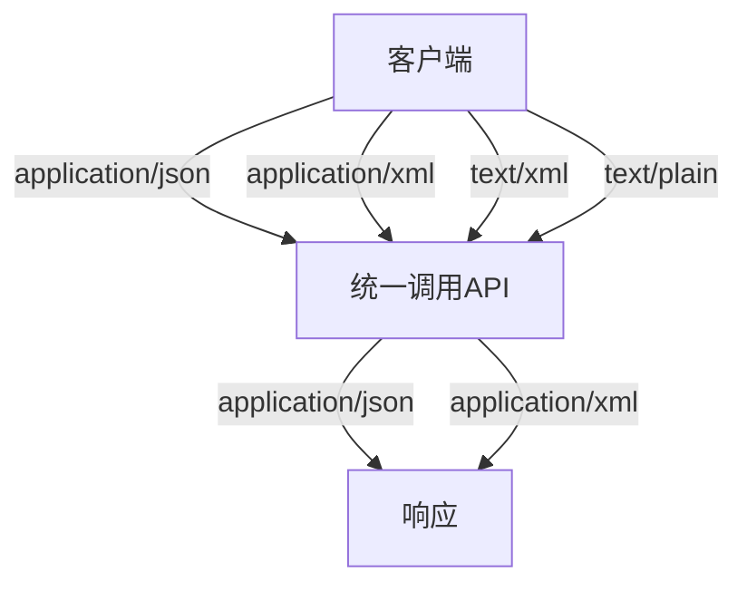
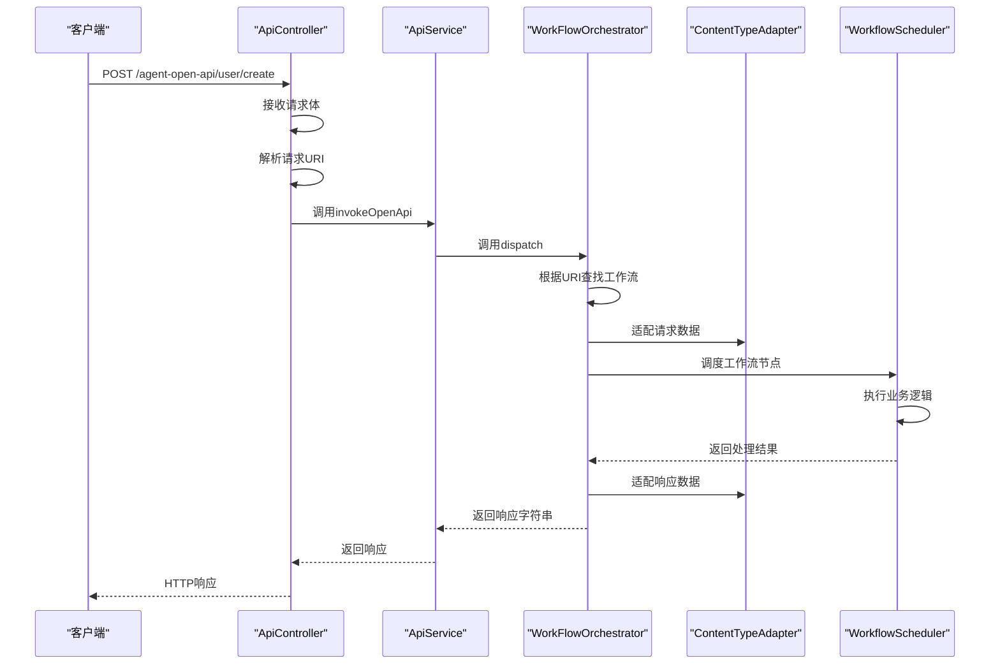
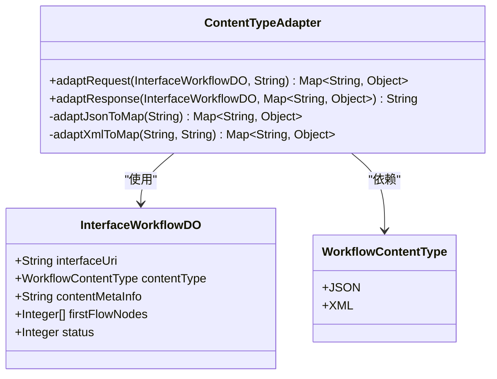
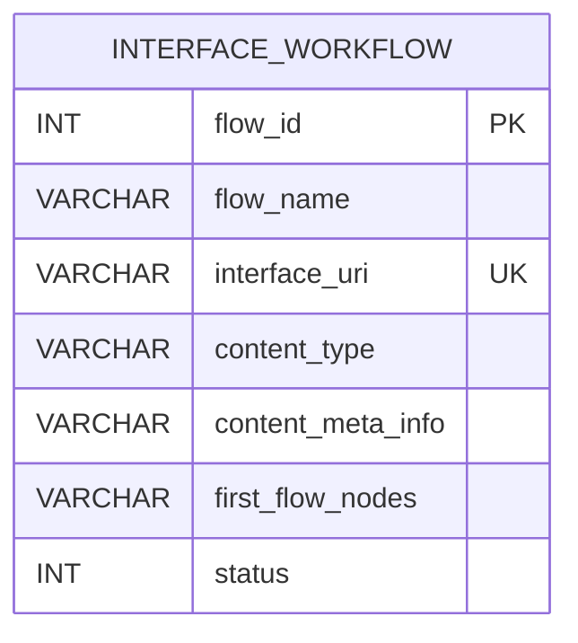
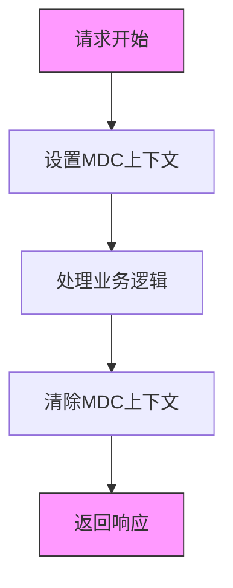
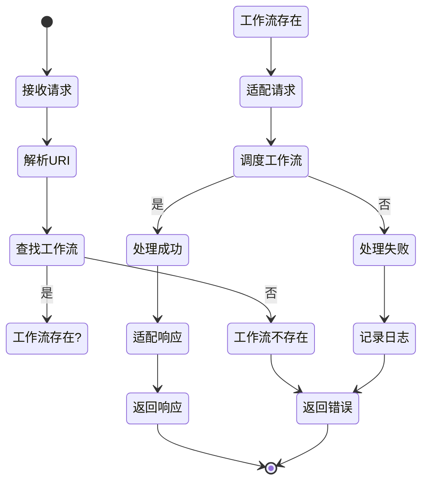

# 统一调用API

<cite>
**本文档引用文件**   
- [ApiController.java](file://agent-api/src/main/java/com/helianhealth/agent/api/controller/ApiController.java)
- [ApiService.java](file://agent-api/src/main/java/com/helianhealth/agent/api/service/ApiService.java)
- [ApiServiceImpl.java](file://agent-api/src/main/java/com/helianhealth/agent/api/service/impl/ApiServiceImpl.java)
- [WorkFlowOrchestrator.java](file://agent-api/src/main/java/com/helianhealth/agent/api/WorkFlowOrchestrator.java)
- [ContentTypeAdapter.java](file://agent-api/src/main/java/com/helianhealth/agent/api/adapter/ContentTypeAdapter.java)
- [WorkflowContentType.java](file://agent-common/src/main/java/com/helianhealth/agent/common/enums/WorkflowContentType.java)
- [JsonUtils.java](file://agent-common/src/main/java/com/helianhealth/agent/common/utils/JsonUtils.java)
- [XmlUtils.java](file://agent-common/src/main/java/com/helianhealth/agent/common/utils/XmlUtils.java)
- [InterfaceWorkflowService.java](file://agent-workflow/src/main/java/com/helianhealth/agent/workflow/service/InterfaceWorkflowService.java)
- [InterfaceWorkflowMapper.java](file://agent-workflow/src/main/java/com/helianhealth/agent/workflow/mapper/agent/InterfaceWorkflowMapper.java)
- [InterfaceWorkflowMapper.xml](file://agent-workflow/src/main/resources/mapper/agent/InterfaceWorkflowMapper.xml)
- [init_mysql.sql](file://doc/init_mysql.sql)
</cite>

## 目录
1. [简介](#简介)
2. [核心设计原理](#核心设计原理)
3. [接口定义与路径处理](#接口定义与路径处理)
4. [内容类型支持](#内容类型支持)
5. [请求处理流程](#请求处理流程)
6. [协议适配机制](#协议适配机制)
7. [工作流调度](#工作流调度)
8. [请求示例](#请求示例)
9. [性能与线程安全](#性能与线程安全)
10. [错误处理](#错误处理)

## 简介
统一调用API是系统对外提供服务的核心入口，通过`/agent-open-api/**`通配路径的POST端点，为外部系统提供统一的接口调用方式。该接口设计旨在简化外部系统集成，提供灵活的协议支持和透明的请求处理机制。

**本文档引用文件**   
- [ApiController.java](file://agent-api/src/main/java/com/helianhealth/agent/api/controller/ApiController.java)
- [WorkFlowOrchestrator.java](file://agent-api/src/main/java/com/helianhealth/agent/api/WorkFlowOrchestrator.java)

## 核心设计原理
统一调用API的设计遵循单一入口原则，所有外部请求都通过`/agent-open-api/**`路径进入系统。这种设计模式具有以下优势：

1. **统一管理**：所有接口调用都经过同一个入口，便于统一的日志记录、监控和安全管理。
2. **灵活扩展**：通过通配符路径，可以轻松添加新的子路径而无需修改API控制器。
3. **解耦设计**：API控制器只负责接收请求和返回响应，具体的业务处理由工作流调度器完成。

该接口采用Spring MVC的`@RequestMapping`注解处理任意子路径请求，通过`value = "/agent-open-api/**"`配置实现路径通配。当请求到达时，框架会自动匹配最合适的处理器方法。

```mermaid
graph TD
A[外部系统] --> B[/agent-open-api/**]
B --> C[ApiController.invokeOpenApi]
C --> D[ApiService.invokeOpenApi]
D --> E[WorkFlowOrchestrator.dispatch]
E --> F[ContentTypeAdapter.adaptRequest]
F --> G[WorkflowScheduler.schedule]
G --> H[ContentTypeAdapter.adaptResponse]
H --> I[返回响应]
```

**Diagram sources**
- [ApiController.java](file://agent-api/src/main/java/com/helianhealth/agent/api/controller/ApiController.java#L37-L48)
- [WorkFlowOrchestrator.java](file://agent-api/src/main/java/com/helianhealth/agent/api/WorkFlowOrchestrator.java#L78-L103)

**Section sources**
- [ApiController.java](file://agent-api/src/main/java/com/helianhealth/agent/api/controller/ApiController.java#L37-L48)
- [WorkFlowOrchestrator.java](file://agent-api/src/main/java/com/helianhealth/agent/api/WorkFlowOrchestrator.java#L78-L103)

## 接口定义与路径处理
统一调用API的端点定义在`ApiController`类中，使用`@RequestMapping`注解处理`/agent-open-api/**`路径下的所有POST请求。

```java
@RequestMapping(
    value = "/agent-open-api/**",
    method = RequestMethod.POST,
    consumes = {MediaType.APPLICATION_JSON_VALUE, MediaType.APPLICATION_XML_VALUE,
                MediaType.TEXT_XML_VALUE, MediaType.TEXT_PLAIN_VALUE},
    produces = {MediaType.APPLICATION_JSON_VALUE, MediaType.APPLICATION_XML_VALUE}
)
@ResponseBody
public String invokeOpenApi(@RequestBody String request, HttpServletRequest httpRequest) {
    String interfaceUri = httpRequest.getRequestURI();
    return apiService.invokeOpenApi(request, interfaceUri);
}
```

该方法接收两个参数：
- `request`：请求体内容，以原始字符串形式接收
- `httpRequest`：HTTP请求对象，用于获取请求URI等信息

通过`HttpServletRequest`的`getRequestURI()`方法获取完整的请求路径，系统根据此路径确定目标工作流。这种设计保持了请求格式的透明性，不预设结构，由工作流配置决定解析方式。

**Section sources**
- [ApiController.java](file://agent-api/src/main/java/com/helianhealth/agent/api/controller/ApiController.java#L37-L48)

## 内容类型支持
统一调用API支持多种Content-Type，以适应不同系统的技术栈和数据格式需求：

- `application/json`：JSON格式数据
- `application/xml`：XML格式数据
- `text/xml`：文本形式的XML数据
- `text/plain`：纯文本数据

这些内容类型在`@RequestMapping`注解的`consumes`属性中定义，确保API能够处理不同格式的请求体。响应内容类型在`produces`属性中定义，支持JSON和XML格式的响应。



**Diagram sources**
- [ApiController.java](file://agent-api/src/main/java/com/helianhealth/agent/api/controller/ApiController.java#L40-L42)

**Section sources**
- [ApiController.java](file://agent-api/src/main/java/com/helianhealth/agent/api/controller/ApiController.java#L40-L42)

## 请求处理流程
统一调用API的请求处理流程分为以下几个步骤：

1. **接收请求**：API控制器接收原始字符串请求体
2. **解析URI**：从`HttpServletRequest`中解析URI以确定目标工作流
3. **委托处理**：将请求委托给`ApiService.invokeOpenApi`方法进行后续处理
4. **工作流调度**：由`WorkFlowOrchestrator`调度相应的工作流节点
5. **返回响应**：将处理结果返回给客户端



**Diagram sources**
- [ApiController.java](file://agent-api/src/main/java/com/helianhealth/agent/api/controller/ApiController.java#L45-L48)
- [ApiServiceImpl.java](file://agent-api/src/main/java/com/helianhealth/agent/api/service/impl/ApiServiceImpl.java#L33-L40)
- [WorkFlowOrchestrator.java](file://agent-api/src/main/java/com/helianhealth/agent/api/WorkFlowOrchestrator.java#L78-L103)

**Section sources**
- [ApiController.java](file://agent-api/src/main/java/com/helianhealth/agent/api/controller/ApiController.java#L45-L48)
- [ApiServiceImpl.java](file://agent-api/src/main/java/com/helianhealth/agent/api/service/impl/ApiServiceImpl.java#L33-L40)
- [WorkFlowOrchestrator.java](file://agent-api/src/main/java/com/helianhealth/agent/api/WorkFlowOrchestrator.java#L78-L103)

## 协议适配机制
统一调用API通过`ContentTypeAdapter`类实现协议适配，将不同格式的请求体转换为内部统一的Map格式，并将处理结果转换为指定格式的响应。



**Diagram sources**
- [ContentTypeAdapter.java](file://agent-api/src/main/java/com/helianhealth/agent/api/adapter/ContentTypeAdapter.java#L29-L65)
- [WorkflowContentType.java](file://agent-common/src/main/java/com/helianhealth/agent/common/enums/WorkflowContentType.java#L9-L14)

**Section sources**
- [ContentTypeAdapter.java](file://agent-api/src/main/java/com/helianhealth/agent/api/adapter/ContentTypeAdapter.java#L29-L65)

## 工作流调度
统一调用API的核心是工作流调度机制，通过`WorkFlowOrchestrator`类实现。系统根据请求URI从数据库中查找对应的工作流配置，然后调度相应的工作流节点。

工作流配置存储在`interface_workflow`表中，主要字段包括：
- `flow_id`：工作流ID
- `flow_name`：工作流名称
- `interface_uri`：接口URI
- `content_type`：内容类型（JSON/XML）
- `content_meta_info`：内容元信息
- `first_flow_nodes`：工作流首节点
- `status`：状态标识



**Diagram sources**
- [init_mysql.sql](file://doc/init_mysql.sql#L4-L19)
- [InterfaceWorkflowMapper.xml](file://agent-workflow/src/main/resources/mapper/agent/InterfaceWorkflowMapper.xml#L43-L48)

**Section sources**
- [init_mysql.sql](file://doc/init_mysql.sql#L4-L19)
- [InterfaceWorkflowMapper.xml](file://agent-workflow/src/main/resources/mapper/agent/InterfaceWorkflowMapper.xml#L43-L48)

## 请求示例
### JSON格式请求
```json
{
    "OrderDeptId": "ef70856500768081165f",
    "OrderDoctId": "f4d8bfd1026480812da6",
    "PatientInfo": {
        "Birthday": "2003-09-08",
        "IDCardNo": "340602200309086130",
        "Name": "测试10271",
        "Sex": "男"
    }
}
```

### XML格式请求
```xml
<HrRequest>
    <Head>
        <TradeCode>LAB203</TradeCode>
        <TradeTime>2025-09-19 12:20:09</TradeTime>
        <TradeNo>3F20C905A3A79FF1E0631F1010ACD55B</TradeNo>
        <BranchCode>01</BranchCode>
        <SystemCode>HIS</SystemCode>
    </Head>
    <Body>
        <patientID>030001406</patientID>
        <visitNo>20250919000102</visitNo>
        <orderId>
            <orderIdList>2025091900000213</orderIdList>
            <orderIdList>2025091900000214</orderIdList>
        </orderId>
    </Body>
</HrRequest>
```

响应数据的格式和编码由工作流配置中的`content_type`决定，系统会自动处理相应的转换。

**Section sources**
- [ContentTypeAdapterTest.java](file://agent-api/src/test/java/com/helianhealth/agent/api/ContentTypeAdapterTest.java#L30-L374)

## 性能与线程安全
统一调用API在高并发场景下具有良好的性能表现和线程安全设计：

1. **无状态设计**：API控制器和相关服务类都是无状态的，不保存任何请求相关的数据，确保线程安全。
2. **MDC上下文**：使用SLF4J的MDC（Mapped Diagnostic Context）在调用链路中传递日志信息，避免线程间数据污染。
3. **连接池**：数据库访问使用连接池技术，提高并发处理能力。
4. **缓存机制**：工作流配置信息可以缓存，减少数据库查询次数。



**Diagram sources**
- [ApiServiceImpl.java](file://agent-api/src/main/java/com/helianhealth/agent/api/service/impl/ApiServiceImpl.java#L34-L38)
- [InvocationLogContextHolder.java](file://agent-invocation/src/main/java/com/helianhealth/agent/invocation/context/InvocationLogContextHolder.java#L8-L32)

**Section sources**
- [ApiServiceImpl.java](file://agent-api/src/main/java/com/helianhealth/agent/api/service/impl/ApiServiceImpl.java#L34-L38)

## 错误处理
统一调用API具有完善的错误处理机制：

1. **协议适配失败**：当请求体格式与配置的`content_type`不匹配时，会抛出运行时异常。
2. **工作流未找到**：当根据URI找不到对应的工作流时，会抛出`WorkflowBusinessException.METHOD_NOT_SUPPORT`异常。
3. **调度异常**：工作流调度过程中发生任何异常，都会被捕获并记录日志。

错误响应遵循统一的`ResultData`格式，包含错误码、错误消息和可选的调试信息。



**Diagram sources**
- [WorkFlowOrchestrator.java](file://agent-api/src/main/java/com/helianhealth/agent/api/WorkFlowOrchestrator.java#L81-L97)
- [ResultData.java](file://agent-common/src/main/java/com/helianhealth/agent/common/base/ResultData.java#L68-L75)

**Section sources**
- [WorkFlowOrchestrator.java](file://agent-api/src/main/java/com/helianhealth/agent/api/WorkFlowOrchestrator.java#L81-L97)
- [ResultData.java](file://agent-common/src/main/java/com/helianhealth/agent/common/base/ResultData.java#L68-L75)