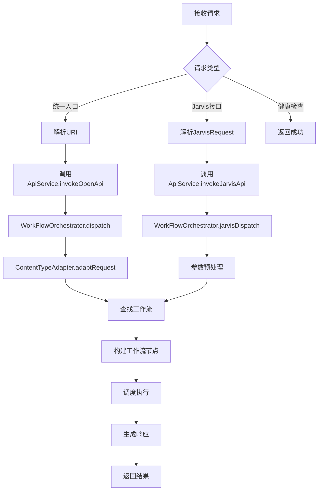
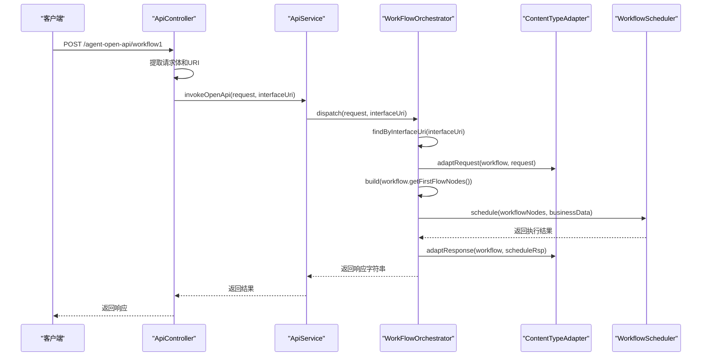
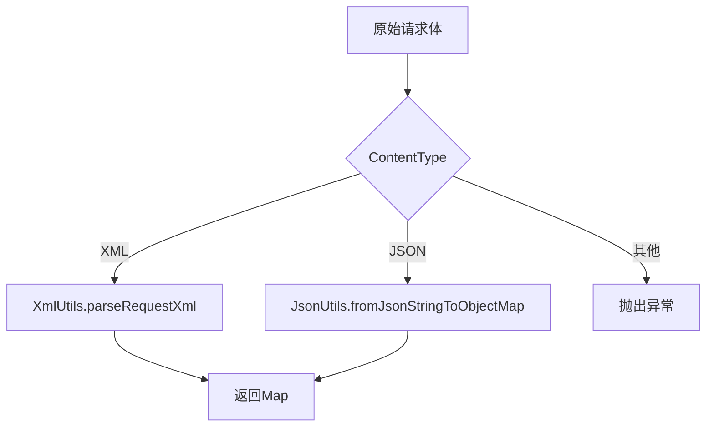
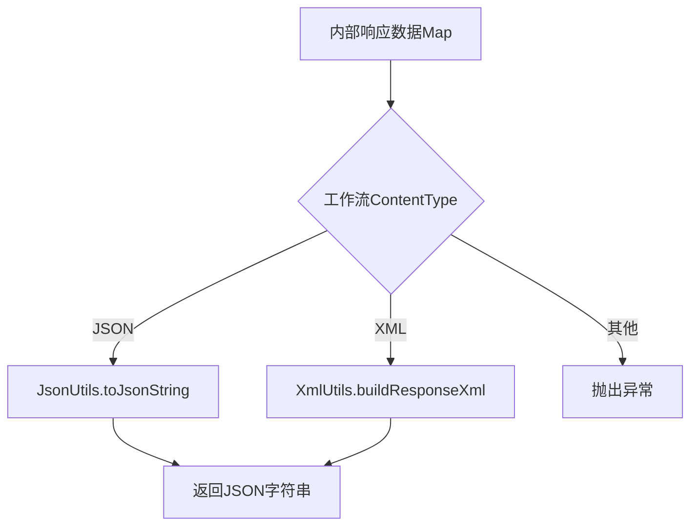
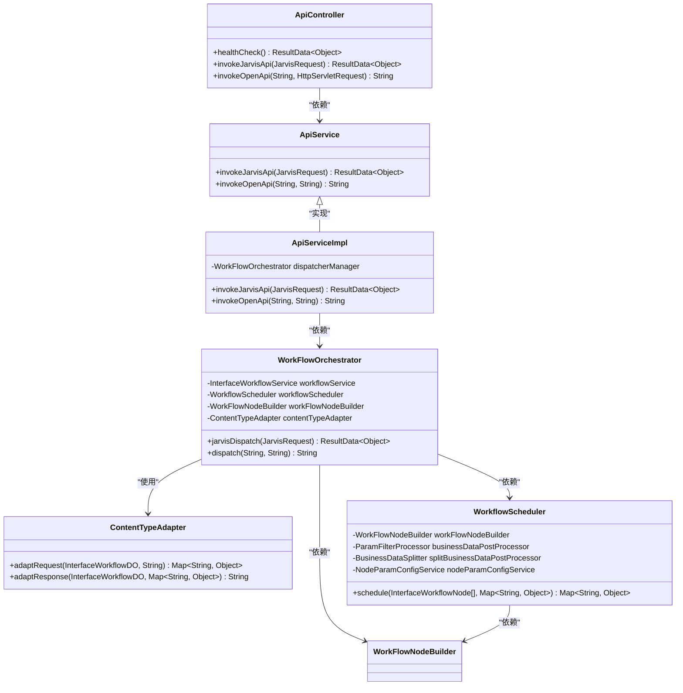

# 调度执行API

<cite>
**本文档引用文件**   
- [ApiController.java](file://agent-api/src/main/java/com/helianhealth/agent/api/controller/ApiController.java)
- [WorkFlowOrchestrator.java](file://agent-api/src/main/java/com/helianhealth/agent/api/WorkFlowOrchestrator.java)
- [ApiService.java](file://agent-api/src/main/java/com/helianhealth/agent/api/service/ApiService.java)
- [ApiServiceImpl.java](file://agent-api/src/main/java/com/helianhealth/agent/api/service/impl/ApiServiceImpl.java)
- [ContentTypeAdapter.java](file://agent-api/src/main/java/com/helianhealth/agent/api/adapter/ContentTypeAdapter.java)
- [JarvisRequest.java](file://agent-api/src/main/java/com/helianhealth/agent/api/model/request/JarvisRequest.java)
- [WorkflowScheduler.java](file://agent-schedule/src/main/java/com/helianhealth/agent/schedule/WorkflowScheduler.java)
- [WorkFlowNodeBuilder.java](file://agent-schedule/src/main/java/com/helianhealth/agent/schedule/builder/WorkFlowNodeBuilder.java)
- [JsonUtils.java](file://agent-common/src/main/java/com/helianhealth/agent/common/utils/JsonUtils.java)
- [XmlUtils.java](file://agent-common/src/main/java/com/helianhealth/agent/common/utils/XmlUtils.java)
</cite>

## 目录
1. [简介](#简介)
2. [核心端点](#核心端点)
3. [统一入口API](#统一入口api)
4. [Jarvis专用接口](#jarvis专用接口)
5. [健康检查端点](#健康检查端点)
6. [处理流程](#处理流程)
7. [请求示例](#请求示例)
8. [Mock测试接口](#mock测试接口)
9. [架构概览](#架构概览)

## 简介
调度执行API是系统与外部交互的核心枢纽，提供统一的入口点来接收外部系统的调用。该API通过解析请求URI来确定目标工作流，并支持多种内容类型（如application/json, application/xml等）。核心功能由`invokeOpenApi`方法实现，该方法将原始字符串请求传递给`WorkFlowOrchestrator`进行工作流的调度执行。此外，API还提供了专门用于Jarvis系统的接口和健康检查端点，确保系统的稳定性和可集成性。

## 核心端点
调度执行API包含三个主要端点，分别用于不同的使用场景：

- **统一入口API**: `POST /agent-open-api/**` - 作为系统的主要入口，接收所有外部调用，支持JSON和XML格式的请求。
- **Jarvis专用接口**: `POST /HLOpenApi/Hjk` - 专为Jarvis系统设计的接口，处理特定格式的请求。
- **健康检查端点**: `GET /HLOpenApi/Hjk` - 用于系统健康状态检查。

这些端点共同构成了系统与外部交互的核心通道。

## 统一入口API
统一入口API是系统的主要对外接口，通过通配路径`/agent-open-api/**`接收所有外部系统的调用。

### 端点定义
```java
@RequestMapping(
    value = "/agent-open-api/**",
    method = RequestMethod.POST,
    consumes = {MediaType.APPLICATION_JSON_VALUE, MediaType.APPLICATION_XML_VALUE,
                MediaType.TEXT_XML_VALUE, MediaType.TEXT_PLAIN_VALUE},
    produces = {MediaType.APPLICATION_JSON_VALUE, MediaType.APPLICATION_XML_VALUE}
)
public String invokeOpenApi(@RequestBody String request, HttpServletRequest httpRequest)
```

### 特性
- **通配路径**: 支持`/agent-open-api/`下的任意子路径，通过解析URI来确定目标工作流。
- **多内容类型支持**: 支持application/json, application/xml, text/xml, text/plain等多种请求内容类型。
- **统一响应格式**: 根据工作流配置的ContentType返回JSON或XML格式的响应。

### 请求处理
当收到请求时，系统会：
1. 从`HttpServletRequest`中提取完整的请求URI。
2. 将URI作为`interfaceUri`参数传递给`ApiService.invokeOpenApi`方法。
3. 由`WorkFlowOrchestrator`根据URI查找对应的工作流并执行。

**核心源码**
- [ApiController.java](file://agent-api/src/main/java/com/helianhealth/agent/api/controller/ApiController.java#L37-L48)

## Jarvis专用接口
Jarvis专用接口是为特定系统（Jarvis）设计的专用通道，处理符合Jarvis规范的请求。

### 端点定义
```java
@PostMapping("/HLOpenApi/Hjk")
public ResultData<Object> invokeJarvisApi(@RequestBody JarvisRequest request)
```

### 请求模型
`JarvisRequest`类定义了Jarvis接口的请求参数：

```java
@Data
@Accessors(chain = true)
public class JarvisRequest {
    @JsonProperty(value = "BusinessMethod")
    private String businessMethod;
    
    @JsonProperty(value = "BusinessCode")
    private String businessCode;
    
    @JsonProperty(value = "data")
    private JSONObject data;
    
    // 报告相关参数
    @JsonProperty(value = "ServiceProviderType")
    private String serviceProviderType;
    
    @JsonProperty(value = "PatientCode")
    private String patientCode;
    
    @JsonProperty(value = "OutFeeItemIdList")
    private List<String> outFeeItemIdList;
    
    @JsonProperty(value = "ApplyNoList")
    private List<String> applyNoList;
    
    @JsonProperty(value = "BarCodeList")
    private List<String> barCodeList;
    
    @JsonProperty(value = "AuditTime")
    private String auditTime;
    
    @JsonProperty(value = "QueryType")
    private Integer queryType;
}
```

### 处理逻辑
1. 接收`JarvisRequest`对象作为请求体。
2. 提取`businessMethod`作为接口URI查找对应的工作流。
3. 根据请求内容提取业务数据（兼容不同格式）。
4. 调度执行对应的工作流并返回结果。

**核心源码**
- [ApiController.java](file://agent-api/src/main/java/com/helianhealth/agent/api/controller/ApiController.java#L32-L35)
- [JarvisRequest.java](file://agent-api/src/main/java/com/helianhealth/agent/api/model/request/JarvisRequest.java#L1-L45)

## 健康检查端点
健康检查端点用于监控系统的运行状态，确保服务的可用性。

### 端点定义
```java
@GetMapping("/HLOpenApi/Hjk")
public ResultData<Object> healthCheck()
```

### 功能
- 返回简单的成功响应，表示服务正常运行。
- 用于外部监控系统定期检查API的可用性。
- 不涉及复杂的业务逻辑，响应速度快。

### 响应格式
返回标准的`ResultData`对象，code为"200"，表示成功。

**核心源码**
- [ApiController.java](file://agent-api/src/main/java/com/helianhealth/agent/api/controller/ApiController.java#L27-L30)

## 处理流程
调度执行API的处理流程从接收到请求开始，到返回响应结束，涉及多个组件的协作。

### 整体流程


**流程图来源**
- [ApiController.java](file://agent-api/src/main/java/com/helianhealth/agent/api/controller/ApiController.java)
- [WorkFlowOrchestrator.java](file://agent-api/src/main/java/com/helianhealth/agent/api/WorkFlowOrchestrator.java)

### invokeOpenApi方法链路
`invokeOpenApi`方法的完整处理链路如下：

1. **控制器层**: `ApiController.invokeOpenApi`
   - 接收原始字符串请求和HTTP请求对象
   - 提取请求URI
   - 调用`ApiService.invokeOpenApi`

2. **服务层**: `ApiService.invokeOpenApi`
   - 作为接口定义，由`ApiServiceImpl`实现
   - 调用`WorkFlowOrchestrator.dispatch`

3. **调度层**: `WorkFlowOrchestrator.dispatch`
   - 根据`interfaceUri`查找对应的工作流
   - 调用`ContentTypeAdapter.adaptRequest`将请求体转换为Map
   - 构建工作流节点
   - 调用`WorkflowScheduler.schedule`执行工作流
   - 调用`ContentTypeAdapter.adaptResponse`生成响应



**序列图来源**
- [ApiController.java](file://agent-api/src/main/java/com/helianhealth/agent/api/controller/ApiController.java#L45-L48)
- [WorkFlowOrchestrator.java](file://agent-api/src/main/java/com/helianhealth/agent/api/WorkFlowOrchestrator.java#L78-L93)
- [ApiServiceImpl.java](file://agent-api/src/main/java/com/helianhealth/agent/api/service/impl/ApiServiceImpl.java#L33-L37)

### 内容类型适配
`ContentTypeAdapter`负责在不同协议格式与内部Map格式之间进行双向转换。

#### 请求适配


#### 响应适配


**适配器源码**
- [ContentTypeAdapter.java](file://agent-api/src/main/java/com/helianhealth/agent/api/adapter/ContentTypeAdapter.java#L29-L65)

## 请求示例
以下是不同格式的请求示例，展示如何调用调度执行API。

### JSON请求示例
```json
POST /agent-open-api/create-patient HTTP/1.1
Content-Type: application/json

{
  "patientName": "张三",
  "age": 30,
  "gender": "男",
  "department": "内科"
}
```

### XML请求示例
```xml
POST /agent-open-api/query-report HTTP/1.1
Content-Type: application/xml

<Request>
  <PatientId>123456</PatientId>
  <ReportType>CT</ReportType>
  <DateRange>
    <StartDate>2023-01-01</StartDate>
    <EndDate>2023-12-31</EndDate>
  </DateRange>
</Request>
```

### Jarvis请求示例
```json
POST /HLOpenApi/Hjk HTTP/1.1
Content-Type: application/json

{
  "BusinessMethod": "GetItemResult",
  "BusinessCode": "LAB001",
  "data": {
    "ApplyNoList": ["2023001", "2023002"],
    "PatientCode": "P123456"
  }
}
```

## Mock测试接口
系统提供了Mock测试接口，用于在开发和测试环境中模拟工作流节点的执行。

### 端点定义
```java
@RestController
@RequestMapping("/v1/console/mock")
public class MockInvokeController {
    
    @PostMapping("/invoke")
    public ResultData<Map<String, Object>> invokeMockNode(
            @RequestParam("nodeId") Integer nodeId,
            @RequestParam("mockId") Integer mockId,
            @RequestBody Map<String, Object> businessData)
}
```

### 功能
- 根据`nodeId`和`mockId`构建带Mock配置的工作流节点。
- 使用`InterfaceRemoteInvoker`直接执行节点。
- 返回执行结果，便于测试和调试。

**核心源码**
- [MockInvokeController.java](file://agent-api/src/main/java/com/helianhealth/agent/api/controller/MockInvokeController.java#L38-L69)

## 架构概览
调度执行API的架构设计体现了清晰的分层和职责分离原则。



**类图来源**
- [ApiController.java](file://agent-api/src/main/java/com/helianhealth/agent/api/controller/ApiController.java)
- [ApiService.java](file://agent-api/src/main/java/com/helianhealth/agent/api/service/ApiService.java)
- [ApiServiceImpl.java](file://agent-api/src/main/java/com/helianhealth/agent/api/service/impl/ApiServiceImpl.java)
- [WorkFlowOrchestrator.java](file://agent-api/src/main/java/com/helianhealth/agent/api/WorkFlowOrchestrator.java)
- [ContentTypeAdapter.java](file://agent-api/src/main/java/com/helianhealth/agent/api/adapter/ContentTypeAdapter.java)
- [WorkflowScheduler.java](file://agent-schedule/src/main/java/com/helianhealth/agent/schedule/WorkflowScheduler.java)
- [WorkFlowNodeBuilder.java](file://agent-schedule/src/main/java/com/helianhealth/agent/schedule/builder/WorkFlowNodeBuilder.java)