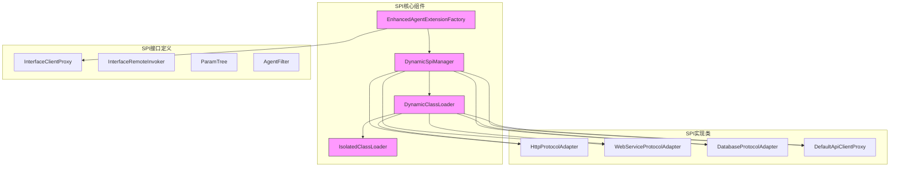
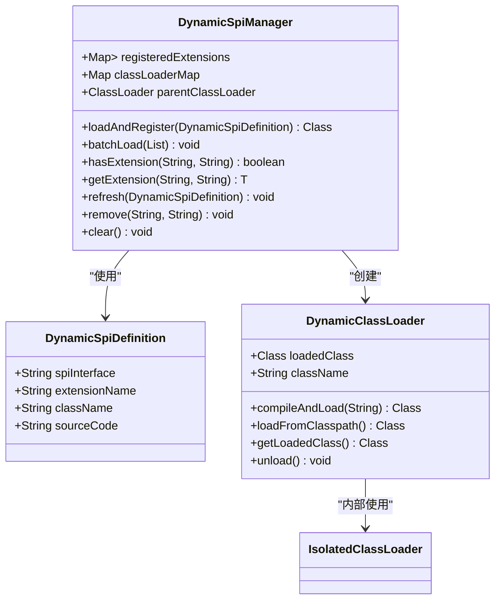
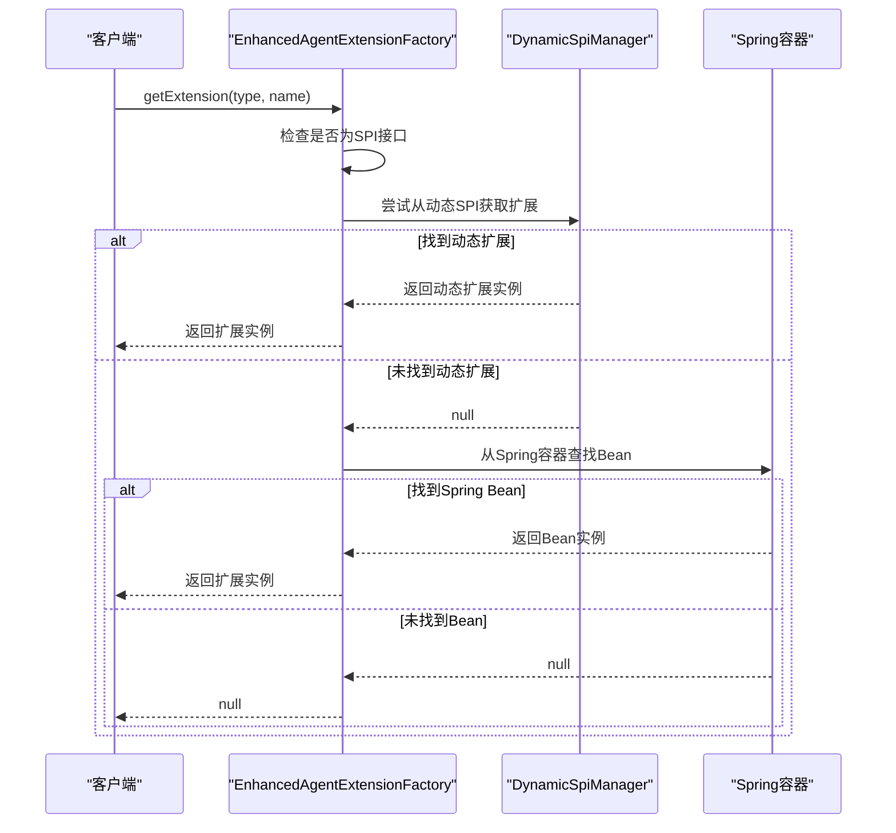
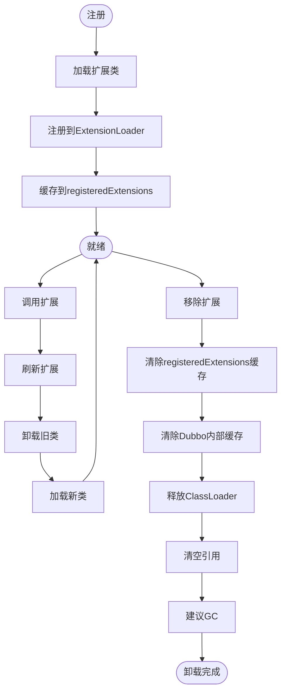

# SPI机制

<cite>
**本文档引用文件**  
- [EnhancedAgentExtensionFactory.java](file://agent-extension/src/main/java/com/helianhealth/agent/extension/factory/EnhancedAgentExtensionFactory.java)
- [DynamicSpiManager.java](file://agent-extension/src/main/java/com/helianhealth/agent/extension/spi/dynamic/DynamicSpiManager.java)
- [DynamicClassLoader.java](file://agent-extension/src/main/java/com/helianhealth/agent/extension/spi/dynamic/DynamicClassLoader.java)
- [DynamicSpiDefinition.java](file://agent-extension/src/main/java/com/helianhealth/agent/extension/spi/model/DynamicSpiDefinition.java)
- [DynamicSpiConfig.java](file://agent-extension/src/main/java/com/helianhealth/agent/extension/config/DynamicSpiConfig.java)
- [DynamicSpiConfigSource.java](file://agent-extension/src/main/java/com/helianhealth/agent/extension/spi/config/DynamicSpiConfigSource.java)
- [InterfaceClientProxy.java](file://agent-invocation/src/main/java/com/helianhealth/agent/invocation/remote/InterfaceClientProxy.java)
- [InterfaceRemoteInvoker.java](file://agent-invocation/src/main/java/com/helianhealth/agent/invocation/remote/InterfaceRemoteInvoker.java)
- [DefaultApiClientProxy.java](file://agent-invocation/src/main/java/com/helianhealth/agent/invocation/remote/DefaultApiClientProxy.java)
- [HttpProtocolAdapter.java](file://agent-invocation/src/main/java/com/helianhealth/agent/invocation/remote/http/HttpProtocolAdapter.java)
- [WebServiceProtocolAdapter.java](file://agent-invocation/src/main/java/com/helianhealth/agent/invocation/remote/webService/WebServiceProtocolAdapter.java)
- [org.apache.dubbo.common.extension.ExtensionFactory](file://agent-invocation/src/main/resources/META-INF/dubbo/org.apache.dubbo.common.extension.ExtensionFactory)
- [InterfaceClientProxy配置](file://agent-invocation/src/main/resources/META-INF/dubbo/com.helianhealth.agent.invocation.remote.InterfaceClientProxy)
- [DynamicSpiAdminService.java](file://agent-workflow/src/main/java/com/helianhealth/agent/workflow/service/extension/DynamicSpiAdminService.java)
</cite>

## 目录
1. [SPI机制概述](#spi机制概述)
2. [核心组件架构](#核心组件架构)
3. [SPI接口与注解](#spi接口与注解)
4. [动态SPI管理器](#动态spi管理器)
5. [类加载与隔离机制](#类加载与隔离机制)
6. [扩展工厂实现](#扩展工厂实现)
7. [SPI生命周期管理](#spi生命周期管理)
8. [配置与发现机制](#配置与发现机制)
9. [关键技术细节](#关键技术细节)
10. [性能监控与故障排查](#性能监控与故障排查)

## SPI机制概述

SPI（Service Provider Interface）机制是本系统实现可插拔架构的核心技术，基于Dubbo SPI框架进行增强扩展。该机制允许系统在运行时动态加载、卸载和管理各种功能扩展，实现了高度的灵活性和可扩展性。

系统通过SPI机制实现了协议适配器的动态扩展，支持HTTP、WebService、数据库等多种远程调用协议。所有扩展实现都可以在不重启应用的情况下进行热更新，满足了生产环境对高可用性的要求。

SPI机制的设计目标包括：
- 实现功能模块的可插拔性
- 支持运行时动态扩展和热更新
- 确保类加载隔离，避免内存泄漏
- 提供灵活的扩展发现和加载机制

**本节来源**
- [EnhancedAgentExtensionFactory.java](file://agent-extension/src/main/java/com/helianhealth/agent/extension/factory/EnhancedAgentExtensionFactory.java#L1-L110)
- [DynamicSpiManager.java](file://agent-extension/src/main/java/com/helianhealth/agent/extension/spi/dynamic/DynamicSpiManager.java#L1-L273)

## 核心组件架构



**图示来源**
- [EnhancedAgentExtensionFactory.java](file://agent-extension/src/main/java/com/helianhealth/agent/extension/factory/EnhancedAgentExtensionFactory.java#L1-L110)
- [DynamicSpiManager.java](file://agent-extension/src/main/java/com/helianhealth/agent/extension/spi/dynamic/DynamicSpiManager.java#L1-L273)
- [DynamicClassLoader.java](file://agent-extension/src/main/java/com/helianhealth/agent/extension/spi/dynamic/DynamicClassLoader.java#L1-L303)

## SPI接口与注解

SPI接口是系统扩展点的契约定义，所有可扩展的功能都通过接口形式暴露。系统使用Dubbo框架提供的`@SPI`注解来标识SPI接口。

`@SPI`注解的作用包括：
- 标识一个接口为SPI扩展点
- 指定默认扩展实现的名称
- 启用Dubbo SPI机制的自动发现和加载功能

例如，`InterfaceClientProxy`接口使用`@SPI("default")`注解，表示这是一个SPI扩展点，其默认实现名称为"default"。这意味着当没有指定具体实现时，系统将自动使用名为"default"的扩展实现。

SPI接口通常包含`@Adaptive`注解的方法，这些方法可以根据运行时参数动态选择具体的扩展实现。例如，`doInvoke`方法使用`@Adaptive("proxy")`注解，表示系统将根据"proxy"参数的值来决定使用哪个具体的实现类。

**本节来源**
- [InterfaceClientProxy.java](file://agent-invocation/src/main/java/com/helianhealth/agent/invocation/remote/InterfaceClientProxy.java#L1-L21)
- [InterfaceRemoteInvoker.java](file://agent-invocation/src/main/java/com/helianhealth/agent/invocation/remote/InterfaceRemoteInvoker.java#L1-L26)

## 动态SPI管理器



**图示来源**
- [DynamicSpiManager.java](file://agent-extension/src/main/java/com/helianhealth/agent/extension/spi/dynamic/DynamicSpiManager.java#L1-L273)
- [DynamicSpiDefinition.java](file://agent-extension/src/main/java/com/helianhealth/agent/extension/spi/model/DynamicSpiDefinition.java#L1-L32)
- [DynamicClassLoader.java](file://agent-extension/src/main/java/com/helianhealth/agent/extension/spi/dynamic/DynamicClassLoader.java#L1-L303)

## 类加载与隔离机制

系统通过独立的`DynamicClassLoader`实现类加载隔离，确保动态加载的类可以被完全卸载，避免内存泄漏问题。

每个动态扩展类都使用独立的`DynamicClassLoader`实例进行加载，实现了类与类加载器的一对一绑定关系。当需要卸载某个扩展时，系统会释放对应的`DynamicClassLoader`，从而触发JVM的类卸载机制。

类加载过程支持两种模式：
1. **动态编译模式**：从Java源代码字符串编译并加载类
2. **项目模式**：从类路径加载预编译的类文件

这种设计确保了类加载的隔离性，不同扩展之间的类不会相互干扰，同时也为类的完全卸载提供了基础。

**本节来源**
- [DynamicClassLoader.java](file://agent-extension/src/main/java/com/helianhealth/agent/extension/spi/dynamic/DynamicClassLoader.java#L1-L303)
- [DynamicSpiManager.java](file://agent-extension/src/main/java/com/helianhealth/agent/extension/spi/dynamic/DynamicSpiManager.java#L63-L76)

## 扩展工厂实现



**图示来源**
- [EnhancedAgentExtensionFactory.java](file://agent-extension/src/main/java/com/helianhealth/agent/extension/factory/EnhancedAgentExtensionFactory.java#L1-L110)
- [DynamicSpiManager.java](file://agent-extension/src/main/java/com/helianhealth/agent/extension/spi/dynamic/DynamicSpiManager.java#L119-L133)

## SPI生命周期管理



**图示来源**
- [DynamicSpiManager.java](file://agent-extension/src/main/java/com/helianhealth/agent/extension/spi/dynamic/DynamicSpiManager.java#L54-L97)
- [DynamicSpiManager.java](file://agent-extension/src/main/java/com/helianhealth/agent/extension/spi/dynamic/DynamicSpiManager.java#L138-L147)
- [DynamicSpiManager.java](file://agent-extension/src/main/java/com/helianhealth/agent/extension/spi/dynamic/DynamicSpiManager.java#L161-L202)

## 配置与发现机制

SPI扩展通过`META-INF/dubbo`目录下的配置文件进行声明。系统在启动时会自动扫描这些配置文件，发现并注册可用的扩展实现。

例如，`InterfaceClientProxy`的配置文件内容如下：
```
com.helianhealth.agent.invocation.remote.wrapper.InterfaceClientProxyLogWrapper
com.helianhealth.agent.invocation.remote.wrapper.InterfaceClientProxyFilterChainWrapper
default=com.helianhealth.agent.invocation.remote.DefaultApiClientProxy
http=com.helianhealth.agent.invocation.remote.http.HttpProtocolAdapter
webservice=com.helianhealth.agent.invocation.remote.webService.WebServiceProtocolAdapter
database=com.helianhealth.agent.invocation.remote.database.DatabaseProtocolAdapter
```

配置文件的每一行定义了一个扩展实现，格式为`[名称]=[全限定类名]`。以`default=`开头的行指定了默认实现。

系统还通过`org.apache.dubbo.common.extension.ExtensionFactory`配置文件指定了增强版的扩展工厂：
```
agent=com.helianhealth.agent.extension.factory.EnhancedAgentExtensionFactory
```

这使得系统优先使用`EnhancedAgentExtensionFactory`来创建扩展实例，从而支持动态SPI功能。

**本节来源**
- [org.apache.dubbo.common.extension.ExtensionFactory](file://agent-invocation/src/main/resources/META-INF/dubbo/org.apache.dubbo.common.extension.ExtensionFactory#L1-L6)
- [InterfaceClientProxy配置](file://agent-invocation/src/main/resources/META-INF/dubbo/com.helianhealth.agent.invocation.remote.InterfaceClientProxy#L1-L7)
- [DynamicSpiConfig.java](file://agent-extension/src/main/java/com/helianhealth/agent/extension/config/DynamicSpiConfig.java#L1-L18)

## 关键技术细节

### 线程安全
`DynamicSpiManager`使用`ConcurrentHashMap`作为缓存存储，确保了多线程环境下的线程安全。`registeredExtensions`和`classLoaderMap`都使用并发集合，避免了显式的同步开销。

### 类加载隔离
每个动态扩展类使用独立的`DynamicClassLoader`实例，实现了类加载器级别的隔离。这种一对一的绑定关系确保了类可以被完全卸载。

### 缓存管理
系统维护了多级缓存：
- `registeredExtensions`：注册的扩展类缓存
- `classLoaderMap`：类加载器缓存
- Dubbo `ExtensionLoader`内部缓存

在卸载扩展时，系统会清除所有相关缓存，确保无内存泄漏。

### 内存泄漏防护
卸载扩展时的完整流程：
1. 从`registeredExtensions`中移除类引用
2. 清除Dubbo `ExtensionLoader`内部缓存
3. 释放`DynamicClassLoader`实例
4. 将类引用置为null
5. 建议JVM执行垃圾回收

**本节来源**
- [DynamicSpiManager.java](file://agent-extension/src/main/java/com/helianhealth/agent/extension/spi/dynamic/DynamicSpiManager.java#L27-L33)
- [DynamicSpiManager.java](file://agent-extension/src/main/java/com/helianhealth/agent/extension/spi/dynamic/DynamicSpiManager.java#L161-L202)
- [DynamicClassLoader.java](file://agent-extension/src/main/java/com/helianhealth/agent/extension/spi/dynamic/DynamicClassLoader.java#L34-L39)

## 性能监控与故障排查

### 性能监控建议
1. **类加载性能**：监控动态编译和类加载的耗时
2. **内存使用**：监控`DynamicClassLoader`实例数量和内存占用
3. **缓存命中率**：监控SPI扩展的缓存命中情况
4. **GC频率**：监控因类卸载导致的GC频率

### 故障排查指南
1. **扩展加载失败**：
   - 检查`DynamicSpiDefinition`中的类名和接口名是否正确
   - 确认实现类确实实现了指定的SPI接口
   - 查看编译错误日志（动态编译模式）

2. **内存泄漏**：
   - 检查`classLoaderMap`中的`DynamicClassLoader`实例是否被正确释放
   - 确认`registeredExtensions`缓存是否被及时清理
   - 使用内存分析工具检查类加载器泄漏

3. **扩展调用异常**：
   - 确认扩展已正确注册到`ExtensionLoader`
   - 检查扩展名称是否匹配
   - 验证Spring容器中是否存在同名Bean导致冲突

4. **热更新失败**：
   - 确保事务提交后才执行刷新操作
   - 检查旧版本类是否被完全卸载
   - 验证新版本类的编译和加载是否成功

**本节来源**
- [DynamicSpiManager.java](file://agent-extension/src/main/java/com/helianhealth/agent/extension/spi/dynamic/DynamicSpiManager.java#L102-L111)
- [DynamicSpiAdminService.java](file://agent-workflow/src/main/java/com/helianhealth/agent/workflow/service/extension/DynamicSpiAdminService.java#L163-L179)
- [EnhancedAgentExtensionFactory.java](file://agent-extension/src/main/java/com/helianhealth/agent/extension/factory/EnhancedAgentExtensionFactory.java#L33-L37)
