# 扩展开发

<cite>
**本文档中引用的文件**
- [DynamicSpiManager.java](file://agent-extension/src/main/java/com/helianhealth/agent/extension/spi/dynamic/DynamicSpiManager.java)
- [DynamicSpiDefinition.java](file://agent-extension/src/main/java/com/helianhealth/agent/extension/spi/model/DynamicSpiDefinition.java)
- [EnhancedAgentExtensionFactory.java](file://agent-extension/src/main/java/com/helianhealth/agent/extension/factory/EnhancedAgentExtensionFactory.java)
- [InterfaceRemoteInvoker.java](file://agent-invocation/src/main/java/com/helianhealth/agent/invocation/remote/InterfaceRemoteInvoker.java)
- [InterfaceRemoteInvokerLogWrapper.java](file://agent-invocation/src/main/java/com/helianhealth/agent/invocation/remote/wrapper/InterfaceRemoteInvokerLogWrapper.java)
- [DefaultInterfaceRemoteInvoker.java](file://agent-invocation/src/main/java/com/helianhealth/agent/invocation/remote/DefaultInterfaceRemoteInvoker.java)
- [DynamicSpiAdminService.java](file://agent-workflow/src/main/java/com/helianhealth/agent/workflow/service/extension/DynamicSpiAdminService.java)
- [SpringDynamicSpiLoader.java](file://agent-extension/src/main/java/com/helianhealth/agent/extension/spi/loader/SpringDynamicSpiLoader.java)
- [com.helianhealth.agent.invocation.remote.InterfaceRemoteInvoker](file://agent-invocation/src/main/resources/META-INF/dubbo/com.helianhealth.agent.invocation.remote.InterfaceRemoteInvoker)
- [org.apache.dubbo.common.extension.ExtensionFactory](file://agent-invocation/src/main/resources/META-INF/dubbo/org.apache.dubbo.common.extension.ExtensionFactory)
- [DynamicSpiConfig.java](file://agent-extension/src/main/java/com/helianhealth/agent/extension/config/DynamicSpiConfig.java)
</cite>

## 目录
1. [引言](#引言)
2. [SPI架构概述](#spi架构概述)
3. [核心组件分析](#核心组件分析)
4. [扩展开发流程](#扩展开发流程)
5. [动态SPI管理机制](#动态spi管理机制)
6. [最佳实践与性能考虑](#最佳实践与性能考虑)
7. [调试技巧](#调试技巧)
8. [结论](#结论)

## 引言
本文档旨在为高级用户提供基于Dubbo SPI机制的扩展开发指南。系统采用可插拔架构设计，允许开发者通过在META-INF/dubbo目录下定义扩展点来实现自定义协议。以InterfaceRemoteInvoker为例，文档将详细说明如何创建新的远程调用实现（如gRPC、Kafka）并注册到系统中。通过深入分析DynamicSpiManager的动态加载和管理机制，帮助开发者安全地增强系统能力。

## SPI架构概述
系统基于Dubbo的SPI（Service Provider Interface）机制构建了可扩展的插件架构。该架构的核心是通过配置文件定义服务接口的实现类，实现运行时的动态加载和替换。系统在启动时会扫描META-INF/dubbo目录下的配置文件，根据配置注册相应的扩展实现。

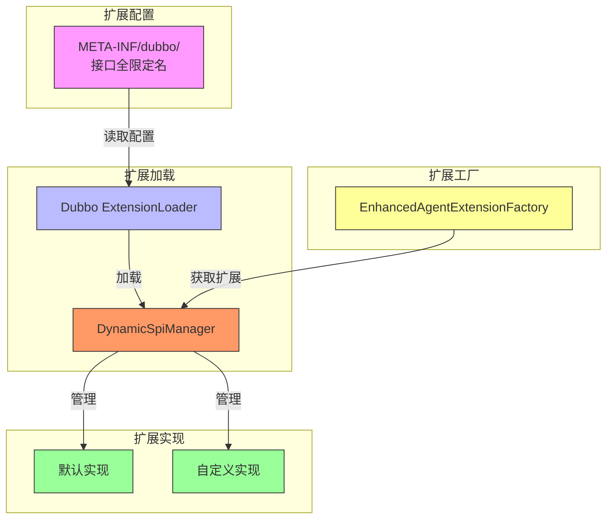

**图示来源**
- [org.apache.dubbo.common.extension.ExtensionFactory](file://agent-invocation/src/main/resources/META-INF/dubbo/org.apache.dubbo.common.extension.ExtensionFactory)
- [DynamicSpiManager.java](file://agent-extension/src/main/java/com/helianhealth/agent/extension/spi/dynamic/DynamicSpiManager.java)
- [EnhancedAgentExtensionFactory.java](file://agent-extension/src/main/java/com/helianhealth/agent/extension/factory/EnhancedAgentExtensionFactory.java)

**本节来源**
- [org.apache.dubbo.common.extension.ExtensionFactory](file://agent-invocation/src/main/resources/META-INF/dubbo/org.apache.dubbo.common.extension.ExtensionFactory)

## 核心组件分析

### InterfaceRemoteInvoker扩展点
InterfaceRemoteInvoker是系统中的核心扩展点之一，负责执行远程调用操作。该接口通过Dubbo的SPI机制实现可插拔设计，支持HTTP、SOAP、数据库等多种协议的调用。

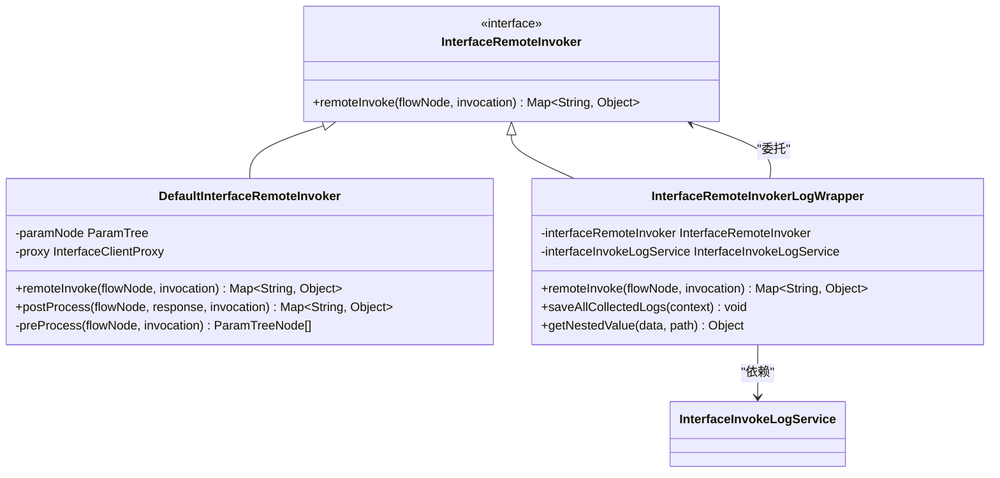

**图示来源**
- [InterfaceRemoteInvoker.java](file://agent-invocation/src/main/java/com/helianhealth/agent/invocation/remote/InterfaceRemoteInvoker.java)
- [DefaultInterfaceRemoteInvoker.java](file://agent-invocation/src/main/java/com/helianhealth/agent/invocation/remote/DefaultInterfaceRemoteInvoker.java)
- [InterfaceRemoteInvokerLogWrapper.java](file://agent-invocation/src/main/java/com/helianhealth/agent/invocation/remote/wrapper/InterfaceRemoteInvokerLogWrapper.java)

**本节来源**
- [InterfaceRemoteInvoker.java](file://agent-invocation/src/main/java/com/helianhealth/agent/invocation/remote/InterfaceRemoteInvoker.java)
- [com.helianhealth.agent.invocation.remote.InterfaceRemoteInvoker](file://agent-invocation/src/main/resources/META-INF/dubbo/com.helianhealth.agent.invocation.remote.InterfaceRemoteInvoker)

### 扩展工厂机制
系统通过EnhancedAgentExtensionFactory实现扩展的获取和管理。该工厂不仅支持从动态SPI管理器获取扩展，还支持从Spring容器中查找Bean，提供了灵活的扩展加载机制。

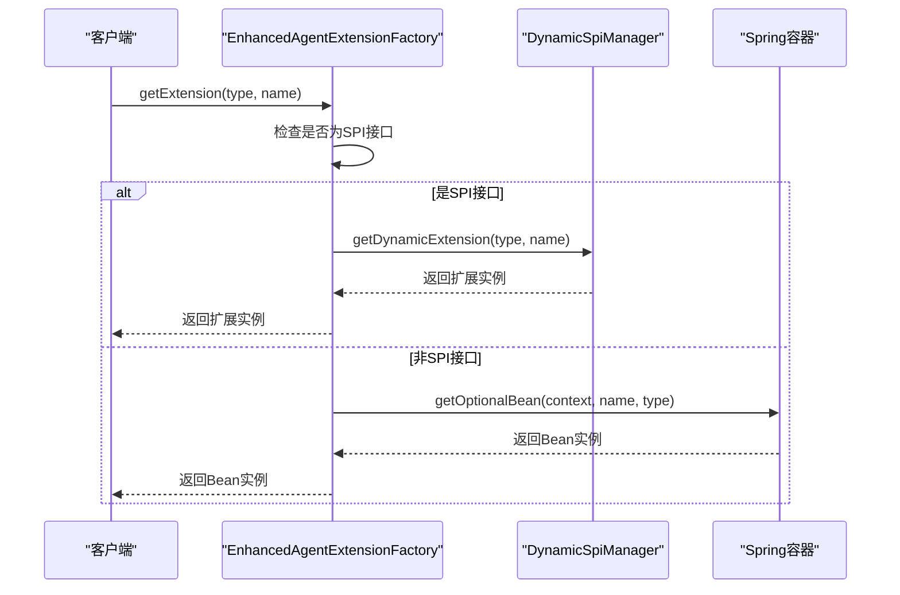

**图示来源**
- [EnhancedAgentExtensionFactory.java](file://agent-extension/src/main/java/com/helianhealth/agent/extension/factory/EnhancedAgentExtensionFactory.java)
- [DynamicSpiManager.java](file://agent-extension/src/main/java/com/helianhealth/agent/extension/spi/dynamic/DynamicSpiManager.java)

**本节来源**
- [EnhancedAgentExtensionFactory.java](file://agent-extension/src/main/java/com/helianhealth/agent/extension/factory/EnhancedAgentExtensionFactory.java)

## 扩展开发流程

### 创建自定义远程调用实现
要创建新的远程调用实现（如gRPC、Kafka），开发者需要遵循以下步骤：

1. 实现InterfaceRemoteInvoker接口
2. 在META-INF/dubbo目录下创建配置文件
3. 在配置文件中注册实现类

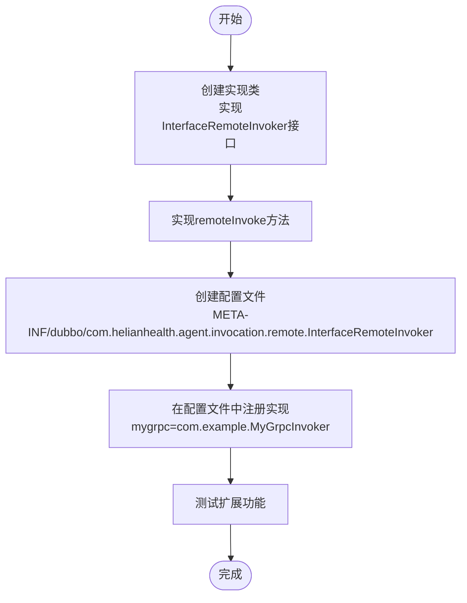

**本节来源**
- [InterfaceRemoteInvoker.java](file://agent-invocation/src/main/java/com/helianhealth/agent/invocation/remote/InterfaceRemoteInvoker.java)
- [com.helianhealth.agent.invocation.remote.InterfaceRemoteInvoker](file://agent-invocation/src/main/resources/META-INF/dubbo/com.helianhealth.agent.invocation.remote.InterfaceRemoteInvoker)

### 配置文件结构
系统中的SPI配置文件遵循Dubbo的标准格式，每行定义一个扩展实现。配置文件位于META-INF/dubbo目录下，文件名为接口的全限定名。

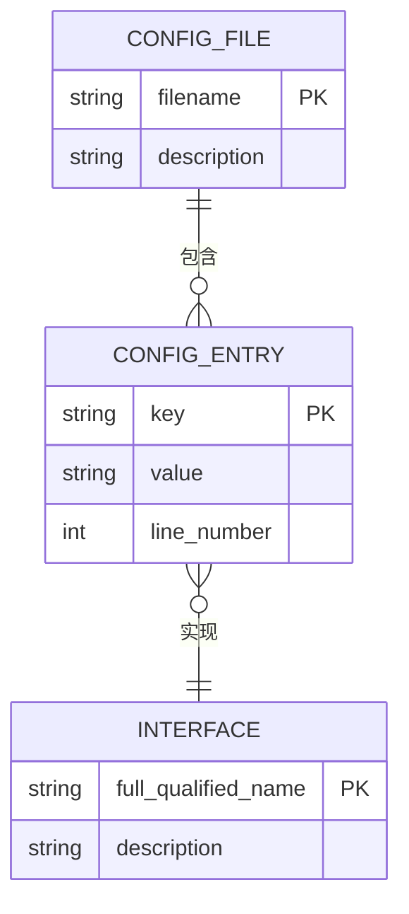

**本节来源**
- [com.helianhealth.agent.invocation.remote.InterfaceRemoteInvoker](file://agent-invocation/src/main/resources/META-INF/dubbo/com.helianhealth.agent.invocation.remote.InterfaceRemoteInvoker)

## 动态SPI管理机制

### DynamicSpiManager架构
DynamicSpiManager是系统动态SPI管理的核心组件，采用隔离的ClassLoader架构来支持完整的类卸载。其核心设计包括：

1. 每个动态类使用独立的DynamicClassLoader实例
2. ClassLoader与类一对一绑定，共同生命周期
3. 卸载时释放ClassLoader以触发JVM类卸载机制

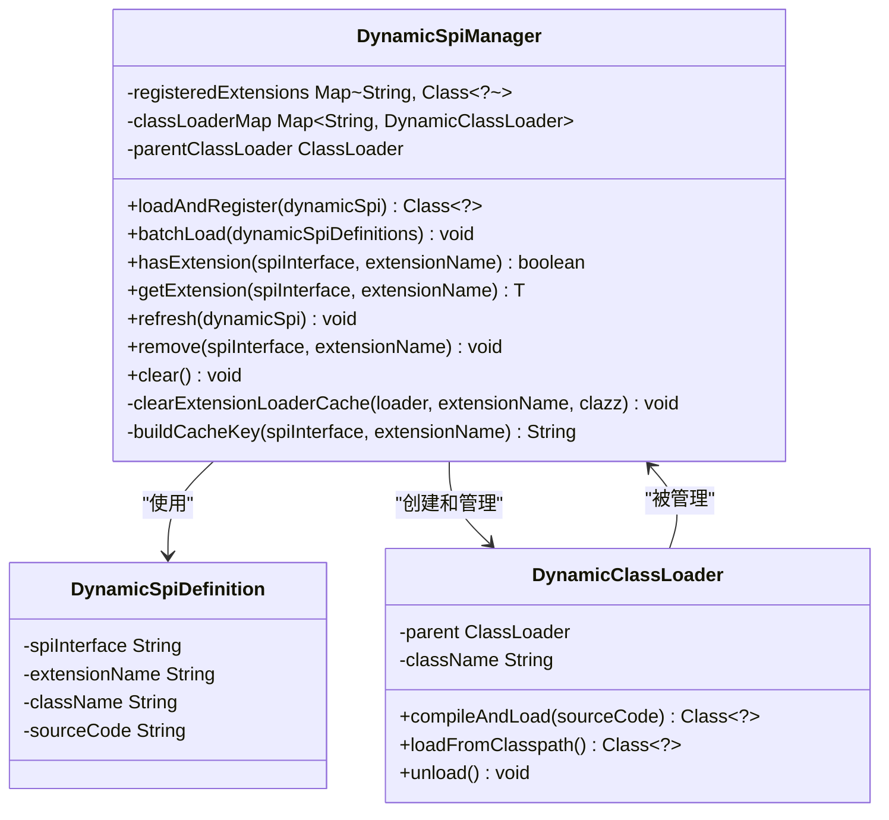

**图示来源**
- [DynamicSpiManager.java](file://agent-extension/src/main/java/com/helianhealth/agent/extension/spi/dynamic/DynamicSpiManager.java)
- [DynamicSpiDefinition.java](file://agent-extension/src/main/java/com/helianhealth/agent/extension/spi/model/DynamicSpiDefinition.java)

**本节来源**
- [DynamicSpiManager.java](file://agent-extension/src/main/java/com/helianhealth/agent/extension/spi/dynamic/DynamicSpiManager.java)

### 动态加载与卸载流程
DynamicSpiManager支持两种加载模式：动态编译模式和项目模式。系统在加载扩展时会根据配置决定使用哪种模式。

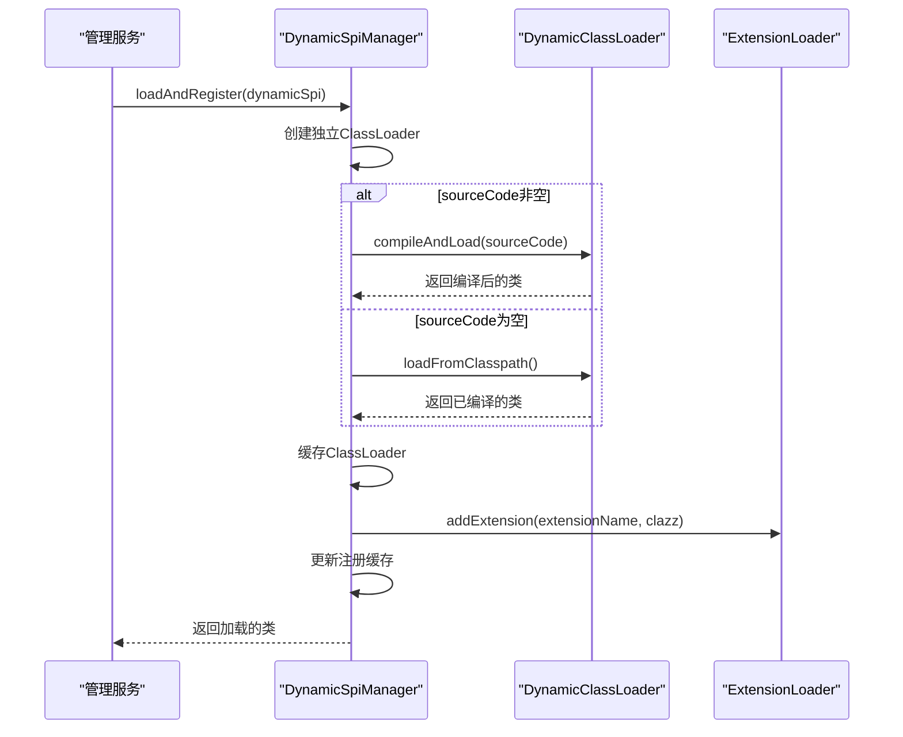

**图示来源**
- [DynamicSpiManager.java](file://agent-extension/src/main/java/com/helianhealth/agent/extension/spi/dynamic/DynamicSpiManager.java)
- [DynamicClassLoader.java](file://agent-extension/src/main/java/com/helianhealth/agent/extension/spi/dynamic/DynamicClassLoader.java)

**本节来源**
- [DynamicSpiManager.java](file://agent-extension/src/main/java/com/helianhealth/agent/extension/spi/dynamic/DynamicSpiManager.java)

### 运行时管理
系统通过DynamicSpiAdminService提供运行时的扩展管理功能，包括创建、更新、刷新和禁用扩展。这些操作都与数据库事务保持一致，确保数据一致性。

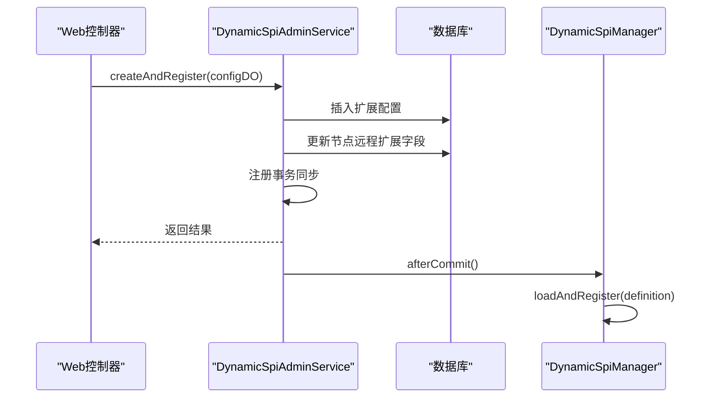

**图示来源**
- [DynamicSpiAdminService.java](file://agent-workflow/src/main/java/com/helianhealth/agent/workflow/service/extension/DynamicSpiAdminService.java)
- [DynamicSpiManager.java](file://agent-extension/src/main/java/com/helianhealth/agent/extension/spi/dynamic/DynamicSpiManager.java)

**本节来源**
- [DynamicSpiAdminService.java](file://agent-workflow/src/main/java/com/helianhealth/agent/workflow/service/extension/DynamicSpiAdminService.java)

## 最佳实践与性能考虑

### 类加载器隔离
为了支持完整的类卸载，系统采用了一对一的ClassLoader绑定策略。每个动态类都有独立的ClassLoader实例，这样在卸载时可以完全释放所有相关资源。

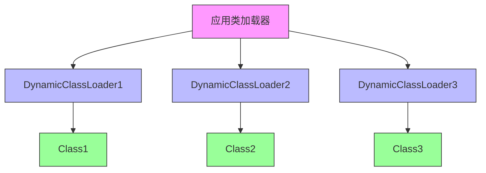

**本节来源**
- [DynamicSpiManager.java](file://agent-extension/src/main/java/com/helianhealth/agent/extension/spi/dynamic/DynamicSpiManager.java)

### 性能优化策略
系统在设计时考虑了多种性能优化策略，包括缓存机制、延迟加载和资源复用。

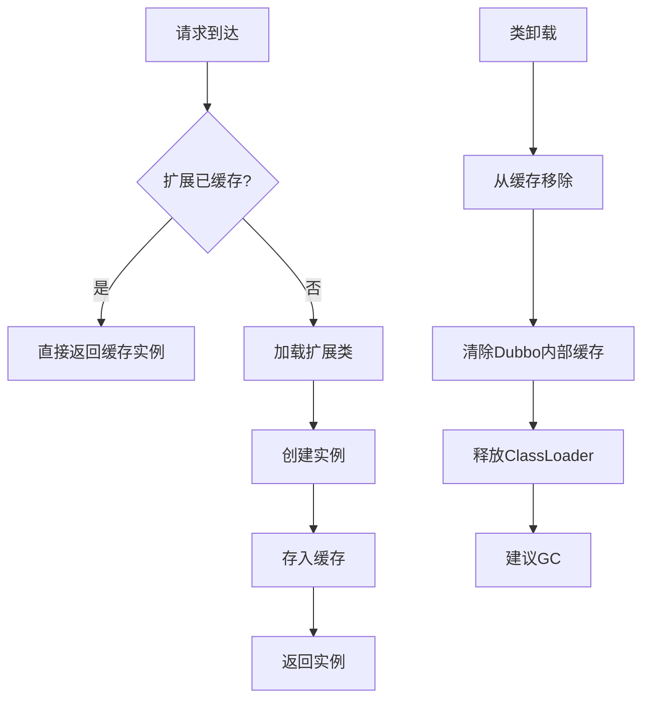

**本节来源**
- [DynamicSpiManager.java](file://agent-extension/src/main/java/com/helianhealth/agent/extension/spi/dynamic/DynamicSpiManager.java)

## 调试技巧

### 日志跟踪
系统提供了详细的日志记录，帮助开发者跟踪扩展的加载和执行过程。关键日志点包括扩展加载、注册、执行和卸载。

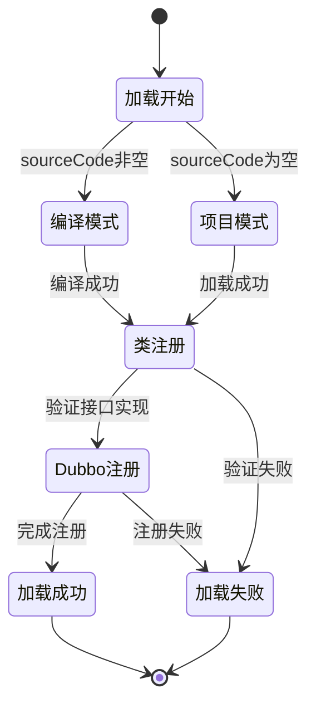

**本节来源**
- [DynamicSpiManager.java](file://agent-extension/src/main/java/com/helianhealth/agent/extension/spi/dynamic/DynamicSpiManager.java)

## 结论
本文档详细介绍了基于Dubbo SPI机制的扩展开发指南。通过分析InterfaceRemoteInvoker扩展点和DynamicSpiManager动态管理机制，展示了如何创建和管理自定义协议实现。系统采用隔离的ClassLoader架构，支持完整的类加载和卸载，确保了扩展的安全性和灵活性。开发者可以遵循文档中的最佳实践，安全地增强系统能力，满足特定业务需求。