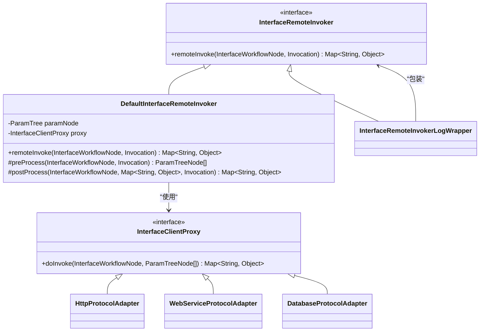
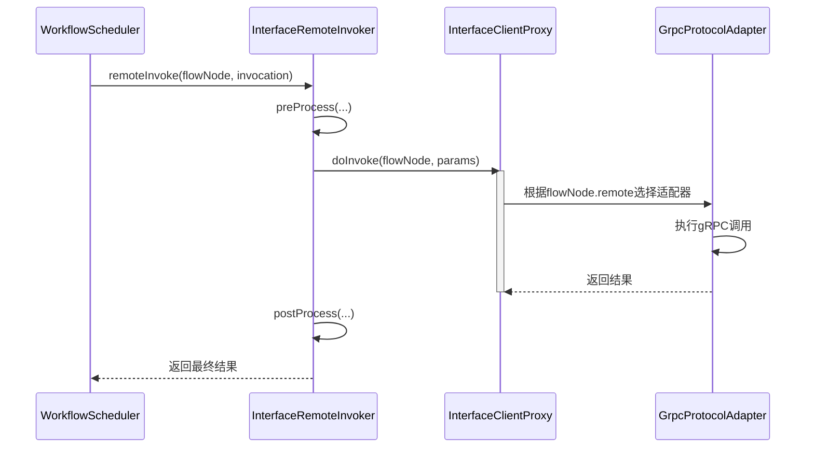
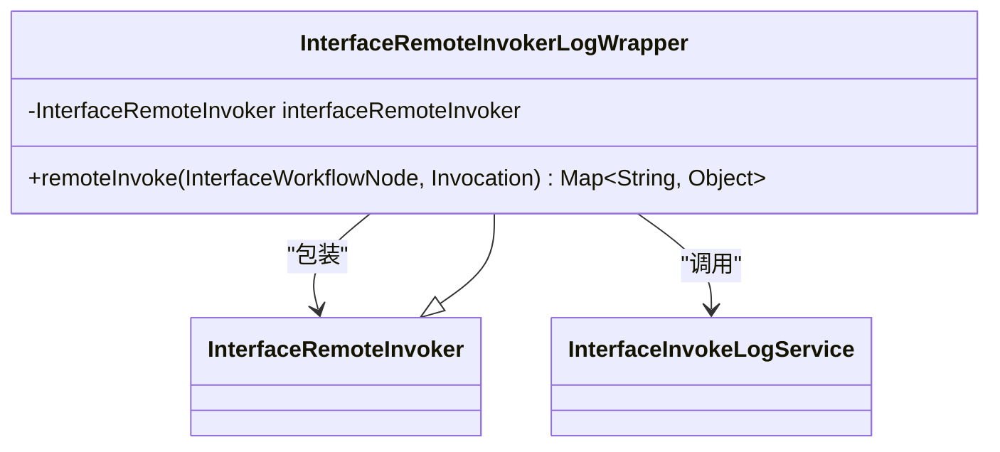
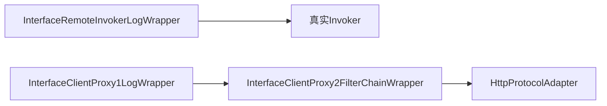

# 自定义协议支持

<cite>
**本文档中引用的文件**  
- [InterfaceRemoteInvoker.java](file://agent-invocation/src/main/java/com/helianhealth/agent/invocation/remote/InterfaceRemoteInvoker.java)
- [DefaultInterfaceRemoteInvoker.java](file://agent-invocation/src/main/java/com/helianhealth/agent/invocation/remote/DefaultInterfaceRemoteInvoker.java)
- [InterfaceRemoteInvokerLogWrapper.java](file://agent-invocation/src/main/java/com/helianhealth/agent/invocation/remote/wrapper/InterfaceRemoteInvokerLogWrapper.java)
- [InterfaceClientProxy.java](file://agent-invocation/src/main/java/com/helianhealth/agent/invocation/remote/InterfaceClientProxy.java)
- [HttpProtocolAdapter.java](file://agent-invocation/src/main/java/com/helianhealth/agent/invocation/remote/http/HttpProtocolAdapter.java)
- [WebServiceProtocolAdapter.java](file://agent-invocation/src/main/java/com/helianhealth/agent/invocation/remote/webService/WebServiceProtocolAdapter.java)
- [DatabaseProtocolAdapter.java](file://agent-invocation/src/main/java/com/helianhealth/agent/invocation/remote/database/DatabaseProtocolAdapter.java)
- [com.helianhealth.agent.invocation.remote.InterfaceRemoteInvoker](file://agent-invocation/src/main/resources/META-INF/dubbo/com.helianhealth.agent.invocation.remote.InterfaceRemoteInvoker)
- [com.helianhealth.agent.invocation.remote.InterfaceClientProxy](file://agent-invocation/src/main/resources/META-INF/dubbo/com.helianhealth.agent.invocation.remote.InterfaceClientProxy)
- [InterfaceWorkflowNode.java](file://agent-invocation/src/main/java/com/helianhealth/agent/invocation/remote/model/InterfaceWorkflowNode.java)
- [Invocation.java](file://agent-invocation/src/main/java/com/helianhealth/agent/invocation/remote/model/Invocation.java)
- [AgentFilter.java](file://agent-invocation/src/main/java/com/helianhealth/agent/invocation/remote/filter/AgentFilter.java)
- [MockAgentFilter.java](file://agent-invocation/src/main/java/com/helianhealth/agent/invocation/remote/filter/impl/MockAgentFilter.java)
- [EnhancedAgentExtensionFactory.java](file://agent-invocation/src/main/java/com/helianhealth/agent/invocation/factory/EnhancedAgentExtensionFactory.java)
</cite>

## 目录
1. [引言](#引言)
2. [核心接口与扩展机制](#核心接口与扩展机制)
3. [协议扩展实现指南](#协议扩展实现指南)
4. [SPI配置与动态选择](#spi配置与动态选择)
5. [日志集成与包装器机制](#日志集成与包装器机制)
6. [非功能性需求最佳实践](#非功能性需求最佳实践)
7. [工作流节点中的协议使用](#工作流节点中的协议使用)
8. [总结](#总结)

## 引言

本指南旨在为开发者提供实现自定义远程调用协议的完整指导。系统基于Dubbo SPI机制构建了灵活的扩展架构，支持通过实现`InterfaceRemoteInvoker`接口来添加新的协议（如gRPC、Kafka、MQTT等）。通过继承`DefaultInterfaceRemoteInvoker`，开发者可复用参数预处理和后处理逻辑，专注于协议本身的实现。`@Adaptive("remote")`注解实现了根据配置动态选择具体协议实现的能力。本文档将详细说明扩展类的定义、SPI配置、日志集成及非功能性需求的最佳实践。

## 核心接口与扩展机制

系统采用分层设计，将远程调用的核心逻辑解耦为多个可扩展的接口。`InterfaceRemoteInvoker`是顶层接口，负责协调整个调用流程，而具体的协议实现则通过`InterfaceClientProxy`接口完成。



**图示来源**  
- [InterfaceRemoteInvoker.java](file://agent-invocation/src/main/java/com/helianhealth/agent/invocation/remote/InterfaceRemoteInvoker.java#L15-L25)
- [DefaultInterfaceRemoteInvoker.java](file://agent-invocation/src/main/java/com/helianhealth/agent/invocation/remote/DefaultInterfaceRemoteInvoker.java#L16-L85)
- [InterfaceClientProxy.java](file://agent-invocation/src/main/java/com/helianhealth/agent/invocation/remote/InterfaceClientProxy.java)

**本节来源**  
- [InterfaceRemoteInvoker.java](file://agent-invocation/src/main/java/com/helianhealth/agent/invocation/remote/InterfaceRemoteInvoker.java#L1-L25)
- [DefaultInterfaceRemoteInvoker.java](file://agent-invocation/src/main/java/com/helianhealth/agent/invocation/remote/DefaultInterfaceRemoteInvoker.java#L1-L85)

## 协议扩展实现指南

要实现一个新的远程调用协议，开发者需要创建一个类实现`InterfaceClientProxy`接口，并在`remoteInvoke`方法中调用该代理。

### 定义新的协议扩展类

以实现gRPC协议为例，首先创建`GrpcProtocolAdapter`类：

```java
public class GrpcProtocolAdapter implements InterfaceClientProxy {
    @Setter
    private GrpcClient grpcClient;

    @Override
    public Map<String, Object> doInvoke(InterfaceWorkflowNode flowNode, List<ParamTreeNode> params) {
        try {
            // 1. 解析gRPC元数据
            Map<String, Object> metaInfo = JsonUtils.toMap(flowNode.getMetaInfo());
            String serviceName = (String) metaInfo.get("serviceName");
            String methodName = (String) metaInfo.get("methodName");
            String host = (String) metaInfo.get("host");
            int port = (int) metaInfo.get("port");

            // 2. 构建请求参数
            String requestPayload = grpcClient.buildRequest(flowNode, params);

            // 3. 执行gRPC调用
            String response = grpcClient.invoke(host, port, serviceName, methodName, requestPayload);

            // 4. 解析响应
            return JsonUtils.toMap(response);
        } catch (Exception e) {
            throw new RuntimeException("gRPC调用失败: " + e.getMessage(), e);
        }
    }
}
```

### 继承DefaultInterfaceRemoteInvoker复用逻辑

开发者无需直接实现`InterfaceRemoteInvoker`，而是可以通过继承`DefaultInterfaceRemoteInvoker`来复用参数预/后处理逻辑：

```java
public class GrpcInterfaceRemoteInvoker extends DefaultInterfaceRemoteInvoker {
    // 可选择性重写 preProcess 或 postProcess 方法
    // 默认行为已由父类实现
}
```

**本节来源**  
- [DefaultInterfaceRemoteInvoker.java](file://agent-invocation/src/main/java/com/helianhealth/agent/invocation/remote/DefaultInterfaceRemoteInvoker.java#L23-L33)
- [HttpProtocolAdapter.java](file://agent-invocation/src/main/java/com/helianhealth/agent/invocation/remote/http/HttpProtocolAdapter.java#L14-L48)

## SPI配置与动态选择

系统通过Dubbo SPI机制实现协议的动态加载和选择。`@Adaptive("remote")`注解根据`InterfaceWorkflowNode`对象的`remote`属性值动态选择具体的实现。

### SPI配置文件编写

在`META-INF/dubbo`目录下创建配置文件`com.helianhealth.agent.invocation.remote.InterfaceClientProxy`：

```
grpc=com.helianhealth.agent.invocation.remote.grpc.GrpcProtocolAdapter
http=com.helianhealth.agent.invocation.remote.http.HttpProtocolAdapter
webservice=com.helianhealth.agent.invocation.remote.webService.WebServiceProtocolAdapter
database=com.helianhealth.agent.invocation.remote.database.DatabaseProtocolAdapter
default=com.helianhealth.agent.invocation.remote.DefaultApiClientProxy
```

### 动态选择机制

`@Adaptive("remote")`注解会检查`InterfaceWorkflowNode`对象的`remote`属性（通常来自URL参数），并根据其值选择对应的实现。例如，当`remote=grpc`时，自动选择`GrpcProtocolAdapter`。



**图示来源**  
- [com.helianhealth.agent.invocation.remote.InterfaceClientProxy](file://agent-invocation/src/main/resources/META-INF/dubbo/com.helianhealth.agent.invocation.remote.InterfaceClientProxy#L1-L7)
- [InterfaceRemoteInvoker.java](file://agent-invocation/src/main/java/com/helianhealth/agent/invocation/remote/InterfaceRemoteInvoker.java#L23-L24)

**本节来源**  
- [com.helianhealth.agent.invocation.remote.InterfaceClientProxy](file://agent-invocation/src/main/resources/META-INF/dubbo/com.helianhealth.agent.invocation.remote.InterfaceClientProxy)
- [InterfaceRemoteInvoker.java](file://agent-invocation/src/main/java/com/helianhealth/agent/invocation/remote/InterfaceRemoteInvoker.java#L23-L24)

## 日志集成与包装器机制

系统采用装饰器模式通过`InterfaceRemoteInvokerLogWrapper`实现调用日志的自动记录，无需修改核心业务逻辑。

### 日志包装器实现

`InterfaceRemoteInvokerLogWrapper`包装了真实的`InterfaceRemoteInvoker`实例，在调用前后记录日志：



**图示来源**  
- [InterfaceRemoteInvokerLogWrapper.java](file://agent-invocation/src/main/java/com/helianhealth/agent/invocation/remote/wrapper/InterfaceRemoteInvokerLogWrapper.java#L16-L123)

### SPI链式调用

多个包装器和过滤器通过SPI机制形成调用链：



**本节来源**  
- [InterfaceRemoteInvokerLogWrapper.java](file://agent-invocation/src/main/java/com/helianhealth/agent/invocation/remote/wrapper/InterfaceRemoteInvokerLogWrapper.java#L1-L123)
- [InterfaceClientProxy1LogWrapper.java](file://agent-invocation/src/main/java/com/helianhealth/agent/invocation/remote/wrapper/InterfaceClientProxy1LogWrapper.java)

## 非功能性需求最佳实践

### 异常处理

所有协议实现应在`doInvoke`方法中捕获底层异常，并包装为`RuntimeException`向上抛出，确保调用链的统一性。

### 超时控制

建议在协议客户端（如`GrpcClient`）中配置合理的连接和读取超时，避免长时间阻塞。

### 连接池管理

对于需要建立网络连接的协议（如HTTP、gRPC），应使用连接池来复用连接，提高性能。

### 过滤器链

系统支持通过`AgentFilter`接口实现过滤器链，可用于实现缓存、重试、熔断等横切关注点。

```java
@Activate(order = 100)
public class RetryAgentFilter implements AgentFilter {
    @Override
    public Map<String, Object> doInvoke(InterfaceClientProxy next, InterfaceWorkflowNode flowNode, List<ParamTreeNode> params) {
        // 实现重试逻辑
        return next.doInvoke(flowNode, params);
    }
}
```

**本节来源**  
- [MockAgentFilter.java](file://agent-invocation/src/main/java/com/helianhealth/agent/invocation/remote/filter/impl/MockAgentFilter.java)
- [AgentFilter.java](file://agent-invocation/src/main/java/com/helianhealth/agent/invocation/remote/filter/AgentFilter.java)

## 工作流节点中的协议使用

在工作流节点配置中，通过`remote`参数指定使用的协议：

```json
{
  "nodeType": "CUSTOM",
  "url": "http://api.example.com?remote=grpc",
  "metaInfo": "{\"serviceName\":\"UserService\",\"methodName\":\"GetUser\",\"host\":\"localhost\",\"port\":50051}"
}
```

系统会根据URL中的`remote=grpc`参数，通过SPI机制自动选择`GrpcProtocolAdapter`进行调用。

**本节来源**  
- [InterfaceWorkflowNode.java](file://agent-invocation/src/main/java/com/helianhealth/agent/invocation/remote/model/InterfaceWorkflowNode.java#L17-L75)
- [MockAgentFilter.java](file://agent-invocation/src/main/java/com/helianhealth/agent/invocation/remote/filter/impl/MockAgentFilter.java#L38-L39)

## 总结

本指南详细介绍了如何在系统中实现自定义远程调用协议。通过遵循Dubbo SPI规范，开发者可以轻松扩展新的协议支持。关键要点包括：
- 实现`InterfaceClientProxy`接口定义协议逻辑
- 利用`DefaultInterfaceRemoteInvoker`复用参数处理
- 通过`@Adaptive("remote")`实现动态协议选择
- 使用包装器模式集成日志等横切功能
- 在SPI配置文件中注册新协议
- 遵循异常处理、超时控制等非功能性最佳实践

这套机制确保了系统的高扩展性和可维护性，同时降低了新协议接入的复杂度。