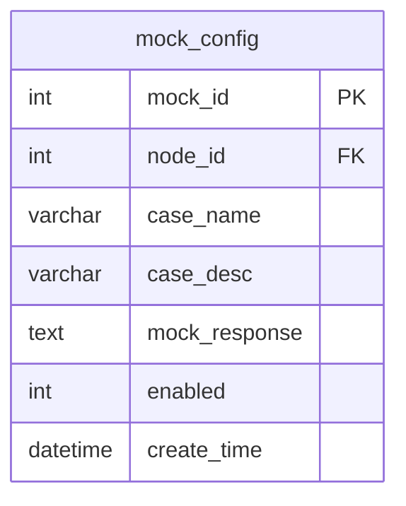
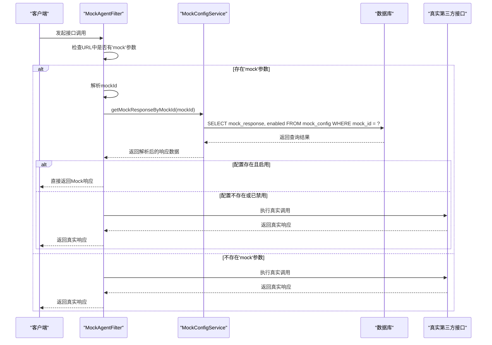

# Mock配置表 (mock_config)

<cite>
**本文档引用文件**  
- [MockConfigDO.java](file://agent-mock/src/main/java/com/helianhealth/agent/mock/model/MockConfigDO.java)
- [MockConfigMapper.java](file://agent-mock/src/main/java/com/helianhealth/agent/mock/mapper/MockConfigMapper.java)
- [MockConfigMapper.xml](file://agent-mock/src/main/resources/mapper/agent/MockConfigMapper.xml)
- [MockConfigService.java](file://agent-mock/src/main/java/com/helianhealth/agent/mock/service/MockConfigService.java)
- [MockConfigServiceImpl.java](file://agent-mock/src/main/java/com/helianhealth/agent/mock/service/impl/MockConfigServiceImpl.java)
- [MockAgentFilter.java](file://agent-invocation/src/main/java/com/helianhealth/agent/invocation/remote/filter/impl/MockAgentFilter.java)
- [WorkFlowNodeBuilder.java](file://agent-schedule/src/main/java/com/helianhealth/agent/schedule/builder/WorkFlowNodeBuilder.java)
- [MockInvokeController.java](file://agent-api/src/main/java/com/helianhealth/agent/api/controller/MockInvokeController.java)
- [mock.js](file://console-ui/src/api/mock.js)
- [MockConfig.vue](file://console-ui/src/views/MockConfig.vue)
- [MockInvokeLog.vue](file://console-ui/src/views/MockInvokeLog.vue)
- [init_mysql.sql](file://doc/init_mysql.sql)
- [query_pacs_report.txt](file://agent-ai/src/main/resources/systemprompt/query_pacs_report.txt)
</cite>

## 目录
1. [简介](#简介)
2. [表结构与字段说明](#表结构与字段说明)
3. [核心功能与使用场景](#核心功能与使用场景)
4. [拦截逻辑与调用流程](#拦截逻辑与调用流程)
5. [医疗影像查询接口Mock配置示例](#医疗影像查询接口mock配置示例)
6. [联调测试中的价值](#联调测试中的价值)

## 简介
`mock_config` 表是系统中用于支持接口Mock功能的核心数据表。它允许开发和测试人员在不依赖真实第三方服务的情况下，模拟任意接口的响应数据。通过在该表中配置特定的Mock规则，系统可以在调用前拦截请求并返回预设的响应体，从而实现对各种业务场景（包括成功、失败、异常等）的全面测试。该机制极大地提升了开发效率和测试覆盖率，特别是在第三方接口不稳定或尚未就绪的阶段。

**Section sources**
- [init_mysql.sql](file://doc/init_mysql.sql#L99-L116)

## 表结构与字段说明
`mock_config` 表存储了所有接口的Mock配置信息，其结构设计简洁而功能完整。



**Diagram sources**
- [init_mysql.sql](file://doc/init_mysql.sql#L99-L116)

### 字段定义

| 字段名 | 类型 | 是否为空 | 默认值 | 描述 |
| :--- | :--- | :--- | :--- | :--- |
| `mock_id` | INT | NOT NULL | AUTO_INCREMENT | **主键ID**：唯一标识一个Mock配置，自增主键。 |
| `node_id` | INT | NOT NULL | - | **关联的节点ID**：该Mock配置所绑定的工作流节点ID，用于确定在哪个接口调用上应用此Mock。 |
| `case_name` | VARCHAR(100) | NOT NULL | - | **场景名称**：描述此Mock配置的业务场景，如“查询成功”、“网络超时”等，便于识别和管理。 |
| `case_desc` | VARCHAR(255) | NULL | - | **场景描述**：对此Mock场景的详细说明，可包含预期行为、测试目的等信息。 |
| `mock_response` | TEXT | NOT NULL | - | **返回的JSON响应体**：以JSON字符串格式存储的模拟响应数据，系统将直接返回此内容。 |
| `enabled` | INT | NOT NULL | 1 | **是否启用**：标识该Mock配置是否生效。1表示启用，0表示禁用。 |
| `create_time` | DATETIME | NOT NULL | NOW() | **创建时间**：记录该Mock配置的创建时间。 |

**Section sources**
- [MockConfigDO.java](file://agent-mock/src/main/java/com/helianhealth/agent/mock/model/MockConfigDO.java#L17-L49)
- [init_mysql.sql](file://doc/init_mysql.sql#L102-L115)

## 核心功能与使用场景
`mock_config` 表的核心功能是为系统中的任意接口工作流节点提供可配置的响应模拟能力。

### 核心功能
1.  **响应模拟**：通过 `mock_response` 字段存储任意JSON格式的响应数据，可以精确模拟第三方接口的各种返回。
2.  **按节点配置**：通过 `node_id` 字段与工作流节点关联，实现对特定接口的精准Mock，不影响其他接口。
3.  **动态启停**：通过 `enabled` 字段控制Mock配置的开关，可以在不重启服务的情况下快速启用或禁用Mock。
4.  **多场景管理**：允许为同一个节点配置多个不同 `case_name` 的Mock，以覆盖不同的业务分支和异常情况。

### 使用场景
- **开发阶段**：当第三方接口文档已定但服务尚未提供时，前端和后端开发人员可以基于Mock数据并行开发。
- **单元测试**：为业务逻辑编写单元测试时，使用Mock数据隔离外部依赖，确保测试的稳定性和可重复性。
- **集成测试**：在集成环境中，模拟各种边界条件和错误码，验证系统的容错和降级能力。
- **性能测试**：模拟大体积响应数据，测试系统在高负载下的处理性能。
- **演示环境**：为演示系统提供稳定、可控的“假数据”，避免因真实数据变动或接口不可用而影响演示效果。

**Section sources**
- [MockConfigService.java](file://agent-mock/src/main/java/com/helianhealth/agent/mock/service/MockConfigService.java#L12-L65)
- [MockConfigServiceImpl.java](file://agent-mock/src/main/java/com/helianhealth/agent/mock/service/impl/MockConfigServiceImpl.java#L23-L124)

## 拦截逻辑与调用流程
系统通过 `MockAgentFilter` 过滤器实现对真实调用的拦截，其逻辑严谨且高效。

### 拦截逻辑
1.  **触发条件**：当且仅当工作流节点的URL参数中包含 `mock` 键时，才会触发Mock逻辑。
2.  **ID解析**：从URL参数中提取 `mock` 的值，并尝试将其解析为 `mock_id`。
3.  **服务调用**：调用 `MockConfigService.getMockResponseByMockId(mockId)` 方法，根据 `mock_id` 查询数据库。
4.  **条件判断**：如果查询到的Mock配置存在且 `enabled=1`，则将其 `mock_response` 字段解析为Map对象并直接返回。
5.  **放行调用**：如果未满足上述条件（无mock参数、ID无效、配置不存在或已禁用），则放行请求，执行真实的远程调用。



**Diagram sources**
- [MockAgentFilter.java](file://agent-invocation/src/main/java/com/helianhealth/agent/invocation/remote/filter/impl/MockAgentFilter.java#L34-L57)
- [MockConfigServiceImpl.java](file://agent-mock/src/main/java/com/helianhealth/agent/mock/service/impl/MockConfigServiceImpl.java#L54-L73)

### 关键代码路径
- **过滤器入口**：`MockAgentFilter.doInvoke()` 方法是整个拦截逻辑的入口。
- **服务层查询**：`MockConfigServiceImpl.getMockResponseByMockId()` 方法负责与数据库交互，获取并解析Mock响应。
- **Mapper层SQL**：`MockConfigMapper.xml` 中的 `selectById` SQL语句执行具体的数据库查询。

**Section sources**
- [MockAgentFilter.java](file://agent-invocation/src/main/java/com/helianhealth/agent/invocation/remote/filter/impl/MockAgentFilter.java#L18-L77)
- [MockConfigServiceImpl.java](file://agent-mock/src/main/java/com/helianhealth/agent/mock/service/impl/MockConfigServiceImpl.java#L54-L73)
- [MockConfigMapper.xml](file://agent-mock/src/main/resources/mapper/agent/MockConfigMapper.xml#L33-L39)

## 医疗影像查询接口Mock配置示例
以医疗影像PACS报告查询接口为例，展示如何利用 `mock_config` 表进行Mock配置。

### 场景一：模拟成功响应
假设需要模拟查询成功并返回报告的场景。

- **node_id**: `1001` (PACS查询节点的ID)
- **case_name**: "查询成功"
- **case_desc**: "模拟PACS系统正常返回报告数据"
- **mock_response**:
```json
{
  "code": "200",
  "message": "成功",
  "rsp": [
    {
      "serviceProviderType": "PACS",
      "patientCode": "25111000116",
      "applyNo": "80000186281",
      "examTime": "2025-11-18 11:33:49",
      "examDoctor": "邹茸茸",
      "impressionValue": "甲状腺左侧叶见囊性及低回声结节。",
      "fileUrl": "http://mock-server/report.pdf",
      "fileType": "pdf"
    }
  ]
}
```
- **enabled**: `1`

### 场景二：模拟失败响应
假设需要模拟PACS系统繁忙，返回错误码的场景。

- **node_id**: `1001`
- **case_name**: "系统繁忙"
- **case_desc**: "模拟PACS系统返回503错误"
- **mock_response**:
```json
{
  "code": "503",
  "message": "系统繁忙，请稍后再试",
  "rsp": []
}
```
- **enabled**: `1`

### 调用方式
要触发上述Mock，只需在调用接口的URL中添加 `?mock=1` 或 `?mock=2` (假设1和2分别是两个Mock配置的ID)。系统将自动拦截请求并返回对应的Mock响应，而不会真正访问PACS系统。

**Section sources**
- [query_pacs_report.txt](file://agent-ai/src/main/resources/systemprompt/query_pacs_report.txt#L15-L36)
- [MockInvokeController.java](file://agent-api/src/main/java/com/helianhealth/agent/api/controller/MockInvokeController.java#L38-L70)

## 联调测试中的价值
`mock_config` 表在联调测试中扮演着至关重要的角色，其价值体现在多个方面：

1.  **解耦依赖，加速进度**：在与第三方系统联调时，对方环境可能不稳定或排期紧张。通过Mock，我方可以独立进行全流程测试，不受外部因素制约，显著加快项目进度。
2.  **覆盖极端场景**：真实环境中很难复现网络超时、服务宕机、特定错误码等异常情况。通过配置Mock，可以轻松模拟这些场景，全面验证我方系统的健壮性和用户体验。
3.  **数据安全与隐私**：避免在测试环境中使用真实的患者数据，通过Mock提供符合格式的假数据，有效保护患者隐私，符合数据安全规范。
4.  **降低测试成本**：减少对第三方服务的无效调用，避免产生不必要的费用（如按调用次数计费的API）。
5.  **提升测试效率**：前端开发人员可以基于稳定的Mock数据快速验证UI和交互逻辑，无需等待后端或第三方接口的联调。

综上所述，`mock_config` 表是支撑系统敏捷开发和高质量交付的关键基础设施，它通过提供灵活、可控的接口模拟能力，极大地增强了系统的可测试性和开发效率。

**Section sources**
- [MockInvokeLog.vue](file://console-ui/src/views/MockInvokeLog.vue#L126-L166)
- [MockConfig.vue](file://console-ui/src/views/MockConfig.vue#L176-L212)
- [mock.js](file://console-ui/src/api/mock.js#L76-L89)