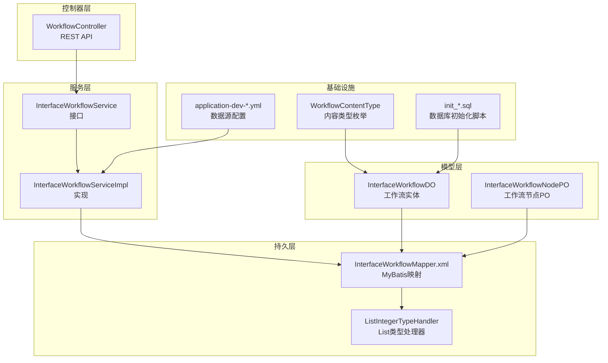
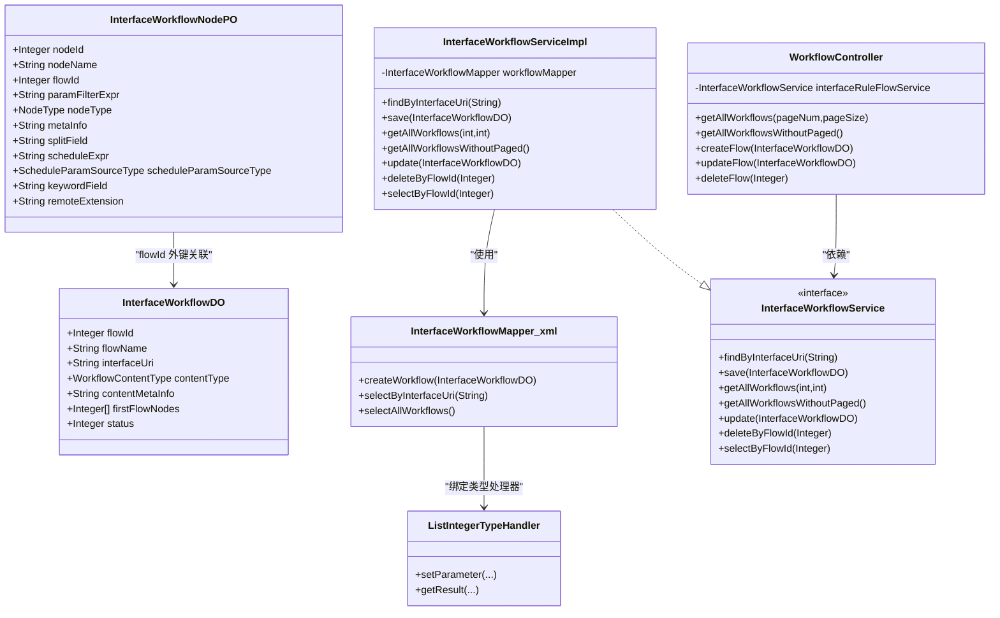
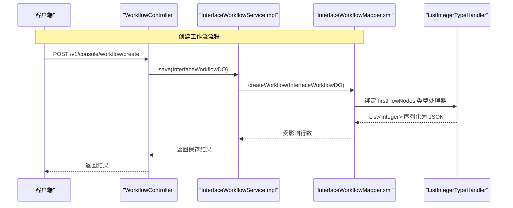
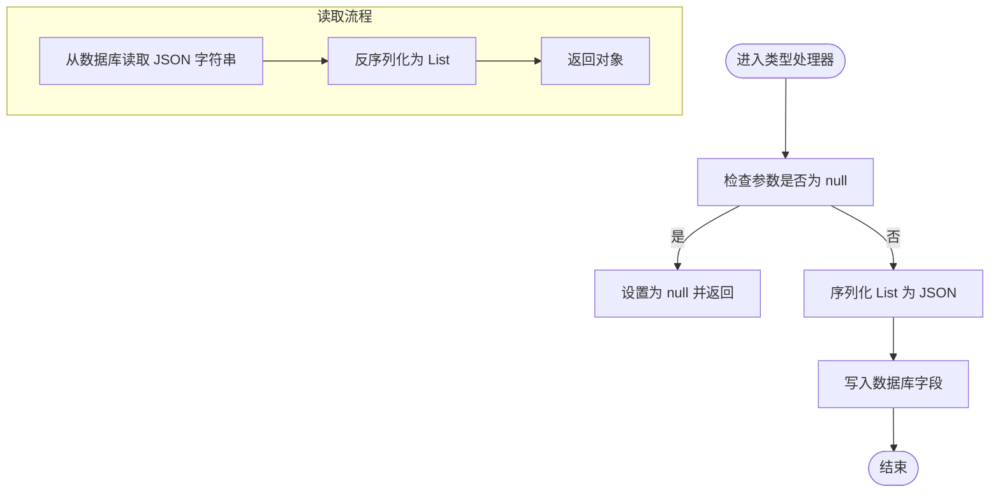
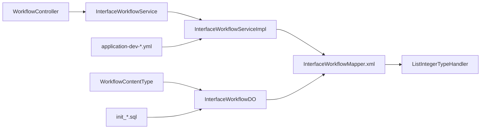

# 工作流主表 (interface_workflow)

<cite>
**本文引用的文件**
- [InterfaceWorkflowDO.java](file://agent-workflow/src/main/java/com/helianhealth/agent/workflow/model/domain/InterfaceWorkflowDO.java)
- [InterfaceWorkflowNodePO.java](file://agent-workflow/src/main/java/com/helianhealth/agent/workflow/model/po/InterfaceWorkflowNodePO.java)
- [WorkflowController.java](file://agent-workflow/src/main/java/com/helianhealth/agent/workflow/controller/WorkflowController.java)
- [InterfaceWorkflowService.java](file://agent-workflow/src/main/java/com/helianhealth/agent/workflow/service/InterfaceWorkflowService.java)
- [InterfaceWorkflowServiceImpl.java](file://agent-workflow/src/main/java/com/helianhealth/agent/workflow/service/impl/InterfaceWorkflowServiceImpl.java)
- [InterfaceWorkflowMapper.xml](file://agent-workflow/src/main/resources/mapper/agent/InterfaceWorkflowMapper.xml)
- [ListIntegerTypeHandler.java](file://agent-workflow/src/main/java/com/helianhealth/agent/workflow/config/ListIntegerTypeHandler.java)
- [WorkflowContentType.java](file://agent-common/src/main/java/com/helianhealth/agent/common/enums/WorkflowContentType.java)
- [init_mysql.sql](file://doc/init_mysql.sql)
- [init_sqlserver.sql](file://doc/init_sqlserver.sql)
- [init_gauss.sql](file://doc/init_gauss.sql)
- [application-dev-mysql.yml](file://agent-web/src/main/resources/application-dev-mysql.yml)
</cite>

## 目录
1. [简介](#简介)
2. [项目结构](#项目结构)
3. [核心组件](#核心组件)
4. [架构总览](#架构总览)
5. [详细组件分析](#详细组件分析)
6. [依赖关系分析](#依赖关系分析)
7. [性能考量](#性能考量)
8. [故障排查指南](#故障排查指南)
9. [结论](#结论)

## 简介
本文件聚焦于系统核心元数据表 interface_workflow 的结构与业务含义，详细说明其字段定义、取值约束、与工作流节点表的关联关系，以及在不同数据库（MySQL、SQL Server、GaussDB）上的建表差异。同时结合 WorkflowController 与 InterfaceWorkflowService 的代码逻辑，阐述该表在工作流创建、更新与查询过程中的使用方式，并提供跨数据库迁移与兼容性建议。

## 项目结构
围绕 interface_workflow 表的关键代码与资源分布如下：
- 数据模型层：实体类与持久化对象定义
- 服务层：工作流服务接口与实现
- 控制器层：对外提供的 REST API
- 持久层：MyBatis 映射 XML 与类型处理器
- 初始化脚本：针对 MySQL、SQL Server、GaussDB 的建表 SQL
- 配置文件：数据库连接与方言配置

图表来源
- [InterfaceWorkflowDO.java](file://agent-workflow/src/main/java/com/helianhealth/agent/workflow/model/domain/InterfaceWorkflowDO.java#L28-L72)
- [InterfaceWorkflowNodePO.java](file://agent-workflow/src/main/java/com/helianhealth/agent/workflow/model/po/InterfaceWorkflowNodePO.java#L25-L43)
- [WorkflowController.java](file://agent-workflow/src/main/java/com/helianhealth/agent/workflow/controller/WorkflowController.java#L24-L102)
- [InterfaceWorkflowService.java](file://agent-workflow/src/main/java/com/helianhealth/agent/workflow/service/InterfaceWorkflowService.java#L9-L24)
- [InterfaceWorkflowServiceImpl.java](file://agent-workflow/src/main/java/com/helianhealth/agent/workflow/service/impl/InterfaceWorkflowServiceImpl.java#L16-L89)
- [InterfaceWorkflowMapper.xml](file://agent-workflow/src/main/resources/mapper/agent/InterfaceWorkflowMapper.xml#L6-L53)
- [ListIntegerTypeHandler.java](file://agent-workflow/src/main/java/com/helianhealth/agent/workflow/config/ListIntegerTypeHandler.java#L14-L79)
- [WorkflowContentType.java](file://agent-common/src/main/java/com/helianhealth/agent/common/enums/WorkflowContentType.java#L8-L14)
- [init_mysql.sql](file://doc/init_mysql.sql#L4-L18)
- [init_sqlserver.sql](file://doc/init_sqlserver.sql#L2-L18)
- [init_gauss.sql](file://doc/init_gauss.sql#L2-L17)
- [application-dev-mysql.yml](file://agent-web/src/main/resources/application-dev-mysql.yml#L4-L34)

章节来源
- [InterfaceWorkflowDO.java](file://agent-workflow/src/main/java/com/helianhealth/agent/workflow/model/domain/InterfaceWorkflowDO.java#L21-L72)
- [InterfaceWorkflowMapper.xml](file://agent-workflow/src/main/resources/mapper/agent/InterfaceWorkflowMapper.xml#L6-L53)

## 核心组件
- 工作流实体：定义了 interface_workflow 的字段、类型与约束，包括主键、名称、对外 API 路径、请求内容类型、内容元信息、首节点列表、状态等。
- MyBatis 映射：通过 XML 定义查询与插入语句，并为首节点列表字段绑定自定义类型处理器。
- 类型处理器：将 List<Integer> 序列化为 JSON 存储，读取时反序列化为对象。
- 服务接口与实现：提供按 URI 查询、分页查询、保存、更新、删除、按主键查询等能力。
- 控制器：提供 REST API，支持创建、更新、删除、分页查询与无分页查询。
- 内容类型枚举：定义 content_type 的取值范围（JSON、XML）。
- 初始化脚本：分别给出 MySQL、SQL Server、GaussDB 的建表语句，体现各数据库自增主键语法差异。

章节来源
- [InterfaceWorkflowDO.java](file://agent-workflow/src/main/java/com/helianhealth/agent/workflow/model/domain/InterfaceWorkflowDO.java#L31-L72)
- [InterfaceWorkflowMapper.xml](file://agent-workflow/src/main/resources/mapper/agent/InterfaceWorkflowMapper.xml#L21-L48)
- [ListIntegerTypeHandler.java](file://agent-workflow/src/main/java/com/helianhealth/agent/workflow/config/ListIntegerTypeHandler.java#L14-L79)
- [InterfaceWorkflowService.java](file://agent-workflow/src/main/java/com/helianhealth/agent/workflow/service/InterfaceWorkflowService.java#L11-L23)
- [WorkflowController.java](file://agent-workflow/src/main/java/com/helianhealth/agent/workflow/controller/WorkflowController.java#L35-L102)
- [WorkflowContentType.java](file://agent-common/src/main/java/com/helianhealth/agent/common/enums/WorkflowContentType.java#L9-L14)
- [init_mysql.sql](file://doc/init_mysql.sql#L4-L18)
- [init_sqlserver.sql](file://doc/init_sqlserver.sql#L2-L18)
- [init_gauss.sql](file://doc/init_gauss.sql#L2-L17)

## 架构总览
下面的类图展示了与 interface_workflow 直接相关的类与关系，包括实体、映射、类型处理器与服务层。

图表来源
- [InterfaceWorkflowDO.java](file://agent-workflow/src/main/java/com/helianhealth/agent/workflow/model/domain/InterfaceWorkflowDO.java#L28-L72)
- [InterfaceWorkflowNodePO.java](file://agent-workflow/src/main/java/com/helianhealth/agent/workflow/model/po/InterfaceWorkflowNodePO.java#L25-L98)
- [InterfaceWorkflowMapper.xml](file://agent-workflow/src/main/resources/mapper/agent/InterfaceWorkflowMapper.xml#L6-L19)
- [ListIntegerTypeHandler.java](file://agent-workflow/src/main/java/com/helianhealth/agent/workflow/config/ListIntegerTypeHandler.java#L14-L79)
- [InterfaceWorkflowService.java](file://agent-workflow/src/main/java/com/helianhealth/agent/workflow/service/InterfaceWorkflowService.java#L9-L24)
- [InterfaceWorkflowServiceImpl.java](file://agent-workflow/src/main/java/com/helianhealth/agent/workflow/service/impl/InterfaceWorkflowServiceImpl.java#L16-L89)
- [WorkflowController.java](file://agent-workflow/src/main/java/com/helianhealth/agent/workflow/controller/WorkflowController.java#L24-L102)

## 详细组件分析

### 表结构与字段定义
- flow_id：主键，自增，非空且不可更新。在不同数据库上采用不同的自增语法：
  - MySQL：AUTO_INCREMENT
  - SQL Server：IDENTITY(1,1)
  - GaussDB：SERIAL
- flow_name：工作流名称，描述性字段，允许为空。
- interface_uri：对外暴露的 API 路由，与工作流一一对应，允许为空。
- content_type：请求内容类型，枚举值来自 WorkflowContentType（JSON、XML）。
- content_meta_info：内容元信息，用于描述请求参数结构或校验规则等。
- first_flow_nodes：工作流首节点 ID 列表，采用自定义类型处理器将 List<Integer> 序列化为 JSON 存储。
- status：启用状态，1 表示启用，0 表示禁用，默认启用。

章节来源
- [InterfaceWorkflowDO.java](file://agent-workflow/src/main/java/com/helianhealth/agent/workflow/model/domain/InterfaceWorkflowDO.java#L31-L72)
- [WorkflowContentType.java](file://agent-common/src/main/java/com/helianhealth/agent/common/enums/WorkflowContentType.java#L9-L14)
- [InterfaceWorkflowMapper.xml](file://agent-workflow/src/main/resources/mapper/agent/InterfaceWorkflowMapper.xml#L12-L16)
- [ListIntegerTypeHandler.java](file://agent-workflow/src/main/java/com/helianhealth/agent/workflow/config/ListIntegerTypeHandler.java#L16-L28)
- [init_mysql.sql](file://doc/init_mysql.sql#L5-L18)
- [init_sqlserver.sql](file://doc/init_sqlserver.sql#L4-L17)
- [init_gauss.sql](file://doc/init_gauss.sql#L4-L17)

### 与工作流节点表的关联关系
- 关系性质：interface_workflow 与 interface_workflow_node 为 1:N 关系，即一个工作流可包含多个节点。
- 外键约束：节点表中的 flow_id 指向工作流表的 flow_id。
- 业务意义：工作流定义了全局配置与入口，节点定义了具体执行步骤；首节点列表 first_flow_nodes 用于快速定位工作流的起始执行点。

章节来源
- [InterfaceWorkflowNodePO.java](file://agent-workflow/src/main/java/com/helianhealth/agent/workflow/model/po/InterfaceWorkflowNodePO.java#L42-L43)
- [InterfaceWorkflowDO.java](file://agent-workflow/src/main/java/com/helianhealth/agent/workflow/model/domain/InterfaceWorkflowDO.java#L64-L66)

### 在不同数据库上的建表差异
- 自增主键语法：
  - MySQL：flow_id INT NOT NULL AUTO_INCREMENT PRIMARY KEY
  - SQL Server：flow_id INT NOT NULL IDENTITY(1,1) PRIMARY KEY
  - GaussDB：flow_id SERIAL PRIMARY KEY
- 字段类型与长度：
  - MySQL 使用 VARCHAR/INT 等标准类型
  - SQL Server 对部分字段使用 NVARCHAR/INT IDENTITY 等
  - GaussDB 使用 VARCHAR/INTEGER/SERIAL 等类型
- 默认值与时间戳：
  - MySQL 使用 DEFAULT 1 或 NOW()
  - SQL Server 使用 DEFAULT GETDATE()
  - GaussDB 使用 DEFAULT CURRENT_TIMESTAMP

章节来源
- [init_mysql.sql](file://doc/init_mysql.sql#L4-L18)
- [init_sqlserver.sql](file://doc/init_sqlserver.sql#L2-L18)
- [init_gauss.sql](file://doc/init_gauss.sql#L2-L17)

### 在工作流创建、更新与查询中的使用方式
- 创建工作流：
  - 控制器接收请求体中的 InterfaceWorkflowDO，调用服务层 save 方法
  - 服务层调用 Mapper 的 createWorkflow 插入记录，返回受影响行数
  - 首节点列表通过类型处理器序列化为 JSON 存储
- 更新工作流：
  - 控制器接收请求体中的 InterfaceWorkflowDO，调用服务层 update 方法
  - 服务层调用 Mapper 的选择性更新方法，仅更新传入字段
- 查询工作流：
  - 分页查询：服务层使用分页插件，Mapper 查询 status=1 的记录
  - 无分页查询：直接查询 status=1 的所有记录
  - 按 URI 查询：根据 interface_uri 与 status=1 返回唯一记录
  - 按主键查询：根据 flow_id 查询记录

图表来源
- [WorkflowController.java](file://agent-workflow/src/main/java/com/helianhealth/agent/workflow/controller/WorkflowController.java#L65-L74)
- [InterfaceWorkflowServiceImpl.java](file://agent-workflow/src/main/java/com/helianhealth/agent/workflow/service/impl/InterfaceWorkflowServiceImpl.java#L29-L35)
- [InterfaceWorkflowMapper.xml](file://agent-workflow/src/main/resources/mapper/agent/InterfaceWorkflowMapper.xml#L21-L41)
- [ListIntegerTypeHandler.java](file://agent-workflow/src/main/java/com/helianhealth/agent/workflow/config/ListIntegerTypeHandler.java#L16-L28)

章节来源
- [WorkflowController.java](file://agent-workflow/src/main/java/com/helianhealth/agent/workflow/controller/WorkflowController.java#L35-L102)
- [InterfaceWorkflowServiceImpl.java](file://agent-workflow/src/main/java/com/helianhealth/agent/workflow/service/impl/InterfaceWorkflowServiceImpl.java#L23-L88)
- [InterfaceWorkflowMapper.xml](file://agent-workflow/src/main/resources/mapper/agent/InterfaceWorkflowMapper.xml#L21-L53)

### 首节点列表字段的序列化与反序列化
- 存储策略：通过自定义类型处理器将 List<Integer> 序列化为 JSON 字符串存入数据库
- 读取策略：从数据库读取 JSON 字符串后反序列化为 List<Integer>
- 异常处理：序列化/反序列化失败时抛出 SQL 异常，便于定位问题

图表来源
- [ListIntegerTypeHandler.java](file://agent-workflow/src/main/java/com/helianhealth/agent/workflow/config/ListIntegerTypeHandler.java#L16-L79)

章节来源
- [ListIntegerTypeHandler.java](file://agent-workflow/src/main/java/com/helianhealth/agent/workflow/config/ListIntegerTypeHandler.java#L14-L79)
- [InterfaceWorkflowMapper.xml](file://agent-workflow/src/main/resources/mapper/agent/InterfaceWorkflowMapper.xml#L12-L16)

## 依赖关系分析
- 控制器依赖服务接口，实现松耦合
- 服务实现依赖 Mapper，Mapper 依赖类型处理器
- 实体类与枚举类型共同决定字段取值范围与约束
- 初始化脚本与数据源配置确保不同数据库环境的一致行为

图表来源
- [WorkflowController.java](file://agent-workflow/src/main/java/com/helianhealth/agent/workflow/controller/WorkflowController.java#L24-L102)
- [InterfaceWorkflowService.java](file://agent-workflow/src/main/java/com/helianhealth/agent/workflow/service/InterfaceWorkflowService.java#L9-L24)
- [InterfaceWorkflowServiceImpl.java](file://agent-workflow/src/main/java/com/helianhealth/agent/workflow/service/impl/InterfaceWorkflowServiceImpl.java#L16-L89)
- [InterfaceWorkflowMapper.xml](file://agent-workflow/src/main/resources/mapper/agent/InterfaceWorkflowMapper.xml#L6-L19)
- [ListIntegerTypeHandler.java](file://agent-workflow/src/main/java/com/helianhealth/agent/workflow/config/ListIntegerTypeHandler.java#L14-L79)
- [InterfaceWorkflowDO.java](file://agent-workflow/src/main/java/com/helianhealth/agent/workflow/model/domain/InterfaceWorkflowDO.java#L28-L72)
- [WorkflowContentType.java](file://agent-common/src/main/java/com/helianhealth/agent/common/enums/WorkflowContentType.java#L9-L14)
- [init_mysql.sql](file://doc/init_mysql.sql#L4-L18)
- [application-dev-mysql.yml](file://agent-web/src/main/resources/application-dev-mysql.yml#L4-L34)

章节来源
- [WorkflowController.java](file://agent-workflow/src/main/java/com/helianhealth/agent/workflow/controller/WorkflowController.java#L24-L102)
- [InterfaceWorkflowServiceImpl.java](file://agent-workflow/src/main/java/com/helianhealth/agent/workflow/service/impl/InterfaceWorkflowServiceImpl.java#L16-L89)
- [InterfaceWorkflowMapper.xml](file://agent-workflow/src/main/resources/mapper/agent/InterfaceWorkflowMapper.xml#L6-L53)

## 性能考量
- 首节点列表采用 JSON 存储，便于灵活扩展但查询条件受限，建议在业务允许范围内限制列表长度
- 分页查询使用分页插件，避免一次性加载大量数据
- Mapper 中对 status=1 的过滤可利用索引提升查询效率
- 自定义类型处理器在序列化/反序列化过程中有额外开销，建议在批量导入/导出场景中进行性能评估

## 故障排查指南
- 首节点列表解析异常：检查 JSON 格式是否正确，确认类型处理器是否生效
- 自增主键冲突：确认数据库方言与建表脚本一致，避免手动插入自增字段
- 查询不到记录：确认 status 字段是否为 1，接口 URI 是否匹配
- 数据库方言不匹配：核对 application-dev-*.yml 中的方言配置与实际数据库一致

章节来源
- [ListIntegerTypeHandler.java](file://agent-workflow/src/main/java/com/helianhealth/agent/workflow/config/ListIntegerTypeHandler.java#L69-L79)
- [InterfaceWorkflowMapper.xml](file://agent-workflow/src/main/resources/mapper/agent/InterfaceWorkflowMapper.xml#L43-L53)
- [application-dev-mysql.yml](file://agent-web/src/main/resources/application-dev-mysql.yml#L32-L34)

## 结论
interface_workflow 是系统工作流配置的核心元数据表，承载了工作流的全局属性与入口信息。通过 MyBatis 类型处理器实现了复杂字段的序列化存储，配合服务层与控制器提供了完整的 CRUD 能力。在多数据库环境下，需注意自增主键语法差异与方言配置，确保初始化脚本与运行时配置一致。建议在生产环境中为常用查询字段建立索引，并对首节点列表的长度与结构进行约束，以提升查询性能与维护性。