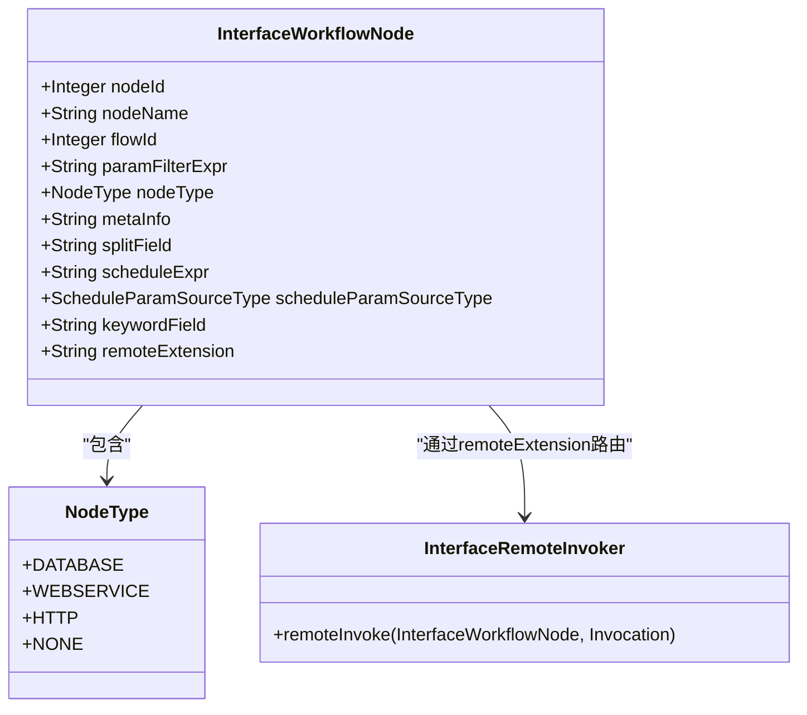
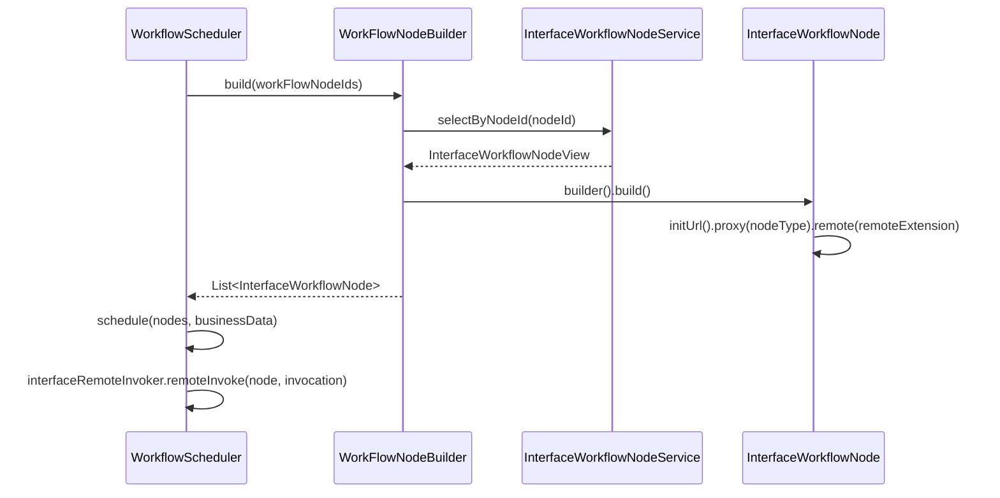

# 工作流节点表 (interface_workflow_node)

<cite>
**本文档引用文件**  
- [interface_workflow_node](file://doc/init_mysql.sql#L22-L45)
- [InterfaceWorkflowNode.java](file://agent-invocation/src/main/java/com/helianhealth/agent/invocation/remote/model/InterfaceWorkflowNode.java)
- [InterfaceWorkflowNodePO.java](file://agent-workflow/src/main/java/com/helianhealth/agent/workflow/model/po/InterfaceWorkflowNodePO.java)
- [WorkFlowNodeBuilder.java](file://agent-schedule/src/main/java/com/helianhealth/agent/schedule/builder/WorkFlowNodeBuilder.java)
- [WorkflowScheduler.java](file://agent-schedule/src/main/java/com/helianhealth/agent/schedule/WorkflowScheduler.java)
- [NodeType.java](file://agent-common/src/main/java/com/helianhealth/agent/common/enums/NodeType.java)
- [ScheduleParamSourceType.java](file://agent-common/src/main/java/com/helianhealth/agent/common/enums/ScheduleParamSourceType.java)
- [InterfaceWorkflowNodeService.java](file://agent-workflow/src/main/java/com/helianhealth/agent/workflow/service/InterfaceWorkflowNodeService.java)
- [InterfaceWorkflowNodeView.java](file://agent-workflow/src/main/java/com/helianhealth/agent/workflow/controller/reponse/InterfaceWorkflowNodeView.java)
</cite>

## 目录
1. [简介](#简介)
2. [表结构与字段详解](#表结构与字段详解)
3. [核心字段协同机制](#核心字段协同机制)
4. [节点配置加载流程](#节点配置加载流程)
5. [实际配置示例](#实际配置示例)
6. [总结](#总结)

## 简介
`interface_workflow_node` 表是工作流调度系统的核心数据表，用于存储工作流中每个节点的详细配置信息。该表定义了节点的类型、执行方式、调度策略以及扩展机制，是整个工作流引擎执行调度任务的依据。通过该表的配置，系统能够动态构建并执行复杂的工作流逻辑。

**表作用概述**  
- 存储工作流中每个节点的元数据和执行配置
- 支持多种协议类型的节点（HTTP、数据库、WebService等）
- 提供灵活的调度表达式和参数来源配置
- 实现基于SPI机制的协议扩展能力

## 表结构与字段详解

`interface_workflow_node` 表在不同数据库中的定义略有差异，但核心字段保持一致。以下是基于MySQL初始化脚本的完整结构：

```sql
CREATE TABLE `interface_workflow_node` (
    `node_id` INT NOT NULL AUTO_INCREMENT PRIMARY KEY,
    `node_name` VARCHAR(100) NULL,
    `flow_id` INT NULL,
    `param_filter_expr` VARCHAR(255) NULL,
    `node_type` VARCHAR(50) NOT NULL,
    `meta_info` TEXT NULL,
    `schedule_expr` VARCHAR(255) NULL,
    `schedule_param_source_type` VARCHAR(25) NULL,
    `split_field` VARCHAR(50) NULL,
    `keyword_field` VARCHAR(50) NULL,
    `remote_extension` VARCHAR(100) NULL
);
```

### 字段详细说明

| 字段名 | 类型 | 是否必填 | 说明 |
|-------|------|---------|------|
| **node_id** | INT | 是 | 节点主键，自增唯一标识 |
| **node_name** | VARCHAR(100) | 否 | 节点名称，用于描述节点功能 |
| **flow_id** | INT | 否 | 所属工作流ID，关联`interface_workflow`表 |
| **param_filter_expr** | VARCHAR(255) | 否 | 参数预处理表达式，用于过滤输入参数 |
| **node_type** | VARCHAR(50) | 是 | 节点类型，枚举值：HTTP、DATABASE、WEBSERVICE、NONE |
| **meta_info** | TEXT | 否 | 节点元数据，JSON格式存储调用地址、认证信息等 |
| **schedule_expr** | VARCHAR(255) | 否 | Quartz调度表达式，控制节点执行时机 |
| **schedule_param_source_type** | VARCHAR(25) | 否 | 调度参数来源：ORIGINAL（原始入参）、PRE_RESPONSE（上个节点响应） |
| **split_field** | VARCHAR(50) | 否 | 数据拆分字段，用于将列表数据拆分为多个单个对象处理 |
| **keyword_field** | VARCHAR(50) | 否 | 关键字字段，通常为`patientCode`，用于业务数据匹配 |
| **remote_extension** | VARCHAR(100) | 否 | SPI扩展标识，用于Dubbo SPI机制的扩展点路由 |

**Section sources**
- [init_mysql.sql](file://doc/init_mysql.sql#L22-L45)
- [InterfaceWorkflowNodePO.java](file://agent-workflow/src/main/java/com/helianhealth/agent/workflow/model/po/InterfaceWorkflowNodePO.java#L26-L98)

## 核心字段协同机制

### node_type 与 remote_extension 的协同工作

`node_type` 和 `remote_extension` 字段共同实现了系统的协议扩展性，其协同机制如下：



**Diagram sources**
- [InterfaceWorkflowNode.java](file://agent-invocation/src/main/java/com/helianhealth/agent/invocation/remote/model/InterfaceWorkflowNode.java#L17-L75)
- [NodeType.java](file://agent-common/src/main/java/com/helianhealth/agent/common/enums/NodeType.java#L9-L28)

#### 协同机制说明

1. **node_type 字段作用**  
   - 定义节点的基本类型，决定默认的调用协议
   - 作为Dubbo SPI的默认扩展名（如`http`、`database`）
   - 控制前端展示和基本行为

2. **remote_extension 字段作用**  
   - 覆盖默认的SPI扩展名，实现自定义协议扩展
   - 支持在线代码扩展和项目级扩展
   - 通过`node_extension_config`表进行管理

3. **协同工作流程**  
   - 当`remote_extension`为空时，使用`node_type`作为SPI扩展名
   - 当`remote_extension`有值时，优先使用该值作为SPI扩展名
   - 系统通过Dubbo的`ExtensionLoader`根据扩展名加载对应的`InterfaceRemoteInvoker`实现

**Section sources**
- [InterfaceWorkflowNode.java](file://agent-invocation/src/main/java/com/helianhealth/agent/invocation/remote/model/InterfaceWorkflowNode.java)
- [NodeType.java](file://agent-common/src/main/java/com/helianhealth/agent/common/enums/NodeType.java)

## 节点配置加载流程

### 配置加载与任务转化

`WorkFlowNodeBuilder` 和 `WorkflowScheduler` 协同工作，将数据库中的节点配置转化为可执行任务：



**Diagram sources**
- [WorkFlowNodeBuilder.java](file://agent-schedule/src/main/java/com/helianhealth/agent/schedule/builder/WorkFlowNodeBuilder.java#L16-L101)
- [WorkflowScheduler.java](file://agent-schedule/src/main/java/com/helianhealth/agent/schedule/WorkflowScheduler.java#L40-L276)

### 加载流程详解

1. **节点构建阶段** (`WorkFlowNodeBuilder`)
   - 根据节点ID列表从数据库查询节点配置
   - 将`InterfaceWorkflowNodeView`转换为`InterfaceWorkflowNode`对象
   - 初始化URL配置，设置代理类型和远程扩展标识

2. **任务调度阶段** (`WorkflowScheduler`)
   - 接收构建好的节点列表和业务数据
   - 根据节点数量决定单节点或并行处理
   - 构建`Invocation`对象，包含前置和后置参数配置
   - 通过Dubbo SPI机制调用对应的`InterfaceRemoteInvoker`

3. **远程调用阶段**
   - `InterfaceRemoteInvoker`根据`remote_extension`选择具体实现
   - 解析`meta_info`中的JSON配置，获取调用地址、认证信息等
   - 执行实际的远程调用操作

**Section sources**
- [WorkFlowNodeBuilder.java](file://agent-schedule/src/main/java/com/helianhealth/agent/schedule/builder/WorkFlowNodeBuilder.java)
- [WorkflowScheduler.java](file://agent-schedule/src/main/java/com/helianhealth/agent/schedule/WorkflowScheduler.java)

## 实际配置示例

### HTTP节点配置示例

```json
{
  "node_id": 1001,
  "node_name": "患者信息查询",
  "flow_id": 100,
  "node_type": "HTTP",
  "meta_info": "{\"url\":\"https://api.hospital.com/patient\",\"method\":\"GET\",\"headers\":{\"Authorization\":\"Bearer token\"}}",
  "schedule_expr": "0 0/5 * * * ?",
  "schedule_param_source_type": "ORIGINAL",
  "split_field": "",
  "keyword_field": "patientCode",
  "remote_extension": "custom-http"
}
```

### 数据库节点配置示例

```json
{
  "node_id": 1002,
  "node_name": "检查结果写入",
  "flow_id": 100,
  "node_type": "DATABASE",
  "meta_info": "{\"connectionUrl\":\"jdbc:mysql://localhost:3306/his\",\"username\":\"his_user\",\"password\":\"encrypted_password\",\"tableName\":\"exam_results\"}",
  "schedule_expr": "0 0 1 * * ?",
  "schedule_param_source_type": "PRE_RESPONSE",
  "split_field": "results",
  "keyword_field": "patientCode",
  "remote_extension": ""
}
```

### WebService节点配置示例

```json
{
  "node_id": 1003,
  "node_name": "报告上传",
  "flow_id": 100,
  "node_type": "WEBSERVICE",
  "meta_info": "{\"endpoint\":\"http://service.hospital.com/report\",\"soapAction\":\"uploadReport\",\"timeout\":30000}",
  "schedule_expr": "0 0/15 * * * ?",
  "schedule_param_source_type": "ORIGINAL",
  "split_field": "",
  "keyword_field": "patientCode",
  "remote_extension": "secure-webservice"
}
```

**Section sources**
- [InterfaceWorkflowNode.java](file://agent-invocation/src/main/java/com/helianhealth/agent/invocation/remote/model/InterfaceWorkflowNode.java)
- [InterfaceWorkflowNodePO.java](file://agent-workflow/src/main/java/com/helianhealth/agent/workflow/model/po/InterfaceWorkflowNodePO.java)

## 总结

`interface_workflow_node` 表作为工作流系统的核心配置表，通过精心设计的字段结构实现了高度的灵活性和扩展性：

1. **结构化设计**：每个字段都有明确的语义和用途，支持复杂的工作流场景
2. **扩展性机制**：`node_type`与`remote_extension`的协同工作，实现了协议的动态扩展
3. **调度灵活性**：通过`schedule_expr`和`schedule_param_source_type`支持复杂的调度逻辑
4. **数据处理能力**：`split_field`和`keyword_field`支持批量数据处理和业务匹配

该表的设计充分体现了微服务架构下的解耦思想，通过配置驱动的方式实现了业务逻辑与执行机制的分离，为系统的可维护性和可扩展性奠定了坚实基础。

**Section sources**
- [InterfaceWorkflowNode.java](file://agent-invocation/src/main/java/com/helianhealth/agent/invocation/remote/model/InterfaceWorkflowNode.java)
- [WorkFlowNodeBuilder.java](file://agent-schedule/src/main/java/com/helianhealth/agent/schedule/builder/WorkFlowNodeBuilder.java)
- [WorkflowScheduler.java](file://agent-schedule/src/main/java/com/helianhealth/agent/schedule/WorkflowScheduler.java)