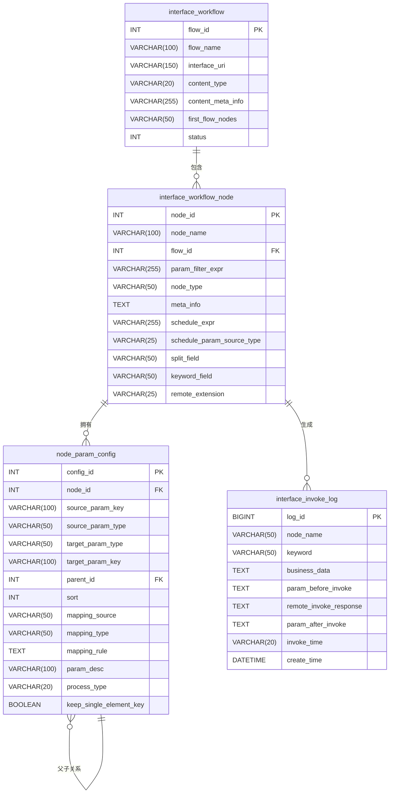

# 数据库设计

<cite>
**本文档引用的文件**  
- [init_mysql.sql](file://doc/init_mysql.sql)
- [init_gauss.sql](file://doc/init_gauss.sql)
- [init_sqlserver.sql](file://doc/init_sqlserver.sql)
- [InterfaceWorkflowMapper.xml](file://agent-workflow/src/main/resources/mapper/agent/InterfaceWorkflowMapper.xml)
- [InterfaceFlowNodeMapper.xml](file://agent-workflow/src/main/resources/mapper/agent/InterfaceFlowNodeMapper.xml)
- [NodeParamConfigMapper.xml](file://agent-workflow/src/main/resources/mapper/agent/NodeParamConfigMapper.xml)
- [InterfaceInvokeLogMapper.xml](file://agent-log/src/main/resources/mapper/agent/InterfaceInvokeLogMapper.xml)
- [InterfaceWorkflowDO.java](file://agent-workflow/src/main/java/com/helianhealth/agent/workflow/model/domain/InterfaceWorkflowDO.java)
- [InterfaceWorkflowNodePO.java](file://agent-workflow/src/main/java/com/helianhealth/agent/workflow/model/po/InterfaceWorkflowNodePO.java)
- [NodeParamConfigDO.java](file://agent-workflow/src/main/java/com/helianhealth/agent/workflow/model/domain/NodeParamConfigDO.java)
- [InterfaceInvokeLogDO.java](file://agent-log/src/main/java/com/helianhealth/agent/log/model/InterfaceInvokeLogDO.java)
- [ParamType.java](file://agent-common/src/main/java/com/helianhealth/agent/common/enums/ParamType.java)
- [ProcessType.java](file://agent-common/src/main/java/com/helianhealth/agent/common/enums/ProcessType.java)
- [NodeType.java](file://agent-common/src/main/java/com/helianhealth/agent/common/enums/NodeType.java)
- [ListIntegerTypeHandler.java](file://agent-workflow/src/main/java/com/helianhealth/agent/workflow/config/ListIntegerTypeHandler.java)
</cite>

## 目录
1. [简介](#简介)
2. [核心表结构](#核心表结构)
3. [表间关系与ER图](#表间关系与er图)
4. [业务规则说明](#业务规则说明)
5. [数据访问模式](#数据访问模式)
6. [示例数据](#示例数据)
7. [数据生命周期与存储策略](#数据生命周期与存储策略)

## 简介
本文档详细描述了接口代理系统的数据库Schema设计。系统支持多种数据库（MySQL、GaussDB、SQL Server），并通过init_*.sql脚本定义了核心数据表结构。核心表包括工作流主表（interface_workflow）、工作流节点表（interface_workflow_node）、节点参数配置表（node_param_config）和调用日志表（interface_invoke_log）。这些表共同构成了接口代理系统的工作流引擎和日志追踪能力。

## 核心表结构

### 工作流主表 (interface_workflow)
该表存储工作流的基本信息，是整个工作流系统的顶层容器。

**字段定义：**

| 字段名 | 数据类型 | 是否为空 | 主外键 | 默认值 | 说明 |
|-------|--------|--------|-------|-------|------|
| flow_id | INT/SERIAL | 否 | 主键 | 自增 | 工作流ID，自增主键 |
| flow_name | VARCHAR(100) | 是 | - | - | 工作流名称 |
| interface_uri | VARCHAR(150) | 是 | - | - | 接口URI，上游系统调用的路由地址 |
| content_type | VARCHAR(20) | 是 | - | - | 接口入参参数类型，如JSON、XML |
| content_meta_info | VARCHAR(255)/NVARCHAR(255) | 是 | - | - | 接口入参元数据信息 |
| first_flow_nodes | VARCHAR(50) | 是 | - | - | 工作流首节点ID列表（逗号分隔的字符串） |
| status | INT/INTEGER | 否 | - | 1 | 状态标识，1-启用，0-禁用 |

**索引与约束：**
- 主键：`flow_id`
- 状态字段默认值：`status` 默认为1（启用）

**Section sources**
- [init_mysql.sql](file://doc/init_mysql.sql#L4-L19)
- [init_gauss.sql](file://doc/init_gauss.sql#L2-L18)
- [init_sqlserver.sql](file://doc/init_sqlserver.sql#L2-L18)
- [InterfaceWorkflowDO.java](file://agent-workflow/src/main/java/com/helianhealth/agent/workflow/model/domain/InterfaceWorkflowDO.java#L29-L73)

### 工作流节点表 (interface_workflow_node)
该表存储工作流中各个节点的配置信息，每个节点代表一个具体的处理步骤。

**字段定义：**

| 字段名 | 数据类型 | 是否为空 | 主外键 | 默认值 | 说明 |
|-------|--------|--------|-------|-------|------|
| node_id | INT/SERIAL | 否 | 主键 | 自增 | 节点ID，自增主键 |
| node_name | VARCHAR(100) | 是 | - | - | 节点名称 |
| flow_id | INT/INTEGER | 是 | 外键 (interface_workflow.flow_id) | - | 所属工作流ID |
| param_filter_expr | VARCHAR(255) | 是 | - | - | 参数预处理表达式 |
| node_type | VARCHAR(50) | 否 | - | - | 节点类型，枚举值（DATABASE, WEBSERVICE, HTTP, NONE） |
| meta_info | TEXT/NVARCHAR(MAX) | 是 | - | - | API实例元数据，JSON格式字符串 |
| schedule_expr | VARCHAR(255) | 是 | - | - | 调度表达式 |
| schedule_param_source_type | VARCHAR(25)/VARCHAR(25) | 是 | - | - | 调度参数来源 |
| split_field | VARCHAR(50) | 是 | - | - | 拆分字段配置 |
| keyword_field | VARCHAR(50) | 是 | - | - | 关键字匹配字段，默认为patientCode |
| remote_extension | VARCHAR(25)/VARCHAR(100) | 是 | - | - | SPI扩展点映射配置，用于Dubbo SPI路由 |

**索引与约束：**
- 主键：`node_id`
- 外键：`flow_id` 引用 `interface_workflow(flow_id)`

**Section sources**
- [init_mysql.sql](file://doc/init_mysql.sql#L22-L45)
- [init_gauss.sql](file://doc/init_gauss.sql#L21-L45)
- [init_sqlserver.sql](file://doc/init_sqlserver.sql#L21-L45)
- [InterfaceWorkflowNodePO.java](file://agent-workflow/src/main/java/com/helianhealth/agent/workflow/model/po/InterfaceWorkflowNodePO.java#L26-L99)

### 节点参数配置表 (node_param_config)
该表存储工作流节点的参数映射配置，支持前置和后置处理。

**字段定义：**

| 字段名 | 数据类型 | 是否为空 | 主外键 | 默认值 | 说明 |
|-------|--------|--------|-------|-------|------|
| config_id | INT/SERIAL | 否 | 主键 | 自增 | 配置ID，自增主键 |
| node_id | INT/INTEGER | 是 | 外键 (interface_workflow_node.node_id) | - | 所属工作流节点ID |
| source_param_key | VARCHAR(100) | 是 | - | - | 上游参数键名 |
| source_param_type | VARCHAR(50) | 是 | - | - | 上游参数类型，枚举值（STRING, INTEGER, OBJECT等） |
| target_param_type | VARCHAR(50) | 是 | - | - | 目标参数类型，枚举值 |
| target_param_key | VARCHAR(100) | 是 | - | - | 目标参数名称 |
| parent_id | INT/INTEGER | 是 | 外键 (node_param_config.config_id) | - | 父节点ID，形成树形结构 |
| sort | INT/INTEGER | 是 | - | 0 | 排序号，控制参数顺序 |
| mapping_source | VARCHAR(50) | 是 | - | - | 映射数据源 |
| mapping_type | VARCHAR(50) | 是 | - | - | 映射规则类型，枚举值 |
| mapping_rule | TEXT/NVARCHAR(MAX) | 是 | - | - | 映射规则内容（固定值、表达式等） |
| param_desc | VARCHAR(100) | 是 | - | - | 参数描述 |
| process_type | VARCHAR(20) | 否 | - | - | 处理类型：PRE_PROCESS（前置）或POST_PROCESS（后置） |
| keep_single_element_key | BIT/BOOLEAN | 是 | - | - | 是否保留单元素键名（仅GaussDB/SQL Server） |

**索引与约束：**
- 主键：`config_id`
- 外键：`node_id` 引用 `interface_workflow_node(node_id)`
- 外键：`parent_id` 引用 `node_param_config(config_id)`，形成父子关系树
- `process_type` 字段不允许为空

**Section sources**
- [init_mysql.sql](file://doc/init_mysql.sql#L48-L75)
- [init_gauss.sql](file://doc/init_gauss.sql#L49-L79)
- [init_sqlserver.sql](file://doc/init_sqlserver.sql#L48-L91)
- [NodeParamConfigDO.java](file://agent-workflow/src/main/java/com/helianhealth/agent/workflow/model/domain/NodeParamConfigDO.java#L28-L124)

### 调用日志表 (interface_invoke_log)
该表记录接口调用的日志信息，用于监控和排查问题。

**字段定义：**

| 字段名 | 数据类型 | 是否为空 | 主外键 | 默认值 | 说明 |
|-------|--------|--------|-------|-------|------|
| log_id | BIGINT/BIGSERIAL | 否 | 主键 | 自增 | 日志ID，自增主键 |
| node_name | INT/VARCHAR(50) | 否 | - | - | 节点名称（MySQL中为INT，其他为VARCHAR） |
| keyword | VARCHAR(50) | 是 | - | - | 业务关键字，默认为patientCode |
| business_data | TEXT/nvarchar(max) | 是 | - | - | 业务数据 |
| param_before_invoke | TEXT/nvarchar(max) | 是 | - | - | 调用前的请求参数 |
| remote_invoke_response | TEXT/nvarchar(max) | 是 | - | - | 远程调用的响应结果 |
| param_after_invoke | TEXT/nvarchar(max) | 是 | - | - | 调用后的响应参数 |
| invoke_time | VARCHAR(20) | 是 | - | - | 调用耗时（单位：毫秒） |
| create_time | DATETIME/TIMESTAMP | 否 | - | CURRENT_TIMESTAMP/GETDATE() | 创建时间 |

**索引与约束：**
- 主键：`log_id`
- `create_time` 字段默认值为当前时间戳

**Section sources**
- [init_mysql.sql](file://doc/init_mysql.sql#L78-L97)
- [init_gauss.sql](file://doc/init_gauss.sql#L83-L103)
- [init_sqlserver.sql](file://doc/init_sqlserver.sql#L93-L113)
- [InterfaceInvokeLogDO.java](file://agent-log/src/main/java/com/helianhealth/agent/log/model/InterfaceInvokeLogDO.java#L23-L80)

## 表间关系与ER图



**Diagram sources**
- [init_mysql.sql](file://doc/init_mysql.sql)
- [init_gauss.sql](file://doc/init_gauss.sql)
- [init_sqlserver.sql](file://doc/init_sqlserver.sql)

## 业务规则说明

### 工作流与节点的关联方式
工作流与节点之间是一对多的关系。`interface_workflow` 表通过 `flow_id` 主键与 `interface_workflow_node` 表的 `flow_id` 外键建立关联。一个工作流可以包含多个节点，这些节点按照预定义的逻辑顺序执行。`interface_workflow` 表中的 `first_flow_nodes` 字段存储了起始节点的ID列表，系统根据此字段确定工作流的入口节点。

### 参数配置的父子关系
`node_param_config` 表通过 `parent_id` 字段实现了参数配置的树形结构。顶级参数配置的 `parent_id` 为 NULL，子参数配置通过 `parent_id` 指向其父配置的 `config_id`。这种设计支持复杂的数据结构映射，例如对象嵌套、数组等。`sort` 字段用于控制同一层级参数的顺序。

### 枚举类型说明
系统使用了多个枚举类型来约束字段值：
- `ParamType`：定义了参数类型，包括STRING、INTEGER、LONG、BOOLEAN、OBJECT、ARRAY、PURE_ARRAY和NONE。
- `ProcessType`：定义了处理类型，包括PRE_PROCESS（前置处理）和POST_PROCESS（后置处理）。
- `NodeType`：定义了节点类型，包括DATABASE、WEBSERVICE、HTTP和NONE。

**Section sources**
- [ParamType.java](file://agent-common/src/main/java/com/helianhealth/agent/common/enums/ParamType.java)
- [ProcessType.java](file://agent-common/src/main/java/com/helianhealth/agent/common/enums/ProcessType.java)
- [NodeType.java](file://agent-common/src/main/java/com/helianhealth/agent/common/enums/NodeType.java)

## 数据访问模式

### MyBatis Mapper XML说明
系统使用MyBatis作为ORM框架，通过XML文件定义SQL映射。

#### 工作流Mapper (InterfaceWorkflowMapper.xml)
- **resultMap**: `BaseResultMap` 将数据库字段映射到 `InterfaceWorkflowDO` 对象。
- **insert**: `createWorkflow` 方法插入新的工作流记录，并使用 `useGeneratedKeys="true"` 获取自增主键。
- **select**: `selectByInterfaceUri` 根据接口URI查询启用的工作流，`selectAllWorkflows` 查询所有启用的工作流。

#### 节点Mapper (InterfaceFlowNodeMapper.xml)
- **resultMap**: `InterfaceFlowNodeResultMap` 将数据库字段映射到 `InterfaceWorkflowNodePO` 对象。
- **insert**: `createNode` 方法使用动态SQL插入节点，仅插入非空字段。
- **select**: `selectByNodeId` 根据节点ID查询，`selectAllNodes` 根据工作流ID查询所有节点。
- **update**: `updateNode` 方法更新节点信息。

#### 参数配置Mapper (NodeParamConfigMapper.xml)
- **resultMap**: `NodeParamConfigResultMap` 将数据库字段映射到 `NodeParamConfigDO` 对象。
- **insert**: `insertNodeParamConfig` 方法插入参数配置。
- **select**: `selectPreProcessConfigByNodeId` 和 `selectPostProcessConfigByNodeId` 分别查询前置和后置处理配置。
- **update**: `updateNodeParamConfig` 方法更新参数配置。

#### 调用日志Mapper (InterfaceInvokeLogMapper.xml)
- **resultMap**: `InterfaceInvokeLogResultMap` 将数据库字段映射到 `InterfaceInvokeLogDO` 对象。
- **insert**: `insertLog` 方法使用动态SQL插入日志记录。
- **select**: `selectAllInvokeLogs` 查询调用日志，支持按节点名称和关键字过滤，按创建时间倒序排列。

### 特殊类型处理器
`ListIntegerTypeHandler` 类用于处理 `interface_workflow` 表中 `first_flow_nodes` 字段。该字段在数据库中存储为VARCHAR类型的JSON字符串，但在Java对象中表现为 `List<Integer>`。该处理器在存取数据时自动进行JSON序列化和反序列化。

**Section sources**
- [InterfaceWorkflowMapper.xml](file://agent-workflow/src/main/resources/mapper/agent/InterfaceWorkflowMapper.xml)
- [InterfaceFlowNodeMapper.xml](file://agent-workflow/src/main/resources/mapper/agent/InterfaceFlowNodeMapper.xml)
- [NodeParamConfigMapper.xml](file://agent-workflow/src/main/resources/mapper/agent/NodeParamConfigMapper.xml)
- [InterfaceInvokeLogMapper.xml](file://agent-log/src/main/resources/mapper/agent/InterfaceInvokeLogMapper.xml)
- [ListIntegerTypeHandler.java](file://agent-workflow/src/main/java/com/helianhealth/agent/workflow/config/ListIntegerTypeHandler.java)

## 示例数据

### 工作流示例
```json
{
  "flow_id": 1,
  "flow_name": "患者档案创建工作流",
  "interface_uri": "/api/createArchive",
  "content_type": "JSON",
  "content_meta_info": "patientInfo",
  "first_flow_nodes": "[1,2]",
  "status": 1
}
```

### 节点示例
```json
{
  "node_id": 1,
  "node_name": "查询PACS报告",
  "flow_id": 1,
  "param_filter_expr": "patient.age > 18",
  "node_type": "HTTP",
  "meta_info": "{\"url\":\"http://pacs.his.com/report\",\"method\":\"GET\",\"headers\":{\"Authorization\":\"Bearer token\"}}",
  "schedule_expr": "0 0 12 * * ?",
  "schedule_param_source_type": "SCHEDULED",
  "split_field": "patientIds",
  "keyword_field": "patientCode",
  "remote_extension": "custom-http"
}
```

### 参数配置示例
```json
{
  "config_id": 1,
  "node_id": 1,
  "source_param_key": "patientCode",
  "source_param_type": "STRING",
  "target_param_type": "STRING",
  "target_param_key": "patient_id",
  "parent_id": null,
  "sort": 1,
  "mapping_source": "SOURCE",
  "mapping_type": "NAME_MAPPING",
  "mapping_rule": "patientCode",
  "param_desc": "患者代码",
  "process_type": "PRE_PROCESS",
  "keep_single_element_key": true
}
```

### 调用日志示例
```json
{
  "log_id": 1001,
  "node_name": "查询PACS报告",
  "keyword": "P001",
  "business_data": "{\"patientCode\":\"P001\",\"name\":\"张三\",\"age\":30}",
  "param_before_invoke": "{\"patient_id\":\"P001\"}",
  "remote_invoke_response": "{\"status\":\"success\",\"data\":[{\"reportId\":\"R001\",\"date\":\"2023-01-01\"}]}",
  "param_after_invoke": "{\"reports\":[{\"id\":\"R001\",\"date\":\"2023-01-01\"}]}",
  "invoke_time": "150",
  "create_time": "2023-01-01T10:00:00"
}
```

## 数据生命周期与存储策略

### 数据生命周期
- **工作流与节点配置数据**：属于系统配置数据，生命周期长，通常在系统初始化时创建，后续根据业务需求进行更新或禁用（通过`status`字段）。
- **参数配置数据**：与工作流节点绑定，生命周期与节点相同。当节点被删除时，相关参数配置也应被清理。
- **调用日志数据**：属于运行时日志数据，生命周期较短。系统应定期归档或清理过期日志，以控制数据库大小。

### 存储策略
- **多数据库支持**：系统通过不同的init_*.sql脚本支持MySQL、GaussDB和SQL Server，确保在不同数据库环境下的兼容性。
- **大文本字段**：`meta_info`、`mapping_rule`、`business_data`等字段使用TEXT或NVARCHAR(MAX)类型，能够存储大量文本数据，适合存储JSON格式的复杂结构。
- **时间字段**：`create_time` 字段使用数据库的当前时间函数（如CURRENT_TIMESTAMP、NOW()、GETDATE()）作为默认值，确保时间戳的准确性。
- **枚举值存储**：枚举类型以字符串形式存储，提高了可读性，便于调试和日志分析。

**Section sources**
- [init_mysql.sql](file://doc/init_mysql.sql)
- [init_gauss.sql](file://doc/init_gauss.sql)
- [init_sqlserver.sql](file://doc/init_sqlserver.sql)
- [InterfaceInvokeLogMapper.xml](file://agent-log/src/main/resources/mapper/agent/InterfaceInvokeLogMapper.xml#L74-L86)