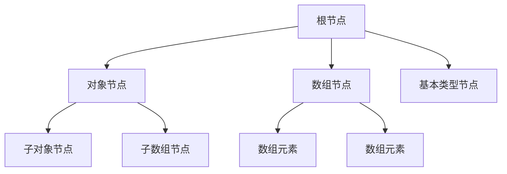
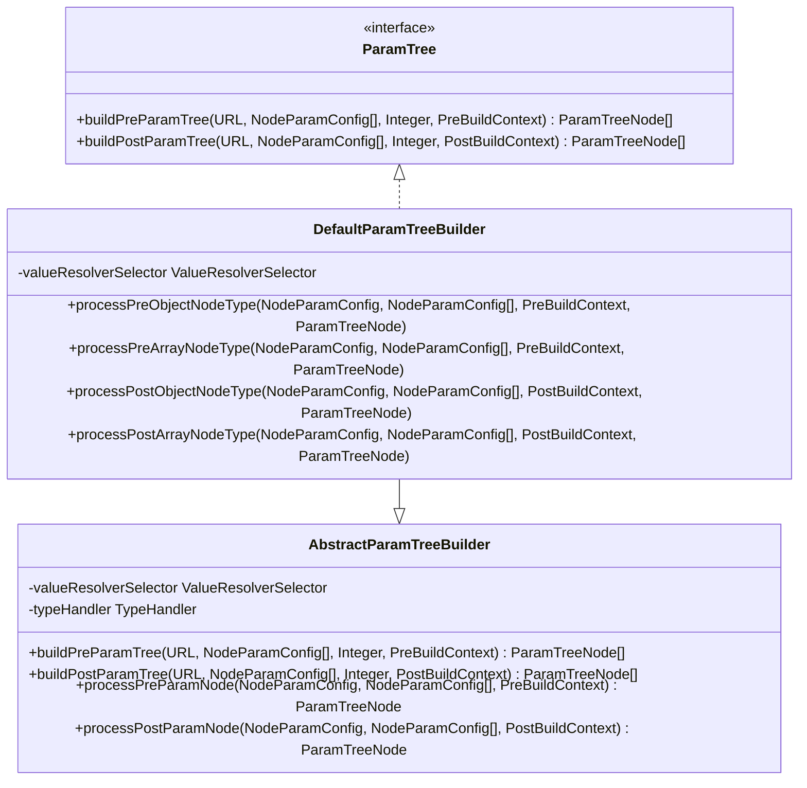
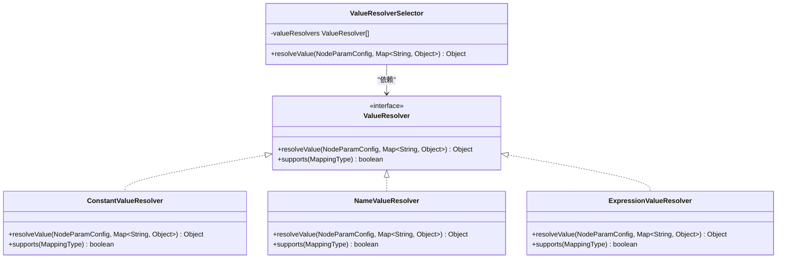
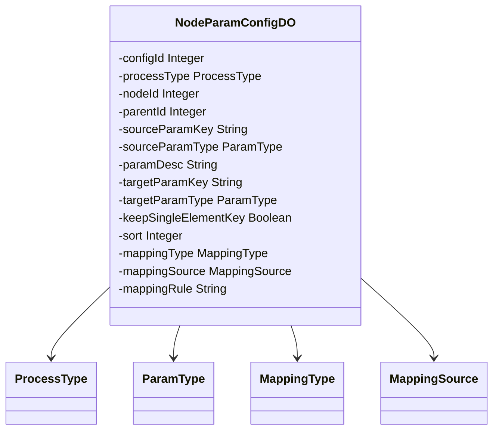
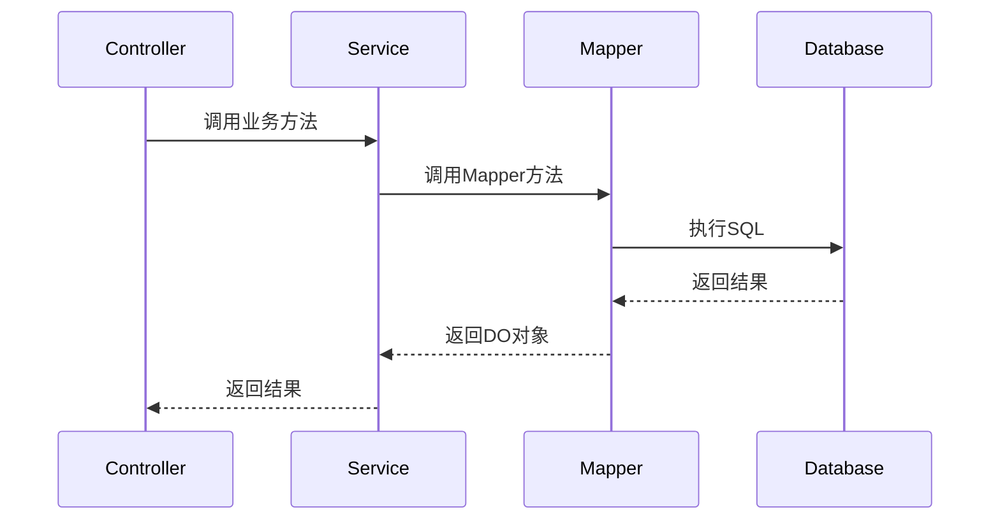

# 节点参数配置表 (node_param_config)

<cite>
**本文档引用文件**  
- [NodeParamConfig.java](file://agent-invocation/src/main/java/com/helianhealth/agent/invocation/remote/model/NodeParamConfig.java)
- [NodeParamConfigDO.java](file://agent-workflow/src/main/java/com/helianhealth/agent/workflow/model/domain/NodeParamConfigDO.java)
- [ParamTree.java](file://agent-invocation/src/main/java/com/helianhealth/agent/invocation/remote/ParamTree.java)
- [DefaultParamTreeBuilder.java](file://agent-invocation/src/main/java/com/helianhealth/agent/invocation/remote/DefaultParamTreeBuilder.java)
- [AbstractParamTreeBuilder.java](file://agent-invocation/src/main/java/com/helianhealth/agent/invocation/remote/AbstractParamTreeBuilder.java)
- [ValueResolver.java](file://agent-invocation/src/main/java/com/helianhealth/agent/invocation/remote/resolver/ValueResolver.java)
- [ValueResolverSelector.java](file://agent-invocation/src/main/java/com/helianhealth/agent/invocation/remote/resolver/ValueResolverSelector.java)
- [ExpressionMapperUtils.java](file://agent-invocation/src/main/java/com/helianhealth/agent/invocation/utils/ExpressionMapperUtils.java)
- [MappingType.java](file://agent-common/src/main/java/com/helianhealth/agent/common/enums/MappingType.java)
- [ProcessType.java](file://agent-common/src/main/java/com/helianhealth/agent/common/enums/ProcessType.java)
- [ParamType.java](file://agent-common/src/main/java/com/helianhealth/agent/common/enums/ParamType.java)
- [MappingSource.java](file://agent-common/src/main/java/com/helianhealth/agent/common/enums/MappingSource.java)
- [NodeParamConfigMapper.xml](file://agent-workflow/src/main/resources/mapper/agent/NodeParamConfigMapper.xml)
</cite>

## 目录
1. [引言](#引言)
2. [核心字段设计原理](#核心字段设计原理)
3. [参数树形结构构建机制](#参数树形结构构建机制)
4. [运行时参数解析流程](#运行时参数解析流程)
5. [典型映射场景示例](#典型映射场景示例)
6. [数据模型与持久化](#数据模型与持久化)
7. [总结](#总结)

## 引言

`node_param_config` 表是接口代理系统中实现参数动态映射与转换的核心配置表。该表支持复杂的嵌套结构映射，通过灵活的配置机制，实现了上游参数（如 Jarvis 参数）到下游三方接口参数的自动化转换。本文档将详细阐述该表的设计原理与实现机制，包括关键字段的含义、参数树的构建方式、运行时解析流程以及典型应用场景。

**本文档引用文件**  
- [NodeParamConfig.java](file://agent-invocation/src/main/java/com/helianhealth/agent/invocation/remote/model/NodeParamConfig.java)
- [NodeParamConfigDO.java](file://agent-workflow/src/main/java/com/helianhealth/agent/workflow/model/domain/NodeParamConfigDO.java)

## 核心字段设计原理

`node_param_config` 表的核心字段设计旨在支持灵活、动态的参数映射需求，每个字段都有其特定的语义和用途。

### config_id（配置ID）

`config_id` 是参数配置的唯一标识符，作为主键使用，确保每条配置记录的唯一性。该字段由数据库自动生成（`GenerationType.IDENTITY`），在系统内部作为引用该配置的唯一凭证。

### node_id（关联节点）

`node_id` 字段标识该参数配置所属的工作流节点。通过此字段，系统可以将多个参数配置与特定的节点关联起来，实现按节点组织和管理参数映射规则。

### source_param_key（上游参数键）与 target_param_key（目标参数键）

`source_param_key` 表示上游系统（如 Jarvis）中的参数名称，而 `target_param_key` 表示目标三方接口所需的参数名称。这两个字段构成了映射的基本单元，定义了“从哪里来”和“到哪里去”的关系。

### source_param_type 与 target_param_type（参数类型）

这两个字段使用 `ParamType` 枚举定义参数的数据类型，包括 `STRING`、`INTEGER`、`OBJECT`、`ARRAY` 等。类型信息对于正确解析和转换数据至关重要，特别是在处理嵌套结构时。

### mapping_type（映射类型）

`mapping_type` 字段是映射规则的核心，决定了如何从源参数生成目标参数值。其值来自 `MappingType` 枚举，主要类型包括：
- `CONSTANT`：常量赋值
- `NAME`：名称映射
- `EXPRESSION`：SpEL 表达式计算
- `BEAN_EXPRESSION`：访问 Spring Bean 的表达式
- `SINGLE_MAP`：单个 Map 键值对

### mapping_rule（映射规则内容）

`mapping_rule` 字段存储了映射规则的具体内容，其解释方式由 `mapping_type` 决定：
- 当 `mapping_type` 为 `CONSTANT` 时，`mapping_rule` 存储固定值。
- 当 `mapping_type` 为 `EXPRESSION` 时，`mapping_rule` 存储 SpEL 表达式，如 `#data.idCard == null ? #data.phone + 'hl' : #data.idCard`。

### parent_id（父子关系）与 process_type（处理时机）

`parent_id` 字段用于构建参数的树形结构，通过指向父节点的 `config_id`，形成父子层级关系。顶级节点的 `parent_id` 为 `null`。

`process_type` 字段使用 `ProcessType` 枚举，决定映射的执行时机：
- `PRE_PROCESS`：前置处理，在调用三方接口前执行，用于构建请求参数。
- `POST_PROCESS`：后置处理，在收到三方接口响应后执行，用于处理响应数据。

**本文档引用文件**  
- [NodeParamConfig.java](file://agent-invocation/src/main/java/com/helianhealth/agent/invocation/remote/model/NodeParamConfig.java#L25-L94)
- [NodeParamConfigDO.java](file://agent-workflow/src/main/java/com/helianhealth/agent/workflow/model/domain/NodeParamConfigDO.java#L36-L123)
- [MappingType.java](file://agent-common/src/main/java/com/helianhealth/agent/common/enums/MappingType.java#L8-L35)
- [ProcessType.java](file://agent-common/src/main/java/com/helianhealth/agent/common/enums/ProcessType.java#L8-L20)
- [ParamType.java](file://agent-common/src/main/java/com/helianhealth/agent/common/enums/ParamType.java#L8-L50)

## 参数树形结构构建机制

`node_param_config` 表通过 `parent_id` 和 `sort` 字段，实现了参数的树形结构构建，与 `ParamTree` 组件协同工作。

### 树形结构构建原理

系统通过 `parent_id` 字段建立父子关系，形成一个 N 叉树（多叉树）结构。`sort` 字段用于控制同一层级下子节点的排序，确保参数生成的顺序符合预期。

**本文档引用文件**  
- [ParamTreeNode.java](file://agent-invocation/src/main/java/com/helianhealth/agent/invocation/remote/model/ParamTreeNode.java#L8-L46)

### ParamTree 组件协同工作

`ParamTree` 是一个 SPI 接口，定义了构建参数树的方法。`DefaultParamTreeBuilder` 是其默认实现类，负责具体的构建逻辑。

**本文档引用文件**  
- [ParamTree.java](file://agent-invocation/src/main/java/com/helianhealth/agent/invocation/remote/ParamTree.java#L17-L47)
- [DefaultParamTreeBuilder.java](file://agent-invocation/src/main/java/com/helianhealth/agent/invocation/remote/DefaultParamTreeBuilder.java#L19-L275)
- [AbstractParamTreeBuilder.java](file://agent-invocation/src/main/java/com/helianhealth/agent/invocation/remote/AbstractParamTreeBuilder.java#L25-L216)

## 运行时参数解析流程

在运行时，系统通过 `ParamTreeBuilder` 和 `ValueResolver` 组件，将配置解析为实际的请求参数。

### 解析流程概述

1. **加载配置**：根据 `node_id` 从数据库加载所有 `PRE_PROCESS` 或 `POST_PROCESS` 的配置。
2. **构建参数树**：`ParamTreeBuilder` 使用 `parent_id` 和 `sort` 字段递归构建参数树。
3. **解析参数值**：对于每个叶子节点，根据 `mapping_type` 选择相应的 `ValueResolver` 来解析 `mapping_rule`，生成最终值。
4. **类型转换**：使用 `TypeHandler` 将解析出的值转换为目标类型。

### ValueResolver 解析机制

`ValueResolver` 是一个策略接口，不同的实现类处理不同类型的映射规则。

`ValueResolverSelector` 作为选择器，根据 `mapping_type` 从所有 `ValueResolver` 实现中选择合适的解析器。

**本文档引用文件**  
- [ValueResolver.java](file://agent-invocation/src/main/java/com/helianhealth/agent/invocation/remote/resolver/ValueResolver.java#L11-L20)
- [ValueResolverSelector.java](file://agent-invocation/src/main/java/com/helianhealth/agent/invocation/remote/resolver/ValueResolverSelector.java#L13-L37)
- [ConstantValueResolver.java](file://agent-invocation/src/main/java/com/helianhealth/agent/invocation/remote/resolver/ConstantValueResolver.java#L10-L21)
- [NameValueResolver.java](file://agent-invocation/src/main/java/com/helianhealth/agent/invocation/remote/resolver/NameValueResolver.java#L10-L21)
- [ExpressionValueResolver.java](file://agent-invocation/src/main/java/com/helianhealth/agent/invocation/remote/resolver/ExpressionValueResolver.java#L15-L38)
- [ExpressionMapperUtils.java](file://agent-invocation/src/main/java/com/helianhealth/agent/invocation/utils/ExpressionMapperUtils.java#L19-L146)

## 典型映射场景示例

以下是几种典型的参数映射场景及其配置方式。

### 常量赋值

将一个固定值赋给目标参数。

| 字段 | 值 |
| :--- | :--- |
| `source_param_key` | (空) |
| `target_param_key` | `systemId` |
| `source_param_type` | `NONE` |
| `target_param_type` | `STRING` |
| `mapping_type` | `CONSTANT` |
| `mapping_rule` | `HL_SYSTEM` |

### 字段映射

将上游参数的值直接映射到目标参数。

| 字段 | 值 |
| :--- | :--- |
| `source_param_key` | `patientId` |
| `target_param_key` | `patient_code` |
| `source_param_type` | `STRING` |
| `target_param_type` | `STRING` |
| `mapping_type` | `NAME` |
| `mapping_rule` | (空) |

### 表达式计算

使用 SpEL 表达式进行复杂计算。

| 字段 | 值 |
| :--- | :--- |
| `source_param_key` | `data` |
| `target_param_key` | `fullName` |
| `source_param_type` | `OBJECT` |
| `target_param_type` | `STRING` |
| `mapping_type` | `EXPRESSION` |
| `mapping_rule` | `#data.firstName + ' ' + #data.lastName` |

**本文档引用文件**  
- [ExpressionMapperUtils.java](file://agent-invocation/src/main/java/com/helianhealth/agent/invocation/utils/ExpressionMapperUtils.java#L39-L81)

## 数据模型与持久化

`node_param_config` 表在代码层面通过 `NodeParamConfigDO` 类进行映射，并通过 MyBatis 进行持久化操作。

### 领域模型

`NodeParamConfigDO` 是数据访问层的领域对象，使用 JPA 注解与数据库表 `node_param_config` 进行映射。

### 持久化操作

`NodeParamConfigMapper` 接口定义了对 `node_param_config` 表的 CRUD 操作，其 SQL 语句在 `NodeParamConfigMapper.xml` 文件中定义。

**本文档引用文件**  
- [NodeParamConfigDO.java](file://agent-workflow/src/main/java/com/helianhealth/agent/workflow/model/domain/NodeParamConfigDO.java#L27-L123)
- [NodeParamConfigMapper.xml](file://agent-workflow/src/main/resources/mapper/agent/NodeParamConfigMapper.xml#L1-L160)

## 总结

`node_param_config` 表通过精心设计的字段和灵活的运行时解析机制，实现了强大的参数动态映射功能。其核心在于利用 `parent_id` 和 `sort` 构建树形结构，结合 `ParamTreeBuilder` 和 `ValueResolver` 组件，在运行时将配置高效地解析为实际参数。这种设计不仅支持简单的字段映射，还能处理复杂的嵌套结构和表达式计算，为系统的灵活性和可扩展性提供了坚实的基础。