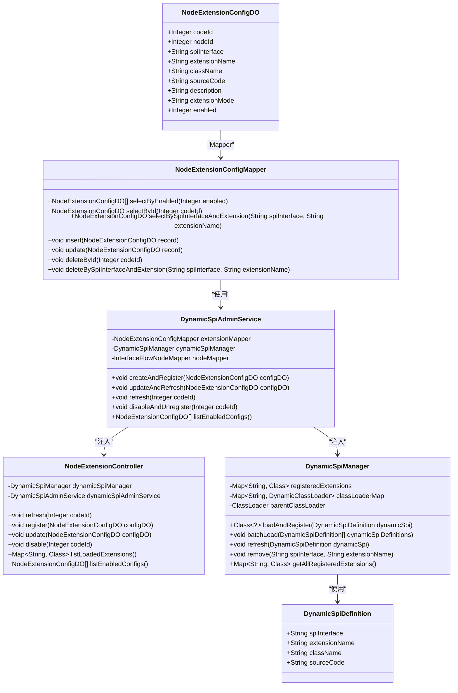
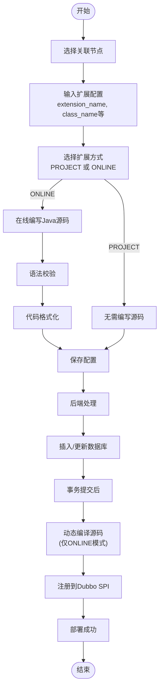
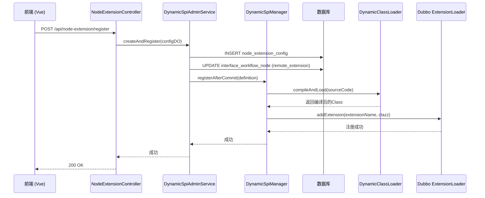

# 节点扩展配置表 (node_extension_config)

<cite>
**本文档引用的文件**
- [NodeExtensionConfigDO.java](file://agent-workflow/src/main/java/com/helianhealth/agent/workflow/model/domain/NodeExtensionConfigDO.java)
- [NodeExtensionConfigMapper.java](file://agent-workflow/src/main/java/com/helianhealth/agent/workflow/mapper/agent/NodeExtensionConfigMapper.java)
- [DynamicSpiAdminService.java](file://agent-workflow/src/main/java/com/helianhealth/agent/workflow/service/extension/DynamicSpiAdminService.java)
- [NodeExtensionController.java](file://agent-workflow/src/main/java/com/helianhealth/agent/workflow/controller/NodeExtensionController.java)
- [DynamicSpiManager.java](file://agent-extension/src/main/java/com/helianhealth/agent/extension/spi/dynamic/DynamicSpiManager.java)
- [DynamicSpiDefinition.java](file://agent-extension/src/main/java/com/helianhealth/agent/extension/spi/model/DynamicSpiDefinition.java)
- [EnhancedAgentExtensionFactory.java](file://agent-extension/src/main/java/com/helianhealth/agent/extension/factory/EnhancedAgentExtensionFactory.java)
- [NodeExtensionConfig.vue](file://console-ui/src/views/NodeExtensionConfig.vue)
- [init_mysql.sql](file://doc/init_mysql.sql)
- [InterfaceRemoteInvoker.java](file://agent-invocation/src/main/java/com/helianhealth/agent/invocation/remote/InterfaceRemoteInvoker.java)
- [SpringDynamicSpiLoader.java](file://agent-extension/src/main/java/com/helianhealth/agent/extension/spi/loader/SpringDynamicSpiLoader.java)
- [org.apache.dubbo.common.extension.ExtensionFactory](file://agent-invocation/src/main/resources/META-INF/dubbo/org.apache.dubbo.common.extension.ExtensionFactory)
</cite>

## 目录
1. [简介](#简介)
2. [表结构与字段详解](#表结构与字段详解)
3. [核心组件与架构](#核心组件与架构)
4. [与Dubbo SPI机制的集成](#与dubbo-spi机制的集成)
5. [在线扩展开发与部署流程](#在线扩展开发与部署流程)
6. [自定义HTTP调用器完整示例](#自定义http调用器完整示例)
7. [总结](#总结)

## 简介

节点扩展配置表（`node_extension_config`）是系统实现动态SPI扩展的核心机制。该表允许通过数据库配置的方式，动态地注册和管理Dubbo SPI扩展，支持两种扩展模式：项目扩展（PROJECT）和在线扩展（ONLINE）。通过此机制，开发者可以在不重启应用的情况下，动态编写、部署和更新自定义的调用实现，极大地提升了系统的灵活性和可维护性。

**本文档引用的文件**
- [init_mysql.sql](file://doc/init_mysql.sql#L118-L140)

## 表结构与字段详解

`node_extension_config` 表定义了动态SPI扩展的所有配置信息。其核心字段如下：

- **code_id**：扩展配置ID，主键，自增。
- **node_id**：可选字段，用于绑定到特定的工作流节点。当配置此字段时，系统会自动将对应节点的 `remote_extension` 字段设置为当前扩展名。
- **spi_interface**：SPI接口的全限定名，例如 `com.helianhealth.agent.invocation.remote.InterfaceRemoteInvoker`。
- **extension_name**：扩展名，即Dubbo SPI配置文件中的key，例如 `custom-http`。
- **class_name**：实现类的全限定名，例如 `com.helianhealth.agent.custom.CustomRemoteInvoker`。
- **source_code**：Java源代码，仅在 `extension_mode` 为 `ONLINE` 时使用，用于在线编写和编译代码。
- **description**：对扩展的描述信息。
- **extension_mode**：扩展方式，必选，支持 `PROJECT`（项目扩展）和 `ONLINE`（在线扩展）两种模式。
- **enabled**：是否启用，1为启用，0为禁用。

**本文档引用的文件**
- [init_mysql.sql](file://doc/init_mysql.sql#L118-L140)
- [NodeExtensionConfigDO.java](file://agent-workflow/src/main/java/com/helianhealth/agent/workflow/model/domain/NodeExtensionConfigDO.java#L16-L75)

## 核心组件与架构

系统通过多个核心组件协同工作，实现了动态SPI扩展的完整生命周期管理。

### 核心类图



**本文档引用的文件**
- [NodeExtensionConfigDO.java](file://agent-workflow/src/main/java/com/helianhealth/agent/workflow/model/domain/NodeExtensionConfigDO.java)
- [NodeExtensionConfigMapper.java](file://agent-workflow/src/main/java/com/helianhealth/agent/workflow/mapper/agent/NodeExtensionConfigMapper.java)
- [DynamicSpiAdminService.java](file://agent-workflow/src/main/java/com/helianhealth/agent/workflow/service/extension/DynamicSpiAdminService.java)
- [NodeExtensionController.java](file://agent-workflow/src/main/java/com/helianhealth/agent/workflow/controller/NodeExtensionController.java)
- [DynamicSpiManager.java](file://agent-extension/src/main/java/com/helianhealth/agent/extension/spi/dynamic/DynamicSpiManager.java)
- [DynamicSpiDefinition.java](file://agent-extension/src/main/java/com/helianhealth/agent/extension/spi/model/DynamicSpiDefinition.java)

## 与Dubbo SPI机制的集成

系统通过 `EnhancedAgentExtensionFactory` 和 `DynamicSpiManager` 实现了与Dubbo SPI机制的深度集成。

### 集成架构图

```mermaid
graph TD
subgraph "前端"
Vue[NodeExtensionConfig.vue]
end
subgraph "后端"
Controller[NodeExtensionController]
Service[DynamicSpiAdminService]
Manager[DynamicSpiManager]
Factory[EnhancedAgentExtensionFactory]
Dubbo[Dubbo ExtensionLoader]
end
subgraph "数据库"
DB[node_extension_config]
end
Vue --> Controller : HTTP请求
Controller --> Service : 调用业务逻辑
Service --> DB : CRUD操作
Service --> Manager : 动态加载/刷新
Manager --> Dubbo : 注册扩展
Factory --> Manager : 获取扩展
Dubbo --> Factory : SPI查找
```

**本文档引用的文件**
- [EnhancedAgentExtensionFactory.java](file://agent-extension/src/main/java/com/helianhealth/agent/extension/factory/EnhancedAgentExtensionFactory.java)
- [DynamicSpiManager.java](file://agent-extension/src/main/java/com/helianhealth/agent/extension/spi/dynamic/DynamicSpiManager.java)
- [NodeExtensionController.java](file://agent-workflow/src/main/java/com/helianhealth/agent/workflow/controller/NodeExtensionController.java)
- [org.apache.dubbo.common.extension.ExtensionFactory](file://agent-invocation/src/main/resources/META-INF/dubbo/org.apache.dubbo.common.extension.ExtensionFactory)

### 集成流程

1. **启动加载**：应用启动时，`SpringDynamicSpiLoader` 实现 `ApplicationRunner` 接口，在 `run` 方法中调用 `DynamicSpiConfigSource` 获取所有启用的扩展配置，并通过 `DynamicSpiManager` 批量加载。
2. **扩展查找**：当Dubbo需要查找SPI扩展时，会调用 `EnhancedAgentExtensionFactory` 的 `getExtension` 方法。该工厂首先尝试从 `DynamicSpiManager` 获取动态扩展，如果未找到，则回退到Spring容器中查找Bean。
3. **动态注册**：通过 `DynamicSpiAdminService` 的 `createAndRegister` 方法，可以将新的扩展配置插入数据库，并在事务提交后通过 `DynamicSpiManager` 注册到Dubbo的 `ExtensionLoader` 中。
4. **热刷新**：通过 `updateAndRefresh` 方法更新配置后，系统会先卸载旧的扩展，再重新加载新的实现，实现热更新。

**本文档引用的文件**
- [SpringDynamicSpiLoader.java](file://agent-extension/src/main/java/com/helianhealth/agent/extension/spi/loader/SpringDynamicSpiLoader.java#L28-L52)
- [EnhancedAgentExtensionFactory.java](file://agent-extension/src/main/java/com/helianhealth/agent/extension/factory/EnhancedAgentExtensionFactory.java#L28-L45)
- [DynamicSpiAdminService.java](file://agent-workflow/src/main/java/com/helianhealth/agent/workflow/service/extension/DynamicSpiAdminService.java#L39-L67)
- [DynamicSpiManager.java](file://agent-extension/src/main/java/com/helianhealth/agent/extension/spi/dynamic/DynamicSpiManager.java#L54-L97)

## 在线扩展开发与部署流程

前端 `NodeExtensionConfig.vue` 组件提供了完整的在线扩展开发与部署界面。

### 开发与部署流程图



**本文档引用的文件**
- [NodeExtensionConfig.vue](file://console-ui/src/views/NodeExtensionConfig.vue)

### 详细步骤

1. **新增扩展**：用户点击“新增扩展”按钮，弹出配置对话框。
2. **填写配置**：用户填写扩展名称、实现类全名、描述等信息，并选择扩展方式。
3. **编写代码**：若选择“在线扩展”，用户可在文本域中编写Java源码，并使用“语法校验”和“格式化”功能辅助开发。
4. **保存配置**：点击“保存”后，前端调用 `registerExtension` 或 `updateExtension` API。
5. **后端处理**：后端 `NodeExtensionController` 接收请求，调用 `DynamicSpiAdminService` 进行业务处理。
6. **数据库持久化**：将配置信息持久化到 `node_extension_config` 表。
7. **动态加载**：在事务提交后，通过 `DynamicSpiManager` 动态编译（若为ONLINE模式）并注册到Dubbo SPI中。

**本文档引用的文件**
- [NodeExtensionConfig.vue](file://console-ui/src/views/NodeExtensionConfig.vue#L322-L427)
- [NodeExtensionController.java](file://agent-workflow/src/main/java/com/helianhealth/agent/workflow/controller/NodeExtensionController.java#L48-L56)

## 自定义HTTP调用器完整示例

以下是一个从配置表记录到运行时生效的完整示例，展示如何创建一个自定义HTTP调用器。

### 示例流程

1. **定义SPI接口**：系统已定义 `InterfaceRemoteInvoker` 接口，用于处理远程调用。
2. **创建配置记录**：在 `node_extension_config` 表中插入一条新记录。
3. **编写实现代码**：在前端界面编写实现 `InterfaceRemoteInvoker` 接口的Java代码。
4. **部署生效**：保存配置后，系统自动编译并注册该实现。

### 配置记录示例

```sql
INSERT INTO `node_extension_config` (
    `node_id`,
    `spi_interface`,
    `extension_name`,
    `class_name`,
    `source_code`,
    `description`,
    `enabled`,
    `extension_mode`
) VALUES (
    1001,
    'com.helianhealth.agent.invocation.remote.InterfaceRemoteInvoker',
    'custom-http-invoker',
    'com.helianhealth.agent.custom.CustomHttpInvoker',
    'package com.helianhealth.agent.custom;

import com.helianhealth.agent.invocation.remote.InterfaceRemoteInvoker;
import com.helianhealth.agent.workflow.model.domain.InterfaceWorkflowNode;
import com.helianhealth.agent.invocation.remote.model.Invocation;
import java.util.Map;

public class CustomHttpInvoker implements InterfaceRemoteInvoker {
    @Override
    public Map<String, Object> remoteInvoke(InterfaceWorkflowNode flowNode, Invocation invocation) {
        // 实现自定义HTTP调用逻辑
        System.out.println("执行自定义HTTP调用: " + flowNode.getNodeName());
        // ... 调用外部HTTP服务
        return invocation.getBusinessData();
    }
}',
    '自定义HTTP调用器实现',
    1,
    'ONLINE'
);
```

### 运行时生效流程



**本文档引用的文件**
- [InterfaceRemoteInvoker.java](file://agent-invocation/src/main/java/com/helianhealth/agent/invocation/remote/InterfaceRemoteInvoker.java)
- [NodeExtensionConfig.vue](file://console-ui/src/views/NodeExtensionConfig.vue)
- [DynamicSpiAdminService.java](file://agent-workflow/src/main/java/com/helianhealth/agent/workflow/service/extension/DynamicSpiAdminService.java#L39-L67)
- [DynamicSpiManager.java](file://agent-extension/src/main/java/com/helianhealth/agent/extension/spi/dynamic/DynamicSpiManager.java#L54-L97)

## 总结

`node_extension_config` 表及其配套的动态SPI机制，为系统提供了强大的扩展能力。通过将Dubbo SPI的配置从静态文件转移到动态数据库，并结合在线代码编辑和动态编译技术，实现了真正的热插拔和热更新。该设计不仅支持复杂的项目扩展，也支持快速的在线扩展，满足了不同场景下的开发需求。整个流程从配置、部署到生效，形成了一个完整的闭环，极大地提升了开发效率和系统灵活性。