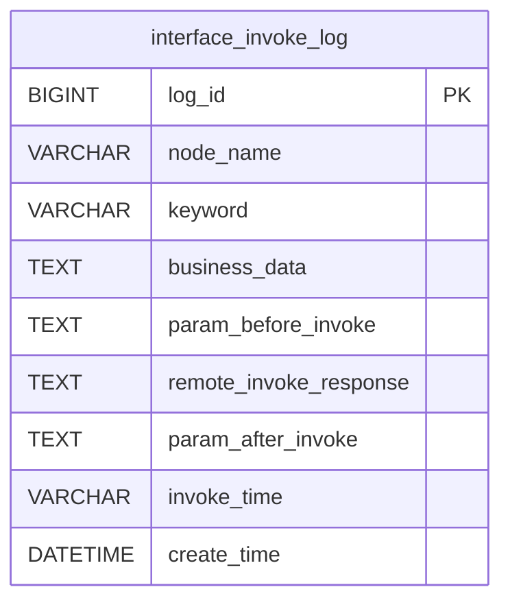
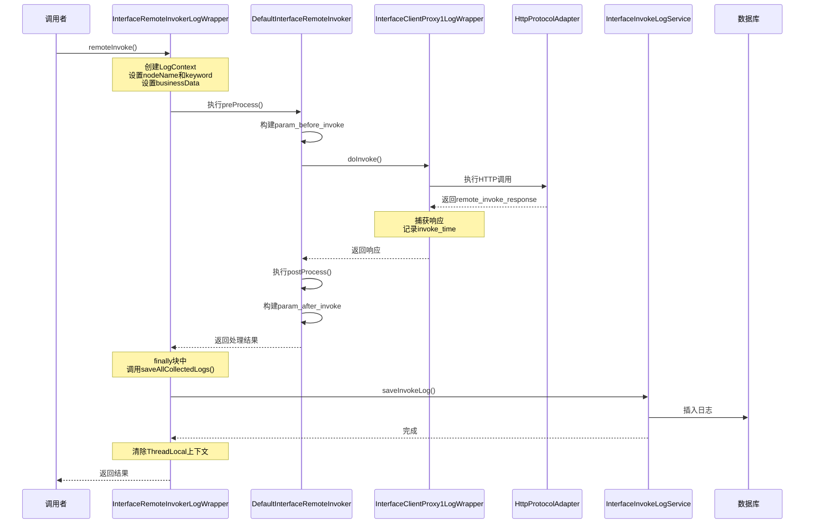
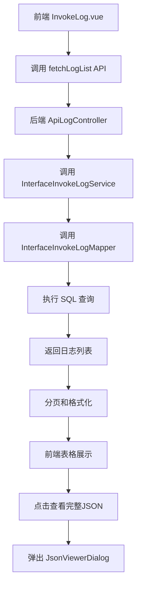

# 调用日志表 (interface_invoke_log)

<cite>
**本文档引用文件**   
- [InterfaceInvokeLogDO.java](file://agent-log/src/main/java/com/helianhealth/agent/log/model/InterfaceInvokeLogDO.java)
- [InterfaceInvokeLogMapper.xml](file://agent-log/src/main/resources/mapper/agent/InterfaceInvokeLogMapper.xml)
- [InterfaceInvokeLogServiceImpl.java](file://agent-log/src/main/java/com/helianhealth/agent/log/service/impl/InterfaceInvokeLogServiceImpl.java)
- [ApiLogController.java](file://agent-log/src/main/java/com/helianhealth/agent/log/controller/ApiLogController.java)
- [InvokeLog.vue](file://console-ui/src/views/InvokeLog.vue)
- [init_mysql.sql](file://doc/init_mysql.sql)
- [InterfaceRemoteInvokerLogWrapper.java](file://agent-invocation/src/main/java/com/helianhealth/agent/invocation/remote/wrapper/InterfaceRemoteInvokerLogWrapper.java)
- [InvocationLogContextHolder.java](file://agent-invocation/src/main/java/com/helianhealth/agent/invocation/context/InvocationLogContextHolder.java)
- [LogContext.java](file://agent-invocation/src/main/java/com/helianhealth/agent/invocation/context/LogContext.java)
- [ParamResolverLogAspect.java](file://agent-invocation/src/main/java/com/helianhealth/agent/invocation/aspect/ParamResolverLogAspect.java)
- [InterfaceClientProxy1LogWrapper.java](file://agent-invocation/src/main/java/com/helianhealth/agent/invocation/remote/wrapper/InterfaceClientProxy1LogWrapper.java)
</cite>

## 目录
1. [介绍](#介绍)
2. [表结构与字段说明](#表结构与字段说明)
3. [调用链路中的日志填充机制](#调用链路中的日志填充机制)
4. [日志数据的查询与展示](#日志数据的查询与展示)
5. [归档与索引策略建议](#归档与索引策略建议)

## 介绍
`interface_invoke_log` 表是系统中用于记录每次接口调用完整上下文的核心日志表。该表在问题排查、性能分析和系统监控中扮演着至关重要的角色。通过记录调用前后的参数、业务数据和响应结果，为开发者提供了完整的调用链路视图，极大地提升了故障诊断的效率。该表由 `InterfaceRemoteInvoker` 在执行远程调用的过程中通过日志上下文机制自动填充，并通过 `ApiLogController` 和前端 `InvokeLog.vue` 组件提供查询与可视化展示功能。

## 表结构与字段说明

**图表来源**
- [init_mysql.sql](file://doc/init_mysql.sql#L78-L97)

本表的结构设计旨在捕获一次接口调用的完整生命周期。以下是各字段的详细说明：

- **log_id (日志主键)**: 该字段是表的主键，类型为 `BIGINT`，采用自增策略。它是每条日志记录的唯一标识，用于精确检索和关联。

- **node_name (节点名称)**: 该字段记录了执行调用的节点名称。**请注意**，在 `init_mysql.sql` 脚本中，此字段被错误地定义为 `INT` 类型（`node_name` INT NOT NULL），这与实际业务逻辑不符。根据 `InterfaceInvokeLogDO.java` 实体类和业务上下文，该字段应为 `VARCHAR` 类型，用于存储节点的名称（如 "查询PACS报告"），而非节点ID。这是一个需要修正的脚本缺陷。

- **keyword (业务关键字)**: 这是一个用于日志检索的关键字段，通常存储业务数据中的唯一标识符，例如 `patientCode`。它允许用户通过特定的业务标识快速定位相关的调用日志，是进行问题追踪的核心索引。

- **business_data (原始业务数据)**: 该字段以JSON字符串的形式存储了调用时的原始业务数据。这是调用的输入源头，包含了所有需要传递给下游系统的业务信息。

- **param_before_invoke (调用前参数)**: 记录了在执行远程调用之前，经过参数映射和转换后，准备发送给目标接口的请求参数。这些参数是根据 `node_param_config` 表中的配置规则从 `business_data` 中提取和构造的。

- **remote_invoke_response (远程调用响应)**: 存储了目标接口返回的原始响应数据。这对于分析接口行为、验证数据正确性以及处理异常情况至关重要。

- **param_after_invoke (调用后参数)**: 记录了在接收到远程响应后，经过后置参数处理（如数据映射、转换）后，准备返回给上游或用于后续节点的数据。

- **invoke_time (调用耗时)**: 以毫秒（ms）为单位记录了本次远程调用的执行耗时，是性能分析的关键指标。

- **create_time (创建时间)**: 记录了日志条目被创建的时间，类型为 `DATETIME`，默认值为 `CURRENT_TIMESTAMP`。该字段用于日志的排序和按时间范围查询。

**本节来源**
- [InterfaceInvokeLogDO.java](file://agent-log/src/main/java/com/helianhealth/agent/log/model/InterfaceInvokeLogDO.java#L23-L80)
- [init_mysql.sql](file://doc/init_mysql.sql#L78-L97)
- [InterfaceInvokeLogMapper.xml](file://agent-log/src/main/resources/mapper/agent/InterfaceInvokeLogMapper.xml#L6-L15)

## 调用链路中的日志填充机制

`interface_invoke_log` 表的数据填充是一个贯穿整个调用流程的自动化过程，其核心依赖于 `ThreadLocal` 实现的上下文管理。整个流程如下：

**图表来源**
- [InterfaceRemoteInvokerLogWrapper.java](file://agent-invocation/src/main/java/com/helianhealth/agent/invocation/remote/wrapper/InterfaceRemoteInvokerLogWrapper.java#L30-L70)
- [InterfaceClientProxy1LogWrapper.java](file://agent-invocation/src/main/java/com/helianhealth/agent/invocation/remote/wrapper/InterfaceClientProxy1LogWrapper.java#L21-L42)
- [ParamResolverLogAspect.java](file://agent-invocation/src/main/java/com/helianhealth/agent/invocation/aspect/ParamResolverLogAspect.java#L23-L36)
- [InvocationLogContextHolder.java](file://agent-invocation/src/main/java/com/helianhealth/agent/invocation/context/InvocationLogContextHolder.java#L15-L31)

1.  **上下文初始化 (InterfaceRemoteInvokerLogWrapper)**:
    当 `InterfaceRemoteInvoker` 开始执行时，`InterfaceRemoteInvokerLogWrapper` 会创建一个 `LogContext` 对象，并通过 `InvocationLogContextHolder.setContext()` 将其绑定到当前线程的 `ThreadLocal` 中。此时，`nodeName`、`keyword` 和 `businessData` 被填充到上下文中。

2.  **调用前参数记录 (ParamResolverLogAspect)**:
    在 `DefaultInterfaceRemoteInvoker` 执行 `preProcess` 方法构建请求参数时，会调用 `ParamResolver`。一个名为 `ParamResolverLogAspect` 的AOP切面会监听 `ParamResolver.resolveParamNodes()` 方法的返回值，并将生成的 `param_before_invoke` JSON字符串注入到当前线程的 `LogContext` 中。

3.  **远程调用与响应记录 (InterfaceClientProxy1LogWrapper)**:
    `InterfaceClientProxy1LogWrapper` 包装了实际的协议调用器（如 `HttpProtocolAdapter`）。在 `doInvoke` 方法执行前后，它会记录开始时间。调用完成后，它将原始的 `remote_invoke_response` 捕获并存入 `LogContext`，同时计算并记录 `invoke_time`。

4.  **调用后参数记录 (DefaultInterfaceRemoteInvoker)**:
    `DefaultInterfaceRemoteInvoker` 在 `postProcess` 方法中处理响应数据，构建 `param_after_invoke`。虽然此过程没有直接的日志记录代码，但最终的处理结果会作为 `remoteInvoke` 的返回值，而 `InterfaceRemoteInvokerLogWrapper` 已经通过 `InterfaceClientProxy1LogWrapper` 获取了原始响应。

5.  **日志持久化与清理**:
    在 `InterfaceRemoteInvokerLogWrapper` 的 `finally` 块中，无论调用成功与否，都会调用 `saveAllCollectedLogs()` 方法。该方法从 `LogContext` 中收集所有已填充的字段，并通过 `InterfaceInvokeLogService` 将其持久化到 `interface_invoke_log` 表中。最后，调用 `InvocationLogContextHolder.clearContext()` 清除 `ThreadLocal`，防止内存泄漏。

**本节来源**
- [InterfaceRemoteInvokerLogWrapper.java](file://agent-invocation/src/main/java/com/helianhealth/agent/invocation/remote/wrapper/InterfaceRemoteInvokerLogWrapper.java#L30-L70)
- [InvocationLogContextHolder.java](file://agent-invocation/src/main/java/com/helianhealth/agent/invocation/context/InvocationLogContextHolder.java#L15-L31)
- [LogContext.java](file://agent-invocation/src/main/java/com/helianhealth/agent/invocation/context/LogContext.java#L15-L45)
- [ParamResolverLogAspect.java](file://agent-invocation/src/main/java/com/helianhealth/agent/invocation/aspect/ParamResolverLogAspect.java#L23-L36)
- [InterfaceClientProxy1LogWrapper.java](file://agent-invocation/src/main/java/com/helianhealth/agent/invocation/remote/wrapper/InterfaceClientProxy1LogWrapper.java#L21-L42)
- [DefaultInterfaceRemoteInvoker.java](file://agent-invocation/src/main/java/com/helianhealth/agent/invocation/remote/DefaultInterfaceRemoteInvoker.java#L24-L32)

## 日志数据的查询与展示

日志数据的查询与展示是一个前后端协作的过程，为用户提供了一个直观的界面来分析调用日志。

**图表来源**
- [InvokeLog.vue](file://console-ui/src/views/InvokeLog.vue#L6-L111)
- [ApiLogController.java](file://agent-log/src/main/java/com/helianhealth/agent/log/controller/ApiLogController.java#L27-L38)
- [InterfaceInvokeLogServiceImpl.java](file://agent-log/src/main/java/com/helianhealth/agent/log/service/impl/InterfaceInvokeLogServiceImpl.java#L48-L67)
- [InterfaceInvokeLogMapper.xml](file://agent-log/src/main/resources/mapper/agent/InterfaceInvokeLogMapper.xml#L74-L86)

- **前端展示 (InvokeLog.vue)**:
    前端的 `InvokeLog.vue` 组件提供了一个用户友好的界面。它包含一个搜索表单，允许用户通过 `node_name`（节点名称）和 `keyword`（业务关键字）进行过滤。日志数据以表格形式展示，关键字段如 `business_data`、`param_before_invoke`、`remote_invoke_response` 和 `param_after_invoke` 都被渲染为可点击的预览单元格。点击这些单元格会弹出一个 `JsonViewerDialog` 对话框，以格式化的方式展示完整的JSON内容，方便用户进行详细分析。

- **后端查询 (ApiLogController & Service)**:
    前端通过调用 `/v1/console/api-log/all` 接口发起查询。`ApiLogController` 接收请求参数（`nodeName`, `keyword`, `pageNum`, `pageSize`），并将其传递给 `InterfaceInvokeLogService`。服务层使用 `PageHelper` 进行分页处理，并调用 `InterfaceInvokeLogMapper` 的 `selectAllInvokeLogs` 方法执行数据库查询。查询结果被封装成 `PageList` 对象返回给前端。

**本节来源**
- [InvokeLog.vue](file://console-ui/src/views/InvokeLog.vue#L1-L265)
- [invokeLog.js](file://console-ui/src/api/invokeLog.js#L6-L11)
- [ApiLogController.java](file://agent-log/src/main/java/com/helianhealth/agent/log/controller/ApiLogController.java#L27-L38)
- [InterfaceInvokeLogServiceImpl.java](file://agent-log/src/main/java/com/helianhealth/agent/log/service/impl/InterfaceInvokeLogServiceImpl.java#L48-L67)
- [InterfaceInvokeLogMapper.xml](file://agent-log/src/main/resources/mapper/agent/InterfaceInvokeLogMapper.xml#L74-L86)

## 归档与索引策略建议

考虑到 `interface_invoke_log` 表是高频写入的流水日志表，其数据量会随着时间推移而急剧增长，因此必须制定合理的归档与索引策略以保证系统性能。

- **归档策略**:
    建议实施定期归档机制。例如，可以每月或每季度将超过一定时间（如3个月）的历史日志数据从主表 `interface_invoke_log` 迁移到一个按时间命名的归档表（如 `interface_invoke_log_202310`）中。对于更久远的数据，可以进一步压缩并存储到成本更低的存储介质（如对象存储）中。线上查询接口应默认只查询最近N个月的数据，对于历史数据查询，提供专门的离线分析通道。

- **索引策略**:
    为了优化查询性能，应在以下字段上建立合适的索引：
    - **复合索引 `(create_time, node_name)`**: 这是最常用的查询场景，即按时间和节点名称筛选日志。将 `create_time` 放在前面可以高效地利用时间范围过滤。
    - **复合索引 `(keyword, create_time)`**: 对于通过业务关键字 `keyword` 进行追踪的场景，此索引能快速定位到特定业务的调用链路。
    - **单列索引 `node_name`**: 如果存在大量只按节点名称查询的场景，单独为 `node_name` 建立索引也是有益的。

    需要注意的是，`param_before_invoke`、`remote_invoke_response` 等大文本字段不适合建立常规索引，否则会极大影响写入性能。如果需要对这些字段的内容进行搜索，应考虑引入Elasticsearch等全文搜索引擎。

**本节来源**
- [InterfaceInvokeLogMapper.xml](file://agent-log/src/main/resources/mapper/agent/InterfaceInvokeLogMapper.xml#L77-L83)
- [InterfaceInvokeLogDO.java](file://agent-log/src/main/java/com/helianhealth/agent/log/model/InterfaceInvokeLogDO.java)