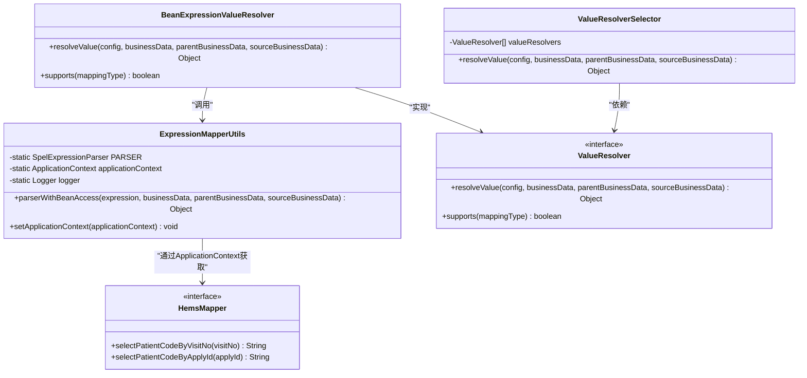
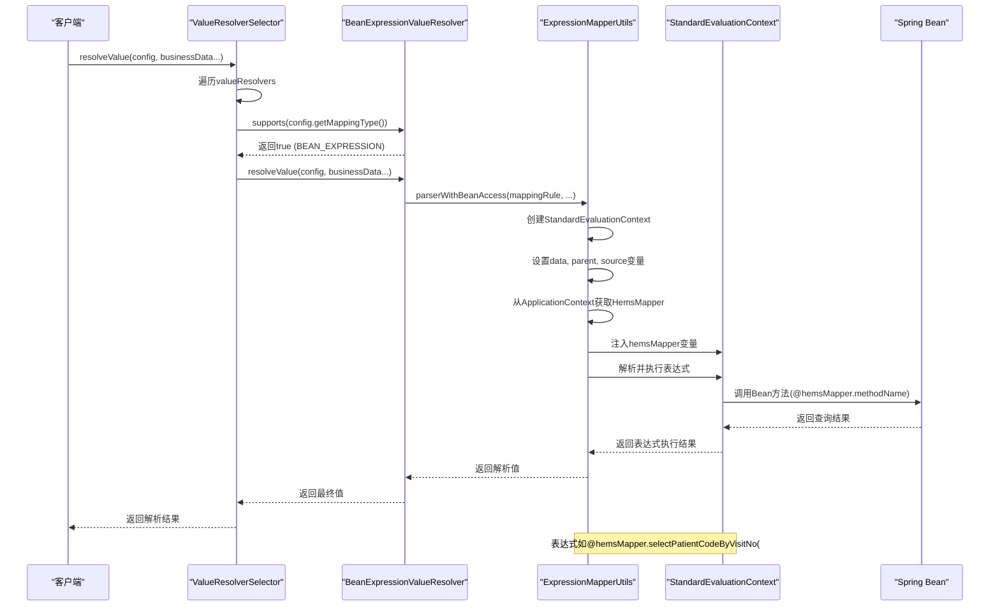
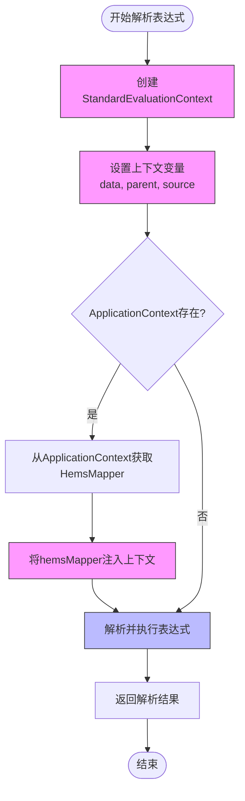
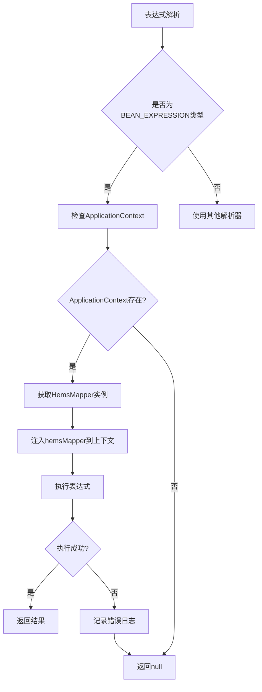

# Bean表达式值解析

<cite>
**本文档引用的文件**   
- [BeanExpressionValueResolver.java](file://agent-invocation/src/main/java/com/helianhealth/agent/invocation/remote/resolver/BeanExpressionValueResolver.java)
- [ExpressionMapperUtils.java](file://agent-invocation/src/main/java/com/helianhealth/agent/invocation/utils/ExpressionMapperUtils.java)
- [ValueResolver.java](file://agent-invocation/src/main/java/com/helianhealth/agent/invocation/remote/resolver/ValueResolver.java)
- [ValueResolverSelector.java](file://agent-invocation/src/main/java/com/helianhealth/agent/invocation/remote/resolver/ValueResolverSelector.java)
- [NodeParamConfig.java](file://agent-invocation/src/main/java/com/helianhealth/agent/invocation/remote/model/NodeParamConfig.java)
- [MappingType.java](file://agent-common/src/main/java/com/helianhealth/agent/common/enums/MappingType.java)
- [HemsMapper.java](file://agent-workflow/src/main/java/com/helianhealth/agent/workflow/mapper/hems/HemsMapper.java)
- [interface-agent.txt](file://agent-ai/src/main/resources/systemprompt/interface-agent.txt)
</cite>

## 目录
1. [简介](#简介)
2. [核心组件分析](#核心组件分析)
3. [执行流程详解](#执行流程详解)
4. [安全限制与性能影响](#安全限制与性能影响)
5. [适用场景](#适用场景)
6. [结论](#结论)

## 简介
Bean表达式值解析器（BeanExpressionValueResolver）是接口代理系统中的关键组件，它通过ExpressionMapperUtils.parserWithBeanAccess方法实现了对Spring Bean的访问能力。该机制允许在映射规则（mappingRule）中引用Spring容器中的Bean进行复杂业务逻辑处理，特别是在需要查询体软表完成字段映射的场景中发挥重要作用。本文档将详细阐述其工作原理、执行流程以及相关的安全和性能考量。

## 核心组件分析

Bean表达式值解析功能由多个核心组件协同工作实现：

- **BeanExpressionValueResolver**: 实现ValueResolver接口的具体解析器，负责处理BEAN_EXPRESSION类型的映射规则。
- **ExpressionMapperUtils**: 提供SpEL表达式解析功能的工具类，其中parserWithBeanAccess方法支持访问Spring Bean。
- **ValueResolverSelector**: 值解析器选择器，根据配置的映射类型选择合适的解析器。
- **HemsMapper**: 体软通用查询接口，作为默认注入的Bean供表达式访问。

**图示来源**
- [BeanExpressionValueResolver.java](file://agent-invocation/src/main/java/com/helianhealth/agent/invocation/remote/resolver/BeanExpressionValueResolver.java)
- [ExpressionMapperUtils.java](file://agent-invocation/src/main/java/com/helianhealth/agent/invocation/utils/ExpressionMapperUtils.java)
- [ValueResolver.java](file://agent-invocation/src/main/java/com/helianhealth/agent/invocation/remote/resolver/ValueResolver.java)
- [HemsMapper.java](file://agent-workflow/src/main/java/com/helianhealth/agent/workflow/mapper/hems/HemsMapper.java)

**本节来源**
- [BeanExpressionValueResolver.java](file://agent-invocation/src/main/java/com/helianhealth/agent/invocation/remote/resolver/BeanExpressionValueResolver.java#L1-L28)
- [ExpressionMapperUtils.java](file://agent-invocation/src/main/java/com/helianhealth/agent/invocation/utils/ExpressionMapperUtils.java#L1-L147)
- [ValueResolver.java](file://agent-invocation/src/main/java/com/helianhealth/agent/invocation/remote/resolver/ValueResolver.java#L1-L20)

## 执行流程详解

当系统需要解析包含Bean调用的表达式时，会按照以下流程执行：

**图示来源**
- [BeanExpressionValueResolver.java](file://agent-invocation/src/main/java/com/helianhealth/agent/invocation/remote/resolver/BeanExpressionValueResolver.java#L16-L22)
- [ExpressionMapperUtils.java](file://agent-invocation/src/main/java/com/helianhealth/agent/invocation/utils/ExpressionMapperUtils.java#L114-L130)
- [ValueResolverSelector.java](file://agent-invocation/src/main/java/com/helianhealth/agent/invocation/remote/resolver/ValueResolverSelector.java#L22-L31)

**本节来源**
- [BeanExpressionValueResolver.java](file://agent-invocation/src/main/java/com/helianhealth/agent/invocation/remote/resolver/BeanExpressionValueResolver.java#L16-L22)
- [ExpressionMapperUtils.java](file://agent-invocation/src/main/java/com/helianhealth/agent/invocation/utils/ExpressionMapperUtils.java#L114-L130)
- [ValueResolverSelector.java](file://agent-invocation/src/main/java/com/helianhealth/agent/invocation/remote/resolver/ValueResolverSelector.java#L22-L31)

### Bean访问控制机制

系统通过以下机制实现对Spring Bean的安全访问：

1. **ApplicationContextAware接口**: ExpressionMapperUtils实现ApplicationContextAware接口，自动注入ApplicationContext实例。
2. **默认Bean注入**: 在parserWithBeanAccess方法中，默认将HemsMapper Bean注入到表达式上下文中。
3. **上下文变量设置**: 将业务数据（businessData）、父级数据（parentBusinessData）和源数据（sourceBusinessData）作为变量注入上下文。

**图示来源**
- [ExpressionMapperUtils.java](file://agent-invocation/src/main/java/com/helianhealth/agent/invocation/utils/ExpressionMapperUtils.java#L116-L126)

**本节来源**
- [ExpressionMapperUtils.java](file://agent-invocation/src/main/java/com/helianhealth/agent/invocation/utils/ExpressionMapperUtils.java#L114-L130)

## 安全限制与性能影响

### 安全限制

系统在Bean表达式解析方面实施了多项安全限制：

1. **有限的Bean访问**: 目前只支持通过#hemsMapper访问HemsMapper接口的方法。
2. **预定义方法**: 只允许调用预定义的方法，如selectPatientCodeByVisitNo和selectPatientCodeByApplyId。
3. **异常处理**: 所有表达式解析异常都会被捕获并记录日志，避免系统崩溃。

**图示来源**
- [ExpressionMapperUtils.java](file://agent-invocation/src/main/java/com/helianhealth/agent/invocation/utils/ExpressionMapperUtils.java#L114-L133)
- [BeanExpressionValueResolver.java](file://agent-invocation/src/main/java/com/helianhealth/agent/invocation/remote/resolver/BeanExpressionValueResolver.java#L16-L22)

**本节来源**
- [ExpressionMapperUtils.java](file://agent-invocation/src/main/java/com/helianhealth/agent/invocation/utils/ExpressionMapperUtils.java#L114-L133)

### 性能影响

Bean表达式解析对系统性能的影响主要体现在以下几个方面：

1. **上下文创建开销**: 每次解析都需要创建StandardEvaluationContext实例。
2. **Bean查找开销**: 通过ApplicationContext.getBean()方法查找Bean实例。
3. **表达式解析开销**: SpEL表达式的解析和执行需要消耗CPU资源。
4. **数据库查询开销**: 如果表达式中调用了查询数据库的方法，会产生额外的数据库访问延迟。

| 影响因素 | 描述 | 优化建议 |
|--------|------|---------|
| 上下文创建 | 每次解析都创建新的EvaluationContext | 考虑上下文缓存机制 |
| Bean查找 | 通过反射查找Bean实例 | 确保Bean已预加载 |
| 表达式复杂度 | 复杂表达式解析时间更长 | 简化表达式逻辑 |
| 数据库访问 | HemsMapper方法可能涉及数据库查询 | 添加查询缓存 |

**本节来源**
- [ExpressionMapperUtils.java](file://agent-invocation/src/main/java/com/helianhealth/agent/invocation/utils/ExpressionMapperUtils.java#L114-L133)
- [HemsMapper.java](file://agent-workflow/src/main/java/com/helianhealth/agent/workflow/mapper/hems/HemsMapper.java#L1-L26)

## 适用场景

Bean表达式值解析器主要适用于以下场景：

1. **体软表字段映射**: 需要从体软系统查询患者信息并进行字段映射的场景。
2. **跨系统数据关联**: 需要关联不同系统数据的复杂业务逻辑处理。
3. **动态值生成**: 需要根据业务规则动态生成目标参数值的场景。

典型的使用示例如下：
- `@hemsMapper.selectPatientCodeByVisitNo(#data.visitNo)`：根据就诊编号查询患者编号
- `@hemsMapper.selectPatientCodeByApplyId(#data.applyId)`：根据申请编号查询患者编号

这些场景通常出现在医疗信息系统集成中，需要将外部系统的数据与内部体软系统的数据进行关联和映射。

**本节来源**
- [interface-agent.txt](file://agent-ai/src/main/resources/systemprompt/interface-agent.txt#L103-L104)
- [HemsMapper.java](file://agent-workflow/src/main/java/com/helianhealth/agent/workflow/mapper/hems/HemsMapper.java#L1-L26)

## 结论

Bean表达式值解析器通过ExpressionMapperUtils.parserWithBeanAccess方法实现了对Spring Bean的安全访问能力，为系统提供了强大的动态值解析功能。该机制允许在映射规则中引用Spring容器中的Bean进行复杂业务逻辑处理，特别适用于需要查询体软表完成字段映射的场景。

系统通过限制可访问的Bean类型和方法，确保了表达式解析的安全性。同时，通过ValueResolver策略模式和Spring的依赖注入机制，实现了良好的扩展性和可维护性。

在实际使用中，应权衡功能需求与性能影响，避免在高并发场景下使用过于复杂的Bean表达式，必要时可考虑添加缓存机制来优化性能。