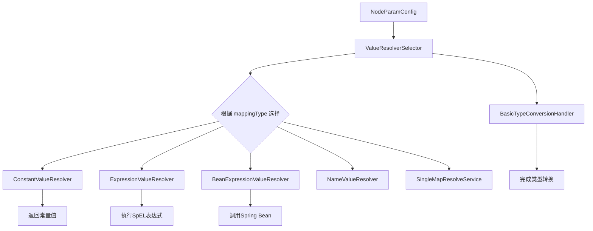
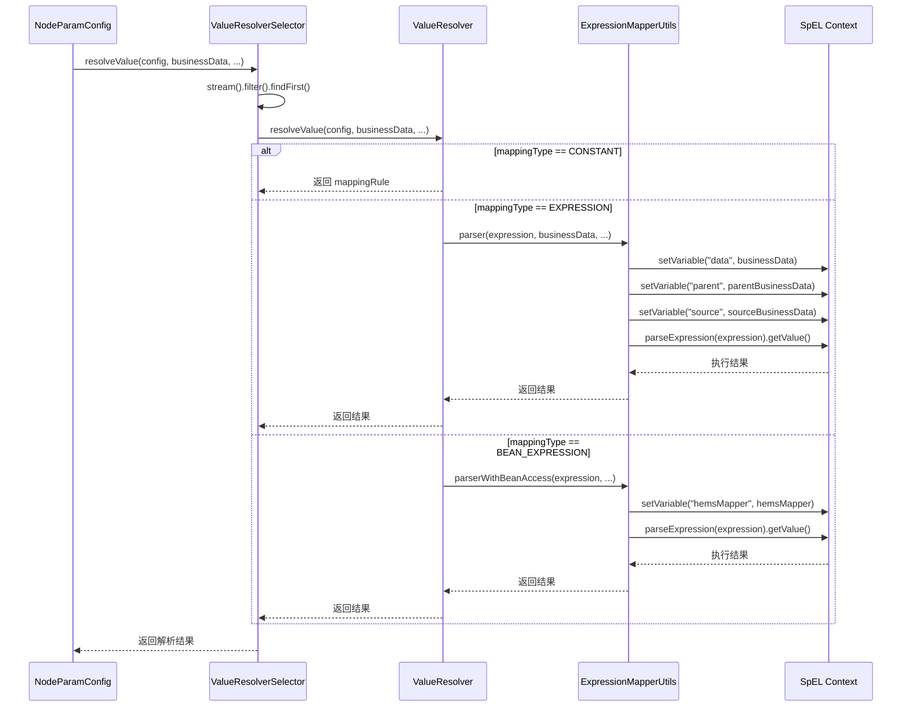
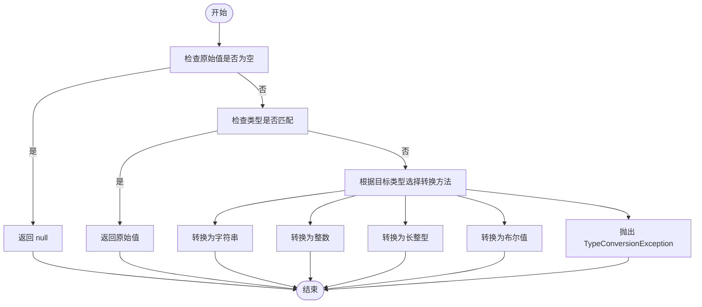

# 参数值解析机制

<cite>
**本文档引用的文件**  
- [ValueResolverSelector.java](file://agent-invocation/src/main/java/com/helianhealth/agent/invocation/remote/resolver/ValueResolverSelector.java)
- [ValueResolver.java](file://agent-invocation/src/main/java/com/helianhealth/agent/invocation/remote/resolver/ValueResolver.java)
- [ConstantValueResolver.java](file://agent-invocation/src/main/java/com/helianhealth/agent/invocation/remote/resolver/ConstantValueResolver.java)
- [ExpressionValueResolver.java](file://agent-invocation/src/main/java/com/helianhealth/agent/invocation/remote/resolver/ExpressionValueResolver.java)
- [BeanExpressionValueResolver.java](file://agent-invocation/src/main/java/com/helianhealth/agent/invocation/remote/resolver/BeanExpressionValueResolver.java)
- [BasicTypeConversionHandler.java](file://agent-invocation/src/main/java/com/helianhealth/agent/invocation/remote/support/BasicTypeConversionHandler.java)
- [NodeParamConfig.java](file://agent-invocation/src/main/java/com/helianhealth/agent/invocation/remote/model/NodeParamConfig.java)
- [ExpressionMapperUtils.java](file://agent-invocation/src/main/java/com/helianhealth/agent/invocation/utils/ExpressionMapperUtils.java)
- [MappingType.java](file://agent-common/src/main/java/com/helianhealth/agent/common/enums/MappingType.java)
- [ParamType.java](file://agent-common/src/main/java/com/helianhealth/agent/common/enums/ParamType.java)
- [ProcessType.java](file://agent-common/src/main/java/com/helianhealth/agent/common/enums/ProcessType.java)
</cite>

## 目录
1. [引言](#引言)
2. [核心组件与架构](#核心组件与架构)
3. [ValueResolverSelector 的核心作用](#valueresolverselector-的核心作用)
4. [值解析器实现分析](#值解析器实现分析)
5. [解析流程与调用链分析](#解析流程与调用链分析)
6. [类型转换机制](#类型转换机制)
7. [配置示例与最佳实践](#配置示例与最佳实践)
8. [总结](#总结)

## 引言

在接口代理系统中，参数映射是实现业务数据与第三方接口之间数据转换的核心环节。`ValueResolverSelector` 作为参数映射机制的中枢，负责根据配置选择合适的值解析器，完成从原始数据到目标参数的动态解析。本文将深入剖析其设计原理、实现机制及各组件协同工作方式。

## 核心组件与架构

参数值解析机制由多个核心组件构成，形成清晰的职责分离架构：



**图示来源**  
- [NodeParamConfig.java](file://agent-invocation/src/main/java/com/helianhealth/agent/invocation/remote/model/NodeParamConfig.java#L20-L95)
- [ValueResolverSelector.java](file://agent-invocation/src/main/java/com/helianhealth/agent/invocation/remote/resolver/ValueResolverSelector.java#L13-L37)
- [ValueResolver.java](file://agent-invocation/src/main/java/com/helianhealth/agent/invocation/remote/resolver/ValueResolver.java#L11-L20)

**本节来源**  
- [NodeParamConfig.java](file://agent-invocation/src/main/java/com/helianhealth/agent/invocation/remote/model/NodeParamConfig.java#L1-L96)
- [ValueResolverSelector.java](file://agent-invocation/src/main/java/com/helianhealth/agent/invocation/remote/resolver/ValueResolverSelector.java#L1-L38)

## ValueResolverSelector 的核心作用

`ValueResolverSelector` 是参数值解析的调度中心，其核心职责是根据 `NodeParamConfig` 中的 `mappingType` 选择合适的 `ValueResolver` 实现进行值解析。

该组件通过 Spring 的依赖注入机制，自动收集所有实现了 `ValueResolver` 接口的 Bean，并在 `resolveValue` 方法中使用 Java Stream 的 `filter().findFirst()` 策略模式进行解析器选择。

```java
valueResolvers.stream()
    .filter(resolver -> resolver.supports(config.getMappingType()))
    .findFirst()
    .map(resolver -> resolver.resolveValue(...))
    .orElse(null);
```

这种设计实现了开闭原则，新增解析器只需实现 `ValueResolver` 接口并注册为 Spring Bean，无需修改 `ValueResolverSelector` 的代码。

**本节来源**  
- [ValueResolverSelector.java](file://agent-invocation/src/main/java/com/helianhealth/agent/invocation/remote/resolver/ValueResolverSelector.java#L13-L37)

## 值解析器实现分析

### 常量值解析器 (ConstantValueResolver)

`ConstantValueResolver` 用于处理 `CONSTANT` 类型的映射，直接返回配置中的 `mappingRule` 作为解析结果。

```java
@Override
public Object resolveValue(NodeParamConfig config, ...) {
    return config.getMappingRule();
}

@Override
public boolean supports(MappingType mappingType) {
    return MappingType.CONSTANT == mappingType;
}
```

适用于需要传递固定值的场景，如接口版本号、固定标识等。

**本节来源**  
- [ConstantValueResolver.java](file://agent-invocation/src/main/java/com/helianhealth/agent/invocation/remote/resolver/ConstantValueResolver.java#L10-L22)

### 表达式解析器 (ExpressionValueResolver)

`ExpressionValueResolver` 支持 SpEL 表达式，能够从业务数据中动态提取或计算值。

根据 `ProcessType` 的不同，调用 `ExpressionMapperUtils` 的不同方法：
- `PRE_PROCESS`：使用 `parser()` 方法，上下文变量为 `data`, `parent`, `source`
- `POST_PROCESS`：使用 `parserPostNode()` 方法，上下文变量为 `data`, `input`, `response`

```java
return ExpressionMapperUtils.parser(config.getMappingRule(), ...);
```

支持复杂的条件判断、字符串拼接等操作，如：`#data.idCard == null ? #data.phone + 'hl' : #data.idCard`

**本节来源**  
- [ExpressionValueResolver.java](file://agent-invocation/src/main/java/com/helianhealth/agent/invocation/remote/resolver/ExpressionValueResolver.java#L15-L38)
- [ExpressionMapperUtils.java](file://agent-invocation/src/main/java/com/helianhealth/agent/invocation/utils/ExpressionMapperUtils.java#L39-L81)

### Bean表达式解析器 (BeanExpressionValueResolver)

`BeanExpressionValueResolver` 支持访问 Spring 容器中的 Bean，实现更强大的数据查询能力。

通过 `ExpressionMapperUtils.parserWithBeanAccess()` 方法执行表达式，上下文中预置了 `hemsMapper` 等 Bean 实例。

典型应用场景：`@interfaceFlowNodeMapper.selectByNodeId(#nodeId)`，通过 Mapper 查询数据库获取动态值。

```java
return ExpressionMapperUtils.parserWithBeanAccess(config.getMappingRule(), ...);
```

**本节来源**  
- [BeanExpressionValueResolver.java](file://agent-invocation/src/main/java/com/helianhealth/agent/invocation/remote/resolver/BeanExpressionValueResolver.java#L14-L28)
- [ExpressionMapperUtils.java](file://agent-invocation/src/main/java/com/helianhealth/agent/invocation/utils/ExpressionMapperUtils.java#L114-L134)

## 解析流程与调用链分析

参数值解析的完整调用链如下：



**图示来源**  
- [ValueResolverSelector.java](file://agent-invocation/src/main/java/com/helianhealth/agent/invocation/remote/resolver/ValueResolverSelector.java#L22-L31)
- [ExpressionMapperUtils.java](file://agent-invocation/src/main/java/com/helianhealth/agent/invocation/utils/ExpressionMapperUtils.java#L39-L134)

**本节来源**  
- [ValueResolverSelector.java](file://agent-invocation/src/main/java/com/helianhealth/agent/invocation/remote/resolver/ValueResolverSelector.java#L1-L38)
- [ExpressionMapperUtils.java](file://agent-invocation/src/main/java/com/helianhealth/agent/invocation/utils/ExpressionMapperUtils.java#L1-L147)

## 类型转换机制

解析得到的原始值需要通过 `BasicTypeConversionHandler` 转换为目标参数类型。

该处理器实现了 `TypeHandler` 接口，支持以下类型转换：
- `STRING`：`String.valueOf()`
- `INTEGER`：`Integer.parseInt()` 或 `Number.intValue()`
- `LONG`：`Long.parseLong()` 或 `Number.longValue()`
- `BOOLEAN`：支持 `"true"`, `"1"`, 非零数字等

转换前会检查类型是否匹配，避免不必要的转换开销。转换失败时抛出 `TypeConversionException`。



**图示来源**  
- [BasicTypeConversionHandler.java](file://agent-invocation/src/main/java/com/helianhealth/agent/invocation/remote/support/BasicTypeConversionHandler.java#L10-L94)

**本节来源**  
- [BasicTypeConversionHandler.java](file://agent-invocation/src/main/java/com/helianhealth/agent/invocation/remote/support/BasicTypeConversionHandler.java#L1-L94)
- [TypeHandler.java](file://agent-invocation/src/main/java/com/helianhealth/agent/invocation/remote/support/TypeHandler.java#L9-L18)

## 配置示例与最佳实践

### 常量映射配置
```json
{
  "mappingType": "CONSTANT",
  "mappingRule": "v1.0",
  "targetParamType": "STRING"
}
```
适用于固定版本号、静态标识等场景。

### 动态表达式配置
```json
{
  "mappingType": "EXPRESSION",
  "mappingRule": "#data.idCard == null ? #data.phone + 'hl' : #data.idCard",
  "targetParamType": "STRING"
}
```
适用于条件判断、数据拼接等复杂逻辑。

### Bean调用配置
```json
{
  "mappingType": "BEAN_EXPRESSION",
  "mappingRule": "@interfaceFlowNodeMapper.selectByNodeId(#nodeId)",
  "targetParamType": "OBJECT"
}
```
适用于需要查询数据库或其他服务获取动态值的场景。

**最佳实践建议**：
1. 简单固定值使用 `CONSTANT` 类型
2. 业务数据内部转换使用 `EXPRESSION` 类型
3. 需要外部数据查询时使用 `BEAN_EXPRESSION` 类型
4. 注意表达式性能，避免复杂计算
5. 合理使用类型转换，确保数据一致性

**本节来源**  
- [MappingType.java](file://agent-common/src/main/java/com/helianhealth/agent/common/enums/MappingType.java#L9-L35)
- [ParamType.java](file://agent-common/src/main/java/com/helianhealth/agent/common/enums/ParamType.java#L9-L50)
- [ProcessType.java](file://agent-common/src/main/java/com/helianhealth/agent/common/enums/ProcessType.java#L9-L20)

## 总结

`ValueResolverSelector` 通过策略模式实现了灵活的参数值解析机制，结合 Spring 的依赖注入和 SpEL 表达式能力，支持常量、动态表达式、Bean 调用等多种映射方式。配合 `BasicTypeConversionHandler` 的类型转换能力，形成了完整的参数映射解决方案。该设计具有良好的扩展性和维护性，是接口代理系统中数据转换的核心组件。