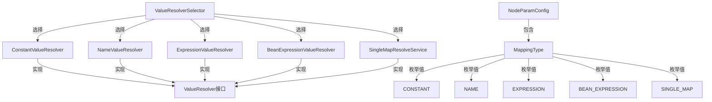
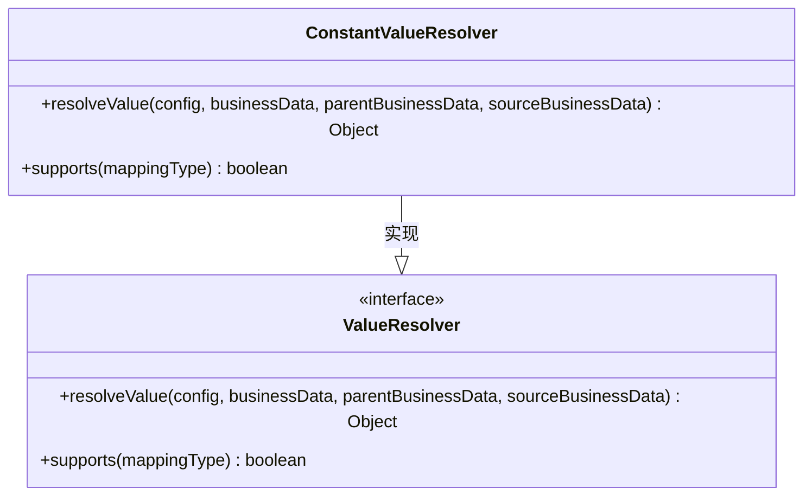
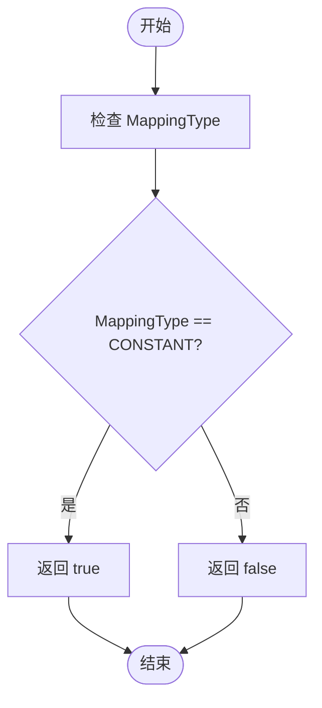
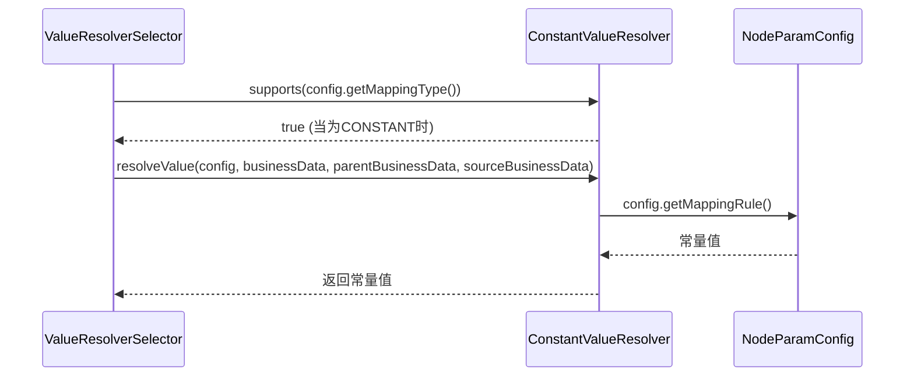

# 常量值解析

<cite>
**本文档中引用的文件**  
- [ConstantValueResolver.java](file://agent-invocation/src/main/java/com/helianhealth/agent/invocation/remote/resolver/ConstantValueResolver.java)
- [ValueResolver.java](file://agent-invocation/src/main/java/com/helianhealth/agent/invocation/remote/resolver/ValueResolver.java)
- [NodeParamConfig.java](file://agent-invocation/src/main/java/com/helianhealth/agent/invocation/remote/model/NodeParamConfig.java)
- [MappingType.java](file://agent-common/src/main/java/com/helianhealth/agent/common/enums/MappingType.java)
- [ValueResolverSelector.java](file://agent-invocation/src/main/java/com/helianhealth/agent/invocation/remote/resolver/ValueResolverSelector.java)
- [create_archive_hbos_config.json](file://agent-ai/src/main/resources/create_archive_hbos_config.json)
</cite>

## 目录
1. [简介](#简介)
2. [核心组件](#核心组件)
3. [架构概述](#架构概述)
4. [详细组件分析](#详细组件分析)
5. [依赖分析](#依赖分析)
6. [性能考虑](#性能考虑)
7. [故障排除指南](#故障排除指南)
8. [结论](#结论)

## 简介
本文档详细说明了`ConstantValueResolver`如何实现`ValueResolver`接口，并通过`supports`方法判断当`MappingType`为`CONSTANT`时启用。解释其`resolveValue`方法直接返回`NodeParamConfig`中的`mappingRule`作为常量值的机制。结合配置示例说明在接口参数需要固定值（如系统编码、默认状态）时的应用场景，提供实际使用中的最佳实践和注意事项。

## 核心组件
`ConstantValueResolver`是接口代理系统中用于处理常量映射的核心组件之一。它实现了`ValueResolver`接口，专门负责处理`MappingType.CONSTANT`类型的参数映射。当工作流节点需要将某个参数设置为固定值时，该解析器会被调用，直接返回配置中定义的常量值。

**本节来源**
- [ConstantValueResolver.java](file://agent-invocation/src/main/java/com/helianhealth/agent/invocation/remote/resolver/ConstantValueResolver.java#L1-L22)
- [ValueResolver.java](file://agent-invocation/src/main/java/com/helianhealth/agent/invocation/remote/resolver/ValueResolver.java#L1-L20)

## 架构概述
系统采用策略模式实现多种值解析器，通过`ValueResolverSelector`根据`MappingType`选择合适的解析器。`ConstantValueResolver`作为其中一种具体实现，与其他解析器（如`NameValueResolver`、`ExpressionValueResolver`等）共同构成了完整的值解析体系。



**图表来源**  
- [ValueResolverSelector.java](file://agent-invocation/src/main/java/com/helianhealth/agent/invocation/remote/resolver/ValueResolverSelector.java#L1-L38)
- [ConstantValueResolver.java](file://agent-invocation/src/main/java/com/helianhealth/agent/invocation/remote/resolver/ConstantValueResolver.java#L1-L22)
- [MappingType.java](file://agent-common/src/main/java/com/helianhealth/agent/common/enums/MappingType.java#L1-L36)

## 详细组件分析

### ConstantValueResolver 实现分析
`ConstantValueResolver`是`ValueResolver`接口的具体实现之一，专门用于处理常量值映射。

#### 类结构与接口实现


**图表来源**  
- [ConstantValueResolver.java](file://agent-invocation/src/main/java/com/helianhealth/agent/invocation/remote/resolver/ConstantValueResolver.java#L1-L22)
- [ValueResolver.java](file://agent-invocation/src/main/java/com/helianhealth/agent/invocation/remote/resolver/ValueResolver.java#L1-L20)

#### 支持判断机制
`ConstantValueResolver`通过`supports`方法判断是否支持当前的映射类型。只有当`MappingType`为`CONSTANT`时才返回`true`，确保该解析器仅在处理常量映射时被调用。



**图表来源**  
- [ConstantValueResolver.java](file://agent-invocation/src/main/java/com/helianhealth/agent/invocation/remote/resolver/ConstantValueResolver.java#L17-L20)

#### 值解析机制
`resolveValue`方法直接返回`NodeParamConfig`对象中的`mappingRule`字段值，作为常量值使用。这种设计简单高效，避免了复杂的计算或查找过程。



**图表来源**  
- [ConstantValueResolver.java](file://agent-invocation/src/main/java/com/helianhealth/agent/invocation/remote/resolver/ConstantValueResolver.java#L13-L15)
- [NodeParamConfig.java](file://agent-invocation/src/main/java/com/helianhealth/agent/invocation/remote/model/NodeParamConfig.java#L1-L96)

**本节来源**
- [ConstantValueResolver.java](file://agent-invocation/src/main/java/com/helianhealth/agent/invocation/remote/resolver/ConstantValueResolver.java#L1-L22)
- [NodeParamConfig.java](file://agent-invocation/src/main/java/com/helianhealth/agent/invocation/remote/model/NodeParamConfig.java#L1-L96)

## 依赖分析
`ConstantValueResolver`与其他组件之间存在明确的依赖关系，形成了一个完整的值解析体系。

```mermaid
erDiagram
VALUE_RESOLVER ||--o{ CONSTANT_VALUE_RESOLVER : "实现"
VALUE_RESOLVER ||--o{ NAME_VALUE_RESOLVER : "实现"
VALUE_RESOLVER ||--o{ EXPRESSION_VALUE_RESOLVER : "实现"
VALUE_RESOLVER ||--o{ BEAN_EXPRESSION_VALUE_RESOLVER : "实现"
VALUE_RESOLVER ||--o{ SINGLE_MAP_RESOLVE_SERVICE : "实现"
VALUE_RESOLVER_SELECTOR }o--|| VALUE_RESOLVER : "依赖"
NODE_PARAM_CONFIG }o--|| MAPPING_TYPE : "包含"
class VALUE_RESOLVER {
resolveValue()
supports()
}
class CONSTANT_VALUE_RESOLVER {
resolveValue()
supports()
}
class VALUE_RESOLVER_SELECTOR {
resolveValue()
}
class NODE_PARAM_CONFIG {
mappingType
mappingRule
}
class MAPPING_TYPE {
CONSTANT
NAME
EXPRESSION
BEAN_EXPRESSION
SINGLE_MAP
}
```

**图表来源**  
- [ValueResolverSelector.java](file://agent-invocation/src/main/java/com/helianhealth/agent/invocation/remote/resolver/ValueResolverSelector.java#L1-L38)
- [ConstantValueResolver.java](file://agent-invocation/src/main/java/com/helianhealth/agent/invocation/remote/resolver/ConstantValueResolver.java#L1-L22)
- [MappingType.java](file://agent-common/src/main/java/com/helianhealth/agent/common/enums/MappingType.java#L1-L36)

**本节来源**
- [ValueResolverSelector.java](file://agent-invocation/src/main/java/com/helianhealth/agent/invocation/remote/resolver/ValueResolverSelector.java#L1-L38)
- [ConstantValueResolver.java](file://agent-invocation/src/main/java/com/helianhealth/agent/invocation/remote/resolver/ConstantValueResolver.java#L1-L22)
- [MappingType.java](file://agent-common/src/main/java/com/helianhealth/agent/common/enums/MappingType.java#L1-L36)

## 性能考虑
`ConstantValueResolver`的设计具有优异的性能特性：
- **时间复杂度**：O(1)，直接返回预设值，无需计算或查找
- **空间复杂度**：O(1)，不产生额外的内存开销
- **线程安全**：无状态设计，天然支持多线程环境
- **GC影响**：极小，仅返回已有对象引用

由于其实现简单直接，`ConstantValueResolver`在高并发场景下表现稳定，不会成为系统性能瓶颈。

## 故障排除指南
在使用`ConstantValueResolver`时可能遇到的问题及解决方案：

1. **常量值未生效**
   - 检查`mappingType`是否正确设置为`CONSTANT`
   - 确认`mappingRule`字段包含期望的常量值
   - 验证配置是否已正确加载

2. **类型转换错误**
   - 确保`mappingRule`中的值与目标参数类型兼容
   - 检查目标系统对接口参数类型的严格要求
   - 必要时在配置中添加类型转换规则

3. **配置错误**
   - 使用JSON Schema验证配置文件格式
   - 检查`targetParamKey`是否与接口文档一致
   - 确认`sort`值正确以保证参数顺序

**本节来源**
- [ConstantValueResolver.java](file://agent-invocation/src/main/java/com/helianhealth/agent/invocation/remote/resolver/ConstantValueResolver.java#L1-L22)
- [create_archive_hbos_config.json](file://agent-ai/src/main/resources/create_archive_hbos_config.json#L1-L251)

## 结论
`ConstantValueResolver`通过简洁高效的设计实现了常量值映射功能。它利用策略模式与`ValueResolverSelector`协同工作，根据`MappingType`判断是否启用，并直接返回`NodeParamConfig`中的`mappingRule`作为常量值。这种设计在需要固定值（如系统编码、默认状态）的场景下非常实用，具有高性能、易维护的优点。通过合理的配置和使用，可以有效支持各种接口集成需求。