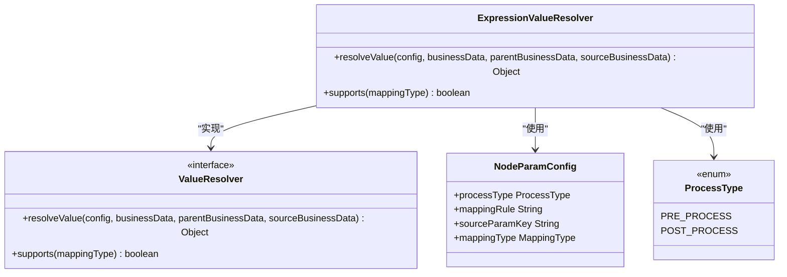
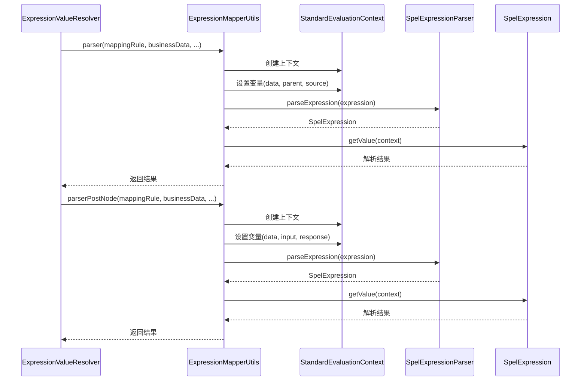
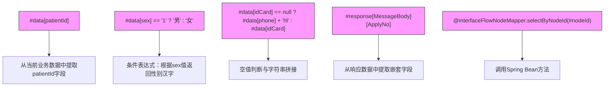
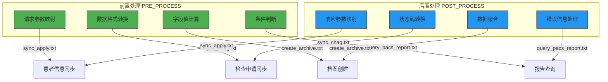
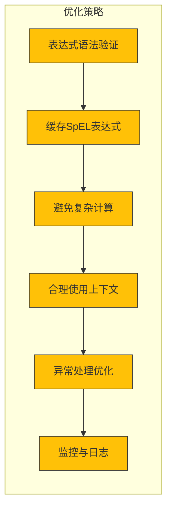

# 表达式值解析

<cite>
**本文档引用文件**   
- [ExpressionValueResolver.java](file://agent-invocation/src/main/java/com/helianhealth/agent/invocation/remote/resolver/ExpressionValueResolver.java)
- [ExpressionMapperUtils.java](file://agent-invocation/src/main/java/com/helianhealth/agent/invocation/utils/ExpressionMapperUtils.java)
- [ProcessType.java](file://agent-common/src/main/java/com/helianhealth/agent/common/enums/ProcessType.java)
- [NodeParamConfig.java](file://agent-invocation/src/main/java/com/helianhealth/agent/invocation/remote/model/NodeParamConfig.java)
- [ValueResolver.java](file://agent-invocation/src/main/java/com/helianhealth/agent/invocation/remote/resolver/ValueResolver.java)
- [ValueResolverSelector.java](file://agent-invocation/src/main/java/com/helianhealth/agent/invocation/remote/resolver/ValueResolverSelector.java)
- [sync_apply.txt](file://agent-ai/src/main/resources/systemprompt/sync_apply.txt)
- [query_pacs_report.txt](file://agent-ai/src/main/resources/systemprompt/query_pacs_report.txt)
</cite>

## 目录
1. [简介](#简介)
2. [核心组件分析](#核心组件分析)
3. [ExpressionValueResolver处理逻辑](#expressionvalueresolver处理逻辑)
4. [ExpressionMapperUtils表达式解析机制](#expressionmapperutils表达式解析机制)
5. [SpEL表达式数据映射示例](#spel表达式数据映射示例)
6. [复杂业务数据转换应用场景](#复杂业务数据转换应用场景)
7. [性能优化建议](#性能优化建议)
8. [结论](#结论)

## 简介
本文档深入分析ExpressionValueResolver如何支持SpEL表达式解析，阐述其根据ProcessType区分PRE_PROCESS与POST_PROCESS的处理逻辑。详细说明ExpressionMapperUtils.parser和parserPostNode方法如何解析SpEL表达式并从businessData中提取动态值，通过具体表达式示例展示数据映射能力，并探讨在复杂业务数据转换中的应用场景及性能优化建议。

## 核心组件分析

**Section sources**
- [ExpressionValueResolver.java](file://agent-invocation/src/main/java/com/helianhealth/agent/invocation/remote/resolver/ExpressionValueResolver.java#L1-L38)
- [ExpressionMapperUtils.java](file://agent-invocation/src/main/java/com/helianhealth/agent/invocation/utils/ExpressionMapperUtils.java#L1-L146)
- [ProcessType.java](file://agent-common/src/main/java/com/helianhealth/agent/common/enums/ProcessType.java#L1-L21)

## ExpressionValueResolver处理逻辑

**Diagram sources**
- [ExpressionValueResolver.java](file://agent-invocation/src/main/java/com/helianhealth/agent/invocation/remote/resolver/ExpressionValueResolver.java#L15-L38)
- [NodeParamConfig.java](file://agent-invocation/src/main/java/com/helianhealth/agent/invocation/remote/model/NodeParamConfig.java#L30-L80)
- [ProcessType.java](file://agent-common/src/main/java/com/helianhealth/agent/common/enums/ProcessType.java#L14-L19)

ExpressionValueResolver是SpEL表达式解析的核心实现类，实现了ValueResolver接口。其处理逻辑根据NodeParamConfig中的ProcessType字段区分前置处理和后置处理：

- 当ProcessType为PRE_PROCESS时，调用ExpressionMapperUtils.parser方法进行表达式解析
- 当ProcessType为POST_PROCESS时，调用ExpressionMapperUtils.parserPostNode方法进行表达式解析

该解析器通过supports方法判断是否支持EXPRESSION类型的映射规则，确保只有在配置为表达式映射时才被选中执行。

**Section sources**
- [ExpressionValueResolver.java](file://agent-invocation/src/main/java/com/helianhealth/agent/invocation/remote/resolver/ExpressionValueResolver.java#L18-L30)
- [ValueResolver.java](file://agent-invocation/src/main/java/com/helianhealth/agent/invocation/remote/resolver/ValueResolver.java#L13-L18)

## ExpressionMapperUtils表达式解析机制

**Diagram sources**
- [ExpressionValueResolver.java](file://agent-invocation/src/main/java/com/helianhealth/agent/invocation/remote/resolver/ExpressionValueResolver.java#L21-L29)
- [ExpressionMapperUtils.java](file://agent-invocation/src/main/java/com/helianhealth/agent/invocation/utils/ExpressionMapperUtils.java#L39-L80)

ExpressionMapperUtils是SpEL表达式解析的工具类，提供了两个核心方法：

1. **parser方法**：用于前置处理，支持三个上下文变量：
   - data：当前层级的业务数据
   - parent：上一层级的业务数据
   - source：根层级的业务数据

2. **parserPostNode方法**：用于后置处理，支持三个上下文变量：
   - data：当前层级的业务数据
   - input：输入参数
   - response：输出参数

两个方法均使用Spring的SpelExpressionParser和StandardEvaluationContext实现表达式解析，通过setVariable方法将业务数据注入上下文，然后解析执行表达式并返回结果。异常情况下会记录错误日志并返回null。

**Section sources**
- [ExpressionMapperUtils.java](file://agent-invocation/src/main/java/com/helianhealth/agent/invocation/utils/ExpressionMapperUtils.java#L39-L80)
- [ExpressionMapperUtils.java](file://agent-invocation/src/main/java/com/helianhealth/agent/invocation/utils/ExpressionMapperUtils.java#L114-L134)

## SpEL表达式数据映射示例

**Diagram sources**
- [sync_apply.txt](file://agent-ai/src/main/resources/systemprompt/sync_apply.txt#L850-L851)
- [query_pacs_report.txt](file://agent-ai/src/main/resources/systemprompt/query_pacs_report.txt#L670-L671)

SpEL表达式在数据映射中具有强大的能力，以下是一些典型示例：

1. **简单字段提取**：`#data['patientId']` 从当前业务数据中提取patientId字段的值

2. **条件表达式**：`#data[sex] == '1' ? '男' : '女'` 根据sex字段的值返回对应的性别汉字

3. **空值处理**：`#data[idCard] == null ? #data[phone] + 'hl' : #data[idCard]` 当身份证号为空时，使用手机号拼接特定后缀

4. **嵌套数据访问**：`#response[MessageBody][ApplyNo]` 从响应数据的嵌套结构中提取申请单号

5. **Bean方法调用**：`@interfaceFlowNodeMapper.selectByNodeId(#nodeId)` 调用Spring容器中的Bean方法

这些表达式通过ExpressionMapperUtils的解析机制，能够灵活地处理各种数据转换需求。

**Section sources**
- [sync_apply.txt](file://agent-ai/src/main/resources/systemprompt/sync_apply.txt#L849-L851)
- [query_pacs_report.txt](file://agent-ai/src/main/resources/systemprompt/query_pacs_report.txt#L669-L671)

## 复杂业务数据转换应用场景

**Diagram sources**
- [sync_apply.txt](file://agent-ai/src/main/resources/systemprompt/sync_apply.txt#L279-L304)
- [sync_chag.txt](file://agent-ai/src/main/resources/systemprompt/sync_chag.txt#L268-L307)
- [query_pacs_report.txt](file://agent-ai/src/main/resources/systemprompt/query_pacs_report.txt#L660-L684)

在复杂业务场景中，SpEL表达式解析机制支持多种高级应用：

1. **医疗数据同步**：在sync_apply.txt中，使用`#data[patientCode]`、`#data[patientName]`等表达式将患者信息从内部系统映射到外部接口

2. **条件状态转换**：在sync_apply.txt中，使用`#data == \"1\" ? \"200\" : \"-1\"`将内部状态码转换为外部接口要求的状态码格式

3. **性别值标准化**：在sync_apply.txt中，使用`#data[sex] == '1' ? '男' : '女'`将数字性别代码转换为中文描述

4. **响应数据提取**：在query_pacs_report.txt中，使用`#response[MessageBody][ApplyNo]`从复杂的XML或JSON响应中提取关键字段

5. **数据过滤处理**：通过businessDataFilter方法，在不修改原始数据的情况下进行数据过滤和转换

这些应用场景展示了SpEL表达式在处理异构系统间数据映射时的强大灵活性。

**Section sources**
- [sync_apply.txt](file://agent-ai/src/main/resources/systemprompt/sync_apply.txt#L279-L571)
- [sync_chag.txt](file://agent-ai/src/main/resources/systemprompt/sync_chag.txt#L268-L307)
- [query_pacs_report.txt](file://agent-ai/src/main/resources/systemprompt/query_pacs_report.txt#L660-L684)

## 性能优化建议

**Diagram sources**
- [ExpressionMapperUtils.java](file://agent-invocation/src/main/java/com/helianhealth/agent/invocation/utils/ExpressionMapperUtils.java#L136-L144)

为确保SpEL表达式解析的高性能，建议采取以下优化措施：

1. **表达式语法预验证**：使用validateExpressionSyntax方法在配置时验证表达式语法，避免运行时解析错误

2. **表达式缓存**：虽然当前实现中SpelExpressionParser是静态常量，但可以进一步缓存解析后的SpelExpression对象，避免重复解析相同表达式

3. **避免复杂计算**：在表达式中避免执行耗时的计算或数据库查询，尽量将复杂逻辑移到Java代码中处理

4. **合理使用上下文变量**：只注入必要的上下文变量，减少上下文初始化的开销

5. **异常处理优化**：捕获特定异常类型而非通用Exception，提高异常处理的精确性

6. **监控与日志**：记录表达式执行时间和频率，便于性能分析和问题排查

7. **表达式复杂度控制**：限制表达式的嵌套深度和复杂度，避免过长的表达式影响可读性和性能

**Section sources**
- [ExpressionMapperUtils.java](file://agent-invocation/src/main/java/com/helianhealth/agent/invocation/utils/ExpressionMapperUtils.java#L136-L144)
- [ExpressionMapperUtils.java](file://agent-invocation/src/main/java/com/helianhealth/agent/invocation/utils/ExpressionMapperUtils.java#L52-L54)

## 结论
ExpressionValueResolver结合ExpressionMapperUtils提供了强大的SpEL表达式解析能力，通过ProcessType区分PRE_PROCESS和POST_PROCESS处理逻辑，支持灵活的数据映射和转换。该机制在医疗接口集成等复杂业务场景中表现出色，能够处理各种数据格式转换、条件判断和值计算需求。通过合理的性能优化措施，可以确保系统在高并发场景下的稳定性和响应速度。建议在实际应用中充分利用SpEL表达式的灵活性，同时注意控制表达式复杂度和做好性能监控。