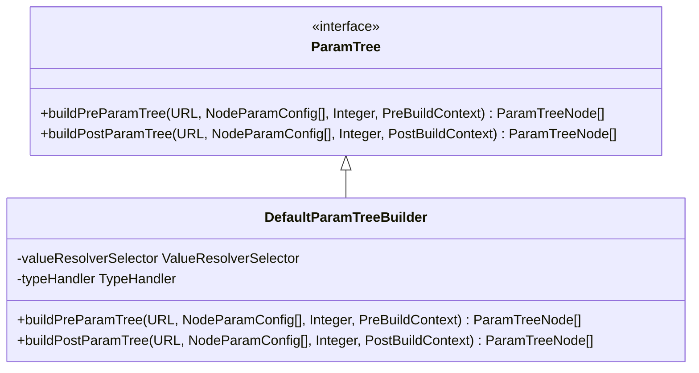
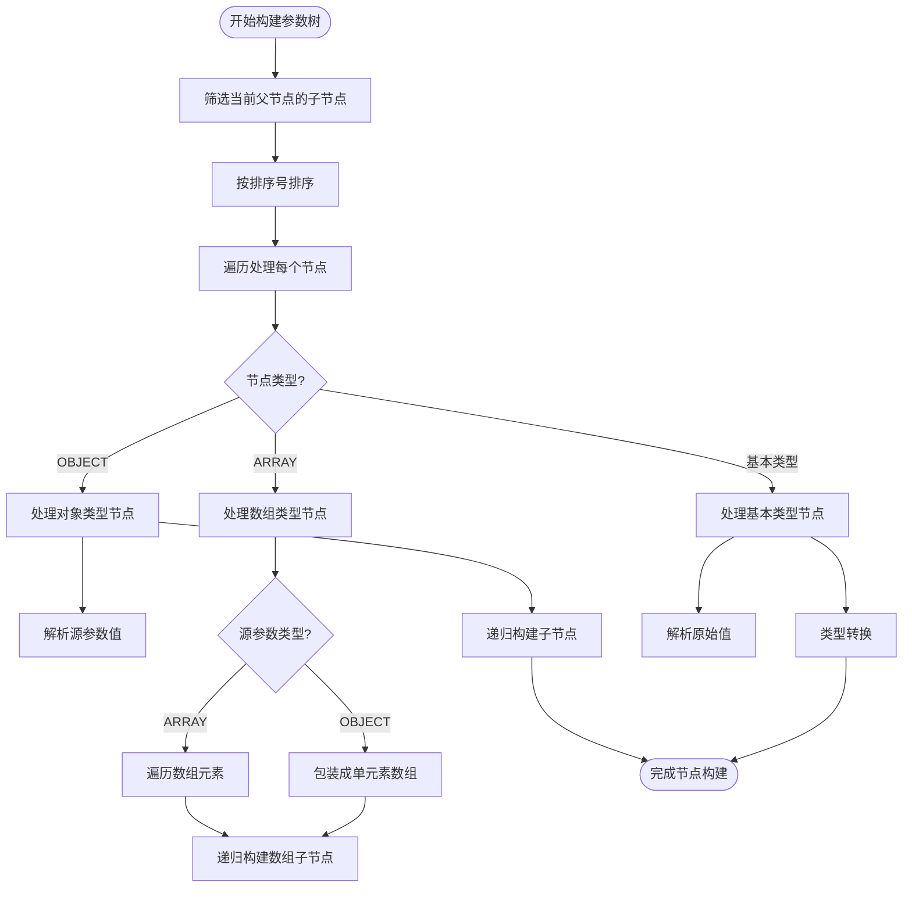
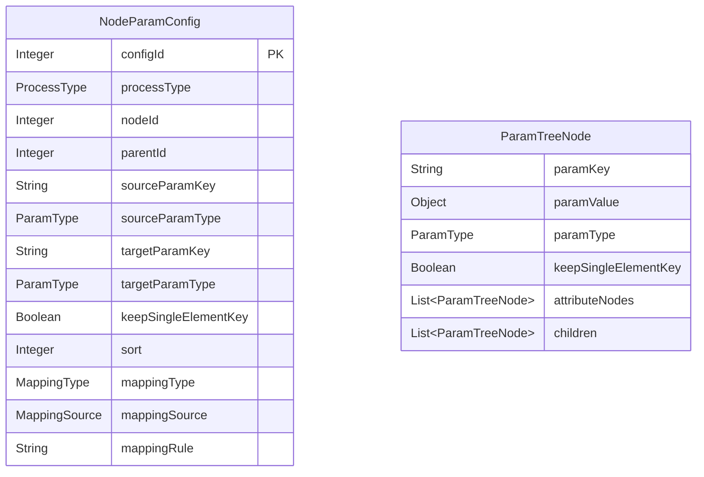
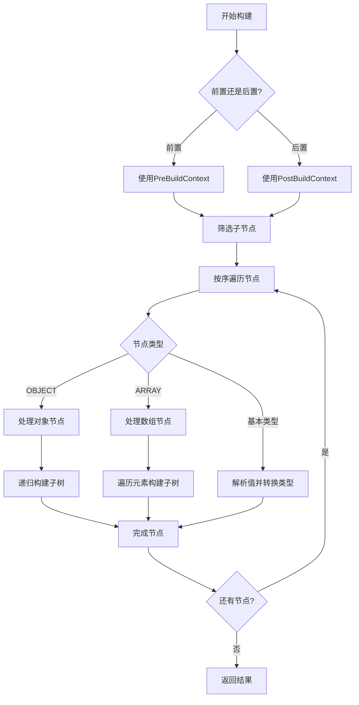

# 参数映射

<cite>
**本文档中引用的文件**
- [ParamTree.java](file://agent-invocation/src/main/java/com/helianhealth/agent/invocation/remote/ParamTree.java)
- [AbstractParamTreeBuilder.java](file://agent-invocation/src/main/java/com/helianhealth/agent/invocation/remote/AbstractParamTreeBuilder.java)
- [DefaultParamTreeBuilder.java](file://agent-invocation/src/main/java/com/helianhealth/agent/invocation/remote/DefaultParamTreeBuilder.java)
- [ValueResolverSelector.java](file://agent-invocation/src/main/java/com/helianhealth/agent/invocation/remote/resolver/ValueResolverSelector.java)
- [TypeHandler.java](file://agent-invocation/src/main/java/com/helianhealth/agent/invocation/remote/support/TypeHandler.java)
- [ParamTreeNode.java](file://agent-invocation/src/main/java/com/helianhealth/agent/invocation/remote/model/ParamTreeNode.java)
- [NodeParamConfig.java](file://agent-invocation/src/main/java/com/helianhealth/agent/invocation/remote/model/NodeParamConfig.java)
- [ConstantValueResolver.java](file://agent-invocation/src/main/java/com/helianhealth/agent/invocation/remote/resolver/ConstantValueResolver.java)
- [ExpressionValueResolver.java](file://agent-invocation/src/main/java/com/helianhealth/agent/invocation/remote/resolver/ExpressionValueResolver.java)
- [BeanExpressionValueResolver.java](file://agent-invocation/src/main/java/com/helianhealth/agent/invocation/remote/resolver/BeanExpressionValueResolver.java)
- [NameValueResolver.java](file://agent-invocation/src/main/java/com/helianhealth/agent/invocation/remote/resolver/NameValueResolver.java)
</cite>

## 目录
1. [引言](#引言)
2. [参数树核心作用](#参数树核心作用)
3. [ParamTree SPI设计](#paramtree-spi设计)
4. [抽象构建器实现](#抽象构建器实现)
5. [默认参数树构建器](#默认参数树构建器)
6. [值解析器选择机制](#值解析器选择机制)
7. [类型转换处理](#类型转换处理)
8. [数据模型结构](#数据模型结构)
9. [构建流程图解](#构建流程图解)
10. [总结](#总结)

## 引言
本文深入讲解参数树（ParamTree）在系统中的核心作用，即如何将配置化的参数映射规则转换为实际的参数树结构，实现复杂的嵌套数据映射。详细说明ParamTree接口的SPI设计，以及AbstractParamTreeBuilder提供的骨架实现。重点描述DefaultParamTreeBuilder如何递归构建前置和后置参数树，处理对象、数组等复杂类型。同时解释ValueResolverSelector如何根据配置选择不同的值解析器来获取原始值，并通过TypeHandler完成类型转换，最终形成可用于远程调用的参数结构。

**Section sources**
- [ParamTree.java](file://agent-invocation/src/main/java/com/helianhealth/agent/invocation/remote/ParamTree.java#L1-L48)

## 参数树核心作用
参数树（ParamTree）是系统中实现参数映射的核心组件，其主要作用是将配置化的参数映射规则转换为实际的参数树结构，支持复杂的嵌套数据映射。该机制允许系统在调用前后对参数进行灵活的转换和处理，确保与第三方接口的兼容性。

参数树的核心功能包括：
- 将配置化的映射规则转换为实际的参数结构
- 支持对象、数组等复杂类型的嵌套映射
- 实现调用前（前置）和调用后（后置）的双向参数转换
- 提供SPI扩展机制，支持自定义实现
- 通过递归方式构建多层级的参数树结构

参数树的应用场景主要集中在接口调用的参数转换，包括HTTP、数据库、WebService等不同协议的远程调用，确保输入参数和响应参数能够按照预设规则进行正确映射。

**Section sources**
- [ParamTree.java](file://agent-invocation/src/main/java/com/helianhealth/agent/invocation/remote/ParamTree.java#L13-L47)

## ParamTree SPI设计
ParamTree接口采用了SPI（Service Provider Interface）设计模式，通过Dubbo的扩展机制实现灵活的插件化架构。这种设计允许系统在运行时动态选择和加载不同的参数树实现。

接口定义中使用了`@SPI("default")`注解，指定了默认的实现为"default"，即DefaultParamTreeBuilder。同时，两个核心方法`buildPreParamTree`和`buildPostParamTree`都使用了`@Adaptive("node")`注解，表明这些方法可以根据URL参数动态适配不同的实现。

SPI设计的优势在于：
- 提供了标准的接口契约，确保所有实现遵循相同的规范
- 支持多实现并存，可根据场景选择最合适的实现
- 通过Dubbo的自适应机制实现运行时动态选择
- 便于扩展和维护，新实现只需遵循接口规范即可集成

这种设计模式使得参数树的实现可以灵活替换，满足不同业务场景的需求，同时保持接口的一致性和稳定性。



**Diagram sources**
- [ParamTree.java](file://agent-invocation/src/main/java/com/helianhealth/agent/invocation/remote/ParamTree.java#L17-L47)
- [DefaultParamTreeBuilder.java](file://agent-invocation/src/main/java/com/helianhealth/agent/invocation/remote/DefaultParamTreeBuilder.java#L19-L276)

## 抽象构建器实现
AbstractParamTreeBuilder作为参数树构建的抽象基类，提供了骨架实现和公共功能。它实现了ParamTree接口，并定义了处理复杂类型的抽象方法，为具体实现类提供统一的基础。

该类的主要特性包括：
- 依赖注入ValueResolverSelector用于值解析
- 内置BasicTypeConversionHandler实例用于类型转换
- 提供统一的异常处理和日志记录
- 实现了前置和后置参数树的通用构建流程
- 定义了处理对象和数组类型的抽象方法

抽象构建器通过模板方法模式，将构建过程分解为固定的步骤和可变的部分。固定步骤包括筛选子节点、排序和异常处理，而可变部分则通过抽象方法`processPreObjectNodeType`、`processPreArrayNodeType`等留给子类实现。

这种设计确保了所有参数树构建器遵循相同的处理流程，同时允许针对不同场景定制复杂的类型处理逻辑，实现了代码复用和扩展性的平衡。

**Section sources**
- [AbstractParamTreeBuilder.java](file://agent-invocation/src/main/java/com/helianhealth/agent/invocation/remote/AbstractParamTreeBuilder.java#L26-L218)

## 默认参数树构建器
DefaultParamTreeBuilder是参数树的默认实现类，继承自AbstractParamTreeBuilder，提供了处理对象、数组等复杂类型的完整实现。该类通过递归方式构建前置和后置参数树，支持复杂的嵌套数据结构映射。

对于对象类型节点，构建器会根据源参数类型进行相应处理：
- 当源类型为NONE时，直接使用当前业务数据
- 当源类型为OBJECT时，将源值转换为Map
- 当源类型为ARRAY时，取数组第一个元素作为对象数据

对于数组类型节点，构建器能够处理多种源数据情况：
- 源为单个对象时，包装成大小为1的数组
- 源为数组时，遍历每个元素进行递归构建
- 支持基础数据类型和对象数组的处理

构建器还支持配置项"当对象元素为单个是否保留key"，提供了更灵活的数据结构控制。通过递归调用`buildPreParamTree`和`buildPostParamTree`方法，实现了多层级参数树的完整构建。



**Diagram sources**
- [DefaultParamTreeBuilder.java](file://agent-invocation/src/main/java/com/helianhealth/agent/invocation/remote/DefaultParamTreeBuilder.java#L19-L276)

## 值解析器选择机制
ValueResolverSelector是值解析器的选择器，负责根据配置的映射类型选择合适的值解析器来获取原始值。该机制采用策略模式，通过依赖注入获取所有可用的值解析器实现。

选择器的核心方法`resolveValue`执行以下流程：
1. 接收节点配置和多个数据源（当前数据、父数据、根数据）
2. 遍历所有注册的值解析器
3. 调用每个解析器的`supports`方法检查是否支持当前映射类型
4. 找到第一个支持的解析器并委托其执行值解析
5. 返回解析结果或null（解析失败时）

系统提供了多种内置的值解析器实现：
- ConstantValueResolver：处理常量映射，直接返回mappingRule的值
- ExpressionValueResolver：处理表达式映射，使用SpEL表达式解析
- BeanExpressionValueResolver：处理Bean表达式映射
- NameValueResolver：处理名称映射，根据字段名查找值

这种设计实现了映射规则的解耦，新增映射类型只需添加新的值解析器实现并注册到Spring容器，无需修改选择器代码，体现了良好的开闭原则。

```mermaid
sequenceDiagram
participant Selector as ValueResolverSelector
participant Config as NodeParamConfig
participant Resolvers as List~ValueResolver~
participant Resolver as ValueResolver
Selector->>Resolvers : 获取所有值解析器
loop 遍历每个解析器
Resolver->>Resolver : supports(mappingType)
alt 支持该类型
Resolver->>Resolver : resolveValue(config, data)
Resolver-->>Selector : 返回解析值
break
end
end
Selector-->>Caller : 返回最终值
```

**Diagram sources**
- [ValueResolverSelector.java](file://agent-invocation/src/main/java/com/helianhealth/agent/invocation/remote/resolver/ValueResolverSelector.java#L13-L37)
- [ValueResolver.java](file://agent-invocation/src/main/java/com/helianhealth/agent/invocation/remote/resolver/ValueResolver.java#L11-L20)

## 类型转换处理
TypeHandler接口定义了类型转换的契约，负责将原始值转换为目标参数类型。系统通过BasicTypeConversionHandler实现类提供了基础类型转换功能。

类型转换的主要职责包括：
- 将字符串转换为数字类型（Integer、Double等）
- 处理布尔值的转换
- 支持日期时间类型的解析
- 处理null值的特殊情况
- 确保类型安全，防止类型不匹配异常

转换过程在获取原始值后立即执行，确保参数树节点的值与其声明的类型一致。对于复杂类型（如OBJECT、ARRAY），转换器主要负责验证和包装，而具体的结构构建由参数树构建器完成。

类型转换是参数映射的最后一道防线，确保传递给远程调用的参数具有正确的数据类型，避免因类型不匹配导致的接口调用失败。

**Section sources**
- [TypeHandler.java](file://agent-invocation/src/main/java/com/helianhealth/agent/invocation/remote/support/TypeHandler.java#L9-L18)

## 数据模型结构
参数映射系统涉及两个核心数据模型：NodeParamConfig和ParamTreeNode，分别表示参数配置和参数树节点。

NodeParamConfig包含以下关键属性：
- sourceParamKey：源参数键名
- targetParamKey：目标参数键名
- sourceParamType：源参数类型
- targetParamType：目标参数类型
- mappingType：映射规则类型
- mappingRule：映射规则内容
- mappingSource：映射来源（输入或响应）
- processType：处理类型（前置或后置）

ParamTreeNode表示参数树的节点，包含：
- paramKey：参数键名
- paramValue：参数值
- paramType：参数类型
- children：子节点列表
- keepSingleElementKey：是否保留单个元素key

这两个模型通过参数树构建过程关联：NodeParamConfig作为输入配置，指导ParamTreeNode的创建和结构组织。



**Diagram sources**
- [NodeParamConfig.java](file://agent-invocation/src/main/java/com/helianhealth/agent/invocation/remote/model/NodeParamConfig.java#L16-L96)
- [ParamTreeNode.java](file://agent-invocation/src/main/java/com/helianhealth/agent/invocation/remote/model/ParamTreeNode.java#L15-L48)

## 构建流程图解
参数树的构建是一个递归过程，从根节点开始，逐级向下构建子节点，直到所有配置都被处理完毕。整个流程可以分为前置构建和后置构建两种场景。

前置构建主要用于准备调用参数，从当前业务数据中提取和转换值；后置构建则用于处理响应数据，可能需要同时访问输入和响应两份数据源。两种构建流程共享相似的结构，但数据源和处理逻辑有所不同。

构建过程的核心是类型判断和递归调用，对于复杂类型节点，会创建新的上下文并递归调用构建方法，形成树状结构。值解析和类型转换贯穿整个构建过程，确保每个节点的值都符合预期。



**Diagram sources**
- [AbstractParamTreeBuilder.java](file://agent-invocation/src/main/java/com/helianhealth/agent/invocation/remote/AbstractParamTreeBuilder.java#L35-L78)
- [DefaultParamTreeBuilder.java](file://agent-invocation/src/main/java/com/helianhealth/agent/invocation/remote/DefaultParamTreeBuilder.java#L22-L70)

## 总结
参数树（ParamTree）系统通过SPI设计提供了灵活的扩展能力，AbstractParamTreeBuilder提供了统一的骨架实现，DefaultParamTreeBuilder则完成了复杂的递归构建逻辑。ValueResolverSelector机制支持多种映射规则，TypeHandler确保了类型安全。

该系统成功实现了配置化参数映射到实际参数结构的转换，支持对象、数组等复杂类型的嵌套处理，满足了不同协议远程调用的需求。通过清晰的职责划分和良好的设计模式应用，系统既保持了灵活性，又确保了稳定性和可维护性。

未来可以考虑增加更多类型的值解析器，优化性能瓶颈，以及提供更完善的错误处理和调试支持，进一步提升系统的实用性和用户体验。