# 参数映射构建机制

<cite>
**本文档引用文件**  
- [AbstractParamTreeBuilder.java](file://agent-invocation/src/main/java/com/helianhealth/agent/invocation/remote/AbstractParamTreeBuilder.java)
- [DefaultParamTreeBuilder.java](file://agent-invocation/src/main/java/com/helianhealth/agent/invocation/remote/DefaultParamTreeBuilder.java)
- [ParamTree.java](file://agent-invocation/src/main/java/com/helianhealth/agent/invocation/remote/ParamTree.java)
- [ParamTreeNode.java](file://agent-invocation/src/main/java/com/helianhealth/agent/invocation/remote/model/ParamTreeNode.java)
- [NodeParamConfig.java](file://agent-invocation/src/main/java/com/helianhealth/agent/invocation/remote/model/NodeParamConfig.java)
- [PreBuildContext.java](file://agent-invocation/src/main/java/com/helianhealth/agent/invocation/remote/model/PreBuildContext.java)
- [PostBuildContext.java](file://agent-invocation/src/main/java/com/helianhealth/agent/invocation/remote/model/PostBuildContext.java)
- [ProxyConvertHelper.java](file://agent-invocation/src/main/java/com/helianhealth/agent/invocation/remote/ProxyConvertHelper.java)
- [com.helianhealth.agent.invocation.remote.ParamTree](file://agent-invocation/src/main/resources/META-INF/dubbo/com.helianhealth.agent.invocation.remote.ParamTree)
- [ParamTreeUtilsTest.java](file://agent-invocation/src/test/java/com/helianhealth/agent/invocation/utils/ParamTreeUtilsTest.java)
</cite>

## 目录
1. [引言](#引言)
2. [SPI接口设计与扩展机制](#spi接口设计与扩展机制)
3. [参数树构建骨架：AbstractParamTreeBuilder](#参数树构建骨架abstractparamtreebuilder)
4. [默认实现：DefaultParamTreeBuilder](#默认实现defaultparamtreebuilder)
5. [参数树节点模型：ParamTreeNode](#参数树节点模型paramtreenode)
6. [构建上下文模型](#构建上下文模型)
7. [复杂类型处理策略](#复杂类型处理策略)
8. [XML构建测试用例分析](#xml构建测试用例分析)
9. [总结](#总结)

## 引言

参数映射构建机制是接口代理系统中的核心组件，负责将配置化的参数映射规则转换为实际的参数树结构。该机制采用多叉树（N-ary Tree）模型来表示参数结构，支持对象、数组等复杂类型的嵌套映射。通过SPI（Service Provider Interface）扩展机制，系统实现了高度可扩展的参数树构建能力，允许开发者根据业务需求定制不同的构建策略。

## SPI接口设计与扩展机制

参数树构建器通过SPI机制实现可扩展性设计，`ParamTree`接口作为服务提供者接口，定义了参数树构建的核心契约。

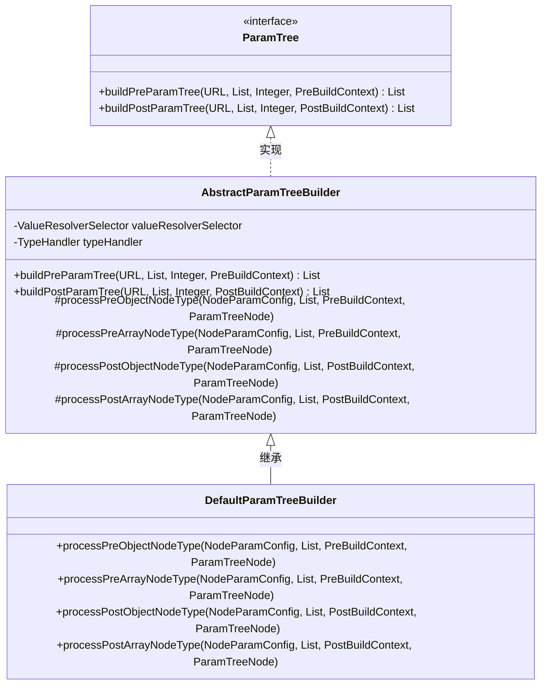

**Diagram sources**
- [ParamTree.java](file://agent-invocation/src/main/java/com/helianhealth/agent/invocation/remote/ParamTree.java#L17-L47)
- [AbstractParamTreeBuilder.java](file://agent-invocation/src/main/java/com/helianhealth/agent/invocation/remote/AbstractParamTreeBuilder.java#L26-L217)
- [DefaultParamTreeBuilder.java](file://agent-invocation/src/main/java/com/helianhealth/agent/invocation/remote/DefaultParamTreeBuilder.java#L19-L275)

**Section sources**
- [ParamTree.java](file://agent-invocation/src/main/java/com/helianhealth/agent/invocation/remote/ParamTree.java#L1-L47)
- [AbstractParamTreeBuilder.java](file://agent-invocation/src/main/java/com/helianhealth/agent/invocation/remote/AbstractParamTreeBuilder.java#L1-L217)

### SPI注解与默认实现

`@SPI("default")`注解声明了`ParamTree`接口的默认实现名称为"default"，这表示当没有显式指定实现时，系统将使用名为"default"的实现类。

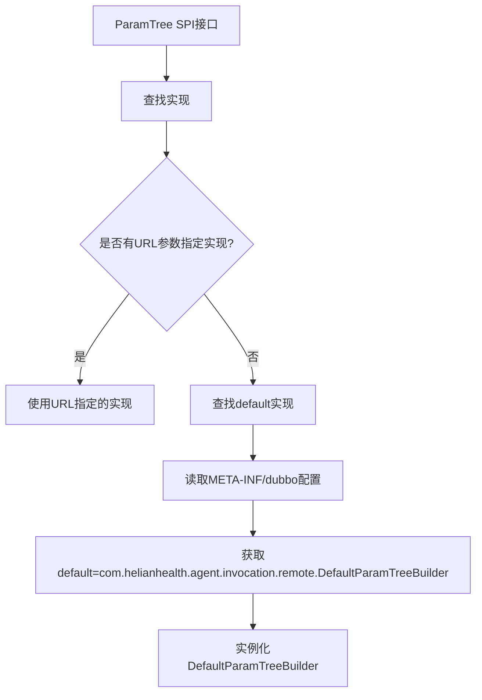

**Diagram sources**
- [ParamTree.java](file://agent-invocation/src/main/java/com/helianhealth/agent/invocation/remote/ParamTree.java#L17)
- [com.helianhealth.agent.invocation.remote.ParamTree](file://agent-invocation/src/main/resources/META-INF/dubbo/com.helianhealth.agent.invocation.remote.ParamTree#L1)

**Section sources**
- [ParamTree.java](file://agent-invocation/src/main/java/com/helianhealth/agent/invocation/remote/ParamTree.java#L1-L47)
- [com.helianhealth.agent.invocation.remote.ParamTree](file://agent-invocation/src/main/resources/META-INF/dubbo/com.helianhealth.agent.invocation.remote.ParamTree#L1)

## 参数树构建骨架：AbstractParamTreeBuilder

`AbstractParamTreeBuilder`作为抽象骨架实现，定义了参数树构建的通用流程和模板方法模式。

### 构建流程设计

该类采用模板方法模式，将构建过程分解为可扩展的钩子方法，同时封装了通用的构建逻辑。

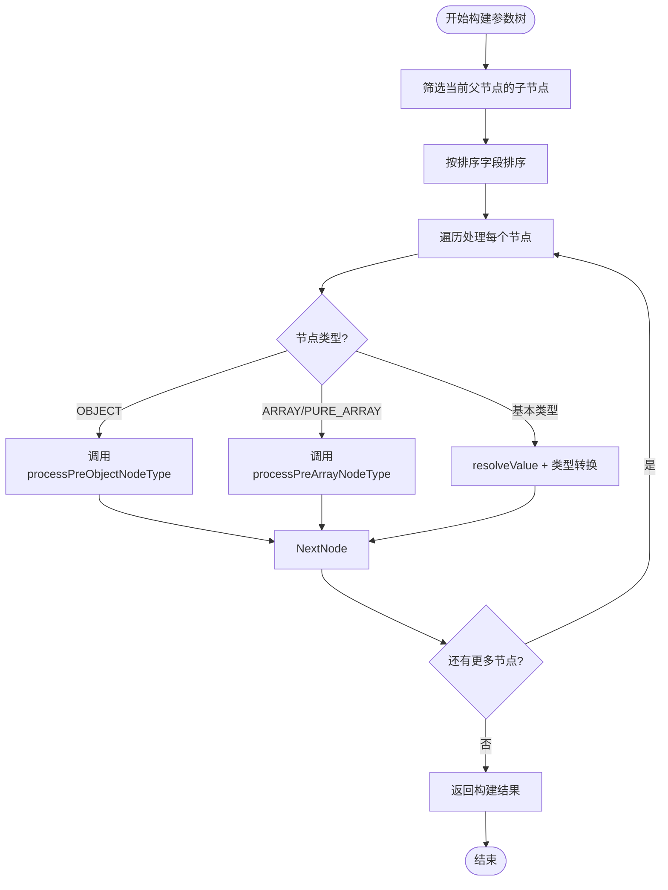

**Diagram sources**
- [AbstractParamTreeBuilder.java](file://agent-invocation/src/main/java/com/helianhealth/agent/invocation/remote/AbstractParamTreeBuilder.java#L58-L78)
- [AbstractParamTreeBuilder.java](file://agent-invocation/src/main/java/com/helianhealth/agent/invocation/remote/AbstractParamTreeBuilder.java#L81-L108)

**Section sources**
- [AbstractParamTreeBuilder.java](file://agent-invocation/src/main/java/com/helianhealth/agent/invocation/remote/AbstractParamTreeBuilder.java#L1-L217)

### 核心方法解析

`AbstractParamTreeBuilder`定义了以下关键方法：

- `doBuildPreParamTree`: 前置参数树构建主流程，包含节点筛选、排序和递归处理
- `processPreParamNode`: 处理单个参数节点，根据节点类型分发到具体处理方法
- `resolveValue`: 通过`ValueResolverSelector`解析参数值，支持常量、表达式、名称映射等多种方式
- `doBuildPostParamTree`: 后置参数树构建流程，处理调用后的响应转换

这些方法共同构成了参数树构建的骨架，确保了构建过程的一致性和可扩展性。

## 默认实现：DefaultParamTreeBuilder

`DefaultParamTreeBuilder`是`ParamTree`接口的默认实现，继承自`AbstractParamTreeBuilder`，提供了对复杂类型的具体处理策略。

### 继承关系与职责划分

```mermaid
classDiagram
class AbstractParamTreeBuilder {
<<abstract>>
+buildPreParamTree()
+buildPostParamTree()
#processPreObjectNodeType()
#processPreArrayNodeType()
#processPostObjectNodeType()
#processPostArrayNodeType()
}
class DefaultParamTreeBuilder {
+processPreObjectNodeType()
+processPreArrayNodeType()
+processPostObjectNodeType()
+processPostArrayNodeType()
}
AbstractParamTreeBuilder <|-- DefaultParamTreeBuilder
note right of AbstractParamTreeBuilder
定义通用构建流程和模板方法
负责节点筛选、排序、递归调用
end
note left of DefaultParamTreeBuilder
实现复杂类型的具体处理逻辑
处理对象节点的源数据转换
处理数组节点的包装与遍历
end
```

**Diagram sources**
- [AbstractParamTreeBuilder.java](file://agent-invocation/src/main/java/com/helianhealth/agent/invocation/remote/AbstractParamTreeBuilder.java#L26-L217)
- [DefaultParamTreeBuilder.java](file://agent-invocation/src/main/java/com/helianhealth/agent/invocation/remote/DefaultParamTreeBuilder.java#L19-L275)

**Section sources**
- [DefaultParamTreeBuilder.java](file://agent-invocation/src/main/java/com/helianhealth/agent/invocation/remote/DefaultParamTreeBuilder.java#L1-L275)

### 构建流程协调

`DefaultParamTreeBuilder`与`AbstractParamTreeBuilder`协同工作，形成完整的构建流程：

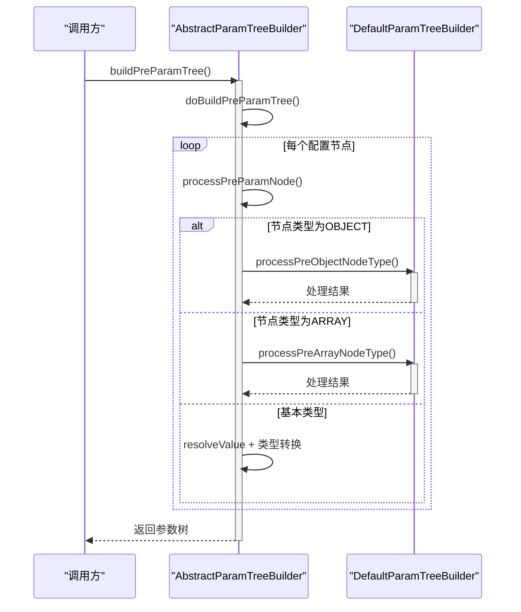

**Diagram sources**
- [AbstractParamTreeBuilder.java](file://agent-invocation/src/main/java/com/helianhealth/agent/invocation/remote/AbstractParamTreeBuilder.java#L35-L40)
- [DefaultParamTreeBuilder.java](file://agent-invocation/src/main/java/com/helianhealth/agent/invocation/remote/DefaultParamTreeBuilder.java#L21-L25)

**Section sources**
- [AbstractParamTreeBuilder.java](file://agent-invocation/src/main/java/com/helianhealth/agent/invocation/remote/AbstractParamTreeBuilder.java#L1-L217)
- [DefaultParamTreeBuilder.java](file://agent-invocation/src/main/java/com/helianhealth/agent/invocation/remote/DefaultParamTreeBuilder.java#L1-L275)

## 参数树节点模型：ParamTreeNode

`ParamTreeNode`类定义了参数树的基本数据结构，采用多叉树模型来表示复杂的参数结构。

### 数据结构设计

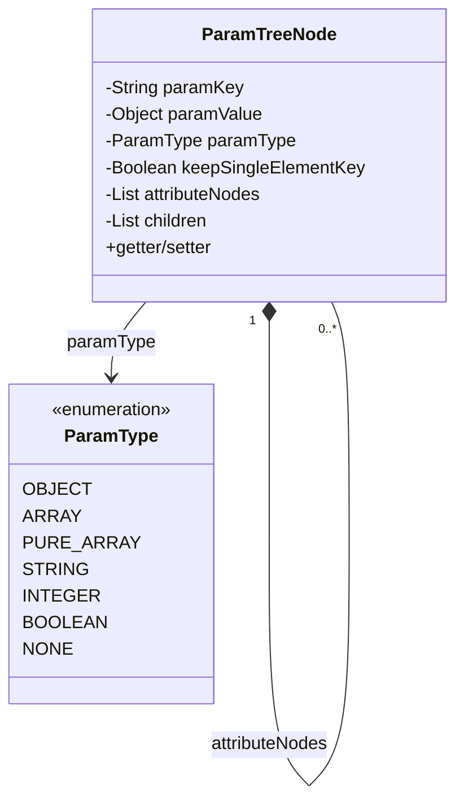

**Diagram sources**
- [ParamTreeNode.java](file://agent-invocation/src/main/java/com/helianhealth/agent/invocation/remote/model/ParamTreeNode.java#L15-L47)
- [NodeParamConfig.java](file://agent-invocation/src/main/java/com/helianhealth/agent/invocation/remote/model/NodeParamConfig.java#L50-L65)

**Section sources**
- [ParamTreeNode.java](file://agent-invocation/src/main/java/com/helianhealth/agent/invocation/remote/model/ParamTreeNode.java#L1-L47)

### 字段作用解析

| 字段名称 | 类型 | 作用说明 |
|---------|------|----------|
| **paramKey** | String | 参数键名，表示该节点在参数树中的名称标识 |
| **paramValue** | Object | 参数值，对于基本类型节点存储实际值，对于复杂类型节点可能为空 |
| **paramType** | ParamType | 节点类型，决定节点的处理方式和子节点结构 |
| **keepSingleElementKey** | Boolean | 当对象元素为单个时是否保留key的配置项 |
| **attributeNodes** | List\<ParamTreeNode\> | XML属性节点列表，用于支持XML格式的属性表示 |
| **children** | List\<ParamTreeNode\> | 子节点列表，实现多叉树结构的关键字段 |

**Section sources**
- [ParamTreeNode.java](file://agent-invocation/src/main/java/com/helianhealth/agent/invocation/remote/model/ParamTreeNode.java#L1-L47)

## 构建上下文模型

参数树构建过程中使用了两种上下文模型，分别用于前置和后置参数转换。

### 前置构建上下文

`PreBuildContext`用于封装前置参数转换所需的所有数据源：

```mermaid
classDiagram
class PreBuildContext {
-Map<String, Object> currentData
-Map<String, Object> parentData
-Map<String, Object> rootData
}
note right of PreBuildContext
currentData : 当前层业务数据<br/>
parentData : 父层业务数据用于相对路径取值<br/>
rootData : 根业务数据用于绝对路径取值
end
```

**Diagram sources**
- [PreBuildContext.java](file://agent-invocation/src/main/java/com/helianhealth/agent/invocation/remote/model/PreBuildContext.java#L14-L30)

**Section sources**
- [PreBuildContext.java](file://agent-invocation/src/main/java/com/helianhealth/agent/invocation/remote/model/PreBuildContext.java#L1-L30)

### 后置构建上下文

`PostBuildContext`用于封装后置参数转换所需的数据源，同时包含输入和响应数据：

```mermaid
classDiagram
class PostBuildContext {
-Map<String, Object> currentInputData
-Map<String, Object> currentResponseData
-Map<String, Object> rootInputData
-Map<String, Object> rootResponseData
}
note right of PostBuildContext
currentInputData : 当前层输入数据<br/>
currentResponseData : 当前层响应数据<br/>
rootInputData : 根输入数据<br/>
rootResponseData : 根响应数据
end
```

**Diagram sources**
- [PostBuildContext.java](file://agent-invocation/src/main/java/com/helianhealth/agent/invocation/remote/model/PostBuildContext.java#L14-L35)

**Section sources**
- [PostBuildContext.java](file://agent-invocation/src/main/java/com/helianhealth/agent/invocation/remote/model/PostBuildContext.java#L1-L35)

### 上下文使用场景

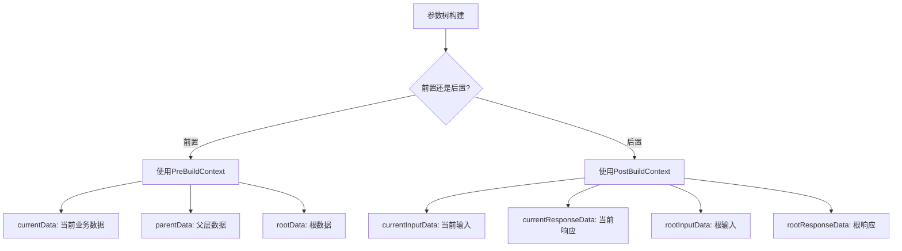

**Section sources**
- [PreBuildContext.java](file://agent-invocation/src/main/java/com/helianhealth/agent/invocation/remote/model/PreBuildContext.java#L1-L30)
- [PostBuildContext.java](file://agent-invocation/src/main/java/com/helianhealth/agent/invocation/remote/model/PostBuildContext.java#L1-L35)

## 复杂类型处理策略

`DefaultParamTreeBuilder`针对复杂类型提供了专门的处理策略，确保能够正确处理对象和数组等嵌套结构。

### 对象节点处理

`processPreObjectNodeType`方法负责处理对象类型的节点，包括源数据转换和子树构建：

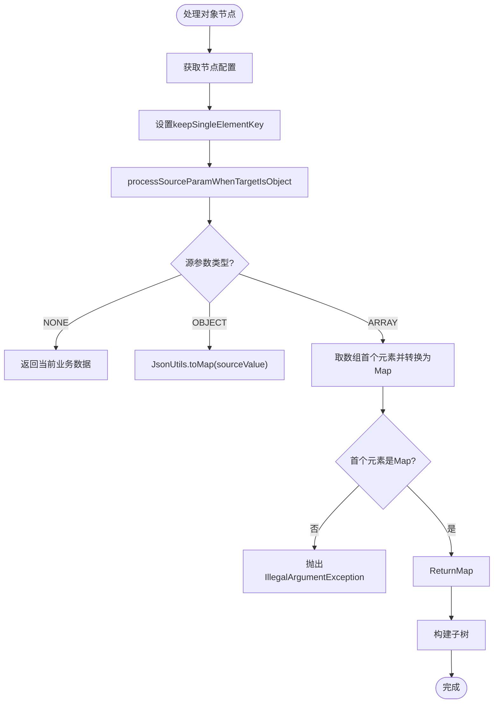

**Diagram sources**
- [DefaultParamTreeBuilder.java](file://agent-invocation/src/main/java/com/helianhealth/agent/invocation/remote/DefaultParamTreeBuilder.java#L22-L35)
- [DefaultParamTreeBuilder.java](file://agent-invocation/src/main/java/com/helianhealth/agent/invocation/remote/DefaultParamTreeBuilder.java#L37-L69)

**Section sources**
- [DefaultParamTreeBuilder.java](file://agent-invocation/src/main/java/com/helianhealth/agent/invocation/remote/DefaultParamTreeBuilder.java#L1-L275)

### 数组节点处理

`processPreArrayNodeType`方法处理数组类型的节点，支持多种源数据类型的转换：

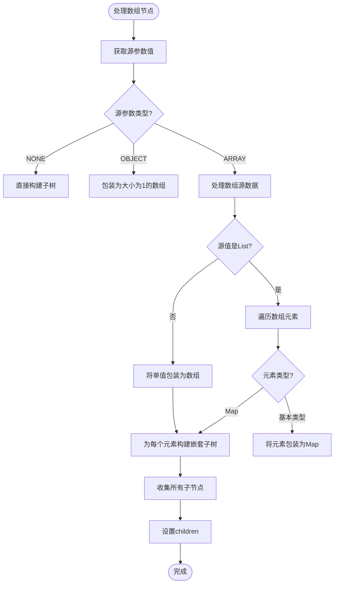

**Diagram sources**
- [DefaultParamTreeBuilder.java](file://agent-invocation/src/main/java/com/helianhealth/agent/invocation/remote/DefaultParamTreeBuilder.java#L74-L80)
- [DefaultParamTreeBuilder.java](file://agent-invocation/src/main/java/com/helianhealth/agent/invocation/remote/DefaultParamTreeBuilder.java#L202-L273)

**Section sources**
- [DefaultParamTreeBuilder.java](file://agent-invocation/src/main/java/com/helianhealth/agent/invocation/remote/DefaultParamTreeBuilder.java#L1-L275)

### 递归构建机制

参数树的构建采用递归方式，通过`buildPreParamTree`方法实现完整的前置参数树结构构建：

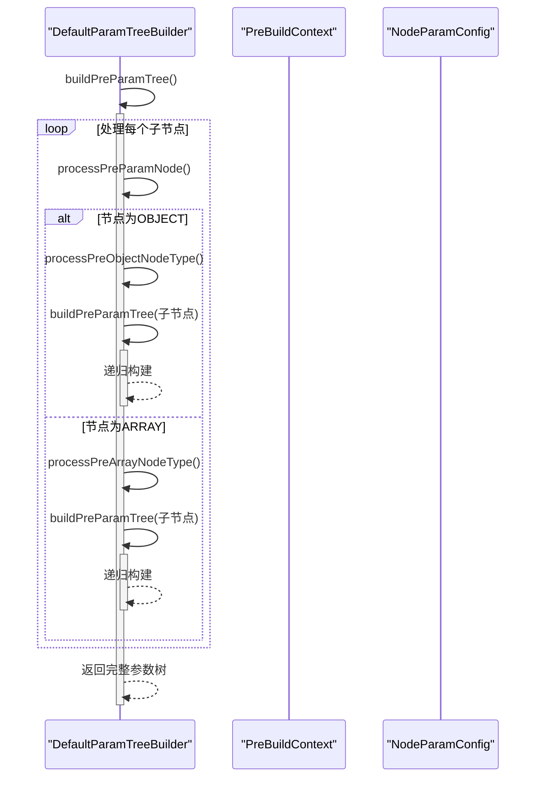

**Section sources**
- [AbstractParamTreeBuilder.java](file://agent-invocation/src/main/java/com/helianhealth/agent/invocation/remote/AbstractParamTreeBuilder.java#L35-L40)
- [DefaultParamTreeBuilder.java](file://agent-invocation/src/main/java/com/helianhealth/agent/invocation/remote/DefaultParamTreeBuilder.java#L33-L34)

## XML构建测试用例分析

通过`ParamTreeUtilsTest`中的测试用例，可以验证参数树在XML构建场景中的实际应用。

### 测试用例结构

```mermaid
erDiagram
SPECIMEN ||--o{ ID : "包含"
SPECIMEN ||--o{ CODE : "包含"
CODE ||--o{ DISPLAY_NAME : "包含"
SPECIMEN }|--|| SPECIMEN : "嵌套"
class SPECIMEN {
paramKey: "specimen"
paramType: OBJECT
}
class ID {
paramKey: "id"
paramType: OBJECT
attributeNodes: [root, extension]
}
class CODE {
paramKey: "code"
paramType: OBJECT
attributeNodes: [code]
children: [displayName]
}
class DISPLAY_NAME {
paramKey: "displayName"
paramType: OBJECT
attributeNodes: [value]
}
```

**Diagram sources**
- [ParamTreeUtilsTest.java](file://agent-invocation/src/test/java/com/helianhealth/agent/invocation/utils/ParamTreeUtilsTest.java#L14-L101)

**Section sources**
- [ParamTreeUtilsTest.java](file://agent-invocation/src/test/java/com/helianhealth/agent/invocation/utils/ParamTreeUtilsTest.java#L1-L101)

### XML结构映射

测试用例展示了如何通过`ParamTreeNode`构建符合XML规范的结构：

```xml
<specimen classCode="SPEC">
    <id root="2.16.156.10011.1.14" extension="800000218793"/>
    <code code="xq">
        <displayName value="血清"/>
    </code>
</specimen>
```

对应的参数树结构：

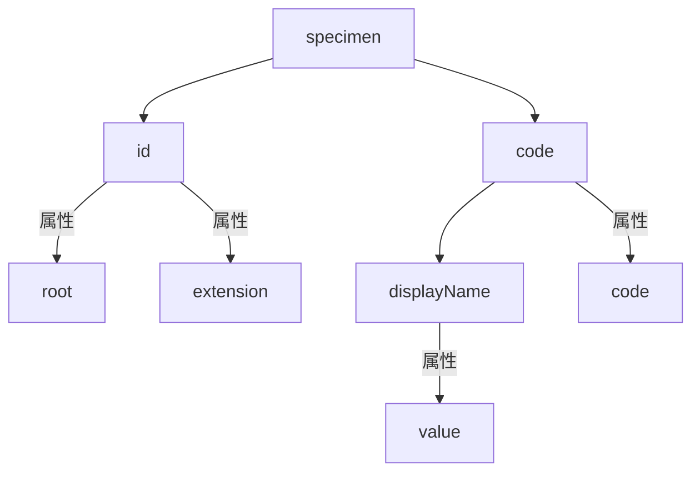

**Section sources**
- [ParamTreeUtilsTest.java](file://agent-invocation/src/test/java/com/helianhealth/agent/invocation/utils/ParamTreeUtilsTest.java#L14-L101)
- [ParamTreeNode.java](file://agent-invocation/src/main/java/com/helianhealth/agent/invocation/remote/model/ParamTreeNode.java#L41-L42)

### 构建过程验证

测试用例验证了参数树构建的正确性，特别是对于XML属性和元素的处理：

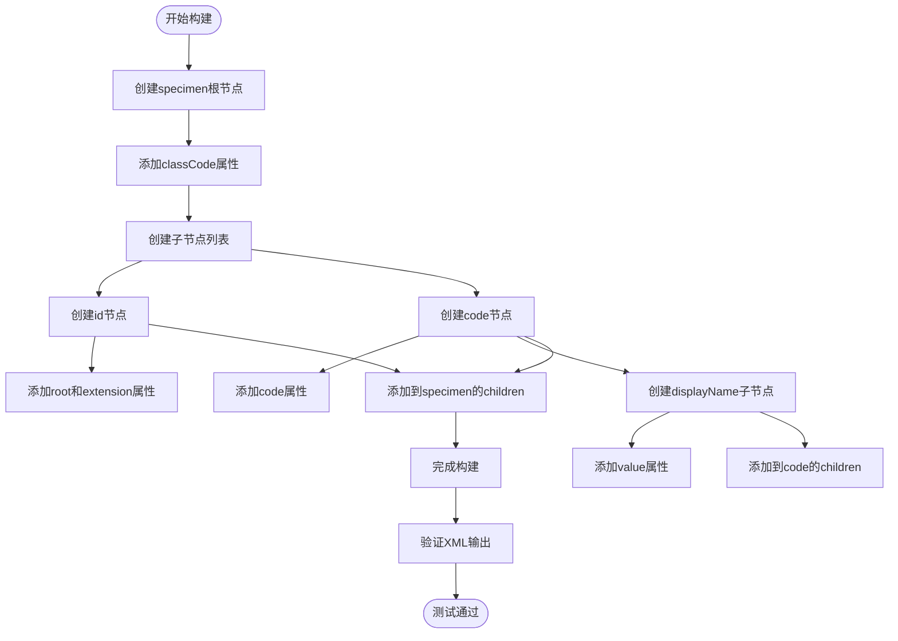

**Section sources**
- [ParamTreeUtilsTest.java](file://agent-invocation/src/test/java/com/helianhealth/agent/invocation/utils/ParamTreeUtilsTest.java#L14-L101)

## 总结

参数映射构建机制通过SPI接口设计实现了高度可扩展的架构，`@SPI("default")`注解确保了系统能够灵活选择默认实现。`AbstractParamTreeBuilder`作为骨架实现，定义了通用的构建流程，包括节点筛选、排序和递归处理，为子类提供了稳定的构建框架。

`DefaultParamTreeBuilder`针对复杂类型提供了精细的处理策略：`processPreObjectNodeType`方法能够处理对象节点的源数据转换，支持从数组提取首个元素作为对象数据；`processPreArrayNodeType`方法则能够处理数组节点的包装与遍历，支持将单个对象包装为数组或遍历数组元素构建嵌套结构。

`ParamTreeNode`的多叉树模型通过`paramKey`、`paramType`和`children`等字段有效组织了参数结构，`attributeNodes`字段特别支持了XML属性的表示。通过`PreBuildContext`和`PostBuildContext`上下文模型，系统能够灵活访问不同层级的数据源，满足复杂映射需求。

测试用例展示了该机制在XML构建场景中的实际应用，验证了参数树能够正确生成符合规范的XML结构。整个设计体现了良好的分层架构和扩展性，为接口参数映射提供了可靠的基础支持。