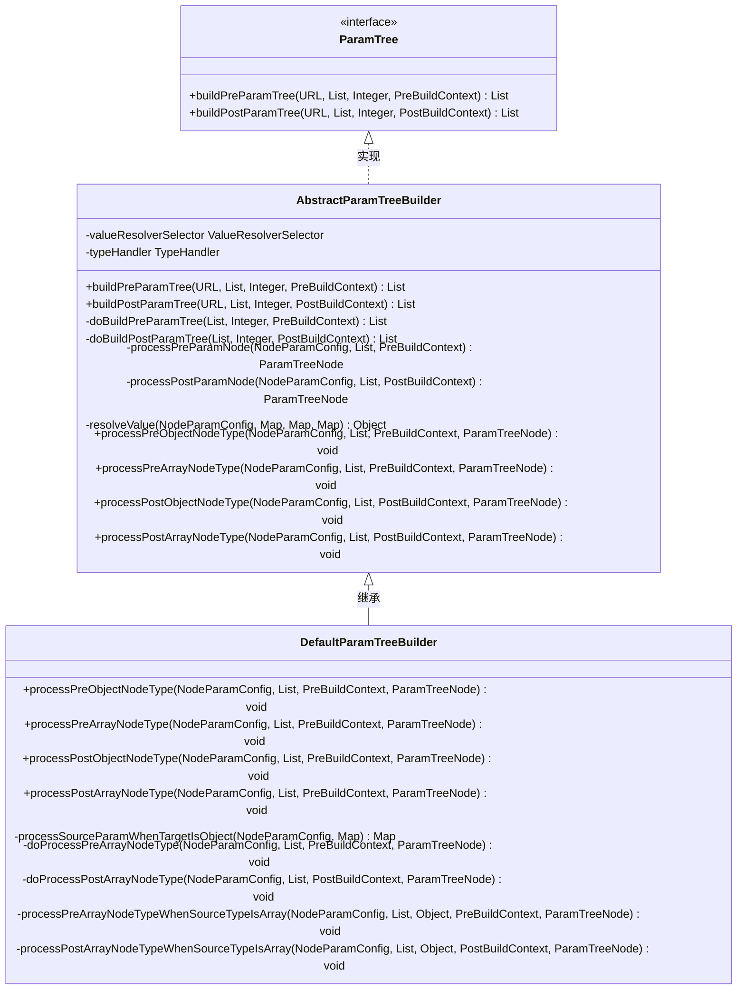
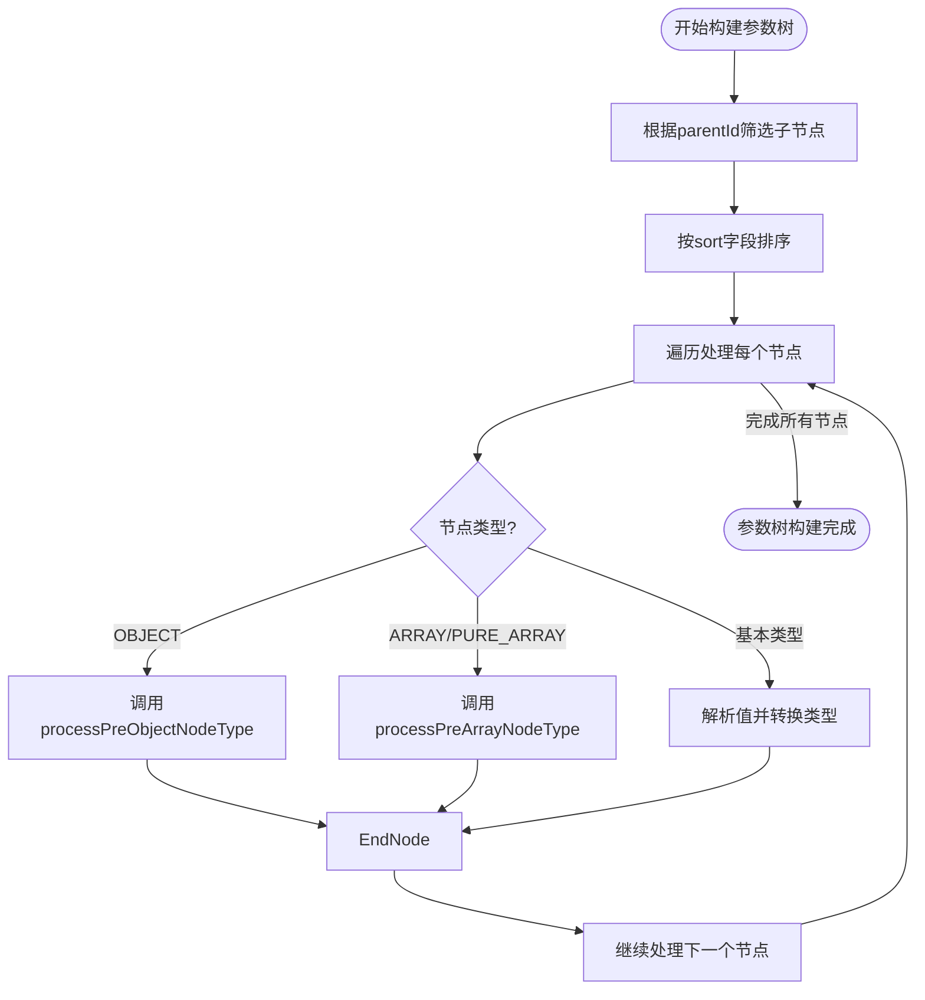
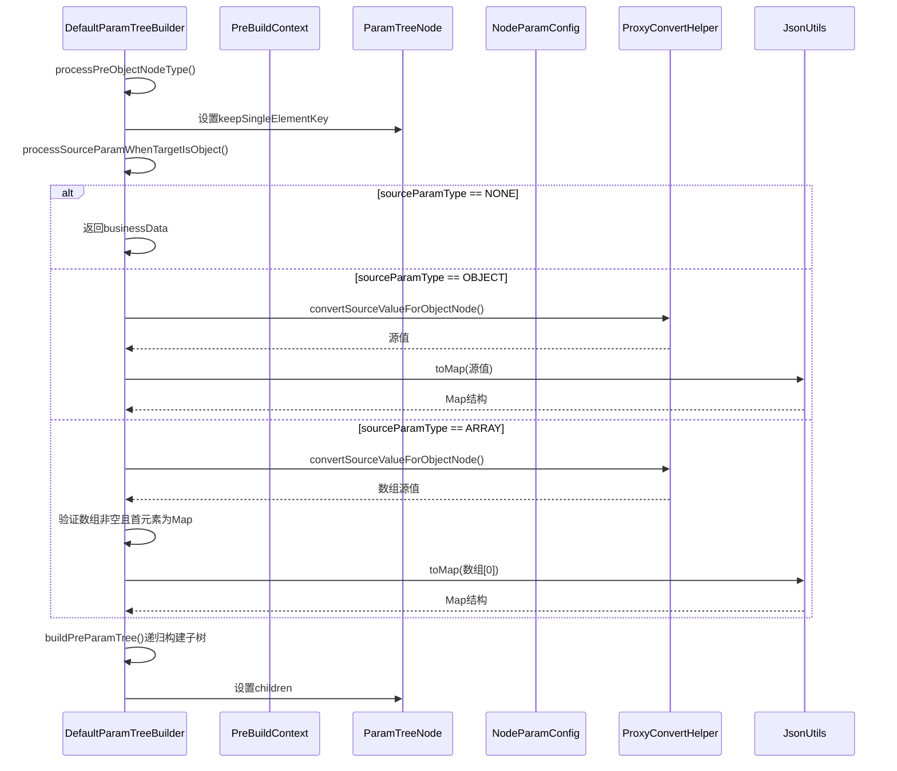
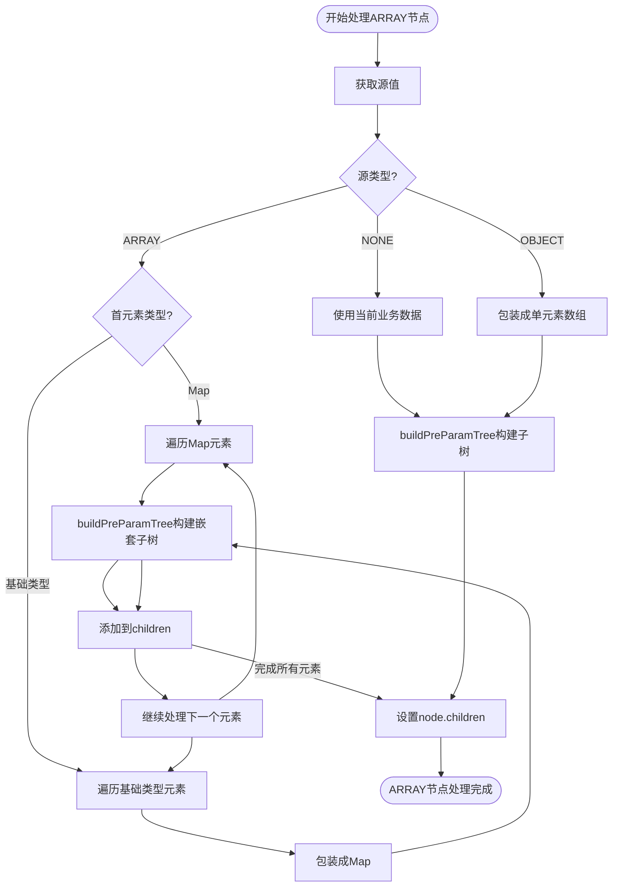
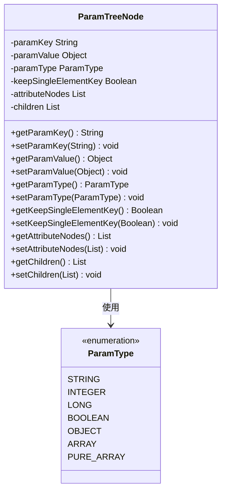
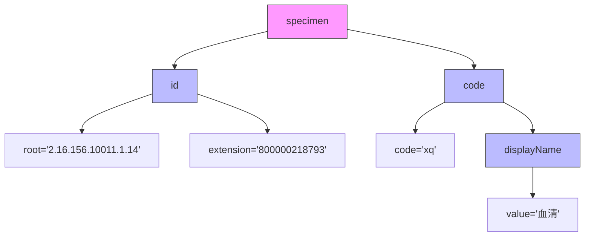

# 调用前参数树构建

<cite>
**本文档引用文件**  
- [DefaultParamTreeBuilder.java](file://agent-invocation/src/main/java/com/helianhealth/agent/invocation/remote/DefaultParamTreeBuilder.java)
- [AbstractParamTreeBuilder.java](file://agent-invocation/src/main/java/com/helianhealth/agent/invocation/remote/AbstractParamTreeBuilder.java)
- [ParamTree.java](file://agent-invocation/src/main/java/com/helianhealth/agent/invocation/remote/ParamTree.java)
- [PreBuildContext.java](file://agent-invocation/src/main/java/com/helianhealth/agent/invocation/remote/model/PreBuildContext.java)
- [ParamTreeNode.java](file://agent-invocation/src/main/java/com/helianhealth/agent/invocation/remote/model/ParamTreeNode.java)
- [NodeParamConfig.java](file://agent-invocation/src/main/java/com/helianhealth/agent/invocation/remote/model/NodeParamConfig.java)
- [BasicTypeConversionHandler.java](file://agent-invocation/src/main/java/com/helianhealth/agent/invocation/remote/support/BasicTypeConversionHandler.java)
- [ValueResolverSelector.java](file://agent-invocation/src/main/java/com/helianhealth/agent/invocation/remote/resolver/ValueResolverSelector.java)
- [ParamTreeUtilsTest.java](file://agent-invocation/src/test/java/com/helianhealth/agent/invocation/utils/ParamTreeUtilsTest.java)
- [ParamNodeUtils.java](file://agent-invocation/src/main/java/com/helianhealth/agent/invocation/utils/ParamNodeUtils.java)
</cite>

## 目录
1. [调用前参数树构建流程概述](#调用前参数树构建流程概述)
2. [SPI机制与DefaultParamTreeBuilder加载](#sp机制与defaultparamtreebuilder加载)
3. [AbstractParamTreeBuilder通用处理逻辑](#abstractparamtreebuilder通用处理逻辑)
4. [OBJECT类型节点处理](#object类型节点处理)
5. [ARRAY类型节点处理](#array类型节点处理)
6. [ParamTreeNode多叉树结构解析](#paramtreenode多叉树结构解析)
7. [XML构建场景应用示例](#xml构建场景应用示例)

## 调用前参数树构建流程概述

调用前参数树（Pre-param Tree）是接口代理系统中用于在调用外部服务前进行参数转换的核心数据结构。该树形结构通过递归方式构建，将配置化的参数映射规则转换为实际的参数树，支持复杂的数据类型转换和嵌套结构处理。整个构建流程基于SPI机制加载实现类，并通过抽象基类定义通用处理逻辑，确保了系统的可扩展性和灵活性。

**Section sources**
- [ParamTree.java](file://agent-invocation/src/main/java/com/helianhealth/agent/invocation/remote/ParamTree.java#L1-L48)
- [AbstractParamTreeBuilder.java](file://agent-invocation/src/main/java/com/helianhealth/agent/invocation/remote/AbstractParamTreeBuilder.java#L1-L218)

## SPI机制与DefaultParamTreeBuilder加载

系统采用Dubbo的SPI（Service Provider Interface）机制来实现参数树构建器的动态加载。`ParamTree`接口通过`@SPI("default")`注解声明，默认实现为`default`，这使得系统能够在运行时根据配置动态选择具体的实现类。

**Diagram sources**
- [ParamTree.java](file://agent-invocation/src/main/java/com/helianhealth/agent/invocation/remote/ParamTree.java#L1-L48)
- [AbstractParamTreeBuilder.java](file://agent-invocation/src/main/java/com/helianhealth/agent/invocation/remote/AbstractParamTreeBuilder.java#L1-L218)
- [DefaultParamTreeBuilder.java](file://agent-invocation/src/main/java/com/helianhealth/agent/invocation/remote/DefaultParamTreeBuilder.java#L1-L276)

**Section sources**
- [ParamTree.java](file://agent-invocation/src/main/java/com/helianhealth/agent/invocation/remote/ParamTree.java#L1-L48)
- [AbstractParamTreeBuilder.java](file://agent-invocation/src/main/java/com/helianhealth/agent/invocation/remote/AbstractParamTreeBuilder.java#L1-L218)

## AbstractParamTreeBuilder通用处理逻辑

`AbstractParamTreeBuilder`作为参数树构建的抽象基类，定义了通用的处理流程。其核心方法`doBuildPreParamTree`负责递归构建参数树，主要包含以下步骤：

1. **节点筛选**：根据`parentId`从所有配置中筛选出当前父节点的子节点
2. **排序处理**：按照`sort`字段对子节点进行排序，确保参数顺序的一致性
3. **节点分发**：通过`processPreParamNode`方法对每个节点进行分发处理

**Diagram sources**
- [AbstractParamTreeBuilder.java](file://agent-invocation/src/main/java/com/helianhealth/agent/invocation/remote/AbstractParamTreeBuilder.java#L58-L78)
- [AbstractParamTreeBuilder.java](file://agent-invocation/src/main/java/com/helianhealth/agent/invocation/remote/AbstractParamTreeBuilder.java#L81-L108)

**Section sources**
- [AbstractParamTreeBuilder.java](file://agent-invocation/src/main/java/com/helianhealth/agent/invocation/remote/AbstractParamTreeBuilder.java#L58-L108)

## OBJECT类型节点处理

`DefaultParamTreeBuilder`对OBJECT类型节点的处理主要通过`processPreObjectNodeType`方法实现。该方法首先设置`keepSingleElementKey`属性，然后调用`processSourceParamWhenTargetIsObject`方法进行源数据转换。

`processSourceParamWhenTargetIsObject`方法根据源参数类型（`sourceParamType`）进行不同的处理：
- **NONE类型**：直接返回当前业务数据
- **OBJECT类型**：将源值转换为Map结构
- **ARRAY类型**：取数组第一个元素并转换为Map结构

**Diagram sources**
- [DefaultParamTreeBuilder.java](file://agent-invocation/src/main/java/com/helianhealth/agent/invocation/remote/DefaultParamTreeBuilder.java#L22-L35)
- [DefaultParamTreeBuilder.java](file://agent-invocation/src/main/java/com/helianhealth/agent/invocation/remote/DefaultParamTreeBuilder.java#L37-L69)

**Section sources**
- [DefaultParamTreeBuilder.java](file://agent-invocation/src/main/java/com/helianhealth/agent/invocation/remote/DefaultParamTreeBuilder.java#L22-L69)

## ARRAY类型节点处理

ARRAY类型节点的处理通过`processPreArrayNodeType`方法触发，实际逻辑由`doProcessPreArrayNodeType`方法实现。该方法根据源数据类型进行分支处理：

1. **NONE类型**：直接使用当前业务数据构建子树
2. **OBJECT类型**：将对象包装成单元素数组后递归构建
3. **ARRAY类型**：遍历数组元素，对每个元素递归构建子树

对于数组元素的处理，系统会判断元素类型：
- **Map类型**：直接作为上下文数据构建子树
- **基础类型**：包装成Map（key为`targetParamKey`，value为元素值）后构建子树

**Diagram sources**
- [DefaultParamTreeBuilder.java](file://agent-invocation/src/main/java/com/helianhealth/agent/invocation/remote/DefaultParamTreeBuilder.java#L74-L80)
- [DefaultParamTreeBuilder.java](file://agent-invocation/src/main/java/com/helianhealth/agent/invocation/remote/DefaultParamTreeBuilder.java#L202-L274)

**Section sources**
- [DefaultParamTreeBuilder.java](file://agent-invocation/src/main/java/com/helianhealth/agent/invocation/remote/DefaultParamTreeBuilder.java#L74-L274)

## ParamTreeNode多叉树结构解析

`ParamTreeNode`是参数树的基本组成单元，采用多叉树（N-ary tree）结构设计，主要包含以下关键属性：

- **paramKey**：参数键名，对应XML标签名或JSON字段名
- **paramType**：参数类型，决定节点的处理方式（OBJECT、ARRAY、STRING等）
- **children**：子节点列表，用于构建树形结构
- **paramValue**：参数值，用于基本类型节点
- **keepSingleElementKey**：对象单元素时是否保留key的配置
- **attributeNodes**：XML属性节点列表

这些属性共同作用，实现了灵活的树形结构组装。`paramKey`和`paramType`决定了节点的基本特征，`children`实现了树的层次结构，而`attributeNodes`则专门用于支持XML属性的表示。

**Diagram sources**
- [ParamTreeNode.java](file://agent-invocation/src/main/java/com/helianhealth/agent/invocation/remote/model/ParamTreeNode.java#L1-L48)
- [NodeParamConfig.java](file://agent-invocation/src/main/java/com/helianhealth/agent/invocation/remote/model/NodeParamConfig.java#L1-L96)

**Section sources**
- [ParamTreeNode.java](file://agent-invocation/src/main/java/com/helianhealth/agent/invocation/remote/model/ParamTreeNode.java#L1-L48)

## XML构建场景应用示例

在XML构建场景中，参数树的结构直接映射为XML文档结构。通过测试用例`ParamTreeUtilsTest.testParamNodeDTO2Xml`可以清晰地看到实际应用：

1. **属性处理**：通过`attributeNodes`列表存储XML属性节点
2. **嵌套结构**：通过`children`列表实现标签的嵌套
3. **自闭合标签**：当节点无子节点且有值时生成自闭合标签

例如，构建一个包含`specimen`标签的XML，其中包含`id`和`code`子标签，每个标签都有相应的属性。系统会递归遍历参数树，根据节点类型生成对应的XML结构，最终输出符合规范的XML文档。

**Diagram sources**
- [ParamTreeUtilsTest.java](file://agent-invocation/src/test/java/com/helianhealth/agent/invocation/utils/ParamTreeUtilsTest.java#L1-L102)
- [ParamNodeUtils.java](file://agent-invocation/src/main/java/com/helianhealth/agent/invocation/utils/ParamNodeUtils.java#L171-L204)

**Section sources**
- [ParamTreeUtilsTest.java](file://agent-invocation/src/test/java/com/helianhealth/agent/invocation/utils/ParamTreeUtilsTest.java#L1-L102)