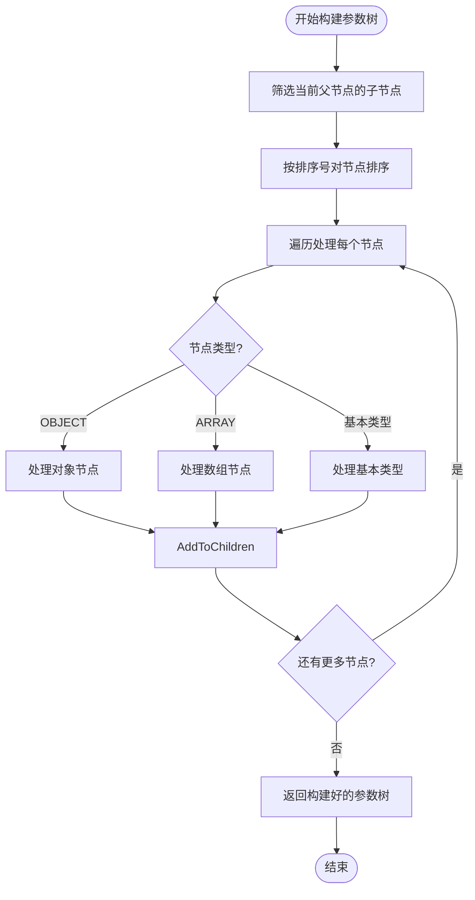
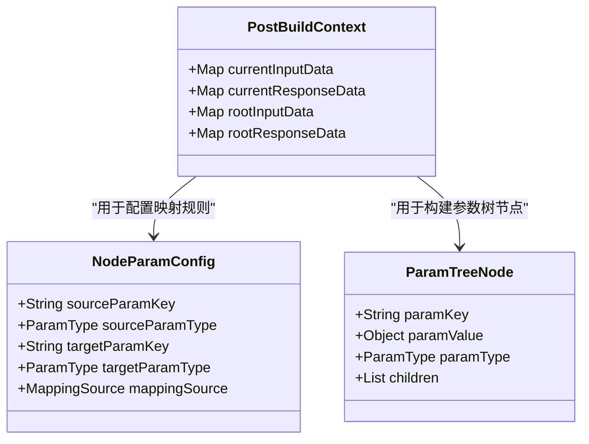
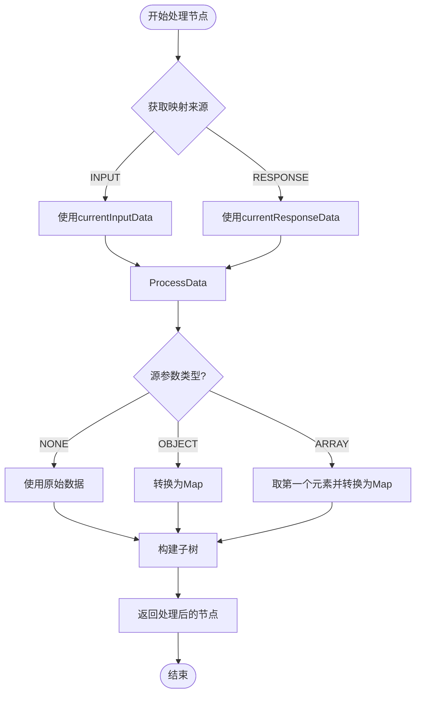
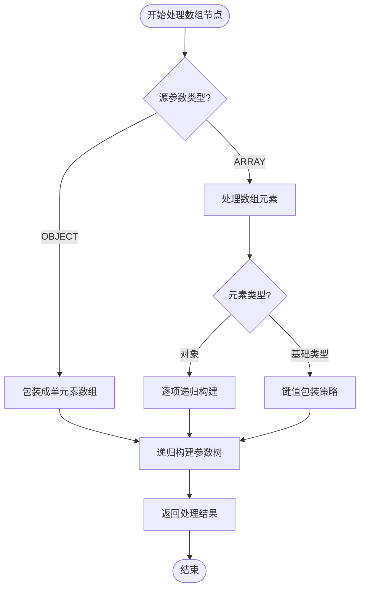
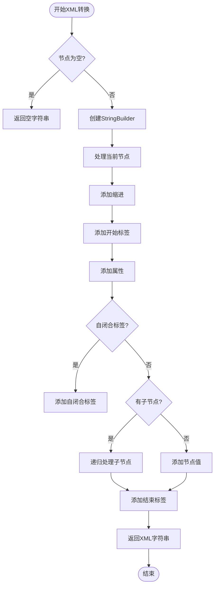

# 调用后参数树构建

<cite>
**本文档引用文件**  
- [AbstractParamTreeBuilder.java](file://agent-invocation/src/main/java/com/helianhealth/agent/invocation/remote/AbstractParamTreeBuilder.java)
- [DefaultParamTreeBuilder.java](file://agent-invocation/src/main/java/com/helianhealth/agent/invocation/remote/DefaultParamTreeBuilder.java)
- [PostBuildContext.java](file://agent-invocation/src/main/java/com/helianhealth/agent/invocation/remote/model/PostBuildContext.java)
- [ParamTreeNode.java](file://agent-invocation/src/main/java/com/helianhealth/agent/invocation/remote/model/ParamTreeNode.java)
- [NodeParamConfig.java](file://agent-invocation/src/main/java/com/helianhealth/agent/invocation/remote/model/NodeParamConfig.java)
- [ParamNodeUtils.java](file://agent-invocation/src/main/java/com/helianhealth/agent/invocation/utils/ParamNodeUtils.java)
- [ProxyConvertHelper.java](file://agent-invocation/src/main/java/com/helianhealth/agent/invocation/remote/ProxyConvertHelper.java)
- [MappingSource.java](file://agent-common/src/main/java/com/helianhealth/agent/common/enums/MappingSource.java)
- [ParamType.java](file://agent-common/src/main/java/com/helianhealth/agent/common/enums/ParamType.java)
</cite>

## 目录
1. [调用后参数树构建机制](#调用后参数树构建机制)
2. [PostBuildContext上下文设计](#postbuildcontext上下文设计)
3. [参数节点处理逻辑](#参数节点处理逻辑)
4. [数组节点的复杂处理](#数组节点的复杂处理)
5. [参数树结构合并与XML输出](#参数树结构合并与xml输出)

## 调用后参数树构建机制

调用后参数树（Post-param Tree）的构建是接口代理系统中响应数据转换的核心机制。该机制通过`buildPostParamTree`方法实现，其主要职责是将远程调用的响应数据按照预定义的映射规则转换为符合目标接口要求的参数结构。

`buildPostParamTree`方法在`AbstractParamTreeBuilder`类中定义，作为参数树构建的入口点。该方法接收参数配置列表、父节点ID和构建上下文等参数，通过递归方式构建完整的参数树结构。构建过程首先筛选出当前父节点的子节点配置，然后逐个处理每个子节点，最终形成树形结构的参数列表。

在构建过程中，系统会根据节点的目标参数类型（targetParamType）进行不同的处理分支：对于对象类型（OBJECT）调用`processPostObjectNodeType`方法，对于数组类型（ARRAY）调用`processPostArrayNodeType`方法，对于基本类型则直接从数据源中取值并进行类型转换。

**图源**  
- [AbstractParamTreeBuilder.java](file://agent-invocation/src/main/java/com/helianhealth/agent/invocation/remote/AbstractParamTreeBuilder.java#L154-L176)

**本节来源**  
- [AbstractParamTreeBuilder.java](file://agent-invocation/src/main/java/com/helianhealth/agent/invocation/remote/AbstractParamTreeBuilder.java#L136-L184)

## PostBuildContext上下文设计

`PostBuildContext`是调用后参数树构建的核心上下文对象，它同时持有多份数据源以支持输入与响应的联合映射。这种设计使得在构建参数树时能够灵活地从不同的数据源中提取所需信息。

该上下文包含四个关键的数据源字段：`currentInputData`（当前层输入数据）、`currentResponseData`（当前层响应数据）、`rootInputData`（根输入数据）和`rootResponseData`（根响应数据）。这种分层设计允许系统在不同场景下选择合适的数据源：当前层数据用于相对路径取值，而根层数据用于绝对路径取值。

当调用`buildPostParamTree`的重载方法时，系统会自动创建`PostBuildContext`实例，并将传入的输入和响应数据分别赋值给对应的字段。这种设计模式实现了数据源的封装与隔离，使得后续的节点处理逻辑可以统一通过上下文对象访问所需数据，而无需关心数据的来源和传递方式。

**图源**  
- [PostBuildContext.java](file://agent-invocation/src/main/java/com/helianhealth/agent/invocation/remote/model/PostBuildContext.java#L1-L35)
- [NodeParamConfig.java](file://agent-invocation/src/main/java/com/helianhealth/agent/invocation/remote/model/NodeParamConfig.java#L1-L96)
- [ParamTreeNode.java](file://agent-invocation/src/main/java/com/helianhealth/agent/invocation/remote/model/ParamTreeNode.java#L1-L48)

**本节来源**  
- [PostBuildContext.java](file://agent-invocation/src/main/java/com/helianhealth/agent/invocation/remote/model/PostBuildContext.java#L1-L35)

## 参数节点处理逻辑

参数节点的处理逻辑是调用后参数树构建的核心部分，主要通过`processPostParamNode`方法实现。该方法根据节点的映射来源（MappingSource）选择相应的数据源进行处理，体现了系统的灵活性和可配置性。

`MappingSource`枚举定义了两种数据源：`INPUT`（来自输入参数）和`RESPONSE`（来自响应数据）。在处理节点时，系统会根据配置的`mappingSource`值决定从哪个数据源提取数据。如果`mappingSource`为`INPUT`，则使用`currentInputData`；如果为`RESPONSE`，则使用`currentResponseData`。这种设计使得同一个参数配置可以灵活地从不同的数据源获取值，满足复杂的映射需求。

对于对象节点的处理，`processPostObjectNodeType`方法会根据配置的映射源获取相应的数据源，然后调用`processSourceParamWhenTargetIsObject`方法处理源参数。该方法会根据源参数类型（sourceParamType）进行不同的转换：如果源类型为`NONE`，则直接使用原始数据；如果为`OBJECT`，则转换为Map；如果为`ARRAY`，则取数组的第一个元素并转换为Map。这种多态处理机制确保了不同类型的数据源都能被正确处理。

**图源**  
- [DefaultParamTreeBuilder.java](file://agent-invocation/src/main/java/com/helianhealth/agent/invocation/remote/DefaultParamTreeBuilder.java#L81-L109)
- [MappingSource.java](file://agent-common/src/main/java/com/helianhealth/agent/common/enums/MappingSource.java#L1-L21)
- [ParamType.java](file://agent-common/src/main/java/com/helianhealth/agent/common/enums/ParamType.java#L1-L51)

**本节来源**  
- [DefaultParamTreeBuilder.java](file://agent-invocation/src/main/java/com/helianhealth/agent/invocation/remote/DefaultParamTreeBuilder.java#L81-L109)

## 数组节点的复杂处理

数组节点的处理是调用后参数树构建中最复杂的部分，主要通过`doProcessPostArrayNodeType`方法实现。该方法需要处理多种数据源类型和转换场景，体现了系统的健壮性和灵活性。

当源类型为`OBJECT`时，系统会将单个对象包装成大小为1的数组。具体实现是调用`buildPostParamTree`方法，将对象转换为Map后作为输入和响应数据，从而创建一个只包含单个元素的数组结构。这种设计确保了对象数据可以被正确地转换为数组格式，满足目标接口的要求。

当源类型为`ARRAY`时，系统会调用`processPostArrayNodeTypeWhenSourceTypeIsArray`方法进行遍历处理。该方法首先判断数组元素的类型：如果元素是对象（Map类型），则对每个元素递归构建参数树；如果元素是基础类型，则将每个元素包装为包含目标键名的Map对象，然后递归构建。这种双重处理机制确保了无论是对象数组还是基础类型数组都能被正确转换。

对于基础类型数组的键值包装策略，系统会创建一个临时Map，将目标参数键名作为key，数组元素作为value，然后基于这个Map构建参数树。这种策略使得基础类型数组也能参与复杂的参数映射，提高了系统的通用性。

**图源**  
- [DefaultParamTreeBuilder.java](file://agent-invocation/src/main/java/com/helianhealth/agent/invocation/remote/DefaultParamTreeBuilder.java#L119-L200)
- [ProxyConvertHelper.java](file://agent-invocation/src/main/java/com/helianhealth/agent/invocation/remote/ProxyConvertHelper.java#L52-L75)

**本节来源**  
- [DefaultParamTreeBuilder.java](file://agent-invocation/src/main/java/com/helianhealth/agent/invocation/remote/DefaultParamTreeBuilder.java#L119-L200)

## 参数树结构合并与XML输出

参数树结构的合并是通过`ParamTreeNode`的`children`字段实现的。每个节点的`children`字段存储了其子节点列表，通过递归方式将多个响应项合并为统一的参数树结构。这种树形结构的设计使得复杂的嵌套数据能够被清晰地组织和表示。

在XML输出场景中，`ParamNodeUtils`类提供了`paramNode2Xml`方法将参数树转换为XML字符串。该方法通过递归遍历参数树，根据节点类型生成相应的XML标签：对于对象节点生成包含子节点的标签，对于数组节点生成包含多个子元素的标签，对于基本类型节点生成包含值的标签。转换过程中还会处理节点属性和缩进格式，确保生成的XML符合标准格式。

实际验证表明，构建的参数树能够正确地转换为XML格式。例如，一个包含对象和数组的复杂参数树会被转换为具有正确嵌套结构的XML文档，其中对象属性作为子标签，数组元素作为重复的子标签，基础类型值作为标签内容。这种转换机制确保了系统能够满足不同接口对数据格式的要求。

**图源**  
- [ParamNodeUtils.java](file://agent-invocation/src/main/java/com/helianhealth/agent/invocation/utils/ParamNodeUtils.java#L165-L281)
- [ParamTreeNode.java](file://agent-invocation/src/main/java/com/helianhealth/agent/invocation/remote/model/ParamTreeNode.java#L1-L48)

**本节来源**  
- [ParamNodeUtils.java](file://agent-invocation/src/main/java/com/helianhealth/agent/invocation/utils/ParamNodeUtils.java#L165-L281)