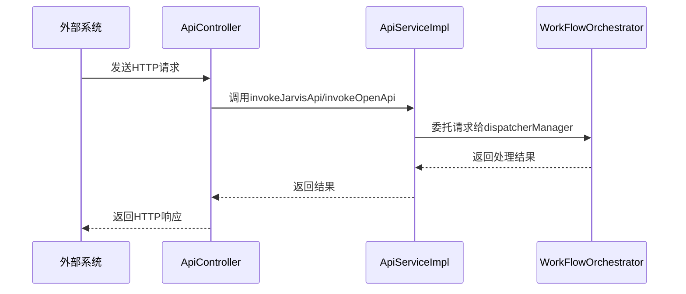
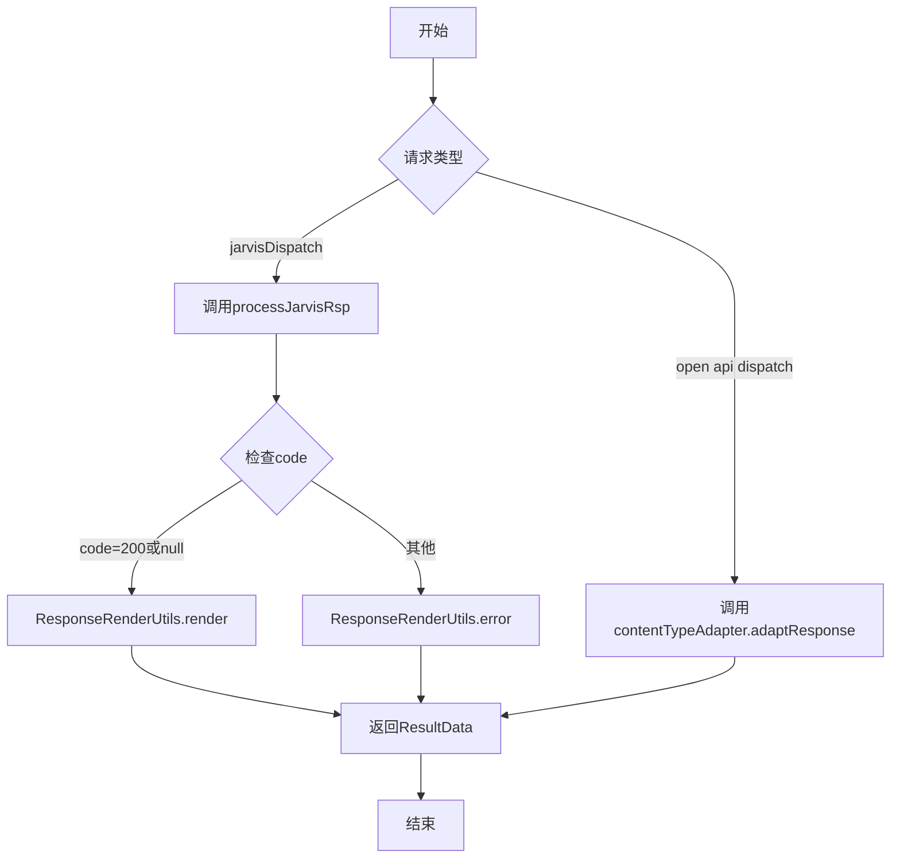
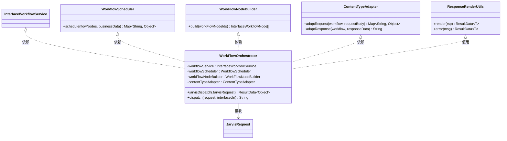

# 工作流编排

<cite>
**本文档中引用的文件**   
- [WorkFlowOrchestrator.java](file://agent-api/src/main/java/com/helianhealth/agent/api/WorkFlowOrchestrator.java)
- [ContentTypeAdapter.java](file://agent-api/src/main/java/com/helianhealth/agent/api/adapter/ContentTypeAdapter.java)
- [JarvisRequest.java](file://agent-api/src/main/java/com/helianhealth/agent/api/model/request/JarvisRequest.java)
- [ResponseRenderUtils.java](file://agent-common/src/main/java/com/helianhealth/agent/common/utils/ResponseRenderUtils.java)
- [InterfaceWorkflowService.java](file://agent-workflow/src/main/java/com/helianhealth/agent/workflow/service/InterfaceWorkflowService.java)
- [WorkflowScheduler.java](file://agent-schedule/src/main/java/com/helianhealth/agent/schedule/WorkflowScheduler.java)
- [WorkFlowNodeBuilder.java](file://agent-schedule/src/main/java/com/helianhealth/agent/schedule/builder/WorkFlowNodeBuilder.java)
- [ApiController.java](file://agent-api/src/main/java/com/helianhealth/agent/api/controller/ApiController.java)
- [ApiService.java](file://agent-api/src/main/java/com/helianhealth/agent/api/service/ApiService.java)
- [ApiServiceImpl.java](file://agent-api/src/main/java/com/helianhealth/agent/api/service/impl/ApiServiceImpl.java)
- [WorkflowContentType.java](file://agent-common/src/main/java/com/helianhealth/agent/common/enums/WorkflowContentType.java)
- [ResultData.java](file://agent-common/src/main/java/com/helianhealth/agent/common/base/ResultData.java)
- [WorkflowBusinessException.java](file://agent-common/src/main/java/com/helianhealth/agent/common/exception/WorkflowBusinessException.java)
</cite>

## 目录
1. [引言](#引言)
2. [核心职责与流程概述](#核心职责与流程概述)
3. [对外API调度中枢的角色](#对外api调度中枢的角色)
4. [请求接收与分发机制](#请求接收与分发机制)
5. [工作流配置查找与协调执行](#工作流配置查找与协调执行)
6. [与InterfaceWorkflowService的交互](#与interfaceworkflowservice的交互)
7. [ContentTypeAdapter的内容类型适配](#contenttypeadapter的内容类型适配)
8. [调度执行与响应处理](#调度执行与响应处理)
9. [异常处理策略与兼容性设计](#异常处理策略与兼容性设计)
10. [关键类与组件关系图](#关键类与组件关系图)

## 引言

工作流编排器（WorkFlowOrchestrator）是整个系统对外API调度的核心中枢，承担着接收外部请求、解析路由、协调执行和返回响应的关键职责。它作为系统的统一入口点，屏蔽了底层复杂的工作流执行细节，为外部系统（如jarvisDispatch和open api dispatch）提供了简洁、一致的调用接口。本文档将深入分析其架构设计、核心流程、关键交互以及异常处理机制，全面揭示其作为调度中枢的运作原理。

## 核心职责与流程概述

工作流编排器的核心职责是作为一个智能的“交通指挥中心”，管理所有进入系统的API请求。其处理流程可以概括为以下几个关键步骤：
1.  **请求接收**：通过`ApiController`接收来自`jarvisDispatch`和`open api dispatch`的两种类型请求。
2.  **路由查找**：根据请求中的接口URI（`interfaceUri`）或业务方法名（`businessMethod`），调用`InterfaceWorkflowService`查找对应的工作流配置。
3.  **参数适配**：利用`ContentTypeAdapter`将不同内容类型（如JSON、XML）的原始请求体转换为内部统一的`Map<String, Object>`数据结构。
4.  **执行协调**：使用`WorkFlowNodeBuilder`构建工作流节点，并通过`WorkflowScheduler`协调整个工作流的执行。
5.  **响应处理**：将调度执行后的结果，再次通过`ContentTypeAdapter`转换为与请求相匹配的内容类型，并通过`ResponseRenderUtils`进行最终的格式化封装后返回。

这一系列流程确保了系统能够灵活、高效地处理多样化的外部请求，并保证了响应的一致性和可靠性。

**Section sources**
- [WorkFlowOrchestrator.java](file://agent-api/src/main/java/com/helianhealth/agent/api/WorkFlowOrchestrator.java#L29-L103)
- [ApiController.java](file://agent-api/src/main/java/com/helianhealth/agent/api/controller/ApiController.java#L23-L50)

## 对外API调度中枢的角色

工作流编排器（WorkFlowOrchestrator）是系统与外部世界交互的唯一官方通道，扮演着至关重要的调度中枢角色。它解耦了外部调用方与内部复杂工作流执行逻辑，使得外部系统无需关心工作流的具体实现细节。

其核心角色体现在两个方面：
1.  **统一入口**：无论是来自`jarvis`系统的`POST /HLOpenApi/Hjk`请求，还是来自其他系统的`POST /agent-open-api/**`请求，最终都会被路由到`WorkFlowOrchestrator`进行处理。这种设计保证了API管理的集中化和安全性。
2.  **协议转换器**：外部系统可能使用不同的数据格式（如JSON或XML）进行通信。`WorkFlowOrchestrator`通过`ContentTypeAdapter`实现了协议的双向转换，将外部的异构请求统一为内部标准的数据格式，执行完毕后再转换回外部系统期望的格式。

这种设计模式极大地提升了系统的可扩展性和兼容性。

**Section sources**
- [ApiController.java](file://agent-api/src/main/java/com/helianhealth/agent/api/controller/ApiController.java#L27-L48)
- [WorkFlowOrchestrator.java](file://agent-api/src/main/java/com/helianhealth/agent/api/WorkFlowOrchestrator.java#L39-L102)

## 请求接收与分发机制

请求的接收和分发由`ApiController`和`ApiService`共同完成，形成了一个清晰的分层结构。

`ApiController`作为Spring MVC的控制器，负责监听HTTP请求。它定义了两个主要的API端点：
- `invokeJarvisApi`：处理`JarvisRequest`对象，专门用于接收`jarvis`系统的调用。
- `invokeOpenApi`：接收原始的字符串请求体和请求URI，用于处理通用的Open API调用。

这两个方法在接收到请求后，会立即调用`ApiService`接口的实现类`ApiServiceImpl`。`ApiServiceImpl`作为服务层，不直接处理业务逻辑，而是将请求进一步委托给`WorkFlowOrchestrator`（在代码中通过`dispatcherManager`字段引用）。这种委托模式实现了关注点分离，`ApiService`层负责服务的暴露和基础的上下文管理（如使用`MDC`记录日志上下文），而具体的调度逻辑则由`WorkFlowOrchestrator`全权负责。

**Diagram sources**
- [ApiController.java](file://agent-api/src/main/java/com/helianhealth/agent/api/controller/ApiController.java#L23-L50)
- [ApiServiceImpl.java](file://agent-api/src/main/java/com/helianhealth/agent/api/service/impl/ApiServiceImpl.java#L18-L42)
- [WorkFlowOrchestrator.java](file://agent-api/src/main/java/com/helianhealth/agent/api/WorkFlowOrchestrator.java#L29-L103)

## 工作流配置查找与协调执行

当`WorkFlowOrchestrator`接收到请求后，其首要任务是根据请求信息定位到正确的工作流配置。

对于`jarvisDispatch`请求，它使用`JarvisRequest`中的`businessMethod`字段作为`interfaceUri`；对于`open api dispatch`请求，则直接使用传入的`interfaceUri`参数。随后，它调用`InterfaceWorkflowService`的`findByInterfaceUri`方法，根据这个URI从数据库中查询出对应的`InterfaceWorkflowDO`对象。这个对象包含了整个工作流的定义，如节点列表、内容类型（`contentType`）等。

一旦获取到工作流配置，`WorkFlowOrchestrator`便开始协调执行。它使用`WorkFlowNodeBuilder`将`InterfaceWorkflowDO`中的节点信息（如`firstFlowNodes`）构建成可执行的`InterfaceWorkflowNode`对象列表。最后，它将这些节点和处理好的业务数据一起交给`WorkflowScheduler`进行实际的调度执行。

**Section sources**
- [WorkFlowOrchestrator.java](file://agent-api/src/main/java/com/helianhealth/agent/api/WorkFlowOrchestrator.java#L41-L47)
- [WorkFlowOrchestrator.java](file://agent-api/src/main/java/com/helianhealth/agent/api/WorkFlowOrchestrator.java#L81-L87)
- [InterfaceWorkflowService.java](file://agent-workflow/src/main/java/com/helianhealth/agent/workflow/service/InterfaceWorkflowService.java#L11-L24)
- [WorkFlowNodeBuilder.java](file://agent-schedule/src/main/java/com/helianhealth/agent/schedule/builder/WorkFlowNodeBuilder.java#L21-L29)

## 与InterfaceWorkflowService的交互

`WorkFlowOrchestrator`与`InterfaceWorkflowService`的交互是其作为调度中枢的基础。`InterfaceWorkflowService`是一个定义在`agent-workflow`模块中的服务接口，它提供了对工作流元数据的CRUD操作。

`WorkFlowOrchestrator`通过Spring的依赖注入，持有一个`InterfaceWorkflowService`的实例。它主要调用该服务的`findByInterfaceUri`方法，这是一个同步的、基于数据库查询的操作。该方法返回一个`Optional<InterfaceWorkflowDO>`，`WorkFlowOrchestrator`据此判断请求的接口是否被支持。

如果`Optional`为空，即工作流未找到，`WorkFlowOrchestrator`会根据请求类型采取不同的策略：对于`jarvisDispatch`，它会返回一个成功但无数据的响应（`ResultData.ok()`），以保证`jarvis`系统的稳定性；对于`open api dispatch`，则会抛出`METHOD_NOT_SUPPORT`业务异常，通过全局异常处理器返回明确的错误信息。这种差异化的处理体现了系统对不同调用方的兼容性设计。

**Section sources**
- [WorkFlowOrchestrator.java](file://agent-api/src/main/java/com/helianhealth/agent/api/WorkFlowOrchestrator.java#L31-L32)
- [WorkFlowOrchestrator.java](file://agent-api/src/main/java/com/helianhealth/agent/api/WorkFlowOrchestrator.java#L41-L55)
- [WorkFlowOrchestrator.java](file://agent-api/src/main/java/com/helianhealth/agent/api/WorkFlowOrchestrator.java#L81-L97)
- [InterfaceWorkflowService.java](file://agent-workflow/src/main/java/com/helianhealth/agent/workflow/service/InterfaceWorkflowService.java#L11-L24)

## ContentTypeAdapter的内容类型适配

`ContentTypeAdapter`是实现系统协议兼容性的关键组件，它解决了不同系统间数据格式不一致的问题。

`WorkFlowOrchestrator`在处理请求时，会调用`ContentTypeAdapter`的`adaptRequest`方法。该方法接收`InterfaceWorkflowDO`（包含`contentType`信息）和原始请求字符串。它首先检查请求体是否为空，然后根据`WorkflowContentType`枚举（`JSON`或`XML`）进行分支处理：
- 对于`JSON`，使用`JsonUtils.fromJsonStringToObjectMap`将其解析为`Map<String, Object>`。
- 对于`XML`，特别是SOAP格式，会先通过`XmlUtils.parseRequestXml`解析XML，并利用`contentMetaInfo`中的元信息来处理复杂的嵌套结构和CDATA。

在响应阶段，`adaptResponse`方法则执行反向操作。它根据工作流配置的`contentType`，将内部的`Map<String, Object>`结果转换为相应的字符串格式：`JSON`使用`JsonUtils.toJsonString`，`XML`使用`XmlUtils.buildResponseXml`。这种双向适配机制使得系统能够无缝集成使用不同通信协议的第三方服务。

**Section sources**
- [WorkFlowOrchestrator.java](file://agent-api/src/main/java/com/helianhealth/agent/api/WorkFlowOrchestrator.java#L34-L35)
- [WorkFlowOrchestrator.java](file://agent-api/src/main/java/com/helianhealth/agent/api/WorkFlowOrchestrator.java#L85-L86)
- [WorkFlowOrchestrator.java](file://agent-api/src/main/java/com/helianhealth/agent/api/WorkFlowOrchestrator.java#L93-L94)
- [ContentTypeAdapter.java](file://agent-api/src/main/java/com/helianhealth/agent/api/adapter/ContentTypeAdapter.java#L29-L65)
- [WorkflowContentType.java](file://agent-common/src/main/java/com/helianhealth/agent/common/enums/WorkflowContentType.java#L8-L14)

## 调度执行与响应处理

工作流的实际执行由`WorkflowScheduler`负责。`WorkFlowOrchestrator`在完成所有前置工作后，会调用`scheduler.schedule`方法，传入构建好的节点列表和适配后的业务数据。

`WorkflowScheduler`是一个功能强大的调度引擎，它支持线性、并行和条件分支等多种执行模式。它会根据节点的`paramFilterExpr`进行参数过滤，根据`splitField`进行数据拆分以实现并行处理，并根据`scheduleExpr`表达式决定下一个要执行的节点，从而实现复杂的工作流编排。

执行完成后，`WorkflowScheduler`返回一个`Map<String, Object>`的结果。`WorkFlowOrchestrator`随后进行响应处理。对于`jarvisDispatch`请求，它调用`processJarvisRsp`私有方法，该方法检查结果中的`code`字段，若为`200`或`null`则认为成功，并使用`ResponseRenderUtils.render`方法包装成`ResultData`对象；否则，使用`ResponseRenderUtils.error`包装错误信息。`ResponseRenderUtils`是一个工具类，它提供了创建标准`ResultData`响应的便捷方法，确保了所有API响应格式的统一。

**Diagram sources**
- [WorkFlowOrchestrator.java](file://agent-api/src/main/java/com/helianhealth/agent/api/WorkFlowOrchestrator.java#L48-L50)
- [WorkFlowOrchestrator.java](file://agent-api/src/main/java/com/helianhealth/agent/api/WorkFlowOrchestrator.java#L89-L93)
- [WorkFlowOrchestrator.java](file://agent-api/src/main/java/com/helianhealth/agent/api/WorkFlowOrchestrator.java#L62-L73)
- [ResponseRenderUtils.java](file://agent-common/src/main/java/com/helianhealth/agent/common/utils/ResponseRenderUtils.java#L8-L19)
- [WorkflowScheduler.java](file://agent-schedule/src/main/java/com/helianhealth/agent/schedule/WorkflowScheduler.java#L57-L70)

## 异常处理策略与兼容性设计

`WorkFlowOrchestrator`的异常处理策略体现了健壮性和用户友好性。

在代码结构上，它使用了`try-catch`块包裹整个处理流程。捕获到任何异常时，会记录详细的错误日志，并返回一个失败的响应（`ResultData.fail()`）。这保证了即使发生未预期的错误，也不会导致服务崩溃。

在业务逻辑层面，它进行了精细化的异常处理：
- **方法不支持**：当`interfaceUri`找不到对应工作流时，抛出预定义的`WorkflowBusinessException.METHOD_NOT_SUPPORT`异常，返回明确的错误码`API-001`。
- **工作流未找到**：在调度器内部，如果节点列表为空，会抛出`FLOW_NOT_FOUND`异常。
- **表达式解析错误**：在`WorkflowScheduler`中，如果`scheduleExpr`表达式解析失败，会抛出`EXPRESSION_PARSING_ERROR`异常。

此外，其兼容性设计尤为突出。对于`jarvisDispatch`请求，当接口未实现时，它选择返回成功而非失败，这是一种“优雅降级”的策略，避免了因单个接口问题影响`jarvis`系统的整体运行，体现了对关键业务系统的特殊照顾。

**Section sources**
- [WorkFlowOrchestrator.java](file://agent-api/src/main/java/com/helianhealth/agent/api/WorkFlowOrchestrator.java#L56-L59)
- [WorkFlowOrchestrator.java](file://agent-api/src/main/java/com/helianhealth/agent/api/WorkFlowOrchestrator.java#L51-L55)
- [WorkFlowOrchestrator.java](file://agent-api/src/main/java/com/helianhealth/agent/api/WorkFlowOrchestrator.java#L95-L97)
- [WorkflowScheduler.java](file://agent-schedule/src/main/java/com/helianhealth/agent/schedule/WorkflowScheduler.java#L66-L68)
- [WorkflowBusinessException.java](file://agent-common/src/main/java/com/helianhealth/agent/common/exception/WorkflowBusinessException.java#L8-L11)

## 关键类与组件关系图

下图展示了`WorkFlowOrchestrator`及其核心依赖组件之间的关系，清晰地描绘了其作为调度中枢的架构。

**Diagram sources**
- [WorkFlowOrchestrator.java](file://agent-api/src/main/java/com/helianhealth/agent/api/WorkFlowOrchestrator.java#L29-L103)
- [ContentTypeAdapter.java](file://agent-api/src/main/java/com/helianhealth/agent/api/adapter/ContentTypeAdapter.java#L19-L85)
- [ResponseRenderUtils.java](file://agent-common/src/main/java/com/helianhealth/agent/common/utils/ResponseRenderUtils.java#L6-L20)
- [WorkflowScheduler.java](file://agent-schedule/src/main/java/com/helianhealth/agent/schedule/WorkflowScheduler.java#L40-L275)
- [WorkFlowNodeBuilder.java](file://agent-schedule/src/main/java/com/helianhealth/agent/schedule/builder/WorkFlowNodeBuilder.java#L16-L100)
- [JarvisRequest.java](file://agent-api/src/main/java/com/helianhealth/agent/api/model/request/JarvisRequest.java#L12-L45)