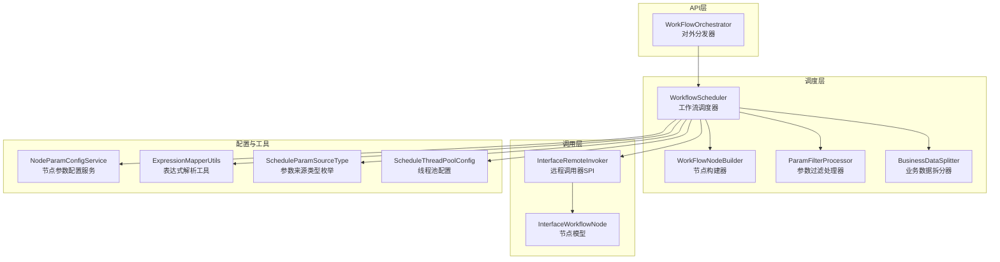
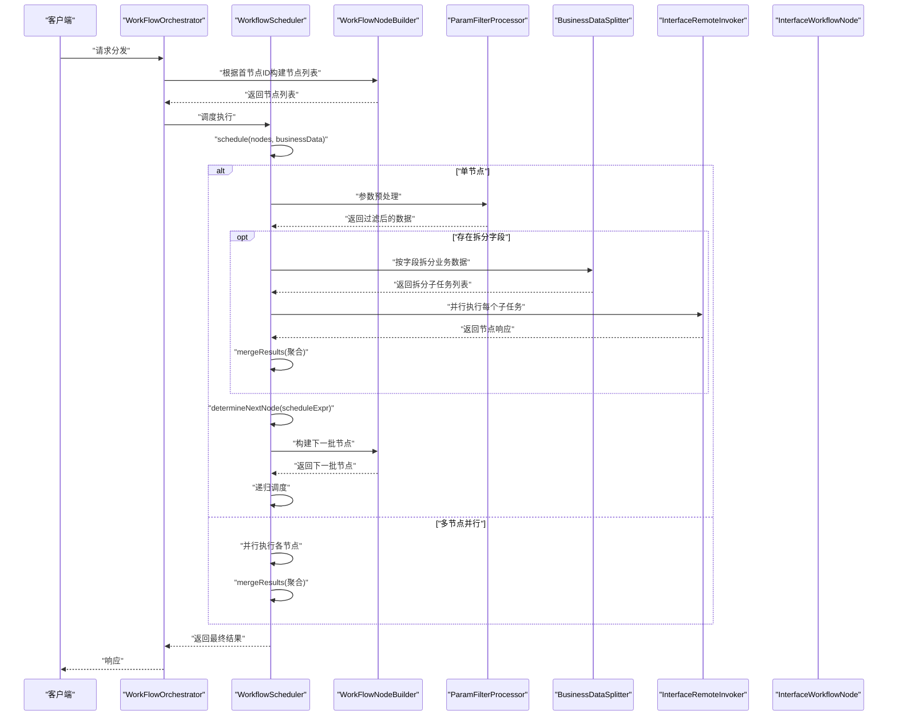
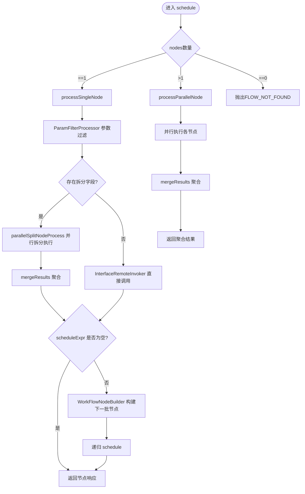
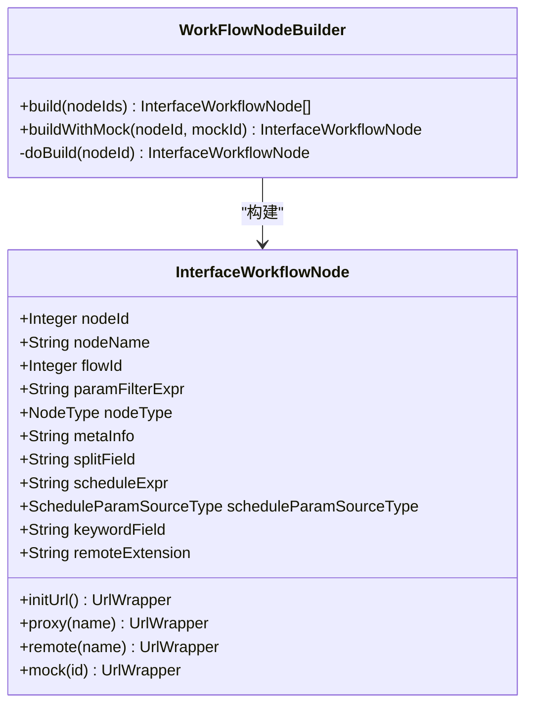
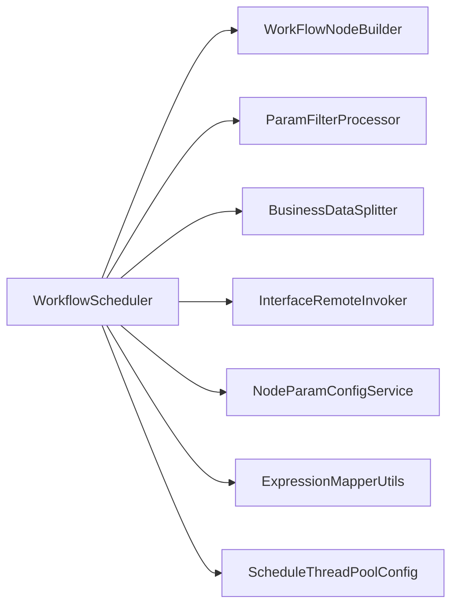

# 工作流调度

<cite>
**本文引用的文件**
- [WorkflowScheduler.java](file://agent-schedule/src/main/java/com/helianhealth/agent/schedule/WorkflowScheduler.java)
- [WorkFlowNodeBuilder.java](file://agent-schedule/src/main/java/com/helianhealth/agent/schedule/builder/WorkFlowNodeBuilder.java)
- [ParamFilterProcessor.java](file://agent-schedule/src/main/java/com/helianhealth/agent/schedule/processor/ParamFilterProcessor.java)
- [BusinessDataSplitter.java](file://agent-schedule/src/main/java/com/helianhealth/agent/schedule/processor/BusinessDataSplitter.java)
- [WorkFlowOrchestrator.java](file://agent-api/src/main/java/com/helianhealth/agent/api/WorkFlowOrchestrator.java)
- [InterfaceWorkflowNode.java](file://agent-invocation/src/main/java/com/helianhealth/agent/invocation/remote/model/InterfaceWorkflowNode.java)
- [InterfaceRemoteInvoker.java](file://agent-invocation/src/main/java/com/helianhealth/agent/invocation/remote/InterfaceRemoteInvoker.java)
- [NodeParamConfigService.java](file://agent-workflow/src/main/java/com/helianhealth/agent/workflow/service/NodeParamConfigService.java)
- [ExpressionMapperUtils.java](file://agent-invocation/src/main/java/com/helianhealth/agent/invocation/utils/ExpressionMapperUtils.java)
- [ScheduleParamSourceType.java](file://agent-common/src/main/java/com/helianhealth/agent/common/enums/ScheduleParamSourceType.java)
- [ScheduleThreadPoolConfig.java](file://agent-schedule/src/main/java/com/helianhealth/agent/schedule/config/ScheduleThreadPoolConfig.java)
</cite>

## 目录
1. [简介](#简介)
2. [项目结构](#项目结构)
3. [核心组件](#核心组件)
4. [架构总览](#架构总览)
5. [组件详解](#组件详解)
6. [依赖关系分析](#依赖关系分析)
7. [性能与并发特性](#性能与并发特性)
8. [故障排查指南](#故障排查指南)
9. [结论](#结论)

## 简介
本文件围绕工作流调度器（WorkflowScheduler）展开，系统阐述其在工作流引擎中的中枢角色与实现机制。重点说明：
- 如何作为工作流引擎的中枢，编排整个工作流的执行流程；
- 在线性流程中如何处理并行节点，通过递归调度实现节点间的流转控制；
- 关键依赖组件：WorkFlowNodeBuilder（构建节点链）、ParamFilterProcessor（参数预处理）、BusinessDataSplitter（数据拆分并行处理）；
- 结合代码路径说明单节点执行、并行节点聚合、条件流转（通过 scheduleExpr）、结果合并（mergeResults）的具体实现；
- 调度器与远程调用器、参数树构建器的协作关系，以及在异常处理、日志记录方面的设计考量。

## 项目结构
工作流调度相关代码主要分布在以下模块：
- agent-schedule：调度器与节点构建、参数过滤、数据拆分等；
- agent-api：对外分发器，协调调度器与节点构建器；
- agent-invocation：远程调用器接口与模型定义；
- agent-workflow：节点参数配置服务；
- agent-common：通用枚举与异常定义；
- agent-invocation-utils：表达式解析工具。

图表来源
- [WorkFlowOrchestrator.java](file://agent-api/src/main/java/com/helianhealth/agent/api/WorkFlowOrchestrator.java#L29-L102)
- [WorkflowScheduler.java](file://agent-schedule/src/main/java/com/helianhealth/agent/schedule/WorkflowScheduler.java#L40-L275)
- [WorkFlowNodeBuilder.java](file://agent-schedule/src/main/java/com/helianhealth/agent/schedule/builder/WorkFlowNodeBuilder.java#L16-L100)
- [ParamFilterProcessor.java](file://agent-schedule/src/main/java/com/helianhealth/agent/schedule/processor/ParamFilterProcessor.java#L12-L19)
- [BusinessDataSplitter.java](file://agent-schedule/src/main/java/com/helianhealth/agent/schedule/processor/BusinessDataSplitter.java#L14-L41)
- [InterfaceRemoteInvoker.java](file://agent-invocation/src/main/java/com/helianhealth/agent/invocation/remote/InterfaceRemoteInvoker.java#L14-L25)
- [InterfaceWorkflowNode.java](file://agent-invocation/src/main/java/com/helianhealth/agent/invocation/remote/model/InterfaceWorkflowNode.java#L17-L75)
- [NodeParamConfigService.java](file://agent-workflow/src/main/java/com/helianhealth/agent/workflow/service/NodeParamConfigService.java#L11-L30)
- [ExpressionMapperUtils.java](file://agent-invocation/src/main/java/com/helianhealth/agent/invocation/utils/ExpressionMapperUtils.java#L19-L146)
- [ScheduleParamSourceType.java](file://agent-common/src/main/java/com/helianhealth/agent/common/enums/ScheduleParamSourceType.java#L9-L20)
- [ScheduleThreadPoolConfig.java](file://agent-schedule/src/main/java/com/helianhealth/agent/schedule/config/ScheduleThreadPoolConfig.java#L15-L44)

章节来源
- [WorkFlowOrchestrator.java](file://agent-api/src/main/java/com/helianhealth/agent/api/WorkFlowOrchestrator.java#L29-L102)
- [WorkflowScheduler.java](file://agent-schedule/src/main/java/com/helianhealth/agent/schedule/WorkflowScheduler.java#L40-L275)

## 核心组件
- 工作流调度器（WorkflowScheduler）：负责整体编排，包括单节点执行、并行节点聚合、条件流转、结果合并、参数预处理与拆分并行等。
- 节点构建器（WorkFlowNodeBuilder）：根据节点ID列表构建 InterfaceWorkflowNode 列表，支持 Mock 配置。
- 参数过滤处理器（ParamFilterProcessor）：基于表达式对业务数据进行预处理过滤。
- 业务数据拆分器（BusinessDataSplitter）：按指定字段拆分业务数据为多个子任务，配合线程池实现并行执行。
- 远程调用器（InterfaceRemoteInvoker）：通过 SPI 适配不同协议（HTTP/Soap/Database），执行远程调用。
- 节点参数配置服务（NodeParamConfigService）：提供节点前后置处理配置，供 Invocation 构建使用。
- 表达式解析工具（ExpressionMapperUtils）：提供表达式解析能力，支持 scheduleExpr 条件判断与参数过滤。
- 参数来源类型（ScheduleParamSourceType）：决定下个节点入参来源（原始入参或上个节点响应）。
- 线程池配置（ScheduleThreadPoolConfig）：为并行执行提供线程池。

章节来源
- [WorkflowScheduler.java](file://agent-schedule/src/main/java/com/helianhealth/agent/schedule/WorkflowScheduler.java#L40-L275)
- [WorkFlowNodeBuilder.java](file://agent-schedule/src/main/java/com/helianhealth/agent/schedule/builder/WorkFlowNodeBuilder.java#L16-L100)
- [ParamFilterProcessor.java](file://agent-schedule/src/main/java/com/helianhealth/agent/schedule/processor/ParamFilterProcessor.java#L12-L19)
- [BusinessDataSplitter.java](file://agent-schedule/src/main/java/com/helianhealth/agent/schedule/processor/BusinessDataSplitter.java#L14-L41)
- [InterfaceRemoteInvoker.java](file://agent-invocation/src/main/java/com/helianhealth/agent/invocation/remote/InterfaceRemoteInvoker.java#L14-L25)
- [NodeParamConfigService.java](file://agent-workflow/src/main/java/com/helianhealth/agent/workflow/service/NodeParamConfigService.java#L11-L30)
- [ExpressionMapperUtils.java](file://agent-invocation/src/main/java/com/helianhealth/agent/invocation/utils/ExpressionMapperUtils.java#L19-L146)
- [ScheduleParamSourceType.java](file://agent-common/src/main/java/com/helianhealth/agent/common/enums/ScheduleParamSourceType.java#L9-L20)
- [ScheduleThreadPoolConfig.java](file://agent-schedule/src/main/java/com/helianhealth/agent/schedule/config/ScheduleThreadPoolConfig.java#L15-L44)

## 架构总览
工作流调度器在系统中的位置与交互如下：

图表来源
- [WorkFlowOrchestrator.java](file://agent-api/src/main/java/com/helianhealth/agent/api/WorkFlowOrchestrator.java#L39-L60)
- [WorkflowScheduler.java](file://agent-schedule/src/main/java/com/helianhealth/agent/schedule/WorkflowScheduler.java#L57-L104)
- [WorkFlowNodeBuilder.java](file://agent-schedule/src/main/java/com/helianhealth/agent/schedule/builder/WorkFlowNodeBuilder.java#L21-L29)
- [ParamFilterProcessor.java](file://agent-schedule/src/main/java/com/helianhealth/agent/schedule/processor/ParamFilterProcessor.java#L14-L18)
- [BusinessDataSplitter.java](file://agent-schedule/src/main/java/com/helianhealth/agent/schedule/processor/BusinessDataSplitter.java#L16-L39)
- [InterfaceRemoteInvoker.java](file://agent-invocation/src/main/java/com/helianhealth/agent/invocation/remote/InterfaceRemoteInvoker.java#L23-L24)
- [InterfaceWorkflowNode.java](file://agent-invocation/src/main/java/com/helianhealth/agent/invocation/remote/model/InterfaceWorkflowNode.java#L17-L75)

## 组件详解

### 工作流调度器（WorkflowScheduler）
- 中枢职责
  - 编排工作流执行，支持线性流程与节点间并行；
  - 单节点执行、并行节点聚合、条件流转、结果合并；
  - 参数预处理与数据拆分并行处理；
  - 与远程调用器、参数配置服务、表达式工具协同。
- 关键方法与流程
  - schedule：入口方法，区分单节点与多节点并行分支；
  - processSingleNode：单节点处理主流程（参数过滤、可选拆分并行、远程调用、条件流转、递归调度）；
  - parallelSplitNodeProcess：按字段拆分并行执行，等待全部完成并合并结果；
  - processParallelNode：并行执行多个节点，等待全部完成并聚合结果；
  - determineNextNode：基于 scheduleExpr 决定下一步节点ID列表；
  - determineNextNodeParam：根据 ScheduleParamSourceType 决定下个节点入参来源；
  - mergeResults/mergeMap/mergeValues：递归合并嵌套结构，支持列表合并与保留首个值策略；
  - buildInvocation：基于 NodeParamConfigService 构建 Invocation（前置/后置参数配置 + 业务数据）。
- 异常与日志
  - 对空工作流、表达式解析类型错误、业务数据拆分异常进行日志记录与异常抛出；
  - 使用 SLF4J 记录关键流程与错误信息。

图表来源
- [WorkflowScheduler.java](file://agent-schedule/src/main/java/com/helianhealth/agent/schedule/WorkflowScheduler.java#L57-L104)
- [WorkflowScheduler.java](file://agent-schedule/src/main/java/com/helianhealth/agent/schedule/WorkflowScheduler.java#L123-L148)
- [WorkflowScheduler.java](file://agent-schedule/src/main/java/com/helianhealth/agent/schedule/WorkflowScheduler.java#L188-L207)
- [WorkflowScheduler.java](file://agent-schedule/src/main/java/com/helianhealth/agent/schedule/WorkflowScheduler.java#L214-L273)

章节来源
- [WorkflowScheduler.java](file://agent-schedule/src/main/java/com/helianhealth/agent/schedule/WorkflowScheduler.java#L40-L275)

### 节点构建器（WorkFlowNodeBuilder）
- 职责：根据节点ID列表构建 InterfaceWorkflowNode 列表；支持带 Mock 配置的节点构建；
- 关键点：通过 InterfaceWorkflowNodeService 查询节点视图，填充节点元信息与URL初始化参数（proxy/remote/mock）。

图表来源
- [WorkFlowNodeBuilder.java](file://agent-schedule/src/main/java/com/helianhealth/agent/schedule/builder/WorkFlowNodeBuilder.java#L16-L100)
- [InterfaceWorkflowNode.java](file://agent-invocation/src/main/java/com/helianhealth/agent/invocation/remote/model/InterfaceWorkflowNode.java#L17-L75)

章节来源
- [WorkFlowNodeBuilder.java](file://agent-schedule/src/main/java/com/helianhealth/agent/schedule/builder/WorkFlowNodeBuilder.java#L16-L100)

### 参数过滤处理器（ParamFilterProcessor）
- 职责：基于表达式对业务数据进行预处理过滤，返回过滤后的数据；
- 实现：委托 ExpressionMapperUtils 的 businessDataFilter 完成表达式解析与深度拷贝过滤。

章节来源
- [ParamFilterProcessor.java](file://agent-schedule/src/main/java/com/helianhealth/agent/schedule/processor/ParamFilterProcessor.java#L12-L19)
- [ExpressionMapperUtils.java](file://agent-invocation/src/main/java/com/helianhealth/agent/invocation/utils/ExpressionMapperUtils.java#L89-L106)

### 业务数据拆分器（BusinessDataSplitter）
- 职责：按 splitField 将业务数据拆分为多个子任务，每个子任务仅包含该字段的一个元素；
- 异常处理：对缺失字段或字段非数组类型进行日志记录与异常抛出；
- 并行执行：与 WorkflowScheduler 的 parallelSplitNodeProcess 协同，使用线程池并行调用远程接口。

章节来源
- [BusinessDataSplitter.java](file://agent-schedule/src/main/java/com/helianhealth/agent/schedule/processor/BusinessDataSplitter.java#L14-L41)
- [WorkflowScheduler.java](file://agent-schedule/src/main/java/com/helianhealth/agent/schedule/WorkflowScheduler.java#L123-L148)

### 远程调用器（InterfaceRemoteInvoker）
- 职责：通过 SPI 适配不同协议（HTTP/Soap/Database）执行远程调用；
- 适配：使用 Dubbo Adaptive 注解，依据节点 remoteExtension 选择具体实现；
- 协作：WorkflowScheduler 通过该接口执行节点调用，返回 Map<String,Object> 结果。

章节来源
- [InterfaceRemoteInvoker.java](file://agent-invocation/src/main/java/com/helianhealth/agent/invocation/remote/InterfaceRemoteInvoker.java#L14-L25)
- [WorkflowScheduler.java](file://agent-schedule/src/main/java/com/helianhealth/agent/schedule/WorkflowScheduler.java#L132-L134)

### 节点参数配置服务（NodeParamConfigService）
- 职责：提供节点前后置处理配置查询，供 Invocation 构建使用；
- 协作：WorkflowScheduler 在 buildInvocation 中读取前置/后置配置，组装到 Invocation。

章节来源
- [NodeParamConfigService.java](file://agent-workflow/src/main/java/com/helianhealth/agent/workflow/service/NodeParamConfigService.java#L11-L30)
- [WorkflowScheduler.java](file://agent-schedule/src/main/java/com/helianhealth/agent/schedule/WorkflowScheduler.java#L106-L118)

### 表达式解析工具（ExpressionMapperUtils）
- 职责：提供表达式解析能力，支持 scheduleExpr 条件判断、参数过滤、后置处理、访问 Spring Bean；
- 协作：WorkflowScheduler 在 determineNextNode 中解析 scheduleExpr，返回下一批节点ID列表。

章节来源
- [ExpressionMapperUtils.java](file://agent-invocation/src/main/java/com/helianhealth/agent/invocation/utils/ExpressionMapperUtils.java#L19-L146)
- [WorkflowScheduler.java](file://agent-schedule/src/main/java/com/helianhealth/agent/schedule/WorkflowScheduler.java#L160-L186)

### 参数来源类型（ScheduleParamSourceType）
- 职责：决定下个节点入参来源（ORIGINAL 或 PRE_RESPONSE）；
- 协作：WorkflowScheduler 在 determineNextNodeParam 中根据该枚举选择入参。

章节来源
- [ScheduleParamSourceType.java](file://agent-common/src/main/java/com/helianhealth/agent/common/enums/ScheduleParamSourceType.java#L9-L20)
- [WorkflowScheduler.java](file://agent-schedule/src/main/java/com/helianhealth/agent/schedule/WorkflowScheduler.java#L150-L158)

### 线程池配置（ScheduleThreadPoolConfig）
- 职责：为并行执行提供线程池，核心线程与最大线程均为5，队列容量为最大值，拒绝策略为 CallerRunsPolicy；
- 协作：WorkflowScheduler 在并行拆分与并行节点执行中使用该线程池。

章节来源
- [ScheduleThreadPoolConfig.java](file://agent-schedule/src/main/java/com/helianhealth/agent/schedule/config/ScheduleThreadPoolConfig.java#L15-L44)
- [WorkflowScheduler.java](file://agent-schedule/src/main/java/com/helianhealth/agent/schedule/WorkflowScheduler.java#L131-L136)

## 依赖关系分析
- 调度器与节点构建器：通过 WorkFlowNodeBuilder 构建下一批节点，形成递归调度闭环；
- 调度器与参数过滤处理器：在单节点执行前进行参数预处理；
- 调度器与业务数据拆分器：在存在拆分字段时，拆分为多个子任务并行执行；
- 调度器与远程调用器：通过 SPI 适配不同协议执行远程调用；
- 调度器与参数配置服务：构建 Invocation 时读取前置/后置配置；
- 调度器与表达式工具：解析 scheduleExpr 决定下一步节点；
- 调度器与线程池：并行执行依赖线程池。

图表来源
- [WorkflowScheduler.java](file://agent-schedule/src/main/java/com/helianhealth/agent/schedule/WorkflowScheduler.java#L40-L49)
- [WorkFlowNodeBuilder.java](file://agent-schedule/src/main/java/com/helianhealth/agent/schedule/builder/WorkFlowNodeBuilder.java#L16-L19)
- [ParamFilterProcessor.java](file://agent-schedule/src/main/java/com/helianhealth/agent/schedule/processor/ParamFilterProcessor.java#L12-L12)
- [BusinessDataSplitter.java](file://agent-schedule/src/main/java/com/helianhealth/agent/schedule/processor/BusinessDataSplitter.java#L14-L14)
- [InterfaceRemoteInvoker.java](file://agent-invocation/src/main/java/com/helianhealth/agent/invocation/remote/InterfaceRemoteInvoker.java#L14-L15)
- [NodeParamConfigService.java](file://agent-workflow/src/main/java/com/helianhealth/agent/workflow/service/NodeParamConfigService.java#L11-L11)
- [ExpressionMapperUtils.java](file://agent-invocation/src/main/java/com/helianhealth/agent/invocation/utils/ExpressionMapperUtils.java#L19-L19)
- [ScheduleThreadPoolConfig.java](file://agent-schedule/src/main/java/com/helianhealth/agent/schedule/config/ScheduleThreadPoolConfig.java#L15-L15)

章节来源
- [WorkflowScheduler.java](file://agent-schedule/src/main/java/com/helianhealth/agent/schedule/WorkflowScheduler.java#L40-L49)

## 性能与并发特性
- 并行执行策略
  - 单节点拆分并行：按 splitField 拆分后使用线程池并行执行，等待全部完成再合并；
  - 多节点并行：对多个首节点并行执行，等待全部完成再聚合；
  - 等待策略：使用 CompletableFuture.allOf 与 join 收集结果，保证顺序一致性与完整性。
- 线程池配置
  - 核心线程与最大线程均为5，队列容量为最大值，拒绝策略为 CallerRunsPolicy，避免丢弃任务；
  - 线程命名前缀便于监控与问题定位。
- 结果合并
  - 递归合并嵌套结构，仅当值为 List 类型时合并为 List，否则保留首个节点值，减少冗余数据；
  - 支持 Map 递归合并，确保深层结构的一致性。

章节来源
- [WorkflowScheduler.java](file://agent-schedule/src/main/java/com/helianhealth/agent/schedule/WorkflowScheduler.java#L123-L148)
- [WorkflowScheduler.java](file://agent-schedule/src/main/java/com/helianhealth/agent/schedule/WorkflowScheduler.java#L188-L207)
- [WorkflowScheduler.java](file://agent-schedule/src/main/java/com/helianhealth/agent/schedule/WorkflowScheduler.java#L214-L273)
- [ScheduleThreadPoolConfig.java](file://agent-schedule/src/main/java/com/helianhealth/agent/schedule/config/ScheduleThreadPoolConfig.java#L15-L44)

## 故障排查指南
- 表达式解析错误
  - 现象：scheduleExpr 返回类型非 List<Integer> 或元素类型非 Integer；
  - 处理：检查表达式语法与返回值类型，确保返回 List<Integer>；
  - 参考：determineNextNode 的类型校验与日志记录。
- 业务数据拆分异常
  - 现象：splitField 不存在或非数组类型；
  - 处理：确认业务数据结构与拆分字段配置；
  - 参考：BusinessDataSplitter 的异常抛出与日志记录。
- 参数过滤后为空
  - 现象：paramFilterExpr 过滤后数据为空；
  - 处理：调整过滤表达式或移除不必要的过滤；
  - 参考：processSingleNode 中对过滤后为空的快速返回逻辑。
- 远程调用失败
  - 现象：InterfaceRemoteInvoker 抛出异常；
  - 处理：检查节点元信息、协议适配、网络连通性；
  - 参考：WorkflowScheduler 在并行执行中捕获异常并记录日志。
- 线程池饱和
  - 现象：大量并行任务导致拒绝策略触发；
  - 处理：评估线程池配置与任务规模，必要时扩容或降载；
  - 参考：ScheduleThreadPoolConfig 的拒绝策略与队列容量。

章节来源
- [WorkflowScheduler.java](file://agent-schedule/src/main/java/com/helianhealth/agent/schedule/WorkflowScheduler.java#L160-L186)
- [BusinessDataSplitter.java](file://agent-schedule/src/main/java/com/helianhealth/agent/schedule/processor/BusinessDataSplitter.java#L16-L26)
- [WorkflowScheduler.java](file://agent-schedule/src/main/java/com/helianhealth/agent/schedule/WorkflowScheduler.java#L72-L80)
- [InterfaceRemoteInvoker.java](file://agent-invocation/src/main/java/com/helianhealth/agent/invocation/remote/InterfaceRemoteInvoker.java#L14-L25)
- [ScheduleThreadPoolConfig.java](file://agent-schedule/src/main/java/com/helianhealth/agent/schedule/config/ScheduleThreadPoolConfig.java#L38-L42)

## 结论
工作流调度器（WorkflowScheduler）通过“单节点执行 + 并行拆分 + 条件流转 + 结果聚合”的组合模式，实现了复杂工作流的高效编排。其关键优势在于：
- 明确的职责边界：调度器专注流程编排，其他组件各司其职；
- 强大的表达式能力：通过 scheduleExpr 实现灵活的条件流转；
- 高效的并行执行：拆分字段与线程池协同，显著提升吞吐；
- 完善的异常与日志：在关键节点进行日志记录与异常抛出，便于问题定位；
- 可扩展的远程调用：通过 SPI 适配多种协议，满足多样化外部系统集成需求。