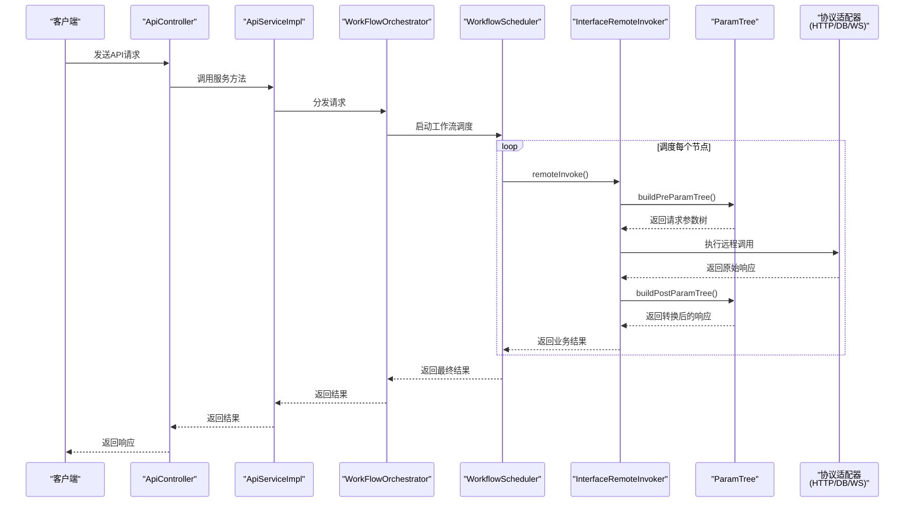

# 核心概念

<cite>
**本文档引用的文件**  
- [WorkFlowOrchestrator.java](file://agent-api/src/main/java/com/helianhealth/agent/api/WorkFlowOrchestrator.java)
- [WorkflowScheduler.java](file://agent-schedule/src/main/java/com/helianhealth/agent/schedule/WorkflowScheduler.java)
- [InterfaceRemoteInvoker.java](file://agent-invocation/src/main/java/com/helianhealth/agent/invocation/remote/InterfaceRemoteInvoker.java)
- [ParamTree.java](file://agent-invocation/src/main/java/com/helianhealth/agent/invocation/remote/ParamTree.java)
- [DefaultInterfaceRemoteInvoker.java](file://agent-invocation/src/main/java/com/helianhealth/agent/invocation/remote/DefaultInterfaceRemoteInvoker.java)
- [DefaultParamTreeBuilder.java](file://agent-invocation/src/main/java/com/helianhealth/agent/invocation/remote/DefaultParamTreeBuilder.java)
- [ApiController.java](file://agent-api/src/main/java/com/helianhealth/agent/api/controller/ApiController.java)
- [ApiService.java](file://agent-api/src/main/java/com/helianhealth/agent/api/service/ApiService.java)
- [ApiServiceImpl.java](file://agent-api/src/main/java/com/helianhealth/agent/api/service/impl/ApiServiceImpl.java)
- [InterfaceWorkflowService.java](file://agent-workflow/src/main/java/com/helianhealth/agent/workflow/service/InterfaceWorkflowService.java)
</cite>

## 目录
1. [工作流引擎调度器](#工作流引擎调度器)
2. [工作流编排器](#工作流编排器)
3. [远程调用器](#远程调用器)
4. [参数树](#参数树)
5. [核心组件交互关系](#核心组件交互关系)

## 工作流引擎调度器

工作流引擎调度器（`WorkflowScheduler`）是整个系统工作流执行的核心引擎，负责根据预定义的流程规则，对工作流节点进行编排和调度。它实现了线性流程中的并行处理能力，并通过递归机制实现节点间的流转。

该调度器的核心逻辑体现在 `schedule` 方法中。当接收到一个或多个工作流节点时，它会根据节点数量决定执行策略：单节点直接处理，多节点则并行执行。对于单节点，调度器会先根据配置的过滤表达式对输入数据进行预处理，然后调用远程接口执行业务逻辑。执行完成后，它会根据节点配置的调度表达式（`scheduleExpr`）解析出下一个要执行的节点ID列表。如果存在下一个节点，调度器会递归调用 `schedule` 方法，将控制权传递给下一组节点，从而实现工作流的链式流转。

对于需要并行处理的场景，调度器提供了两种模式：一是多个节点并行执行（`processParallelNode`），适用于如同时调用多个服务获取数据的场景；二是单个节点根据某个字段拆分数据后并行执行（`parallelSplitNodeProcess`），适用于需要对列表数据进行批量处理的场景。这两种模式都利用了线程池（`ThreadPoolTaskExecutor`）和 `CompletableFuture` 来实现高效的异步并行处理。最终，所有并行任务的结果会通过 `mergeResults` 方法进行合并，该方法支持递归合并嵌套的Map结构，确保复杂数据的正确聚合。

**Section sources**
- [WorkflowScheduler.java](file://agent-schedule/src/main/java/com/helianhealth/agent/schedule/WorkflowScheduler.java#L57-L275)

## 工作流编排器

工作流编排器（`WorkFlowOrchestrator`）是系统的对外API调度中枢，充当了外部请求与内部工作流引擎之间的桥梁。它不直接执行具体的业务逻辑，而是负责协调和分发请求到正确的工作流。

该组件的主要职责是根据外部请求的接口URI（`interfaceUri`）查找对应的工作流定义。它通过依赖 `InterfaceWorkflowService` 服务，调用 `findByInterfaceUri` 方法，根据请求的URI精确匹配到一个工作流实例。一旦找到工作流，编排器便启动调度流程。它首先会使用 `WorkFlowNodeBuilder` 将工作流的初始节点构建成可执行的节点对象列表，然后将这些节点和经过 `ContentTypeAdapter` 处理后的业务数据一起交给 `WorkflowScheduler` 进行调度。

`WorkFlowOrchestrator` 提供了两个核心的调度方法：`dispatch` 和 `jarvisDispatch`。前者用于处理标准的Open API请求，后者则专门用于适配特定的Jarvis系统请求。这两个方法的调用链最终都会汇聚到 `ApiController`，由控制器接收HTTP请求并调用相应的服务方法。这种设计使得系统能够灵活地支持多种外部调用协议，同时保持内部调度逻辑的统一。

**Section sources**
- [WorkFlowOrchestrator.java](file://agent-api/src/main/java/com/helianhealth/agent/api/WorkFlowOrchestrator.java#L39-L103)
- [ApiServiceImpl.java](file://agent-api/src/main/java/com/helianhealth/agent/api/service/impl/ApiServiceImpl.java#L23-L39)
- [ApiController.java](file://agent-api/src/main/java/com/helianhealth/agent/api/controller/ApiController.java#L32-L48)
- [InterfaceWorkflowService.java](file://agent-workflow/src/main/java/com/helianhealth/agent/workflow/service/InterfaceWorkflowService.java#L11)

## 远程调用器

远程调用器（`InterfaceRemoteInvoker`）是一个基于SPI（Service Provider Interface）机制的扩展接口，它是系统支持多种协议（如HTTP、数据库、WebService等）进行远程调用的基础。该接口定义了 `remoteInvoke` 方法，作为所有具体调用实现的统一入口。

通过使用Dubbo的 `@SPI` 和 `@Adaptive` 注解，系统实现了运行时的动态扩展。当 `WorkflowScheduler` 需要执行一个节点时，它会通过 `ExtensionLoader.getExtensionLoader(InterfaceRemoteInvoker.class).getAdaptiveExtension()` 获取一个自适应的调用器实例。这个实例会根据工作流节点（`InterfaceWorkflowNode`）中的元数据（`metaInfo`）自动选择并委托给具体的协议适配器（如 `HttpProtocolAdapter` 或 `DatabaseProtocolAdapter`）来完成实际的网络或数据库操作。

`DefaultInterfaceRemoteInvoker` 是该接口的默认实现，它定义了远程调用的标准流程：首先，调用 `ParamTree` 构建前置参数树，将业务数据按照配置规则转换为协议调用所需的请求参数；然后，通过 `InterfaceClientProxy` 执行实际的协议调用；最后，再次调用 `ParamTree` 构建后置参数树，将原始的响应结果转换为符合业务需求的格式。这种设计将协议无关的参数转换逻辑与协议相关的调用逻辑解耦，极大地增强了系统的可扩展性。

**Section sources**
- [InterfaceRemoteInvoker.java](file://agent-invocation/src/main/java/com/helianhealth/agent/invocation/remote/InterfaceRemoteInvoker.java#L15-L24)
- [DefaultInterfaceRemoteInvoker.java](file://agent-invocation/src/main/java/com/helianhealth/agent/invocation/remote/DefaultInterfaceRemoteInvoker.java#L24-L33)

## 参数树

参数树（`ParamTree`）是系统实现复杂数据映射的核心组件，其核心作用是将配置化的参数映射规则转换为实际的、可执行的参数树结构。它解决了从输入数据到目标协议请求，以及从协议响应到输出数据的双向转换问题。

该接口定义了 `buildPreParamTree` 和 `buildPostParamTree` 两个方法，分别用于构建调用前的请求参数树和调用后的响应参数树。`DefaultParamTreeBuilder` 是其默认实现，它通过递归算法遍历节点参数配置（`NodeParamConfig`），根据配置的源类型（`sourceParamType`）、目标类型（`paramType`）和映射源（`mappingSource`）来动态构建树形结构。

在构建过程中，`ParamTree` 能够处理复杂的嵌套映射，例如将一个JSON对象中的某个数组字段映射到请求体的特定位置，或者将一个扁平的响应结果重新组装成一个嵌套的JSON对象。它还支持数据类型的转换和过滤，如 `ParamFilterProcessor` 可以根据表达式过滤掉不需要的数据。`ProxyConvertHelper` 工具类则负责具体的值转换和提取。整个过程是递归的，确保了无论数据结构多么复杂，都能被正确地映射和转换。

**Section sources**
- [ParamTree.java](file://agent-invocation/src/main/java/com/helianhealth/agent/invocation/remote/ParamTree.java#L18-L47)
- [DefaultParamTreeBuilder.java](file://agent-invocation/src/main/java/com/helianhealth/agent/invocation/remote/DefaultParamTreeBuilder.java#L19)
- [Invocation.java](file://agent-invocation/src/main/java/com/helianhealth/agent/invocation/remote/model/Invocation.java#L16-L29)

## 核心组件交互关系

这四大核心组件构成了一个层次清晰、职责分明的调用链。当一个外部请求到达时，`ApiController` 接收请求并调用 `ApiServiceImpl`。`ApiServiceImpl` 作为服务层，将请求委托给 `WorkFlowOrchestrator` 这个编排中枢。

`WorkFlowOrchestrator` 根据请求的URI查找并加载对应的工作流，然后将调度任务交给 `WorkflowScheduler`。`WorkflowScheduler` 作为执行引擎，开始遍历和调度工作流节点。当需要执行一个具体的远程调用时，`WorkflowScheduler` 会调用 `InterfaceRemoteInvoker` 的 `remoteInvoke` 方法。

`InterfaceRemoteInvoker`（具体为 `DefaultInterfaceRemoteInvoker`）在执行调用前，会使用 `ParamTree` 组件来构建请求参数。它将当前节点的配置和业务数据传递给 `ParamTree`，`ParamTree` 返回一个结构化的参数树，该树精确地描述了如何从原始数据中提取和组织信息以形成最终的请求。调用完成后，`InterfaceRemoteInvoker` 再次使用 `ParamTree` 来解析和转换响应，将原始的、可能很复杂的响应数据，按照预设的规则映射成简洁、统一的业务结果。

这个交互过程形成了一个完整的闭环：`WorkFlowOrchestrator` 负责宏观的流程协调，`WorkflowScheduler` 负责微观的节点调度，`InterfaceRemoteInvoker` 负责协议无关的调用执行，而 `ParamTree` 则负责数据层面的精确转换。它们共同协作，实现了灵活、强大且可扩展的接口代理功能。

**Diagram sources**
- [ApiController.java](file://agent-api/src/main/java/com/helianhealth/agent/api/controller/ApiController.java)
- [ApiServiceImpl.java](file://agent-api/src/main/java/com/helianhealth/agent/api/service/impl/ApiServiceImpl.java)
- [WorkFlowOrchestrator.java](file://agent-api/src/main/java/com/helianhealth/agent/api/WorkFlowOrchestrator.java)
- [WorkflowScheduler.java](file://agent-schedule/src/main/java/com/helianhealth/agent/schedule/WorkflowScheduler.java)
- [DefaultInterfaceRemoteInvoker.java](file://agent-invocation/src/main/java/com/helianhealth/agent/invocation/remote/DefaultInterfaceRemoteInvoker.java)
- [ParamTree.java](file://agent-invocation/src/main/java/com/helianhealth/agent/invocation/remote/ParamTree.java)