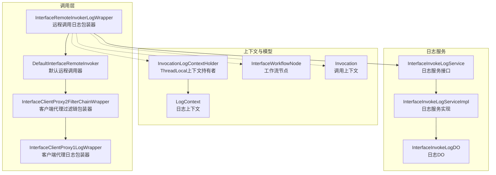
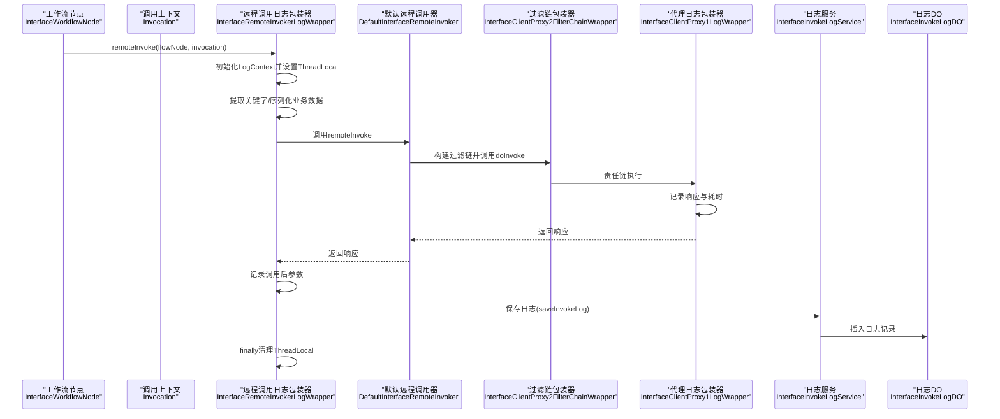
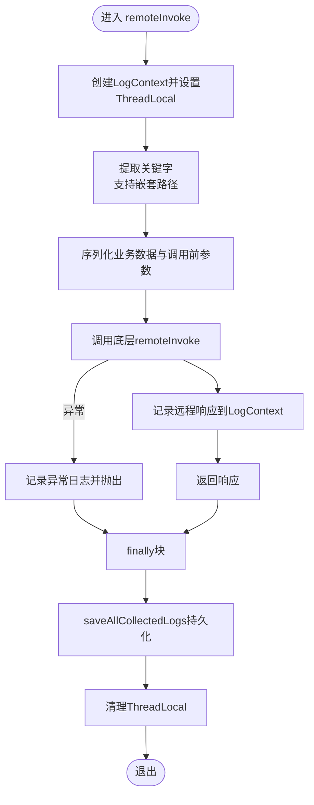
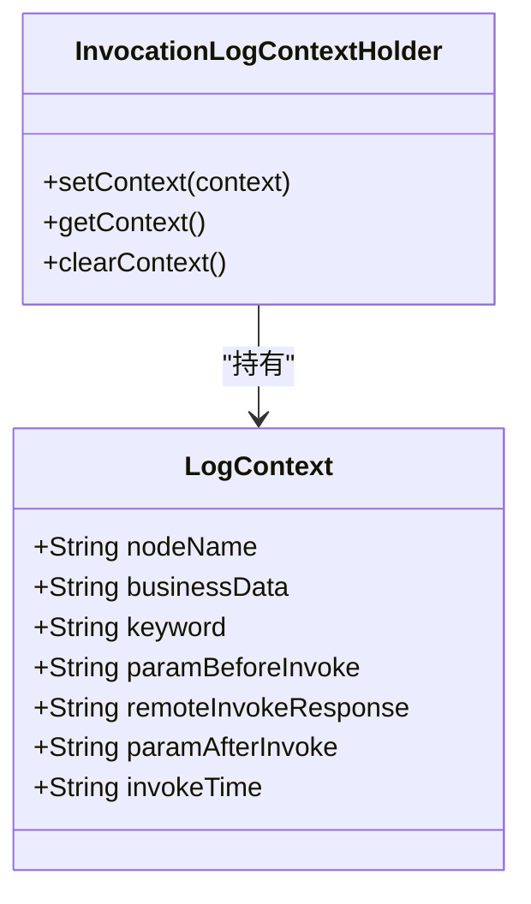
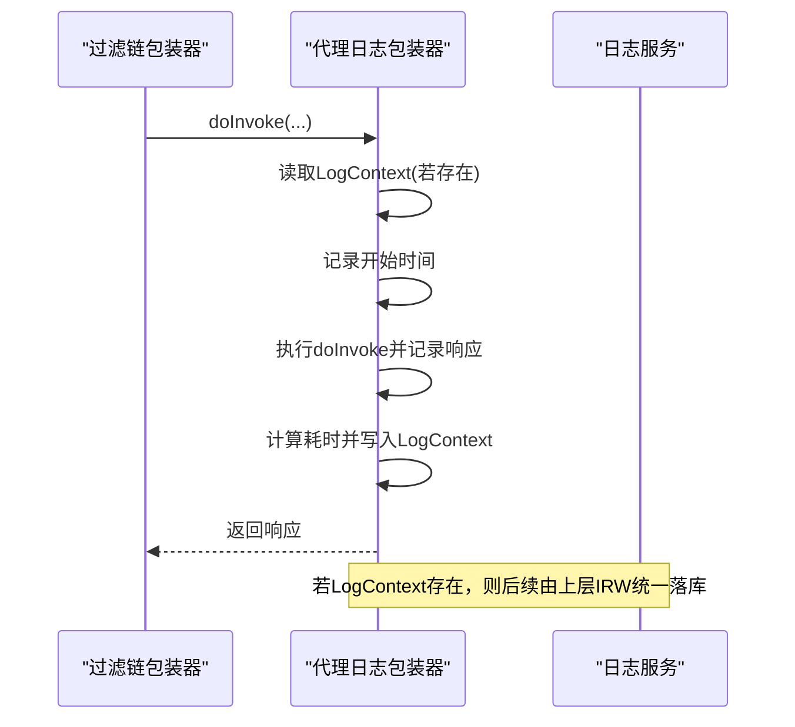
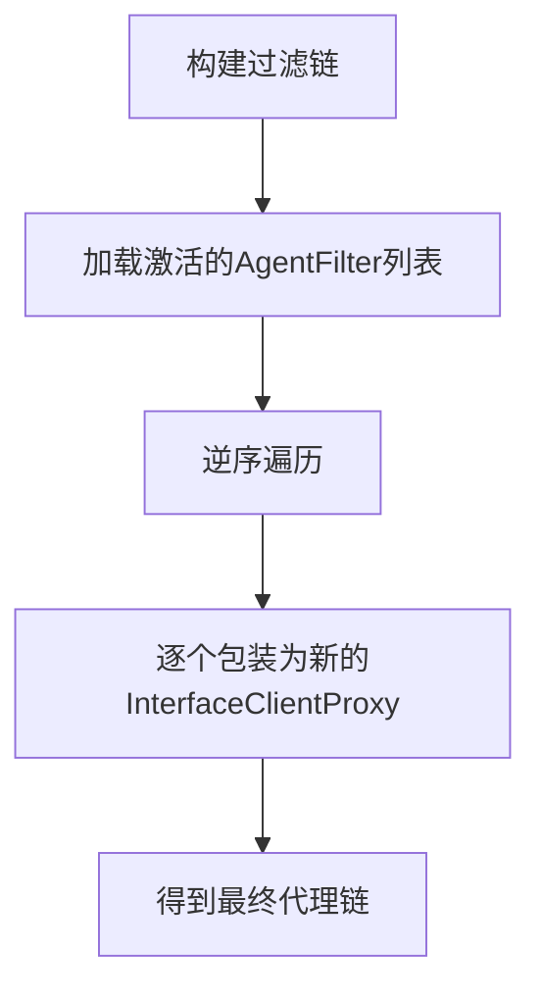
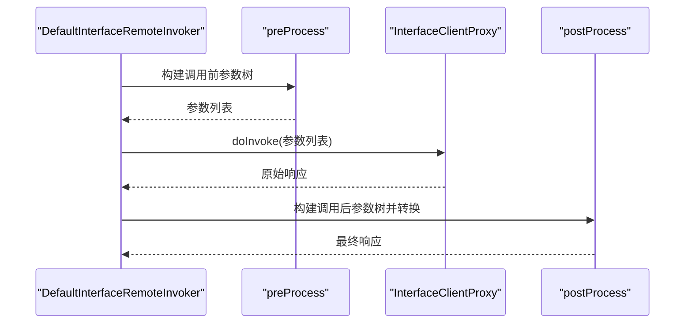
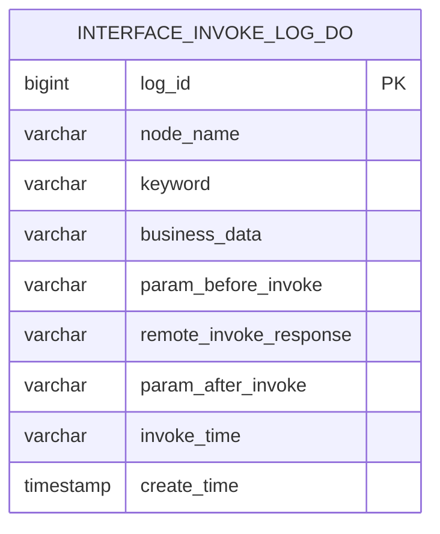
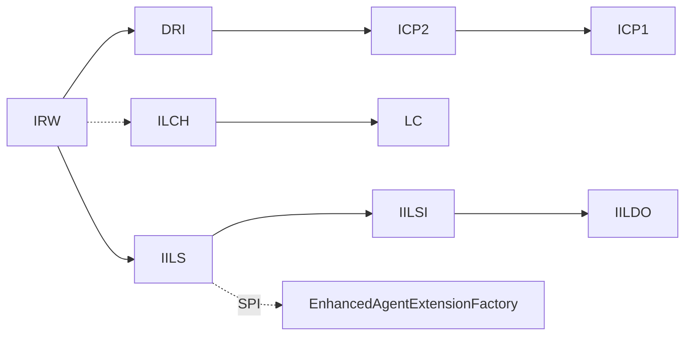

# 扩展包装机制

<cite>
**本文引用的文件**
- [InterfaceRemoteInvokerLogWrapper.java](file://agent-invocation/src/main/java/com/helianhealth/agent/invocation/remote/wrapper/InterfaceRemoteInvokerLogWrapper.java)
- [InvocationLogContextHolder.java](file://agent-invocation/src/main/java/com/helianhealth/agent/invocation/context/InvocationLogContextHolder.java)
- [LogContext.java](file://agent-invocation/src/main/java/com/helianhealth/agent/invocation/context/LogContext.java)
- [InterfaceRemoteInvoker.java](file://agent-invocation/src/main/java/com/helianhealth/agent/invocation/remote/InterfaceRemoteInvoker.java)
- [DefaultInterfaceRemoteInvoker.java](file://agent-invocation/src/main/java/com/helianhealth/agent/invocation/remote/DefaultInterfaceRemoteInvoker.java)
- [InterfaceClientProxy1LogWrapper.java](file://agent-invocation/src/main/java/com/helianhealth/agent/invocation/remote/wrapper/InterfaceClientProxy1LogWrapper.java)
- [InterfaceClientProxy2FilterChainWrapper.java](file://agent-invocation/src/main/java/com/helianhealth/agent/invocation/remote/wrapper/InterfaceClientProxy2FilterChainWrapper.java)
- [InterfaceWorkflowNode.java](file://agent-invocation/src/main/java/com/helianhealth/agent/invocation/remote/model/InterfaceWorkflowNode.java)
- [Invocation.java](file://agent-invocation/src/main/java/com/helianhealth/agent/invocation/remote/model/Invocation.java)
- [InterfaceInvokeLogService.java](file://agent-log/src/main/java/com/helianhealth/agent/log/service/InterfaceInvokeLogService.java)
- [InterfaceInvokeLogServiceImpl.java](file://agent-log/src/main/java/com/helianhealth/agent/log/service/impl/InterfaceInvokeLogServiceImpl.java)
- [InterfaceInvokeLogDO.java](file://agent-log/src/main/java/com/helianhealth/agent/log/model/InterfaceInvokeLogDO.java)
- [EnhancedAgentExtensionFactory.java](file://agent-invocation/src/main/java/com/helianhealth/agent/invocation/factory/EnhancedAgentExtensionFactory.java)
</cite>

## 目录
1. [简介](#简介)
2. [项目结构](#项目结构)
3. [核心组件](#核心组件)
4. [架构总览](#架构总览)
5. [详细组件分析](#详细组件分析)
6. [依赖关系分析](#依赖关系分析)
7. [性能考量](#性能考量)
8. [故障排查指南](#故障排查指南)
9. [结论](#结论)
10. [附录](#附录)

## 简介
本文件围绕 InterfaceRemoteInvokerLogWrapper 如何通过“责任链+包装器”模式对远程调用器进行功能增强，实现调用日志的自动记录与上下文管理展开。重点解析以下方面：
- 如何利用 ThreadLocal（InvocationLogContextHolder）在一次调用生命周期内传递 LogContext，实现跨方法调用的日志上下文共享；
- 从提取业务关键字、序列化业务数据，到捕获调用前后参数、记录执行耗时的完整日志采集流程；
- 与 InterfaceInvokeLogService 的协作关系，以及在 finally 块中确保日志持久化与 ThreadLocal 清理；
- 实际调用场景下的日志数据结构示例；
- 设计对系统可观测性的贡献及潜在的内存泄漏风险防范措施。

## 项目结构
该模块位于 agent-invocation 与 agent-log 两个子工程中，分别负责远程调用与日志持久化；同时存在多个包装器与上下文工具类，形成可插拔的责任链扩展体系。

图表来源
- [InterfaceRemoteInvokerLogWrapper.java](file://agent-invocation/src/main/java/com/helianhealth/agent/invocation/remote/wrapper/InterfaceRemoteInvokerLogWrapper.java#L1-L124)
- [DefaultInterfaceRemoteInvoker.java](file://agent-invocation/src/main/java/com/helianhealth/agent/invocation/remote/DefaultInterfaceRemoteInvoker.java#L1-L86)
- [InterfaceClientProxy1LogWrapper.java](file://agent-invocation/src/main/java/com/helianhealth/agent/invocation/remote/wrapper/InterfaceClientProxy1LogWrapper.java#L1-L44)
- [InterfaceClientProxy2FilterChainWrapper.java](file://agent-invocation/src/main/java/com/helianhealth/agent/invocation/remote/wrapper/InterfaceClientProxy2FilterChainWrapper.java#L1-L40)
- [InvocationLogContextHolder.java](file://agent-invocation/src/main/java/com/helianhealth/agent/invocation/context/InvocationLogContextHolder.java#L1-L33)
- [LogContext.java](file://agent-invocation/src/main/java/com/helianhealth/agent/invocation/context/LogContext.java#L1-L47)
- [InterfaceInvokeLogService.java](file://agent-log/src/main/java/com/helianhealth/agent/log/service/InterfaceInvokeLogService.java#L1-L43)
- [InterfaceInvokeLogServiceImpl.java](file://agent-log/src/main/java/com/helianhealth/agent/log/service/impl/InterfaceInvokeLogServiceImpl.java#L1-L68)
- [InterfaceInvokeLogDO.java](file://agent-log/src/main/java/com/helianhealth/agent/log/model/InterfaceInvokeLogDO.java#L1-L81)

章节来源
- [InterfaceRemoteInvokerLogWrapper.java](file://agent-invocation/src/main/java/com/helianhealth/agent/invocation/remote/wrapper/InterfaceRemoteInvokerLogWrapper.java#L1-L124)
- [DefaultInterfaceRemoteInvoker.java](file://agent-invocation/src/main/java/com/helianhealth/agent/invocation/remote/DefaultInterfaceRemoteInvoker.java#L1-L86)

## 核心组件
- InterfaceRemoteInvokerLogWrapper：远程调用日志包装器，负责在 remoteInvoke 生命周期内创建并填充 LogContext，提取关键字、序列化业务数据，记录调用前后参数与耗时，并最终持久化与清理 ThreadLocal。
- InvocationLogContextHolder：基于 ThreadLocal 的上下文持有者，提供 set/get/clear 方法，保证同一调用线程内的上下文可见性。
- LogContext：日志上下文载体，包含节点名、业务数据、关键字、调用前/后参数、远程响应、耗时等字段。
- InterfaceRemoteInvoker：远程调用器接口，定义 remoteInvoke 方法，是包装器增强的目标。
- DefaultInterfaceRemoteInvoker：默认实现，串联 preProcess、proxy.doInvoke、postProcess 三个阶段。
- InterfaceClientProxy1LogWrapper：客户端代理日志包装器，记录 doInvoke 的响应与耗时。
- InterfaceClientProxy2FilterChainWrapper：客户端代理过滤链包装器，将多个 AgentFilter 组装为责任链。
- InterfaceInvokeLogService/Impl/DO：日志服务接口、实现与持久化实体，负责将日志写入数据库。

章节来源
- [InterfaceRemoteInvokerLogWrapper.java](file://agent-invocation/src/main/java/com/helianhealth/agent/invocation/remote/wrapper/InterfaceRemoteInvokerLogWrapper.java#L1-L124)
- [InvocationLogContextHolder.java](file://agent-invocation/src/main/java/com/helianhealth/agent/invocation/context/InvocationLogContextHolder.java#L1-L33)
- [LogContext.java](file://agent-invocation/src/main/java/com/helianhealth/agent/invocation/context/LogContext.java#L1-L47)
- [InterfaceRemoteInvoker.java](file://agent-invocation/src/main/java/com/helianhealth/agent/invocation/remote/InterfaceRemoteInvoker.java#L1-L26)
- [DefaultInterfaceRemoteInvoker.java](file://agent-invocation/src/main/java/com/helianhealth/agent/invocation/remote/DefaultInterfaceRemoteInvoker.java#L1-L86)
- [InterfaceClientProxy1LogWrapper.java](file://agent-invocation/src/main/java/com/helianhealth/agent/invocation/remote/wrapper/InterfaceClientProxy1LogWrapper.java#L1-L44)
- [InterfaceClientProxy2FilterChainWrapper.java](file://agent-invocation/src/main/java/com/helianhealth/agent/invocation/remote/wrapper/InterfaceClientProxy2FilterChainWrapper.java#L1-L40)
- [InterfaceInvokeLogService.java](file://agent-log/src/main/java/com/helianhealth/agent/log/service/InterfaceInvokeLogService.java#L1-L43)
- [InterfaceInvokeLogServiceImpl.java](file://agent-log/src/main/java/com/helianhealth/agent/log/service/impl/InterfaceInvokeLogServiceImpl.java#L1-L68)
- [InterfaceInvokeLogDO.java](file://agent-log/src/main/java/com/helianhealth/agent/log/model/InterfaceInvokeLogDO.java#L1-L81)

## 架构总览
下面的时序图展示了从工作流节点触发 remoteInvoke 到日志落库与上下文清理的完整流程，体现责任链与包装器的协作关系。

图表来源
- [InterfaceRemoteInvokerLogWrapper.java](file://agent-invocation/src/main/java/com/helianhealth/agent/invocation/remote/wrapper/InterfaceRemoteInvokerLogWrapper.java#L29-L71)
- [DefaultInterfaceRemoteInvoker.java](file://agent-invocation/src/main/java/com/helianhealth/agent/invocation/remote/DefaultInterfaceRemoteInvoker.java#L23-L33)
- [InterfaceClientProxy2FilterChainWrapper.java](file://agent-invocation/src/main/java/com/helianhealth/agent/invocation/remote/wrapper/InterfaceClientProxy2FilterChainWrapper.java#L24-L38)
- [InterfaceClientProxy1LogWrapper.java](file://agent-invocation/src/main/java/com/helianhealth/agent/invocation/remote/wrapper/InterfaceClientProxy1LogWrapper.java#L21-L42)
- [InterfaceInvokeLogService.java](file://agent-log/src/main/java/com/helianhealth/agent/log/service/InterfaceInvokeLogService.java#L18-L24)
- [InterfaceInvokeLogServiceImpl.java](file://agent-log/src/main/java/com/helianhealth/agent/log/service/impl/InterfaceInvokeLogServiceImpl.java#L23-L41)
- [InterfaceInvokeLogDO.java](file://agent-log/src/main/java/com/helianhealth/agent/log/model/InterfaceInvokeLogDO.java#L23-L80)

## 详细组件分析

### InterfaceRemoteInvokerLogWrapper：远程调用日志包装器
- 职责与定位
  - 作为 InterfaceRemoteInvoker 的装饰器，围绕 remoteInvoke 方法进行功能增强，不改变原有调用语义。
  - 在调用前后收集关键日志信息，包括关键字、业务数据、调用前/后参数、远程响应、耗时等。
- 关键流程
  - 初始化与上下文注入：创建 LogContext 并通过 InvocationLogContextHolder.setContext 注入当前线程。
  - 关键字提取：从业务数据中按配置的 keywordField 提取关键字，支持点号分隔的嵌套路径。
  - 序列化：将业务数据与调用前后参数统一序列化为 JSON 字符串，便于持久化与检索。
  - 调用执行：委托给底层 InterfaceRemoteInvoker.remoteInvoke 执行真实调用。
  - 结果记录：将响应结果序列化并写入 LogContext。
  - 异常处理：捕获异常并记录错误日志，向上抛出。
  - 日志持久化与清理：在 finally 块中调用 saveAllCollectedLogs，确保即使异常也落库；最后清除 ThreadLocal 防止内存泄漏。
- 嵌套字段提取算法
  - 通过点号分隔的路径逐层访问 Map 结构，遇到非 Map 或缺失键即返回 null，避免 NPE。
- 与 InterfaceInvokeLogService 协作
  - 通过 saveAllCollectedLogs 调用服务层 saveInvokeLog，传入节点名、关键字、业务数据、调用前后参数、远程响应、调用耗时等。
- ThreadLocal 使用与清理
  - 通过 InvocationLogContextHolder.setContext 在入口设置，finally 中调用 clearContext 移除，避免线程复用导致的数据残留。

图表来源
- [InterfaceRemoteInvokerLogWrapper.java](file://agent-invocation/src/main/java/com/helianhealth/agent/invocation/remote/wrapper/InterfaceRemoteInvokerLogWrapper.java#L29-L71)
- [InvocationLogContextHolder.java](file://agent-invocation/src/main/java/com/helianhealth/agent/invocation/context/InvocationLogContextHolder.java#L15-L31)

章节来源
- [InterfaceRemoteInvokerLogWrapper.java](file://agent-invocation/src/main/java/com/helianhealth/agent/invocation/remote/wrapper/InterfaceRemoteInvokerLogWrapper.java#L29-L122)
- [InvocationLogContextHolder.java](file://agent-invocation/src/main/java/com/helianhealth/agent/invocation/context/InvocationLogContextHolder.java#L8-L32)

### InvocationLogContextHolder 与 LogContext：上下文传递与承载
- InvocationLogContextHolder
  - 使用 ThreadLocal 存储 LogContext，保证同一调用线程内可见。
  - 提供 setContext/getContext/clearContext 三板斧，简洁高效。
- LogContext
  - 字段覆盖：节点名、业务数据(JSON)、关键字、调用前/后参数(JSON)、远程响应(JSON)、耗时字符串。
  - 采用字符串形式存储，便于序列化与数据库持久化。

图表来源
- [InvocationLogContextHolder.java](file://agent-invocation/src/main/java/com/helianhealth/agent/invocation/context/InvocationLogContextHolder.java#L8-L32)
- [LogContext.java](file://agent-invocation/src/main/java/com/helianhealth/agent/invocation/context/LogContext.java#L9-L46)

章节来源
- [InvocationLogContextHolder.java](file://agent-invocation/src/main/java/com/helianhealth/agent/invocation/context/InvocationLogContextHolder.java#L8-L32)
- [LogContext.java](file://agent-invocation/src/main/java/com/helianhealth/agent/invocation/context/LogContext.java#L9-L46)

### InterfaceClientProxy1LogWrapper：代理层日志增强
- 作用：在 doInvoke 执行期间记录远程响应与耗时，补充调用链中间环节的日志信息。
- 关键点：从 ThreadLocal 获取 LogContext，若不存在则直接透传；记录响应后设置耗时。

图表来源
- [InterfaceClientProxy1LogWrapper.java](file://agent-invocation/src/main/java/com/helianhealth/agent/invocation/remote/wrapper/InterfaceClientProxy1LogWrapper.java#L21-L42)

章节来源
- [InterfaceClientProxy1LogWrapper.java](file://agent-invocation/src/main/java/com/helianhealth/agent/invocation/remote/wrapper/InterfaceClientProxy1LogWrapper.java#L13-L43)

### InterfaceClientProxy2FilterChainWrapper：过滤链包装器
- 作用：基于 Dubbo SPI 机制加载一组 AgentFilter，构建责任链，依次执行每个 Filter 的 doInvoke 包装逻辑。
- 关键点：通过 ExtensionLoader.getActivateExtension(url, "filter") 获取激活的过滤器列表，逆序组装为包装链。

图表来源
- [InterfaceClientProxy2FilterChainWrapper.java](file://agent-invocation/src/main/java/com/helianhealth/agent/invocation/remote/wrapper/InterfaceClientProxy2FilterChainWrapper.java#L29-L38)

章节来源
- [InterfaceClientProxy2FilterChainWrapper.java](file://agent-invocation/src/main/java/com/helianhealth/agent/invocation/remote/wrapper/InterfaceClientProxy2FilterChainWrapper.java#L16-L39)

### DefaultInterfaceRemoteInvoker：默认远程调用器
- 作用：串联参数预处理、代理调用、参数后处理三个阶段，形成标准的调用流程。
- 关键点：preProcess 与 postProcess 分别构建参数树并进行映射转换，proxy.doInvoke 交由代理链完成实际网络调用。

图表来源
- [DefaultInterfaceRemoteInvoker.java](file://agent-invocation/src/main/java/com/helianhealth/agent/invocation/remote/DefaultInterfaceRemoteInvoker.java#L23-L33)

章节来源
- [DefaultInterfaceRemoteInvoker.java](file://agent-invocation/src/main/java/com/helianhealth/agent/invocation/remote/DefaultInterfaceRemoteInvoker.java#L16-L85)

### InterfaceInvokeLogService/Impl/DO：日志持久化
- InterfaceInvokeLogService：定义 saveInvokeLog 两种重载（含/不含业务数据与调用后参数），以及分页查询接口。
- InterfaceInvokeLogServiceImpl：实现保存逻辑，构造 InterfaceInvokeLogDO 并调用 Mapper 插入；分页查询通过 PageHelper 实现。
- InterfaceInvokeLogDO：数据库实体，字段与服务接口一一对应，包含日志ID、节点名、关键字、业务数据、调用前后参数、远程响应、耗时、创建时间等。

图表来源
- [InterfaceInvokeLogDO.java](file://agent-log/src/main/java/com/helianhealth/agent/log/model/InterfaceInvokeLogDO.java#L23-L80)

章节来源
- [InterfaceInvokeLogService.java](file://agent-log/src/main/java/com/helianhealth/agent/log/service/InterfaceInvokeLogService.java#L6-L42)
- [InterfaceInvokeLogServiceImpl.java](file://agent-log/src/main/java/com/helianhealth/agent/log/service/impl/InterfaceInvokeLogServiceImpl.java#L19-L67)
- [InterfaceInvokeLogDO.java](file://agent-log/src/main/java/com/helianhealth/agent/log/model/InterfaceInvokeLogDO.java#L18-L80)

## 依赖关系分析
- 包装器与调用器
  - InterfaceRemoteInvokerLogWrapper 装饰 DefaultInterfaceRemoteInvoker，形成“外层日志 + 内层调用”的组合。
  - InterfaceClientProxy2FilterChainWrapper 与 InterfaceClientProxy1LogWrapper 分别在代理层与过滤链层进行日志增强。
- 上下文与服务
  - InvocationLogContextHolder 与 LogContext 为跨方法传递提供载体；InterfaceInvokeLogService/Impl/DO 负责持久化。
- SPI 与扩展
  - EnhancedAgentExtensionFactory 支持从 Spring 容器与动态 SPI 管理器获取扩展 Bean，保证包装器与服务的装配灵活性。

图表来源
- [InterfaceRemoteInvokerLogWrapper.java](file://agent-invocation/src/main/java/com/helianhealth/agent/invocation/remote/wrapper/InterfaceRemoteInvokerLogWrapper.java#L16-L26)
- [DefaultInterfaceRemoteInvoker.java](file://agent-invocation/src/main/java/com/helianhealth/agent/invocation/remote/DefaultInterfaceRemoteInvoker.java#L16-L21)
- [InterfaceClientProxy2FilterChainWrapper.java](file://agent-invocation/src/main/java/com/helianhealth/agent/invocation/remote/wrapper/InterfaceClientProxy2FilterChainWrapper.java#L16-L22)
- [InterfaceClientProxy1LogWrapper.java](file://agent-invocation/src/main/java/com/helianhealth/agent/invocation/remote/wrapper/InterfaceClientProxy1LogWrapper.java#L13-L19)
- [InvocationLogContextHolder.java](file://agent-invocation/src/main/java/com/helianhealth/agent/invocation/context/InvocationLogContextHolder.java#L8-L32)
- [InterfaceInvokeLogService.java](file://agent-log/src/main/java/com/helianhealth/agent/log/service/InterfaceInvokeLogService.java#L6-L42)
- [EnhancedAgentExtensionFactory.java](file://agent-invocation/src/main/java/com/helianhealth/agent/invocation/factory/EnhancedAgentExtensionFactory.java#L30-L51)

章节来源
- [EnhancedAgentExtensionFactory.java](file://agent-invocation/src/main/java/com/helianhealth/agent/invocation/factory/EnhancedAgentExtensionFactory.java#L23-L147)

## 性能考量
- 序列化成本：对业务数据与参数进行 JSON 序列化，建议在高并发场景下控制日志字段大小，避免过长 JSON 影响 IO 与存储。
- ThreadLocal 清理：finally 块中强制清理，避免线程池复用导致的内存泄漏；在异步/定时任务中更需注意。
- 调用链深度：过滤链越深，日志记录次数越多，需权衡可观测性与性能。
- 数据库写入：批量入库或异步落库策略可进一步降低阻塞。

## 故障排查指南
- 日志未落库
  - 检查 saveAllCollectedLogs 是否被调用（finally 块），确认 InterfaceInvokeLogService 实现已装配。
  - 核对数据库连接与表结构，确认字段长度与类型匹配。
- 关键字为空
  - 检查 InterfaceWorkflowNode 的 keywordField 配置是否正确，以及业务数据中是否存在该字段。
- ThreadLocal 泄漏
  - 确认 finally 中调用了 InvocationLogContextHolder.clearContext；排查自定义线程池或异步任务未清理的情况。
- 异常吞吐
  - 查看日志中是否有“保存接口调用日志失败”等错误，定位数据库异常或序列化异常。

章节来源
- [InterfaceRemoteInvokerLogWrapper.java](file://agent-invocation/src/main/java/com/helianhealth/agent/invocation/remote/wrapper/InterfaceRemoteInvokerLogWrapper.java#L60-L70)
- [InterfaceInvokeLogServiceImpl.java](file://agent-log/src/main/java/com/helianhealth/agent/log/service/impl/InterfaceInvokeLogServiceImpl.java#L38-L41)

## 结论
InterfaceRemoteInvokerLogWrapper 通过“责任链+包装器”模式，将日志采集能力以横切关注点的方式注入到远程调用流程中，实现了：
- 自动化的日志采集：关键字提取、业务数据序列化、调用前后参数记录、耗时统计；
- 可靠的上下文传递：基于 ThreadLocal 的 LogContext 在整个调用链中贯穿始终；
- 明确的持久化与清理：finally 块确保日志落库与 ThreadLocal 清理，降低内存泄漏风险；
- 与日志服务的解耦：通过 InterfaceInvokeLogService 抽象，便于替换实现与扩展。

该设计显著提升了系统的可观测性，便于问题定位与审计追踪。

## 附录

### 实际调用场景下的日志数据结构示例
- 节点名：工作流节点名称
- 关键字：从业务数据中提取的关键字段值（如患者编号）
- 业务数据：原始业务数据的 JSON 字符串
- 调用前参数：参数预处理后的 JSON 字符串
- 远程调用响应：代理层返回的 JSON 字符串
- 调用后参数：参数后处理后的 JSON 字符串
- 调用耗时：毫秒数字符串
- 创建时间：日志创建时间

章节来源
- [InterfaceInvokeLogDO.java](file://agent-log/src/main/java/com/helianhealth/agent/log/model/InterfaceInvokeLogDO.java#L23-L80)
- [LogContext.java](file://agent-invocation/src/main/java/com/helianhealth/agent/invocation/context/LogContext.java#L9-L46)