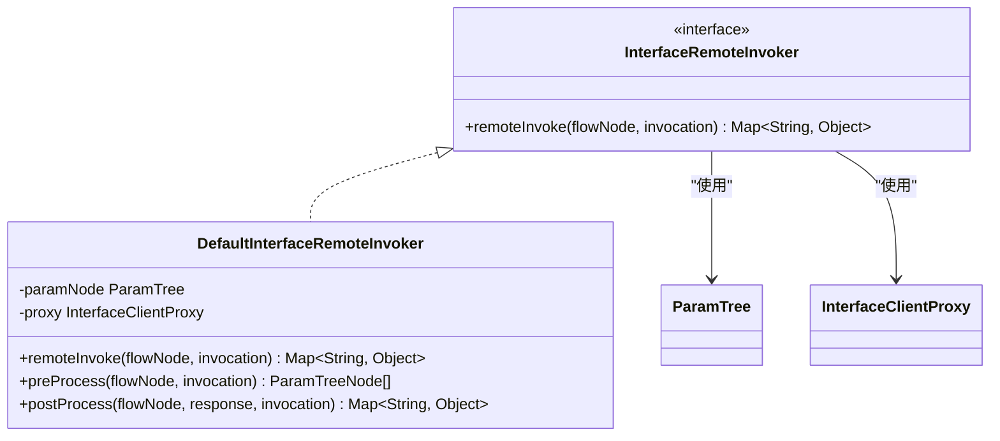
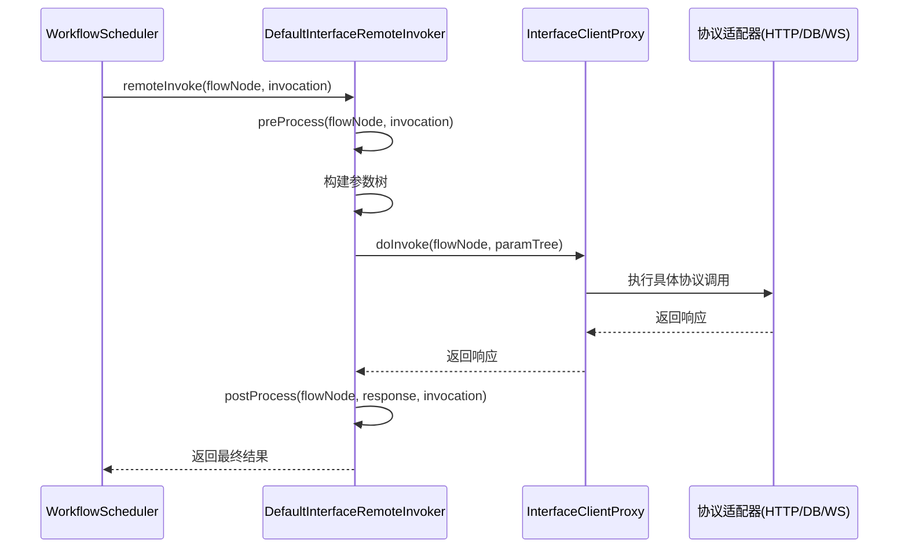
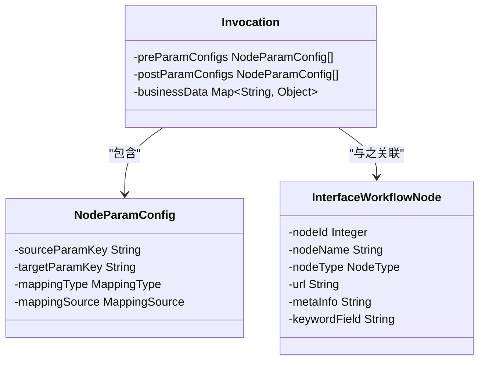
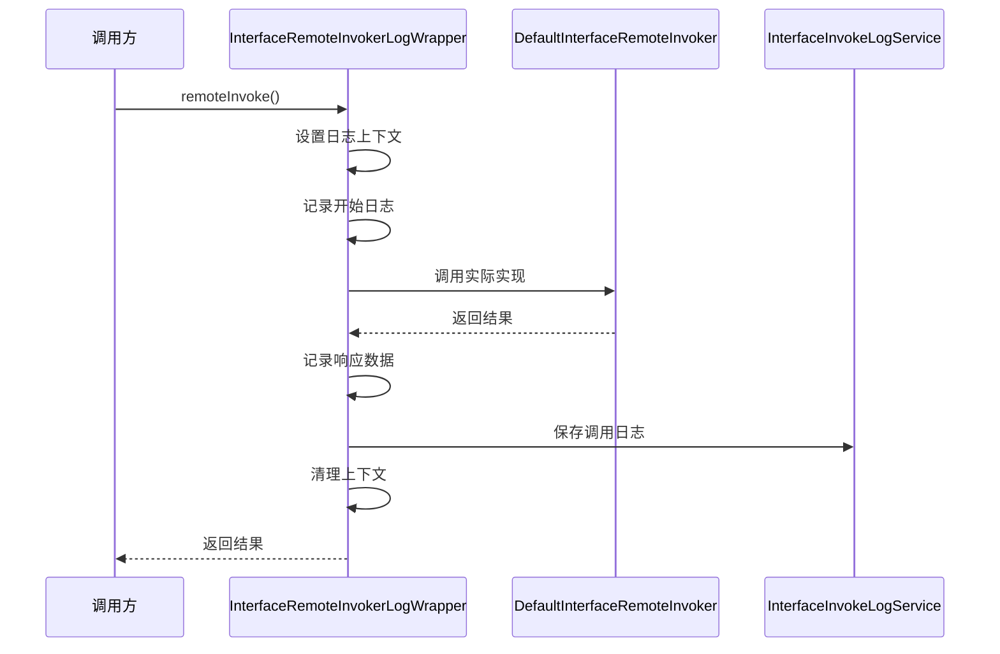
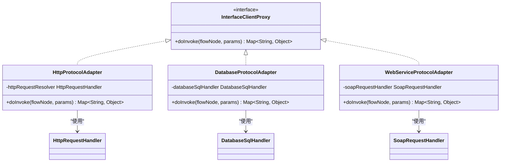

# 远程调用

<cite>
**本文档引用的文件**
- [InterfaceRemoteInvoker.java](file://agent-invocation/src/main/java/com/helianhealth/agent/invocation/remote/InterfaceRemoteInvoker.java)
- [DefaultInterfaceRemoteInvoker.java](file://agent-invocation/src/main/java/com/helianhealth/agent/invocation/remote/DefaultInterfaceRemoteInvoker.java)
- [Invocation.java](file://agent-invocation/src/main/java/com/helianhealth/agent/invocation/remote/model/Invocation.java)
- [InterfaceRemoteInvokerLogWrapper.java](file://agent-invocation/src/main/java/com/helianhealth/agent/invocation/remote/wrapper/InterfaceRemoteInvokerLogWrapper.java)
- [InterfaceClientProxy.java](file://agent-invocation/src/main/java/com/helianhealth/agent/invocation/remote/InterfaceClientProxy.java)
- [ParamTree.java](file://agent-invocation/src/main/java/com/helianhealth/agent/invocation/remote/ParamTree.java)
- [HttpProtocolAdapter.java](file://agent-invocation/src/main/java/com/helianhealth/agent/invocation/remote/http/HttpProtocolAdapter.java)
- [DatabaseProtocolAdapter.java](file://agent-invocation/src/main/java/com/helianhealth/agent/invocation/remote/database/DatabaseProtocolAdapter.java)
- [WebServiceProtocolAdapter.java](file://agent-invocation/src/main/java/com/helianhealth/agent/invocation/remote/webService/WebServiceProtocolAdapter.java)
- [InvocationLogContextHolder.java](file://agent-invocation/src/main/java/com/helianhealth/agent/invocation/context/InvocationLogContextHolder.java)
- [LogContext.java](file://agent-invocation/src/main/java/com/helianhealth/agent/invocation/context/LogContext.java)
- [com.helianhealth.agent.invocation.remote.InterfaceRemoteInvoker](file://agent-invocation/src/main/resources/META-INF/dubbo/com.helianhealth.agent.invocation.remote.InterfaceRemoteInvoker)
</cite>

## 目录
1. [引言](#引言)
2. [核心接口设计与SPI扩展机制](#核心接口设计与spi扩展机制)
3. [DefaultInterfaceRemoteInvoker实现解析](#defaultinterfaceremoteinvoker实现解析)
4. [调用上下文Invocation对象](#调用上下文invocation对象)
5. [调用日志包装器与责任链模式](#调用日志包装器与责任链模式)
6. [协议适配器实现](#协议适配器实现)
7. [总结](#总结)

## 引言
本文档全面解析远程调用器（InterfaceRemoteInvoker）的设计原理与实现机制。该系统作为接口代理平台的核心组件，支持HTTP、数据库、WebService等多种协议的远程调用，通过Dubbo SPI实现可插拔架构，具备高度的扩展性和灵活性。文档将深入分析其三阶段执行流程、调用上下文管理以及可观察性设计。

## 核心接口设计与SPI扩展机制

远程调用功能的核心是`InterfaceRemoteInvoker`接口，它定义了远程调用的基本契约。该接口通过Dubbo SPI（Service Provider Interface）机制实现可插拔架构，允许系统在运行时动态选择和加载不同的实现。

**图示来源**
- [InterfaceRemoteInvoker.java](file://agent-invocation/src/main/java/com/helianhealth/agent/invocation/remote/InterfaceRemoteInvoker.java#L1-L26)
- [DefaultInterfaceRemoteInvoker.java](file://agent-invocation/src/main/java/com/helianhealth/agent/invocation/remote/DefaultInterfaceRemoteInvoker.java#L1-L86)

`InterfaceRemoteInvoker`接口使用`@SPI("default")`注解标记，表明这是一个SPI接口，其默认实现为`default`。同时，`remoteInvoke`方法使用`@Adaptive("remote")`注解，使得Dubbo能够根据运行时参数动态选择具体的实现。

**本节来源**
- [InterfaceRemoteInvoker.java](file://agent-invocation/src/main/java/com/helianhealth/agent/invocation/remote/InterfaceRemoteInvoker.java#L1-L26)

## DefaultInterfaceRemoteInvoker实现解析

`DefaultInterfaceRemoteInvoker`是`InterfaceRemoteInvoker`的默认实现类，它采用三阶段执行流程来处理远程调用：

1. **前置参数处理**（preProcess）
2. **协议调用执行**（proxy.doInvoke）
3. **后置响应处理**（postProcess）

**图示来源**
- [DefaultInterfaceRemoteInvoker.java](file://agent-invocation/src/main/java/com/helianhealth/agent/invocation/remote/DefaultInterfaceRemoteInvoker.java#L1-L86)

`DefaultInterfaceRemoteInvoker`在构造时通过Dubbo的`ExtensionLoader`获取`ParamTree`和`InterfaceClientProxy`的自适应扩展实例。`remoteInvoke`方法按照三阶段流程执行：首先调用`preProcess`方法将配置参数转换为参数树，然后通过`proxy.doInvoke`执行实际的协议调用，最后通过`postProcess`方法处理响应数据。

**本节来源**
- [DefaultInterfaceRemoteInvoker.java](file://agent-invocation/src/main/java/com/helianhealth/agent/invocation/remote/DefaultInterfaceRemoteInvoker.java#L1-L86)

## 调用上下文Invocation对象

`Invocation`对象作为远程调用的上下文，封装了调用所需的全部信息，包括前置参数配置、后置参数配置和业务数据。

**图示来源**
- [Invocation.java](file://agent-invocation/src/main/java/com/helianhealth/agent/invocation/remote/model/Invocation.java#L1-L31)
- [DefaultInterfaceRemoteInvoker.java](file://agent-invocation/src/main/java/com/helianhealth/agent/invocation/remote/DefaultInterfaceRemoteInvoker.java#L4-L8)

`Invocation`对象通过`@Builder`注解支持流式构建，包含三个核心属性：`preParamConfigs`用于定义请求参数的映射规则，`postParamConfigs`用于定义响应参数的映射规则，`businessData`则封装了原始的业务数据。这种设计使得调用上下文既灵活又易于扩展。

**本节来源**
- [Invocation.java](file://agent-invocation/src/main/java/com/helianhealth/agent/invocation/remote/model/Invocation.java#L1-L31)

## 调用日志包装器与责任链模式

`InterfaceRemoteInvokerLogWrapper`通过责任链模式包装`InterfaceRemoteInvoker`，实现了调用日志的自动记录与上下文管理，体现了系统的可观察性设计。

**图示来源**
- [InterfaceRemoteInvokerLogWrapper.java](file://agent-invocation/src/main/java/com/helianhealth/agent/invocation/remote/wrapper/InterfaceRemoteInvokerLogWrapper.java#L1-L124)

`InterfaceRemoteInvokerLogWrapper`实现了`InterfaceRemoteInvoker`接口，并持有一个`InterfaceRemoteInvoker`类型的委托实例。在`remoteInvoke`方法中，它首先设置日志上下文，记录调用开始信息，然后调用委托实例的实际方法，捕获结果后通过`InterfaceInvokeLogService`保存完整的调用日志，最后在`finally`块中清理`ThreadLocal`数据以防止内存泄漏。

日志上下文通过`InvocationLogContextHolder`管理，使用`ThreadLocal`确保线程安全。`LogContext`对象封装了节点名称、业务数据、关键字、调用前后参数等信息，为后续的日志分析和问题排查提供了完整的数据支持。

**本节来源**
- [InterfaceRemoteInvokerLogWrapper.java](file://agent-invocation/src/main/java/com/helianhealth/agent/invocation/remote/wrapper/InterfaceRemoteInvokerLogWrapper.java#L1-L124)
- [InvocationLogContextHolder.java](file://agent-invocation/src/main/java/com/helianhealth/agent/invocation/context/InvocationLogContextHolder.java#L1-L33)
- [LogContext.java](file://agent-invocation/src/main/java/com/helianhealth/agent/invocation/context/LogContext.java#L1-L47)

## 协议适配器实现

系统通过`InterfaceClientProxy`接口和多种协议适配器实现了对不同协议的支持。`InterfaceClientProxy`是一个SPI接口，其具体实现包括`HttpProtocolAdapter`、`DatabaseProtocolAdapter`和`WebServiceProtocolAdapter`。

**图示来源**
- [InterfaceClientProxy.java](file://agent-invocation/src/main/java/com/helianhealth/agent/invocation/remote/InterfaceClientProxy.java#L1-L21)
- [HttpProtocolAdapter.java](file://agent-invocation/src/main/java/com/helianhealth/agent/invocation/remote/http/HttpProtocolAdapter.java#L1-L49)
- [DatabaseProtocolAdapter.java](file://agent-invocation/src/main/java/com/helianhealth/agent/invocation/remote/database/DatabaseProtocolAdapter.java#L1-L33)
- [WebServiceProtocolAdapter.java](file://agent-invocation/src/main/java/com/helianhealth/agent/invocation/remote/webService/WebServiceProtocolAdapter.java#L1-L30)

每种协议适配器负责处理特定类型的远程调用。例如，`HttpProtocolAdapter`从`flowNode`的`metaInfo`中解析URL、HTTP方法和请求头，使用`HttpRequestHandler`构建请求体并执行HTTP调用；`DatabaseProtocolAdapter`使用`DatabaseSqlHandler`将参数树转换为SQL语句并执行数据库查询；`WebServiceProtocolAdapter`则使用`SoapRequestHandler`构建和发送SOAP消息。

这些适配器通过Dubbo SPI机制注册，在运行时根据`flowNode`的`nodeType`被动态选择和调用，实现了协议的可插拔性。

**本节来源**
- [InterfaceClientProxy.java](file://agent-invocation/src/main/java/com/helianhealth/agent/invocation/remote/InterfaceClientProxy.java#L1-L21)
- [HttpProtocolAdapter.java](file://agent-invocation/src/main/java/com/helianhealth/agent/invocation/remote/http/HttpProtocolAdapter.java#L1-L49)
- [DatabaseProtocolAdapter.java](file://agent-invocation/src/main/java/com/helianhealth/agent/invocation/remote/database/DatabaseProtocolAdapter.java#L1-L33)
- [WebServiceProtocolAdapter.java](file://agent-invocation/src/main/java/com/helianhealth/agent/invocation/remote/webService/WebServiceProtocolAdapter.java#L1-L30)

## 总结
远程调用器系统通过精心设计的接口和SPI扩展机制，实现了对多种协议的统一支持。`InterfaceRemoteInvoker`作为核心接口，定义了远程调用的标准流程；`DefaultInterfaceRemoteInvoker`通过三阶段执行模型确保了调用过程的清晰和可控；`Invocation`对象作为调用上下文，有效地封装了业务数据和配置信息；而`InterfaceRemoteInvokerLogWrapper`则通过责任链模式增强了系统的可观察性。整个架构体现了高内聚、低耦合的设计原则，为系统的稳定运行和持续扩展提供了坚实的基础。