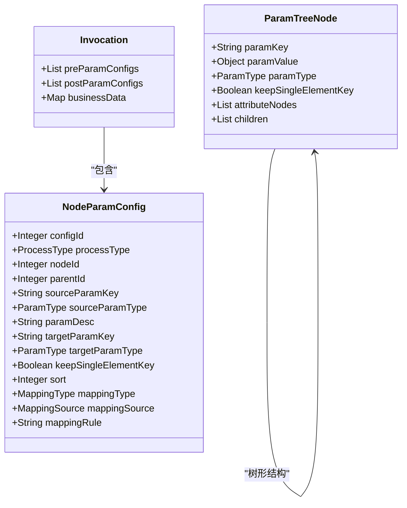
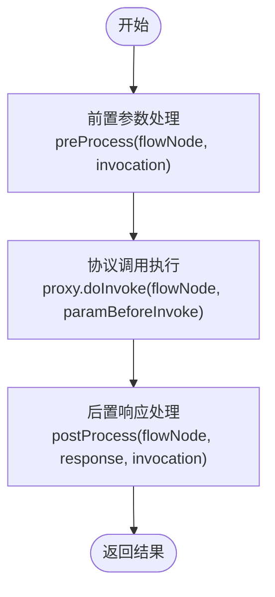
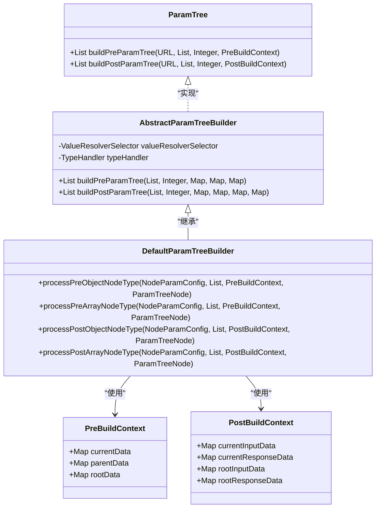
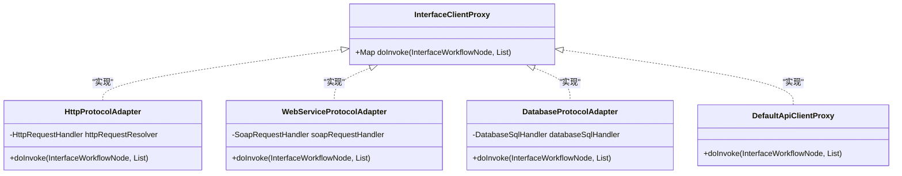
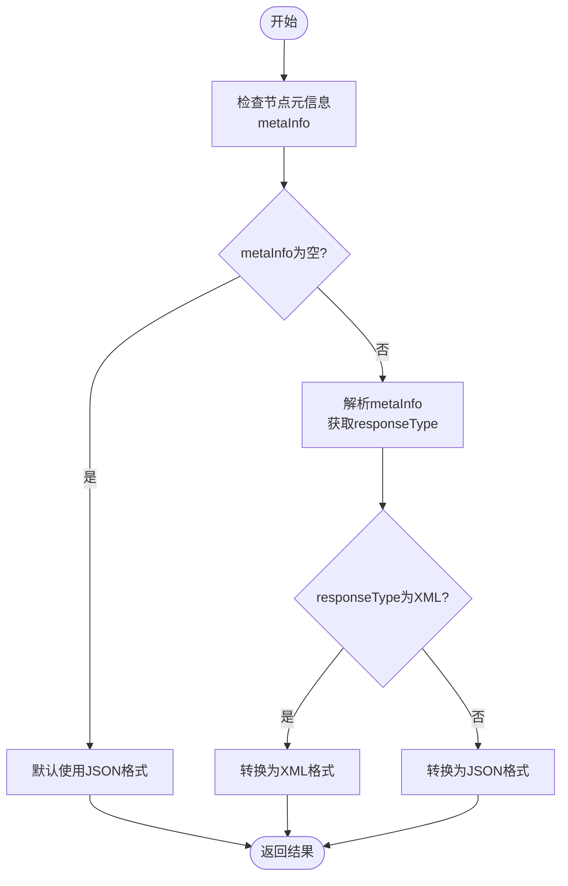
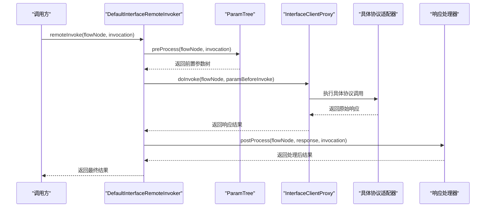

# 远程调用机制

<cite>
**本文档引用文件**  
- [DefaultInterfaceRemoteInvoker.java](file://agent-invocation/src/main/java/com/helianhealth/agent/invocation/remote/DefaultInterfaceRemoteInvoker.java)
- [Invocation.java](file://agent-invocation/src/main/java/com/helianhealth/agent/invocation/remote/model/Invocation.java)
- [ParamTree.java](file://agent-invocation/src/main/java/com/helianhealth/agent/invocation/remote/ParamTree.java)
- [ProxyConvertHelper.java](file://agent-invocation/src/main/java/com/helianhealth/agent/invocation/remote/ProxyConvertHelper.java)
- [InterfaceClientProxy.java](file://agent-invocation/src/main/java/com/helianhealth/agent/invocation/remote/InterfaceClientProxy.java)
- [DefaultParamTreeBuilder.java](file://agent-invocation/src/main/java/com/helianhealth/agent/invocation/remote/DefaultParamTreeBuilder.java)
- [NodeParamConfig.java](file://agent-invocation/src/main/java/com/helianhealth/agent/invocation/remote/model/NodeParamConfig.java)
- [ParamTreeNode.java](file://agent-invocation/src/main/java/com/helianhealth/agent/invocation/remote/model/ParamTreeNode.java)
- [PreBuildContext.java](file://agent-invocation/src/main/java/com/helianhealth/agent/invocation/remote/model/PreBuildContext.java)
- [PostBuildContext.java](file://agent-invocation/src/main/java/com/helianhealth/agent/invocation/remote/model/PostBuildContext.java)
- [HttpProtocolAdapter.java](file://agent-invocation/src/main/java/com/helianhealth/agent/invocation/remote/http/HttpProtocolAdapter.java)
- [WebServiceProtocolAdapter.java](file://agent-invocation/src/main/java/com/helianhealth/agent/invocation/remote/webService/WebServiceProtocolAdapter.java)
- [DatabaseProtocolAdapter.java](file://agent-invocation/src/main/java/com/helianhealth/agent/invocation/remote/database/DatabaseProtocolAdapter.java)
- [AbstractParamTreeBuilder.java](file://agent-invocation/src/main/java/com/helianhealth/agent/invocation/remote/AbstractParamTreeBuilder.java)
</cite>

## 目录
1. [远程调用核心流程](#远程调用核心流程)
2. [调用上下文与参数配置](#调用上下文与参数配置)
3. [三阶段调用机制详解](#三阶段调用机制详解)
4. [参数树构建原理](#参数树构建原理)
5. [协议适配与SPI动态扩展](#协议适配与spi动态扩展)
6. [响应处理与结果转换](#响应处理与结果转换)
7. [调用链路时序图](#调用链路时序图)
8. [扩展点与自定义可能性](#扩展点与自定义可能性)

## 远程调用核心流程

远程调用机制的核心是 `DefaultInterfaceRemoteInvoker` 类，它实现了 `InterfaceRemoteInvoker` 接口，采用三阶段调用模式：前置参数处理、协议调用执行和后置响应处理。该机制通过 Dubbo SPI 实现动态扩展，支持 HTTP、WebService、数据库等多种协议的统一调用。

**Section sources**
- [DefaultInterfaceRemoteInvoker.java](file://agent-invocation/src/main/java/com/helianhealth/agent/invocation/remote/DefaultInterfaceRemoteInvoker.java#L1-L86)

## 调用上下文与参数配置

`Invocation` 对象是远程调用的核心上下文，贯穿整个调用流程。它封装了业务数据和前后置参数配置，为参数转换提供数据源。

**Diagram sources**
- [Invocation.java](file://agent-invocation/src/main/java/com/helianhealth/agent/invocation/remote/model/Invocation.java#L1-L31)
- [NodeParamConfig.java](file://agent-invocation/src/main/java/com/helianhealth/agent/invocation/remote/model/NodeParamConfig.java#L1-L96)
- [ParamTreeNode.java](file://agent-invocation/src/main/java/com/helianhealth/agent/invocation/remote/model/ParamTreeNode.java#L1-L48)

## 三阶段调用机制详解

`DefaultInterfaceRemoteInvoker` 的 `remoteInvoke` 方法实现了三阶段调用机制：

1. **前置参数处理**：调用 `preProcess` 方法，根据 `preParamConfigs` 构建请求参数树
2. **协议调用执行**：通过 `proxy.doInvoke` 执行实际的远程调用
3. **后置响应处理**：调用 `postProcess` 方法，根据 `postParamConfigs` 处理响应结果

**Diagram sources**
- [DefaultInterfaceRemoteInvoker.java](file://agent-invocation/src/main/java/com/helianhealth/agent/invocation/remote/DefaultInterfaceRemoteInvoker.java#L23-L33)

**Section sources**
- [DefaultInterfaceRemoteInvoker.java](file://agent-invocation/src/main/java/com/helianhealth/agent/invocation/remote/DefaultInterfaceRemoteInvoker.java#L23-L85)

## 参数树构建原理

参数树构建由 `ParamTree` 接口定义，`DefaultParamTreeBuilder` 提供默认实现。构建过程基于 `NodeParamConfig` 配置，通过递归方式生成 `ParamTreeNode` 树形结构。

**Diagram sources**
- [ParamTree.java](file://agent-invocation/src/main/java/com/helianhealth/agent/invocation/remote/ParamTree.java#L1-L48)
- [AbstractParamTreeBuilder.java](file://agent-invocation/src/main/java/com/helianhealth/agent/invocation/remote/AbstractParamTreeBuilder.java#L1-L218)
- [DefaultParamTreeBuilder.java](file://agent-invocation/src/main/java/com/helianhealth/agent/invocation/remote/DefaultParamTreeBuilder.java#L1-L276)
- [PreBuildContext.java](file://agent-invocation/src/main/java/com/helianhealth/agent/invocation/remote/model/PreBuildContext.java#L1-L31)
- [PostBuildContext.java](file://agent-invocation/src/main/java/com/helianhealth/agent/invocation/remote/model/PostBuildContext.java#L1-L32)

## 协议适配与SPI动态扩展

通过 Dubbo SPI 机制，`InterfaceClientProxy` 接口实现了多种协议的动态适配。`DefaultInterfaceRemoteInvoker` 通过 `@Adaptive` 注解获取适配的协议实现。

**Diagram sources**
- [InterfaceClientProxy.java](file://agent-invocation/src/main/java/com/helianhealth/agent/invocation/remote/InterfaceClientProxy.java#L1-L21)
- [HttpProtocolAdapter.java](file://agent-invocation/src/main/java/com/helianhealth/agent/invocation/remote/http/HttpProtocolAdapter.java#L1-L49)
- [WebServiceProtocolAdapter.java](file://agent-invocation/src/main/java/com/helianhealth/agent/invocation/remote/webService/WebServiceProtocolAdapter.java#L1-L30)
- [DatabaseProtocolAdapter.java](file://agent-invocation/src/main/java/com/helianhealth/agent/invocation/remote/database/DatabaseProtocolAdapter.java#L1-L33)

## 响应处理与结果转换

后置处理阶段通过 `ProxyConvertHelper` 将参数树转换为最终响应结果。转换过程考虑节点元信息中的响应类型（JSON/XML）。

**Diagram sources**
- [ProxyConvertHelper.java](file://agent-invocation/src/main/java/com/helianhealth/agent/invocation/remote/ProxyConvertHelper.java#L1-L103)

**Section sources**
- [ProxyConvertHelper.java](file://agent-invocation/src/main/java/com/helianhealth/agent/invocation/remote/ProxyConvertHelper.java#L20-L45)
- [DefaultInterfaceRemoteInvoker.java](file://agent-invocation/src/main/java/com/helianhealth/agent/invocation/remote/DefaultInterfaceRemoteInvoker.java#L72-L82)

## 调用链路时序图

**Diagram sources**
- [DefaultInterfaceRemoteInvoker.java](file://agent-invocation/src/main/java/com/helianhealth/agent/invocation/remote/DefaultInterfaceRemoteInvoker.java#L23-L33)
- [ParamTree.java](file://agent-invocation/src/main/java/com/helianhealth/agent/invocation/remote/ParamTree.java#L28-L47)
- [InterfaceClientProxy.java](file://agent-invocation/src/main/java/com/helianhealth/agent/invocation/remote/InterfaceClientProxy.java#L18-L20)

## 扩展点与自定义可能性

系统提供了多个扩展点，支持自定义实现：

1. **参数树构建**：继承 `AbstractParamTreeBuilder` 并重写处理方法
2. **协议适配**：实现 `InterfaceClientProxy` 接口支持新协议
3. **值解析**：实现 `ValueResolver` 接口并注册到 `ValueResolverSelector`
4. **类型转换**：实现 `TypeHandler` 接口处理特殊类型转换

这些扩展点通过 Dubbo SPI 机制实现动态加载，无需修改核心代码即可扩展功能。

**Section sources**
- [AbstractParamTreeBuilder.java](file://agent-invocation/src/main/java/com/helianhealth/agent/invocation/remote/AbstractParamTreeBuilder.java#L26-L218)
- [InterfaceClientProxy.java](file://agent-invocation/src/main/java/com/helianhealth/agent/invocation/remote/InterfaceClientProxy.java#L15-L21)
- [ValueResolverSelector.java](file://agent-invocation/src/main/java/com/helianhealth/agent/invocation/remote/resolver/ValueResolverSelector.java)
- [TypeHandler.java](file://agent-invocation/src/main/java/com/helianhealth/agent/invocation/remote/support/TypeHandler.java)