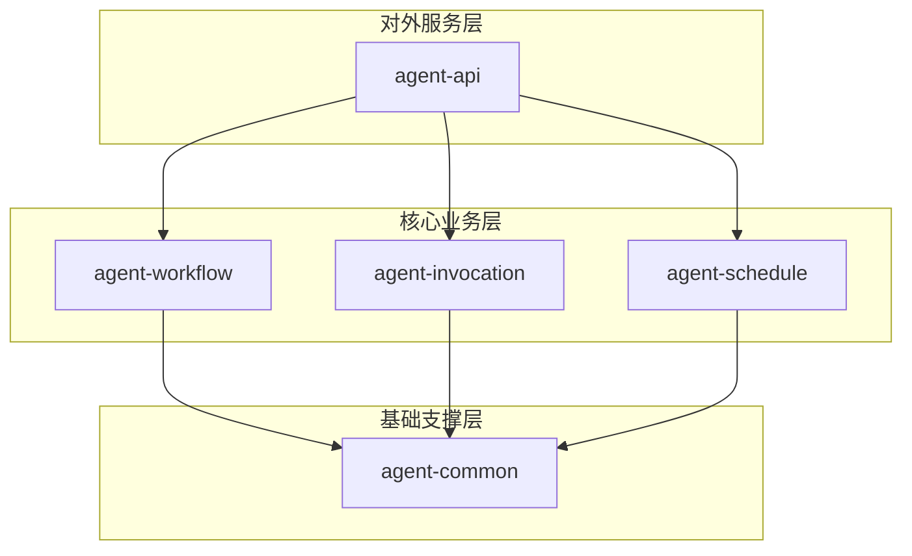
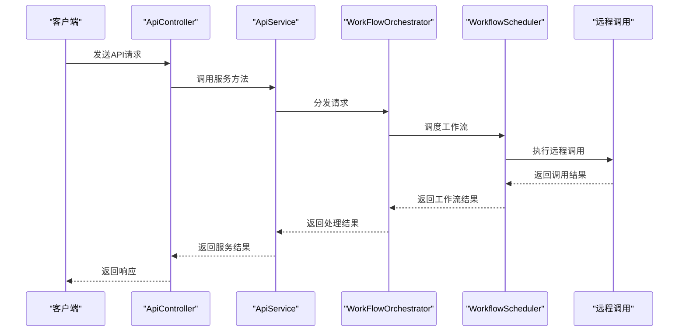
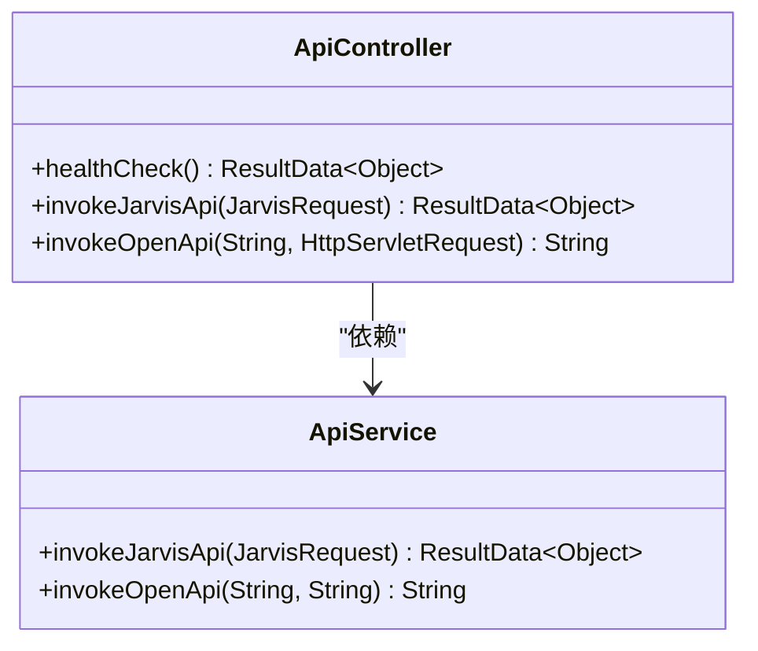
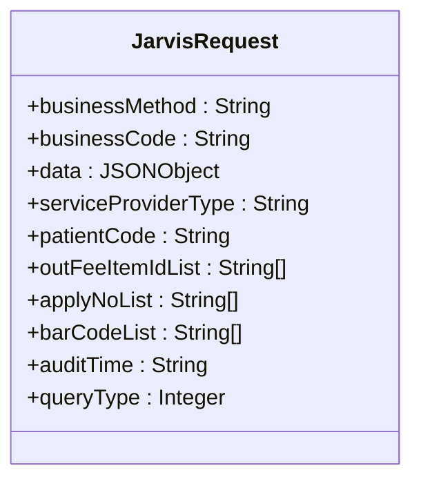
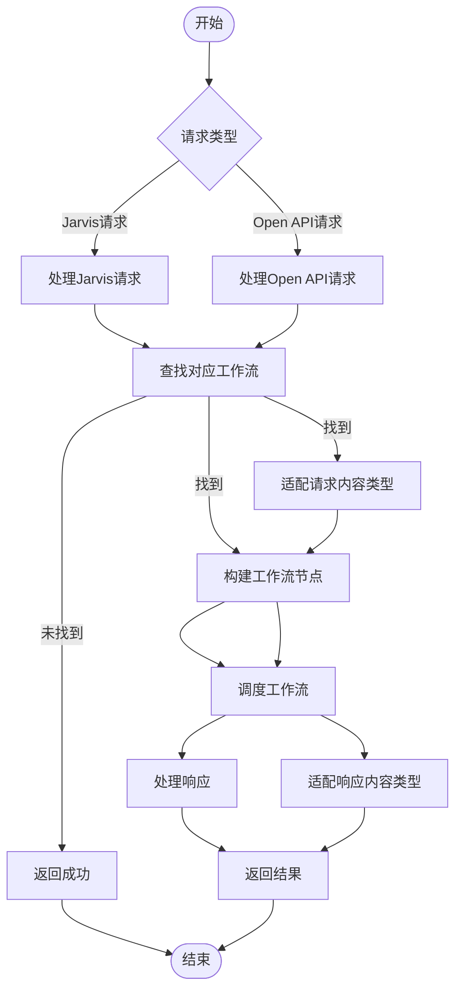
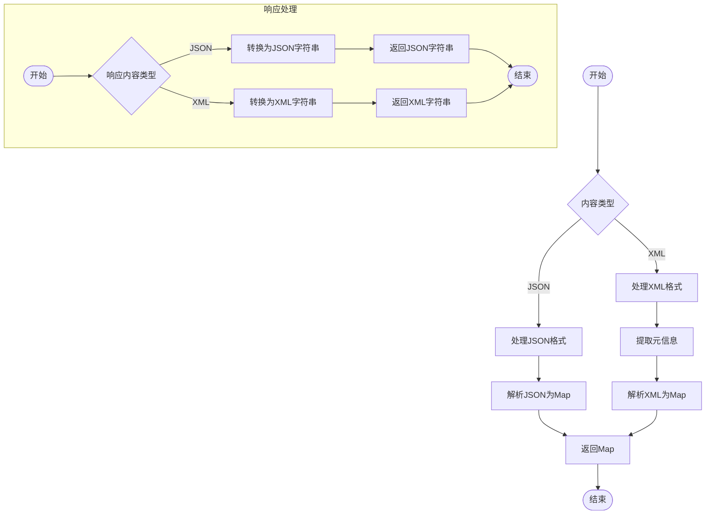
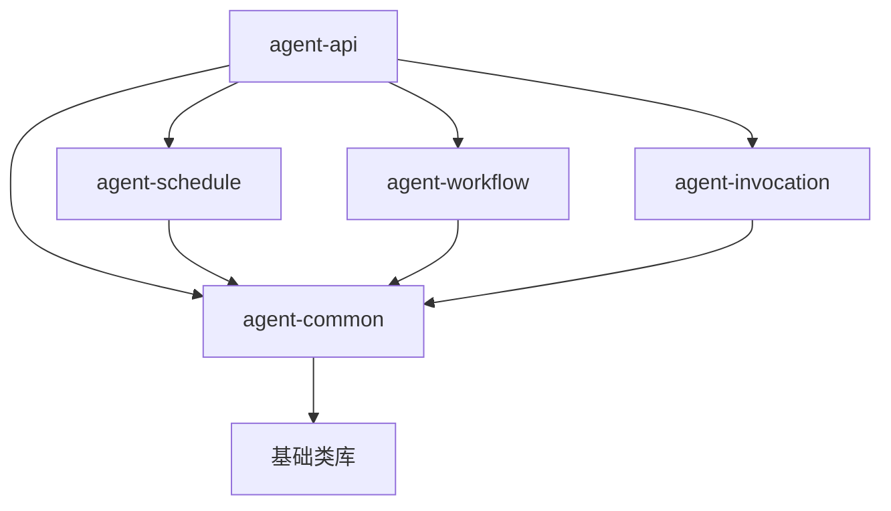
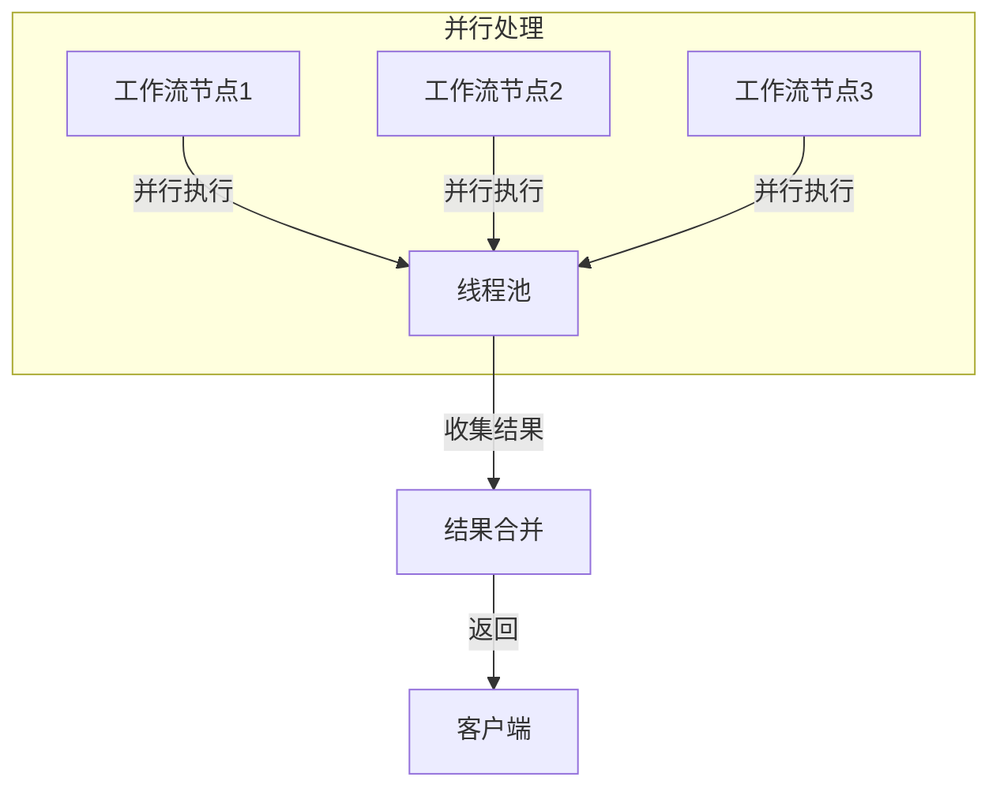
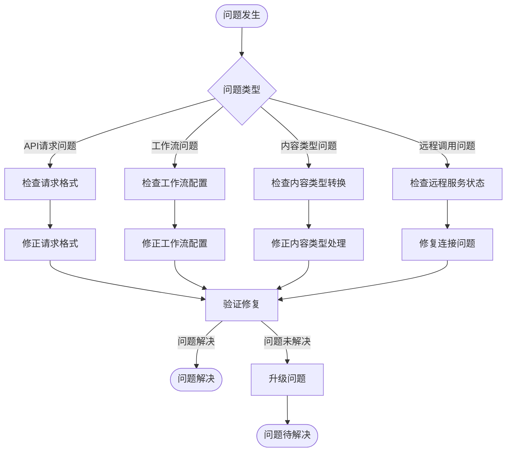

# agent-api 模块

<cite>
**本文档引用的文件**
- [ApiController.java](file://agent-api/src/main/java/com/helianhealth/agent/api/controller/ApiController.java)
- [JarvisRequest.java](file://agent-api/src/main/java/com/helianhealth/agent/api/model/request/JarvisRequest.java)
- [WorkFlowOrchestrator.java](file://agent-api/src/main/java/com/helianhealth/agent/api/WorkFlowOrchestrator.java)
- [ContentTypeAdapter.java](file://agent-api/src/main/java/com/helianhealth/agent/api/adapter/ContentTypeAdapter.java)
- [ApiService.java](file://agent-api/src/main/java/com/helianhealth/agent/api/service/ApiService.java)
- [ApiServiceImpl.java](file://agent-api/src/main/java/com/helianhealth/agent/api/service/impl/ApiServiceImpl.java)
- [GlobalExceptionHandler.java](file://agent-config/src/main/java/com/helianhealth/agent/config/GlobalExceptionHandler.java)
- [ResultData.java](file://agent-common/src/main/java/com/helianhealth/agent/common/base/ResultData.java)
- [BaseBusinessException.java](file://agent-common/src/main/java/com/helianhealth/agent/common/exception/BaseBusinessException.java)
- [WorkflowScheduler.java](file://agent-schedule/src/main/java/com/helianhealth/agent/schedule/WorkflowScheduler.java)
- [interface-config-guide.md](file://agent-ai/src/main/resources/interface-config-guide.md)
</cite>

## 目录
1. [简介](#简介)
2. [项目结构](#项目结构)
3. [核心组件](#核心组件)
4. [架构概述](#架构概述)
5. [详细组件分析](#详细组件分析)
6. [依赖分析](#依赖分析)
7. [性能考虑](#性能考虑)
8. [故障排除指南](#故障排除指南)
9. [结论](#结论)

## 简介
agent-api模块作为整个系统的对外服务门面，负责接收外部API请求并协调内部各模块完成业务流程。该模块通过ApiController提供对外API接口，利用WorkFlowOrchestrator工作流编排器协调workflow、invocation、schedule等模块完成端到端的业务流程执行，并通过ContentTypeAdapter实现不同内容类型的转换。

**本文档引用的文件**
- [ApiController.java](file://agent-api/src/main/java/com/helianhealth/agent/api/controller/ApiController.java)
- [WorkFlowOrchestrator.java](file://agent-api/src/main/java/com/helianhealth/agent/api/WorkFlowOrchestrator.java)

## 项目结构
agent-api模块是整个系统对外提供服务的核心模块，其主要职责是作为API网关接收外部请求并协调内部各模块完成业务处理。该模块位于系统架构的最上层，依赖于agent-common、agent-workflow、agent-invocation和agent-schedule等底层模块。

**图表来源**
- [agent-api](file://agent-api)
- [agent-workflow](file://agent-workflow)
- [agent-invocation](file://agent-invocation)
- [agent-schedule](file://agent-schedule)
- [agent-common](file://agent-common)

**本节来源**
- [agent-api](file://agent-api)
- [模块化架构说明.md](file://模块化架构说明.md)

## 核心组件
agent-api模块包含多个核心组件，其中ApiController负责接收外部API请求，WorkFlowOrchestrator负责协调工作流执行，ContentTypeAdapter负责处理不同内容类型的转换，而JarvisRequest则定义了特定API的请求数据结构。

**本节来源**
- [ApiController.java](file://agent-api/src/main/java/com/helianhealth/agent/api/controller/ApiController.java)
- [WorkFlowOrchestrator.java](file://agent-api/src/main/java/com/helianhealth/agent/api/WorkFlowOrchestrator.java)
- [ContentTypeAdapter.java](file://agent-api/src/main/java/com/helianhealth/agent/api/adapter/ContentTypeAdapter.java)
- [JarvisRequest.java](file://agent-api/src/main/java/com/helianhealth/agent/api/model/request/JarvisRequest.java)

## 架构概述
agent-api模块作为系统的API网关，其架构设计体现了清晰的分层和职责分离。该模块接收外部请求后，通过工作流编排器协调各内部模块完成业务处理，并返回相应的响应结果。

**图表来源**
- [ApiController.java](file://agent-api/src/main/java/com/helianhealth/agent/api/controller/ApiController.java)
- [ApiServiceImpl.java](file://agent-api/src/main/java/com/helianhealth/agent/api/service/impl/ApiServiceImpl.java)
- [WorkFlowOrchestrator.java](file://agent-api/src/main/java/com/helianhealth/agent/api/WorkFlowOrchestrator.java)
- [WorkflowScheduler.java](file://agent-schedule/src/main/java/com/helianhealth/agent/schedule/WorkflowScheduler.java)

## 详细组件分析

### ApiController分析
ApiController是agent-api模块的主要控制器，负责暴露对外的API接口。该控制器提供了两个主要的API端点：/HLOpenApi/Hjk用于健康检查和Jarvis API调用，以及/agent-open-api/**用于通用的开放API调用。

**图表来源**
- [ApiController.java](file://agent-api/src/main/java/com/helianhealth/agent/api/controller/ApiController.java)
- [ApiService.java](file://agent-api/src/main/java/com/helianhealth/agent/api/service/ApiService.java)

**本节来源**
- [ApiController.java](file://agent-api/src/main/java/com/helianhealth/agent/api/controller/ApiController.java)

### JarvisRequest请求体分析
JarvisRequest类定义了Jarvis API调用的请求数据结构，包含了业务方法、业务代码、数据体以及其他与报告相关的特定字段。该类通过@JsonProperty注解确保了与外部系统的字段映射兼容性。

**图表来源**
- [JarvisRequest.java](file://agent-api/src/main/java/com/helianhealth/agent/api/model/request/JarvisRequest.java)

**本节来源**
- [JarvisRequest.java](file://agent-api/src/main/java/com/helianhealth/agent/api/model/request/JarvisRequest.java)

### WorkFlowOrchestrator工作流编排器分析
WorkFlowOrchestrator是agent-api模块的核心协调组件，负责调度和编排整个工作流的执行。该组件接收来自ApiService的请求，根据请求类型调用相应的处理方法，并协调工作流的执行。

**图表来源**
- [WorkFlowOrchestrator.java](file://agent-api/src/main/java/com/helianhealth/agent/api/WorkFlowOrchestrator.java)
- [WorkflowScheduler.java](file://agent-schedule/src/main/java/com/helianhealth/agent/schedule/WorkflowScheduler.java)
- [ContentTypeAdapter.java](file://agent-api/src/main/java/com/helianhealth/agent/api/adapter/ContentTypeAdapter.java)

**本节来源**
- [WorkFlowOrchestrator.java](file://agent-api/src/main/java/com/helianhealth/agent/api/WorkFlowOrchestrator.java)

### ContentTypeAdapter内容类型适配器分析
ContentTypeAdapter负责处理不同内容类型（JSON/XML）与内部Map格式之间的双向转换。该组件在接收请求时将外部格式转换为内部格式，在返回响应时将内部格式转换为外部格式。

**图表来源**
- [ContentTypeAdapter.java](file://agent-api/src/main/java/com/helianhealth/agent/api/adapter/ContentTypeAdapter.java)
- [XmlUtils.java](file://agent-common/src/main/java/com/helianhealth/agent/common/utils/XmlUtils.java)
- [JsonUtils.java](file://agent-common/src/main/java/com/helianhealth/agent/common/utils/JsonUtils.java)

**本节来源**
- [ContentTypeAdapter.java](file://agent-api/src/main/java/com/helianhealth/agent/api/adapter/ContentTypeAdapter.java)

## 依赖分析
agent-api模块与其他模块之间存在明确的依赖关系。该模块依赖于agent-common提供基础工具和异常处理，依赖于agent-workflow获取工作流配置，依赖于agent-invocation执行远程调用，以及依赖于agent-schedule进行工作流调度。

**图表来源**
- [agent-api](file://agent-api)
- [agent-common](file://agent-common)
- [agent-workflow](file://agent-workflow)
- [agent-invocation](file://agent-invocation)
- [agent-schedule](file://agent-schedule)

**本节来源**
- [agent-api](file://agent-api)
- [agent-common](file://agent-common)
- [agent-workflow](file://agent-workflow)
- [agent-invocation](file://agent-invocation)
- [agent-schedule](file://agent-schedule)

## 性能考虑
agent-api模块在设计时考虑了性能优化，特别是在工作流调度和远程调用方面。WorkflowScheduler使用线程池来并行处理多个工作流节点，提高了系统的吞吐量和响应速度。

**图表来源**
- [WorkflowScheduler.java](file://agent-schedule/src/main/java/com/helianhealth/agent/schedule/WorkflowScheduler.java)
- [WorkFlowNodeBuilder.java](file://agent-schedule/src/main/java/com/helianhealth/agent/schedule/builder/WorkFlowNodeBuilder.java)

## 故障排除指南
当agent-api模块出现问题时，可以从以下几个方面进行排查：

1. **API请求失败**：检查请求格式是否正确，特别是JarvisRequest的字段是否符合要求
2. **工作流执行异常**：查看日志中是否有WorkflowBusinessException相关错误
3. **内容类型转换错误**：检查ContentTypeAdapter是否正确处理了JSON/XML格式的转换
4. **远程调用失败**：确认目标服务是否可用，网络连接是否正常

**本节来源**
- [GlobalExceptionHandler.java](file://agent-config/src/main/java/com/helianhealth/agent/config/GlobalExceptionHandler.java)
- [BaseBusinessException.java](file://agent-common/src/main/java/com/helianhealth/agent/common/exception/BaseBusinessException.java)
- [ResultData.java](file://agent-common/src/main/java/com/helianhealth/agent/common/base/ResultData.java)

## 结论
agent-api模块作为系统的对外服务门面，通过清晰的架构设计和职责分离，有效地协调了内部各模块完成业务流程。该模块提供了灵活的API接口，支持多种内容类型的转换，并通过工作流编排器实现了复杂的业务逻辑处理。通过合理的异常处理和错误码体系，该模块能够提供稳定可靠的API服务。