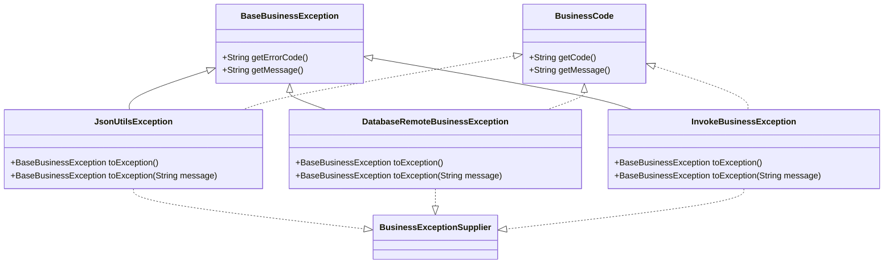
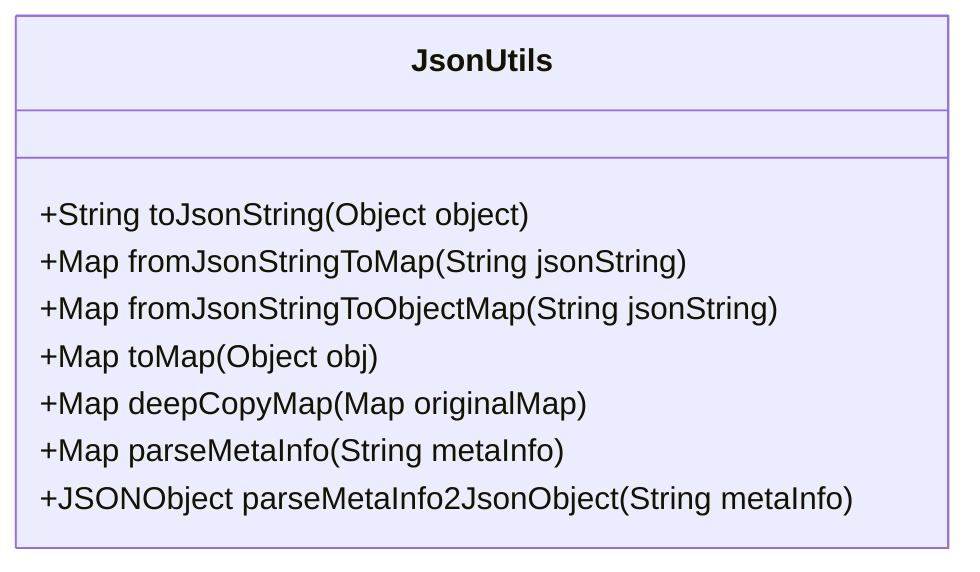
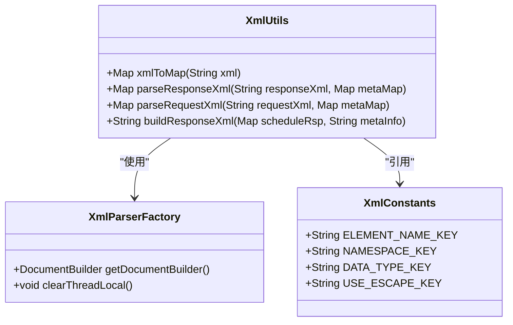
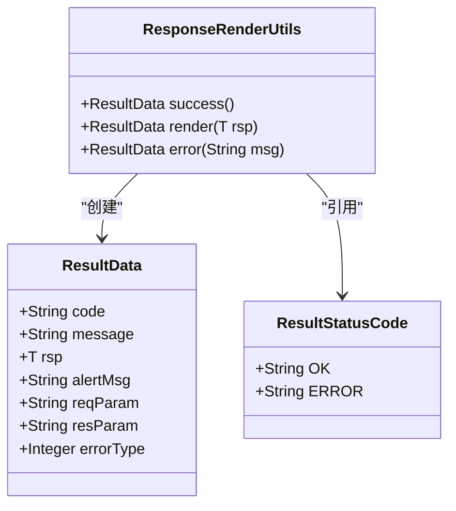
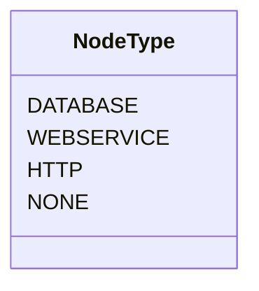
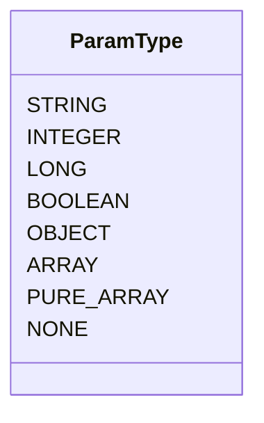
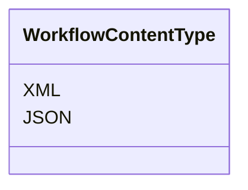

# agent-common 模块

<cite>
**本文档中引用的文件**   
- [BaseBusinessException.java](file://agent-common/src/main/java/com/helianhealth/agent/common/exception/BaseBusinessException.java)
- [BusinessCode.java](file://agent-common/src/main/java/com/helianhealth/agent/common/exception/BusinessCode.java)
- [JsonUtils.java](file://agent-common/src/main/java/com/helianhealth/agent/common/utils/JsonUtils.java)
- [XmlUtils.java](file://agent-common/src/main/java/com/helianhealth/agent/common/utils/XmlUtils.java)
- [ResponseRenderUtils.java](file://agent-common/src/main/java/com/helianhealth/agent/common/utils/ResponseRenderUtils.java)
- [NodeType.java](file://agent-common/src/main/java/com/helianhealth/agent/common/enums/NodeType.java)
- [ParamType.java](file://agent-common/src/main/java/com/helianhealth/agent/common/enums/ParamType.java)
- [WorkflowContentType.java](file://agent-common/src/main/java/com/helianhealth/agent/common/enums/WorkflowContentType.java)
- [Url.java](file://agent-common/src/main/java/com/helianhealth/agent/common/annotation/Url.java)
- [ResultData.java](file://agent-common/src/main/java/com/helianhealth/agent/common/base/ResultData.java)
- [ResultStatusCode.java](file://agent-common/src/main/java/com/helianhealth/agent/common/base/ResultStatusCode.java)
- [XmlConstants.java](file://agent-common/src/main/java/com/helianhealth/agent/common/base/XmlConstants.java)
- [XmlParserFactory.java](file://agent-common/src/main/java/com/helianhealth/agent/common/factory/XmlParserFactory.java)
- [JsonUtilsException.java](file://agent-common/src/main/java/com/helianhealth/agent/common/exception/JsonUtilsException.java)
- [DatabaseRemoteBusinessException.java](file://agent-common/src/main/java/com/helianhealth/agent/common/exception/DatabaseRemoteBusinessException.java)
- [InvokeBusinessException.java](file://agent-common/src/main/java/com/helianhealth/agent/common/exception/InvokeBusinessException.java)
</cite>

## 目录
1. [简介](#简介)
2. [异常体系设计](#异常体系设计)
3. [工具类使用方法](#工具类使用方法)
4. [关键枚举类型](#关键枚举类型)
5. [注解设计](#注解设计)
6. [公共组件引用与扩展](#公共组件引用与扩展)
7. [常见问题解决方案](#常见问题解决方案)

## 简介
agent-common模块作为整个系统的基础共享层，为其他模块提供统一的异常处理机制、工具类支持、枚举定义和基础数据结构。该模块的设计目标是提高代码复用性、保证系统一致性并简化各业务模块的开发复杂度。通过集中管理公共组件，确保了跨模块调用时的数据格式统一和异常处理标准化。

## 异常体系设计

agent-common模块定义了一套完整的业务异常处理体系，以`BaseBusinessException`为核心，构建了分层的异常处理机制。该体系通过`BusinessCode`接口规范错误码和错误信息的标准格式，实现了异常信息的统一管理和可扩展性。



**图示来源**
- [BaseBusinessException.java](file://agent-common/src/main/java/com/helianhealth/agent/common/exception/BaseBusinessException.java#L1-L31)
- [BusinessCode.java](file://agent-common/src/main/java/com/helianhealth/agent/common/exception/BusinessCode.java#L1-L18)
- [JsonUtilsException.java](file://agent-common/src/main/java/com/helianhealth/agent/common/exception/JsonUtilsException.java#L1-L41)
- [DatabaseRemoteBusinessException.java](file://agent-common/src/main/java/com/helianhealth/agent/common/exception/DatabaseRemoteBusinessException.java#L1-L44)
- [InvokeBusinessException.java](file://agent-common/src/main/java/com/helianhealth/agent/common/exception/InvokeBusinessException.java#L1-L38)

**异常体系核心组件说明：**

- `BaseBusinessException`：所有业务异常的基类，继承自`RuntimeException`，包含`businessCode`字段用于标识具体的业务错误码。
- `BusinessCode`：错误码接口，定义了`getCode()`和`getMessage()`方法，所有具体的业务异常枚举都需要实现此接口。
- 各类业务异常枚举（如`JsonUtilsException`、`DatabaseRemoteBusinessException`等）：实现了`BusinessCode`和`BusinessExceptionSupplier`接口，提供了具体的错误码和错误信息，并能生成对应的`BaseBusinessException`实例。

**异常处理最佳实践：**
1. 所有业务相关的异常都应继承`BaseBusinessException`或使用现有的业务异常枚举。
2. 新增业务异常时，应在相应的异常枚举中添加新的枚举项，并遵循统一的错误码命名规范。
3. 在捕获异常时，可以通过`getErrorCode()`方法获取具体的错误码，便于日志记录和问题定位。

**本节来源**
- [BaseBusinessException.java](file://agent-common/src/main/java/com/helianhealth/agent/common/exception/BaseBusinessException.java#L1-L31)
- [BusinessCode.java](file://agent-common/src/main/java/com/helianhealth/agent/common/exception/BusinessCode.java#L1-L18)

## 工具类使用方法

agent-common模块提供了多个实用的工具类，包括`JsonUtils`、`XmlUtils`和`ResponseRenderUtils`，这些工具类封装了常用的数据处理逻辑，简化了开发人员的工作。

### JsonUtils工具类

`JsonUtils`类提供了JSON数据的序列化、反序列化和转换功能，基于Fastjson2实现，具有良好的性能和稳定性。



**图示来源**
- [JsonUtils.java](file://agent-common/src/main/java/com/helianhealth/agent/common/utils/JsonUtils.java#L1-L136)

**主要方法说明：**
- `toJsonString(Object object)`：将对象序列化为JSON字符串。
- `toMap(Object obj)`：将不同类型的对象（JSONObject、String、Map等）转换为`Map<String, Object>`。
- `deepCopyMap(Map<String, Object> originalMap)`：对Map进行深度复制，避免修改副本时影响原始数据。
- `parseMetaInfo(String metaInfo)`：解析metaInfo JSON字符串为`Map<String, Object>`。

**使用示例：**
```java
// 对象转JSON字符串
String json = JsonUtils.toJsonString(user);

// JSON字符串转Map
Map<String, Object> map = JsonUtils.toMap(jsonString);

// Map深度复制
Map<String, Object> copiedMap = JsonUtils.deepCopyMap(originalMap);
```

**本节来源**
- [JsonUtils.java](file://agent-common/src/main/java/com/helianhealth/agent/common/utils/JsonUtils.java#L1-L136)

### XmlUtils工具类

`XmlUtils`类提供了XML数据的解析和生成功能，支持复杂的XML结构处理，特别适用于SOAP协议的接口调用场景。



**图示来源**
- [XmlUtils.java](file://agent-common/src/main/java/com/helianhealth/agent/common/utils/XmlUtils.java#L1-L606)
- [XmlParserFactory.java](file://agent-common/src/main/java/com/helianhealth/agent/common/factory/XmlParserFactory.java#L1-L53)
- [XmlConstants.java](file://agent-common/src/main/java/com/helianhealth/agent/common/base/XmlConstants.java#L1-L22)

**主要功能特点：**
1. **线程安全的XML解析器工厂**：`XmlParserFactory`使用`ThreadLocal`确保每个线程都有独立的`DocumentBuilder`实例，避免了多线程环境下的并发问题。
2. **灵活的XML解析配置**：通过`metaMap`参数支持命名空间、元素名称、CDATA处理等高级配置。
3. **完整的XML构建功能**：`buildResponseXml`方法支持自定义根元素名称和命名空间，生成格式化的XML响应。
4. **智能的节点处理**：自动处理属性、文本内容和子元素，同名子元素自动转换为List。

**使用场景：**
- SOAP接口的请求和响应处理
- 复杂XML配置文件的解析
- XML与Map之间的相互转换

**本节来源**
- [XmlUtils.java](file://agent-common/src/main/java/com/helianhealth/agent/common/utils/XmlUtils.java#L1-L606)
- [XmlParserFactory.java](file://agent-common/src/main/java/com/helianhealth/agent/common/factory/XmlParserFactory.java#L1-L53)
- [XmlConstants.java](file://agent-common/src/main/java/com/helianhealth/agent/common/base/XmlConstants.java#L1-L22)

### ResponseRenderUtils工具类

`ResponseRenderUtils`类提供了统一的响应数据封装方法，简化了API接口的返回值处理。



**图示来源**
- [ResponseRenderUtils.java](file://agent-common/src/main/java/com/helianhealth/agent/common/utils/ResponseRenderUtils.java#L1-L20)
- [ResultData.java](file://agent-common/src/main/java/com/helianhealth/agent/common/base/ResultData.java#L1-L84)
- [ResultStatusCode.java](file://agent-common/src/main/java/com/helianhealth/agent/common/base/ResultStatusCode.java#L1-L22)

**主要方法说明：**
- `success()`：创建成功的响应结果，不包含数据。
- `render(T rsp)`：创建包含数据的成功响应结果。
- `error(String msg)`：创建包含错误信息的失败响应结果。

**本节来源**
- [ResponseRenderUtils.java](file://agent-common/src/main/java/com/helianhealth/agent/common/utils/ResponseRenderUtils.java#L1-L20)
- [ResultData.java](file://agent-common/src/main/java/com/helianhealth/agent/common/base/ResultData.java#L1-L84)
- [ResultStatusCode.java](file://agent-common/src/main/java/com/helianhealth/agent/common/base/ResultStatusCode.java#L1-L22)

## 关键枚举类型

agent-common模块定义了多个关键的枚举类型，用于规范系统中的各种类型定义。

### NodeType枚举

`NodeType`枚举定义了三方接口的调用方式，是系统中接口类型的核心分类。



**图示来源**
- [NodeType.java](file://agent-common/src/main/java/com/helianhealth/agent/common/enums/NodeType.java#L1-L30)

**枚举值说明：**
- `DATABASE`：数据库调用，包括存储过程和视图。
- `WEBSERVICE`：WebService接口调用，通常使用XML格式的参数。
- `HTTP`：HTTP接口调用，通常使用JSON格式的参数。
- `NONE`：无三方接口调用，表示本地处理。

**应用场景：**
在工作流节点配置中，通过`NodeType`确定节点的执行方式和参数处理逻辑。

**本节来源**
- [NodeType.java](file://agent-common/src/main/java/com/helianhealth/agent/common/enums/NodeType.java#L1-L30)

### ParamType枚举

`ParamType`枚举定义了参数的类型，用于参数解析和类型转换。



**图示来源**
- [ParamType.java](file://agent-common/src/main/java/com/helianhealth/agent/common/enums/ParamType.java#L1-L51)

**枚举值说明：**
- `STRING`、`INTEGER`、`LONG`、`BOOLEAN`：基本数据类型。
- `OBJECT`：对象类型，通常对应JSON对象。
- `ARRAY`：数组类型，用于表示列表数据。
- `PURE_ARRAY`：纯数组类型，表示接口入参本身就是数组。
- `NONE`：无类型，表示不需要参数。

**应用场景：**
在接口参数配置中，通过`ParamType`确定参数的序列化和反序列化方式。

**本节来源**
- [ParamType.java](file://agent-common/src/main/java/com/helianhealth/agent/common/enums/ParamType.java#L1-L51)

### WorkflowContentType枚举

`WorkflowContentType`枚举定义了工作流内容的类型，主要用于区分不同的数据格式。



**图示来源**
- [WorkflowContentType.java](file://agent-common/src/main/java/com/helianhealth/agent/common/enums/WorkflowContentType.java#L1-L15)

**枚举值说明：**
- `XML`：XML格式的内容。
- `JSON`：JSON格式的内容。

**应用场景：**
在工作流配置中，通过`WorkflowContentType`确定内容的解析方式和工具类选择。

**本节来源**
- [WorkflowContentType.java](file://agent-common/src/main/java/com/helianhealth/agent/common/enums/WorkflowContentType.java#L1-L15)

## 注解设计

### Url注解

`Url`注解用于标记方法参数，指示该参数是一个URL地址。


**图示来源**
- [Url.java](file://agent-common/src/main/java/com/helianhealth/agent/common/annotation/Url.java#L1-L10)

**设计目的：**
- 通过注解方式标记URL参数，便于框架进行统一的参数验证和处理。
- 提高代码的可读性和可维护性，明确参数的语义。

**使用场景：**
在需要接收URL参数的方法中，使用`@Url`注解标记参数，框架可以根据注解进行URL格式验证或其他处理。

**本节来源**
- [Url.java](file://agent-common/src/main/java/com/helianhealth/agent/common/annotation/Url.java#L1-L10)

## 公共组件引用与扩展

### 在其他模块中引用公共组件

在其他模块中使用agent-common模块的公共组件非常简单，只需在pom.xml中添加依赖：

```xml
<dependency>
    <groupId>com.helianhealth.agent</groupId>
    <artifactId>agent-common</artifactId>
    <version>${project.version}</version>
</dependency>
```

然后就可以在代码中直接使用各种工具类和枚举：

```java
// 使用异常体系
throw JsonUtilsException.JSON_PARSE_ERROR.toException();

// 使用工具类
Map<String, Object> data = JsonUtils.toMap(jsonString);
String xml = XmlUtils.buildResponseXml(data, metaInfo);

// 使用枚举
NodeType nodeType = NodeType.HTTP;
```

### 扩展公共组件

当需要扩展公共组件时，应遵循以下原则：

1. **扩展异常体系**：如果需要新增业务异常，应在相应的异常枚举中添加新的枚举项，而不是创建新的异常类。
2. **扩展工具类**：如果工具类功能不足，应优先考虑在现有工具类中添加新方法，而不是创建新的工具类。
3. **保持向后兼容**：在扩展公共组件时，必须确保不会破坏现有功能的兼容性。

**本节来源**
- [BaseBusinessException.java](file://agent-common/src/main/java/com/helianhealth/agent/common/exception/BaseBusinessException.java#L1-L31)
- [JsonUtils.java](file://agent-common/src/main/java/com/helianhealth/agent/common/utils/JsonUtils.java#L1-L136)
- [XmlUtils.java](file://agent-common/src/main/java/com/helianhealth/agent/common/utils/XmlUtils.java#L1-L606)

## 常见问题解决方案

### JSON处理异常

**问题描述：** 在使用`JsonUtils`进行JSON处理时抛出`JsonUtilsException`。

**解决方案：**
1. 检查输入的JSON字符串是否格式正确。
2. 确保对象的序列化和反序列化方法正确实现。
3. 使用`try-catch`捕获`JsonUtilsException`，并根据错误码进行相应的处理。

```java
try {
    Map<String, Object> map = JsonUtils.toMap(jsonString);
} catch (BaseBusinessException e) {
    if ("JSON-002".equals(e.getErrorCode())) {
        // JSON解析失败，记录日志并返回友好错误信息
        log.error("JSON解析失败: {}", e.getMessage());
    }
}
```

### XML解析性能问题

**问题描述：** 在高并发场景下，XML解析出现性能瓶颈。

**解决方案：**
1. 使用`XmlParserFactory`的线程安全设计，避免频繁创建`DocumentBuilder`。
2. 对于重复解析的XML，考虑使用缓存机制。
3. 优化XML结构，减少不必要的嵌套层级。

### 响应数据格式不一致

**问题描述：** 不同接口返回的响应数据格式不一致。

**解决方案：**
1. 统一使用`ResponseRenderUtils`工具类生成响应数据。
2. 遵循`ResultData`的结构规范，确保code、message、rsp等字段的一致性。
3. 在全局异常处理器中统一处理异常响应格式。

**本节来源**
- [JsonUtilsException.java](file://agent-common/src/main/java/com/helianhealth/agent/common/exception/JsonUtilsException.java#L1-L41)
- [XmlParserFactory.java](file://agent-common/src/main/java/com/helianhealth/agent/common/factory/XmlParserFactory.java#L1-L53)
- [ResponseRenderUtils.java](file://agent-common/src/main/java/com/helianhealth/agent/common/utils/ResponseRenderUtils.java#L1-L20)