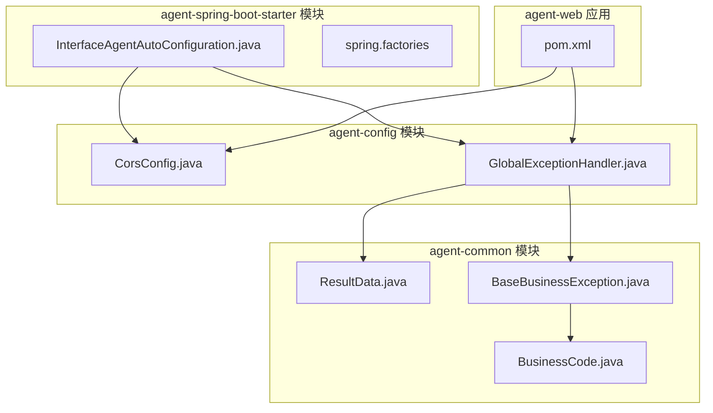
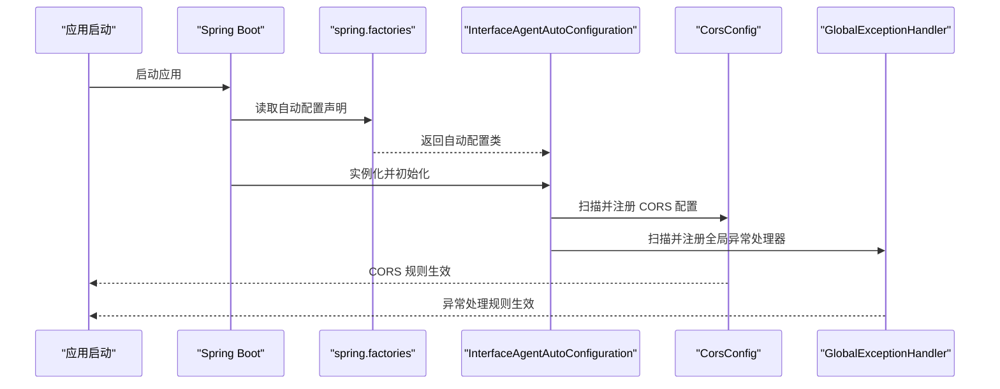
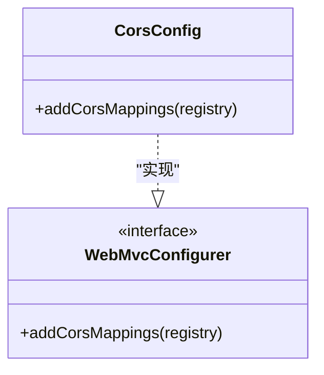
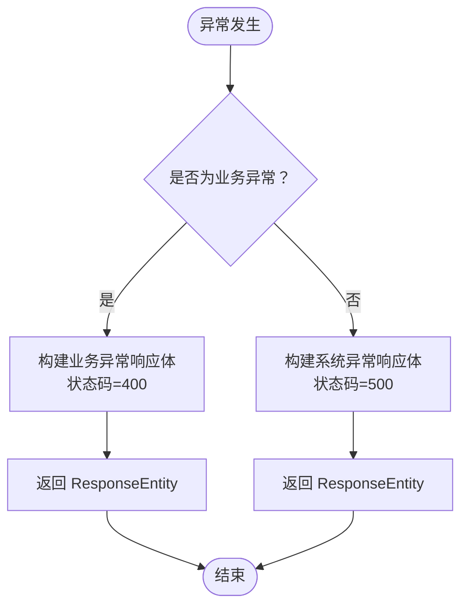
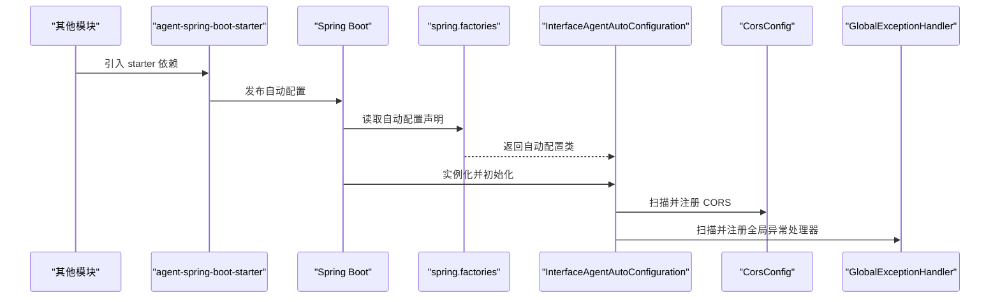
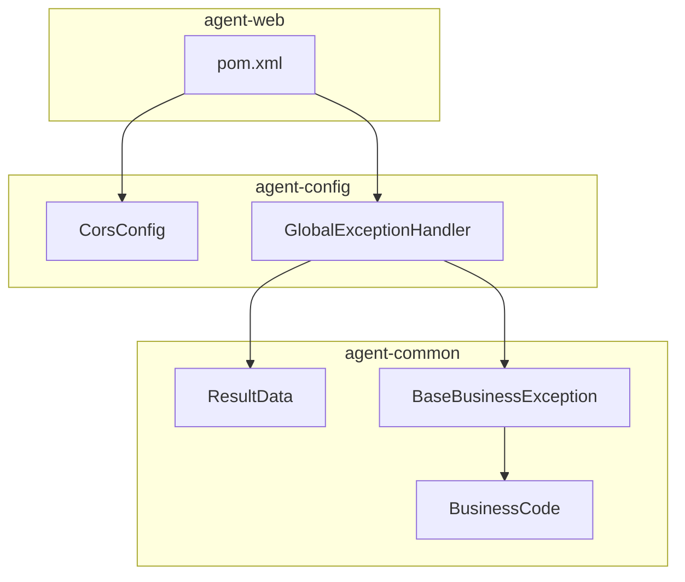

# agent-config 模块

<cite>
**本文档引用的文件**
- [CorsConfig.java](file://agent-config/src/main/java/com/helianhealth/agent/config/CorsConfig.java)
- [GlobalExceptionHandler.java](file://agent-config/src/main/java/com/helianhealth/agent/config/GlobalExceptionHandler.java)
- [InterfaceAgentAutoConfiguration.java](file://agent-spring-boot-starter/src/main/java/com/helianhealth/agent/starter/InterfaceAgentAutoConfiguration.java)
- [spring.factories](file://agent-spring-boot-starter/src/main/resources/META-INF/spring.factories)
- [ResultData.java](file://agent-common/src/main/java/com/helianhealth/agent/common/base/ResultData.java)
- [BaseBusinessException.java](file://agent-common/src/main/java/com/helianhealth/agent/common/exception/BaseBusinessException.java)
- [BusinessCode.java](file://agent-common/src/main/java/com/helianhealth/agent/common/exception/BusinessCode.java)
- [pom.xml](file://agent-web/pom.xml)
</cite>

## 目录
1. [简介](#简介)
2. [项目结构](#项目结构)
3. [核心组件](#核心组件)
4. [架构总览](#架构总览)
5. [详细组件分析](#详细组件分析)
6. [依赖关系分析](#依赖关系分析)
7. [性能考虑](#性能考虑)
8. [故障排除指南](#故障排除指南)
9. [结论](#结论)

## 简介
agent-config 模块是 Interface Agent 项目中的通用配置与基础设施模块，提供以下关键能力：
- 跨域资源共享（CORS）策略配置，统一管理允许的来源、方法与头部等安全设置
- 全局异常处理器，统一捕获并处理业务异常与系统异常，输出标准化的错误响应
- 通过 Spring Boot 自动配置机制，被其他模块自动引入，确保一致的跨域与异常处理策略

该模块以最小侵入的方式为上层模块提供横切关注点，降低重复配置成本，提升系统的安全性与一致性。

## 项目结构
agent-config 模块位于 agent-config 目录下，包含两个核心配置类：
- CorsConfig：基于 Spring MVC 的 CORS 配置实现
- GlobalExceptionHandler：基于 @ControllerAdvice 的全局异常处理

同时，该模块通过 agent-spring-boot-starter 提供自动装配支持，使其他模块在引入 starter 后即可自动启用本模块的配置。

图表来源
- [CorsConfig.java](file://agent-config/src/main/java/com/helianhealth/agent/config/CorsConfig.java#L1-L18)
- [GlobalExceptionHandler.java](file://agent-config/src/main/java/com/helianhealth/agent/config/GlobalExceptionHandler.java#L1-L35)
- [InterfaceAgentAutoConfiguration.java](file://agent-spring-boot-starter/src/main/java/com/helianhealth/agent/starter/InterfaceAgentAutoConfiguration.java#L1-L28)
- [spring.factories](file://agent-spring-boot-starter/src/main/resources/META-INF/spring.factories#L1-L3)
- [ResultData.java](file://agent-common/src/main/java/com/helianhealth/agent/common/base/ResultData.java#L1-L84)
- [BaseBusinessException.java](file://agent-common/src/main/java/com/helianhealth/agent/common/exception/BaseBusinessException.java#L1-L31)
- [BusinessCode.java](file://agent-common/src/main/java/com/helianhealth/agent/common/exception/BusinessCode.java#L1-L18)
- [pom.xml](file://agent-web/pom.xml#L15-L21)

章节来源
- [CorsConfig.java](file://agent-config/src/main/java/com/helianhealth/agent/config/CorsConfig.java#L1-L18)
- [GlobalExceptionHandler.java](file://agent-config/src/main/java/com/helianhealth/agent/config/GlobalExceptionHandler.java#L1-L35)
- [InterfaceAgentAutoConfiguration.java](file://agent-spring-boot-starter/src/main/java/com/helianhealth/agent/starter/InterfaceAgentAutoConfiguration.java#L1-L28)
- [spring.factories](file://agent-spring-boot-starter/src/main/resources/META-INF/spring.factories#L1-L3)
- [pom.xml](file://agent-web/pom.xml#L15-L21)

## 核心组件
本模块的核心由两个组件构成：
- 跨域配置（CorsConfig）：定义全局 CORS 规则，覆盖所有请求路径，允许任意来源、方法与头部，并控制凭据策略
- 全局异常处理（GlobalExceptionHandler）：统一捕获业务异常与系统异常，返回标准化的响应体

章节来源
- [CorsConfig.java](file://agent-config/src/main/java/com/helianhealth/agent/config/CorsConfig.java#L7-L17)
- [GlobalExceptionHandler.java](file://agent-config/src/main/java/com/helianhealth/agent/config/GlobalExceptionHandler.java#L10-L34)

## 架构总览
agent-config 通过 Spring Boot 自动配置机制被其他模块引入，形成“配置即服务”的横切能力。下图展示了从自动配置到实际生效的关键流程：

图表来源
- [spring.factories](file://agent-spring-boot-starter/src/main/resources/META-INF/spring.factories#L1-L3)
- [InterfaceAgentAutoConfiguration.java](file://agent-spring-boot-starter/src/main/java/com/helianhealth/agent/starter/InterfaceAgentAutoConfiguration.java#L14-L18)
- [CorsConfig.java](file://agent-config/src/main/java/com/helianhealth/agent/config/CorsConfig.java#L7-L17)
- [GlobalExceptionHandler.java](file://agent-config/src/main/java/com/helianhealth/agent/config/GlobalExceptionHandler.java#L10-L34)

## 详细组件分析

### 跨域配置（CorsConfig）
CorsConfig 实现了 Spring MVC 的 WebMvcConfigurer 接口，通过重写 addCorsMappings 方法，为整个应用提供统一的 CORS 策略。其设计要点如下：
- 路径映射：对所有请求路径（/**）应用 CORS 规则，便于全局一致性
- 来源控制：允许任意来源（*），在生产环境中建议限定为受信任域名
- 方法与头部：允许 GET、POST、PUT、DELETE、OPTIONS 等常用方法与任意头部
- 凭据策略：允许携带凭据（allowCredentials=true），结合来源限制使用更安全

图表来源
- [CorsConfig.java](file://agent-config/src/main/java/com/helianhealth/agent/config/CorsConfig.java#L7-L17)

章节来源
- [CorsConfig.java](file://agent-config/src/main/java/com/helianhealth/agent/config/CorsConfig.java#L7-L17)

### 全局异常处理器（GlobalExceptionHandler）
GlobalExceptionHandler 使用 @ControllerAdvice 注解，为整个应用提供统一的异常处理能力。其处理策略如下：
- 业务异常（BaseBusinessException 及其子类）：捕获后封装为标准化响应体，状态码为 400（BAD_REQUEST），消息来自异常对象
- 系统异常（其他未捕获异常）：统一返回 500（INTERNAL_SERVER_ERROR）的状态码与标准错误消息

异常处理流程如下：

图表来源
- [GlobalExceptionHandler.java](file://agent-config/src/main/java/com/helianhealth/agent/config/GlobalExceptionHandler.java#L14-L34)
- [ResultData.java](file://agent-common/src/main/java/com/helianhealth/agent/common/base/ResultData.java#L68-L82)
- [BaseBusinessException.java](file://agent-common/src/main/java/com/helianhealth/agent/common/exception/BaseBusinessException.java#L9-L29)

章节来源
- [GlobalExceptionHandler.java](file://agent-config/src/main/java/com/helianhealth/agent/config/GlobalExceptionHandler.java#L10-L34)
- [ResultData.java](file://agent-common/src/main/java/com/helianhealth/agent/common/base/ResultData.java#L1-L84)
- [BaseBusinessException.java](file://agent-common/src/main/java/com/helianhealth/agent/common/exception/BaseBusinessException.java#L1-L31)

### Spring 自动配置集成
agent-spring-boot-starter 通过 spring.factories 声明自动配置类，当其他模块引入该 starter 后，Spring Boot 会在启动时自动加载 InterfaceAgentAutoConfiguration。该配置类通过组件扫描启用 agent-config 中的配置与处理器，从而实现“零样板代码”的横切能力注入。

图表来源
- [spring.factories](file://agent-spring-boot-starter/src/main/resources/META-INF/spring.factories#L1-L3)
- [InterfaceAgentAutoConfiguration.java](file://agent-spring-boot-starter/src/main/java/com/helianhealth/agent/starter/InterfaceAgentAutoConfiguration.java#L14-L18)
- [CorsConfig.java](file://agent-config/src/main/java/com/helianhealth/agent/config/CorsConfig.java#L7-L17)
- [GlobalExceptionHandler.java](file://agent-config/src/main/java/com/helianhealth/agent/config/GlobalExceptionHandler.java#L10-L34)

章节来源
- [spring.factories](file://agent-spring-boot-starter/src/main/resources/META-INF/spring.factories#L1-L3)
- [InterfaceAgentAutoConfiguration.java](file://agent-spring-boot-starter/src/main/java/com/helianhealth/agent/starter/InterfaceAgentAutoConfiguration.java#L14-L18)

## 依赖关系分析
agent-config 模块与 agent-common 模块存在直接依赖关系，用于统一异常响应格式与业务异常模型；agent-web 模块通过依赖 agent-config 实现配置的自动引入。

图表来源
- [GlobalExceptionHandler.java](file://agent-config/src/main/java/com/helianhealth/agent/config/GlobalExceptionHandler.java#L3-L8)
- [ResultData.java](file://agent-common/src/main/java/com/helianhealth/agent/common/base/ResultData.java#L1-L84)
- [BaseBusinessException.java](file://agent-common/src/main/java/com/helianhealth/agent/common/exception/BaseBusinessException.java#L1-L31)
- [BusinessCode.java](file://agent-common/src/main/java/com/helianhealth/agent/common/exception/BusinessCode.java#L1-L18)
- [pom.xml](file://agent-web/pom.xml#L15-L21)

章节来源
- [GlobalExceptionHandler.java](file://agent-config/src/main/java/com/helianhealth/agent/config/GlobalExceptionHandler.java#L3-L8)
- [ResultData.java](file://agent-common/src/main/java/com/helianhealth/agent/common/base/ResultData.java#L1-L84)
- [BaseBusinessException.java](file://agent-common/src/main/java/com/helianhealth/agent/common/exception/BaseBusinessException.java#L1-L31)
- [BusinessCode.java](file://agent-common/src/main/java/com/helianhealth/agent/common/exception/BusinessCode.java#L1-L18)
- [pom.xml](file://agent-web/pom.xml#L15-L21)

## 性能考虑
- CORS 配置采用通配符策略，简化部署但可能带来安全风险。建议在生产环境将 allowedOrigins 限定为受信域名列表，避免使用 *
- 全局异常处理器仅进行轻量级封装与状态码映射，不会引入额外的计算开销
- 统一异常响应体结构简单，序列化成本低，适合高并发场景

## 故障排除指南
- CORS 相关问题
  - 症状：浏览器报跨域错误或预检失败
  - 排查：确认 allowedOrigins 是否正确配置；若使用凭据（Cookie/Authorization），需确保来源为具体域名而非 *
  - 参考：[CorsConfig.java](file://agent-config/src/main/java/com/helianhealth/agent/config/CorsConfig.java#L11-L16)
- 异常响应不符合预期
  - 症状：业务异常返回状态码不为 400 或消息格式异常
  - 排查：确认异常类型是否为 BaseBusinessException 及其子类；检查异常消息是否符合预期
  - 参考：[GlobalExceptionHandler.java](file://agent-config/src/main/java/com/helianhealth/agent/config/GlobalExceptionHandler.java#L14-L22)
- 自动配置未生效
  - 症状：应用启动后 CORS 与异常处理未生效
  - 排查：确认已引入 agent-spring-boot-starter；检查 spring.factories 是否存在自动配置声明
  - 参考：[spring.factories](file://agent-spring-boot-starter/src/main/resources/META-INF/spring.factories#L1-L3)

章节来源
- [CorsConfig.java](file://agent-config/src/main/java/com/helianhealth/agent/config/CorsConfig.java#L11-L16)
- [GlobalExceptionHandler.java](file://agent-config/src/main/java/com/helianhealth/agent/config/GlobalExceptionHandler.java#L14-L22)
- [spring.factories](file://agent-spring-boot-starter/src/main/resources/META-INF/spring.factories#L1-L3)

## 结论
agent-config 模块通过简洁而强大的配置与异常处理机制，为 Interface Agent 提供了统一、可复用的横切能力。CorsConfig 与 GlobalExceptionHandler 分别解决了跨域与异常响应的标准化问题，配合 Spring Boot 自动配置，实现了“即插即用”的工程实践。建议在生产环境中根据安全策略调整 CORS 配置，并保持异常处理逻辑的一致性，以获得更稳定可靠的系统表现。