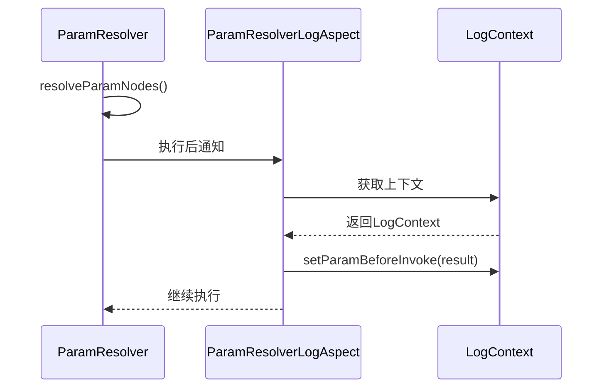
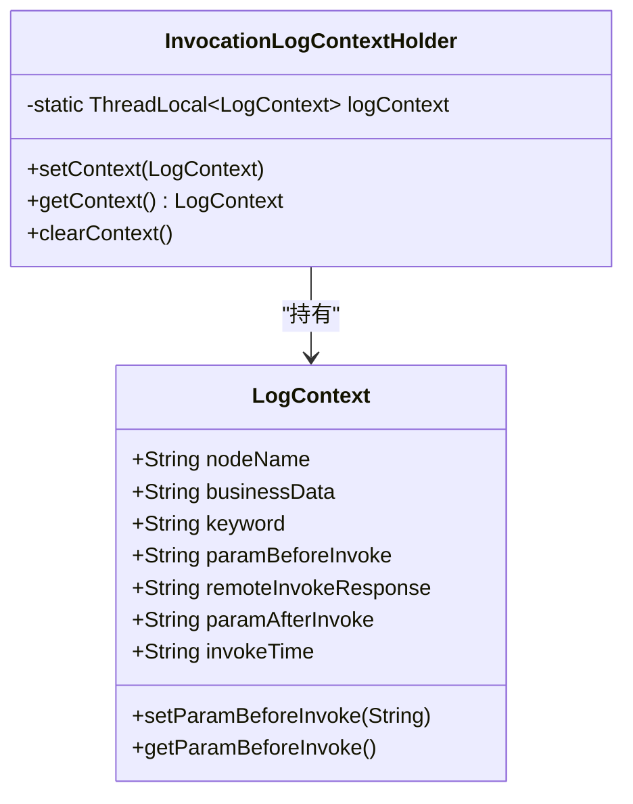
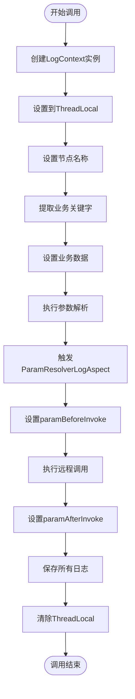

# AOP日志切面

<cite>
**本文档引用的文件**   
- [ParamResolverLogAspect.java](file://agent-invocation/src/main/java/com/helianhealth/agent/invocation/aspect/ParamResolverLogAspect.java)
- [LogContext.java](file://agent-invocation/src/main/java/com/helianhealth/agent/invocation/context/LogContext.java)
- [InvocationLogContextHolder.java](file://agent-invocation/src/main/java/com/helianhealth/agent/invocation/context/InvocationLogContextHolder.java)
- [ParamResolver.java](file://agent-invocation/src/main/java/com/helianhealth/agent/invocation/remote/ParamResolver.java)
- [InterfaceRemoteInvokerLogWrapper.java](file://agent-invocation/src/main/java/com/helianhealth/agent/invocation/remote/wrapper/InterfaceRemoteInvokerLogWrapper.java)
- [DefaultParamTreeBuilder.java](file://agent-invocation/src/main/java/com/helianhealth/agent/invocation/remote/DefaultParamTreeBuilder.java)
- [ProxyConvertHelper.java](file://agent-invocation/src/main/java/com/helianhealth/agent/invocation/remote/ProxyConvertHelper.java)
</cite>

## 目录
1. [引言](#引言)
2. [核心组件分析](#核心组件分析)
3. [日志切面机制详解](#日志切面机制详解)
4. [调用链日志上下文](#调用链日志上下文)
5. [参数解析与日志关联流程](#参数解析与日志关联流程)
6. [问题排查价值分析](#问题排查价值分析)
7. [配置建议与最佳实践](#配置建议与最佳实践)
8. [结论](#结论)

## 引言
ParamResolverLogAspect 是接口代理系统中用于监控参数解析过程的关键日志切面。该切面通过 AOP 技术捕获参数解析前后的数据状态，为系统调试、性能分析和问题定位提供重要支持。本文档详细说明该切面的工作机制、实现原理及其在实际运维中的应用价值。

## 核心组件分析

ParamResolverLogAspect 切面主要依赖于日志上下文管理机制和参数解析器组件协同工作，实现完整的日志追踪能力。

**Section sources**
- [ParamResolverLogAspect.java](file://agent-invocation/src/main/java/com/helianhealth/agent/invocation/aspect/ParamResolverLogAspect.java)
- [LogContext.java](file://agent-invocation/src/main/java/com/helianhealth/agent/invocation/context/LogContext.java)
- [ParamResolver.java](file://agent-invocation/src/main/java/com/helianhealth/agent/invocation/remote/ParamResolver.java)

## 日志切面机制详解

ParamResolverLogAspect 使用 `@AfterReturning` 通知在 `ParamResolver.resolveParamNodes` 方法成功执行后收集参数预处理结果。该切面将解析后的参数字符串保存到日志上下文（LogContext）中，供后续日志记录使用。

切面通过 `InvocationLogContextHolder.getContext()` 获取当前线程的 `LogContext` 实例，并调用 `setParamBeforeInvoke` 方法设置解析前的参数数据。若上下文为空或发生异常，切面会记录错误日志但不会中断主流程执行。



**Diagram sources**
- [ParamResolverLogAspect.java](file://agent-invocation/src/main/java/com/helianhealth/agent/invocation/aspect/ParamResolverLogAspect.java)
- [LogContext.java](file://agent-invocation/src/main/java/com/helianhealth/agent/invocation/context/LogContext.java)

**Section sources**
- [ParamResolverLogAspect.java](file://agent-invocation/src/main/java/com/helianhealth/agent/invocation/aspect/ParamResolverLogAspect.java)

## 调用链日志上下文

日志上下文（LogContext）是贯穿整个调用链路的核心数据容器，采用 ThreadLocal 机制保证线程安全。`InvocationLogContextHolder` 提供了上下文的设置、获取和清除操作，确保在单线程处理的 remoteInvoke 流程中正确传递日志信息。

LogContext 包含节点名称、业务数据、关键字、调用前后参数、远程响应和调用时间等关键字段，为日志分析提供完整上下文。



**Diagram sources**
- [LogContext.java](file://agent-invocation/src/main/java/com/helianhealth/agent/invocation/context/LogContext.java)
- [InvocationLogContextHolder.java](file://agent-invocation/src/main/java/com/helianhealth/agent/invocation/context/InvocationLogContextHolder.java)

**Section sources**
- [LogContext.java](file://agent-invocation/src/main/java/com/helianhealth/agent/invocation/context/LogContext.java)
- [InvocationLogContextHolder.java](file://agent-invocation/src/main/java/com/helianhealth/agent/invocation/context/InvocationLogContextHolder.java)

## 参数解析与日志关联流程

参数解析与日志记录的完整流程始于 `InterfaceRemoteInvokerLogWrapper` 的 `remoteInvoke` 方法。该方法创建 `LogContext` 实例并设置到线程上下文中，随后执行实际的远程调用。

在调用过程中，`ParamResolver` 解析参数时触发 `ParamResolverLogAspect` 切面，将解析前的参数写入日志上下文。调用完成后，返回结果被设置为 `paramAfterInvoke`，最终通过 `interfaceInvokeLogService` 统一保存所有日志数据。



**Diagram sources**
- [InterfaceRemoteInvokerLogWrapper.java](file://agent-invocation/src/main/java/com/helianhealth/agent/invocation/remote/wrapper/InterfaceRemoteInvokerLogWrapper.java)
- [ParamResolverLogAspect.java](file://agent-invocation/src/main/java/com/helianhealth/agent/invocation/aspect/ParamResolverLogAspect.java)
- [InvocationLogContextHolder.java](file://agent-invocation/src/main/java/com/helianhealth/agent/invocation/context/InvocationLogContextHolder.java)

**Section sources**
- [InterfaceRemoteInvokerLogWrapper.java](file://agent-invocation/src/main/java/com/helianhealth/agent/invocation/remote/wrapper/InterfaceRemoteInvokerLogWrapper.java)

## 问题排查价值分析

ParamResolverLogAspect 提供的详细日志对问题排查具有重要价值：

1. **定位参数映射错误**：通过对比 `paramBeforeInvoke` 和预期值，可快速发现参数映射配置错误或数据源问题。
2. **分析表达式解析性能**：结合调用耗时信息，可识别参数解析过程中的性能瓶颈。
3. **验证数据转换逻辑**：检查 `businessData` 到 `paramBeforeInvoke` 的转换过程，确认数据处理逻辑正确性。
4. **调试复杂对象结构**：对于嵌套对象和数组的解析，日志提供了中间状态的可视化。

实际日志输出示例：
```
工作流节点: [查询患者信息] 执行结束, 耗时: [156]ms
paramBeforeInvoke: {"patientId":"12345","orgCode":"HOSP001"}
paramAfterInvoke: {"status":"success","data":{"name":"张三","age":35}}
```

**Section sources**
- [ParamResolverLogAspect.java](file://agent-invocation/src/main/java/com/helianhealth/agent/invocation/aspect/ParamResolverLogAspect.java)
- [InterfaceRemoteInvokerLogWrapper.java](file://agent-invocation/src/main/java/com/helianhealth/agent/invocation/remote/wrapper/InterfaceRemoteInvokerLogWrapper.java)

## 配置建议与最佳实践

### 日志级别配置
建议将 ParamResolverLogAspect 相关日志设置为 INFO 级别，确保正常运行时记录关键信息。在调试阶段可临时调整为 DEBUG 级别获取更详细信息。

### 敏感数据脱敏
1. 在 `LogContext` 中对敏感字段（如身份证号、手机号）进行脱敏处理
2. 实现自定义日志处理器，在保存前过滤敏感信息
3. 配置日志框架的敏感词过滤规则
4. 对 `businessData` 和参数字段实施字段级脱敏策略

### 性能优化
1. 确保 `ThreadLocal` 变量在 finally 块中被正确清除，防止内存泄漏
2. 对日志序列化操作进行性能评估，避免影响主流程
3. 在高并发场景下考虑异步日志写入

**Section sources**
- [LogContext.java](file://agent-invocation/src/main/java/com/helianhealth/agent/invocation/context/LogContext.java)
- [InvocationLogContextHolder.java](file://agent-invocation/src/main/java/com/helianhealth/agent/invocation/context/InvocationLogContextHolder.java)
- [InterfaceRemoteInvokerLogWrapper.java](file://agent-invocation/src/main/java/com/helianhealth/agent/invocation/remote/wrapper/InterfaceRemoteInvokerLogWrapper.java)

## 结论
ParamResolverLogAspect 通过 AOP 技术实现了对参数解析过程的无侵入式监控，结合 ThreadLocal 上下文管理机制，构建了完整的调用链日志体系。该设计不仅提供了强大的问题排查能力，还为性能分析和系统优化提供了数据支持。通过合理的配置和最佳实践，可在保障系统性能的同时，最大化日志的运维价值。