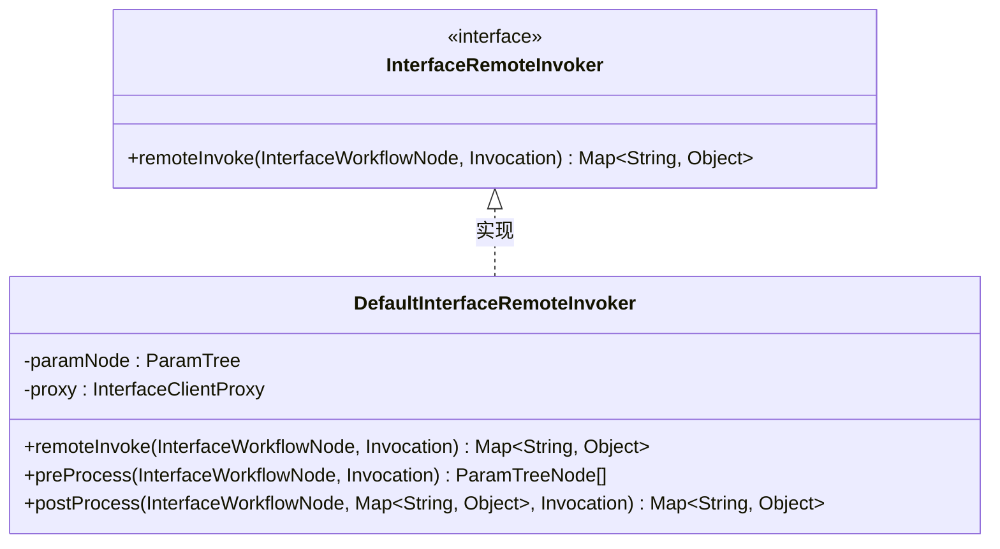
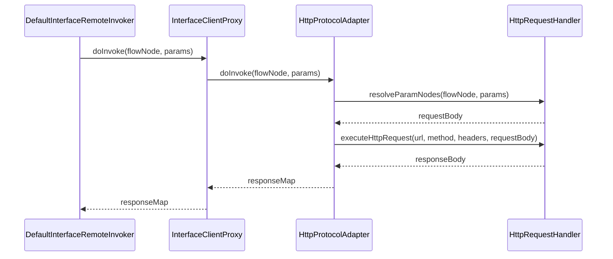
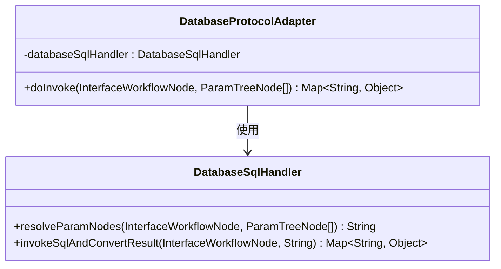
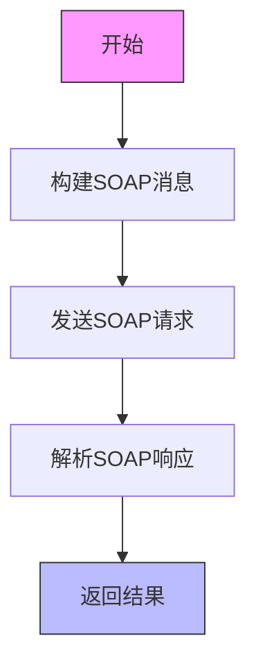
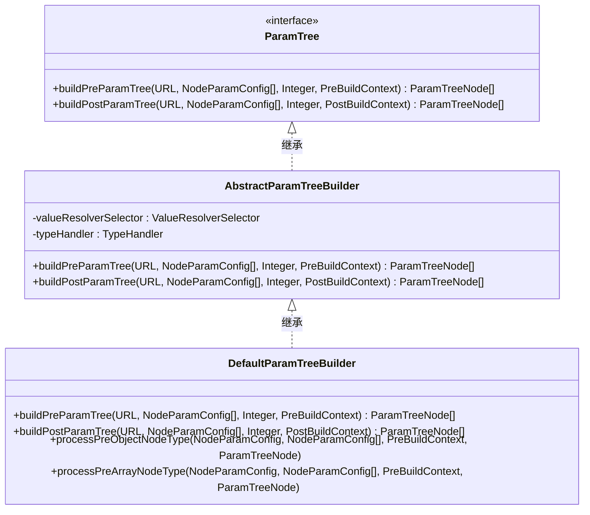
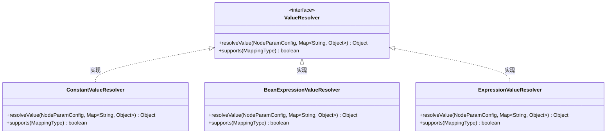
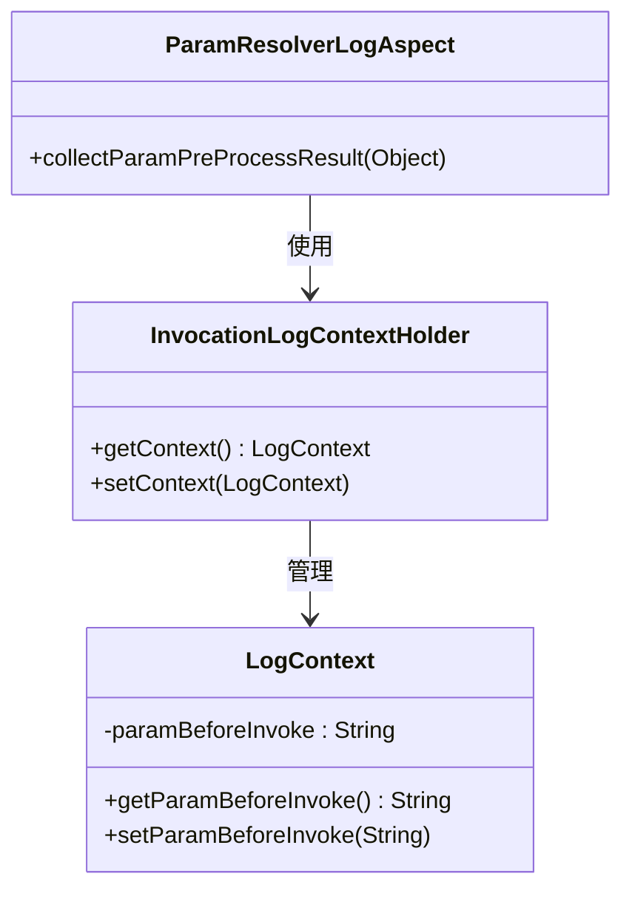
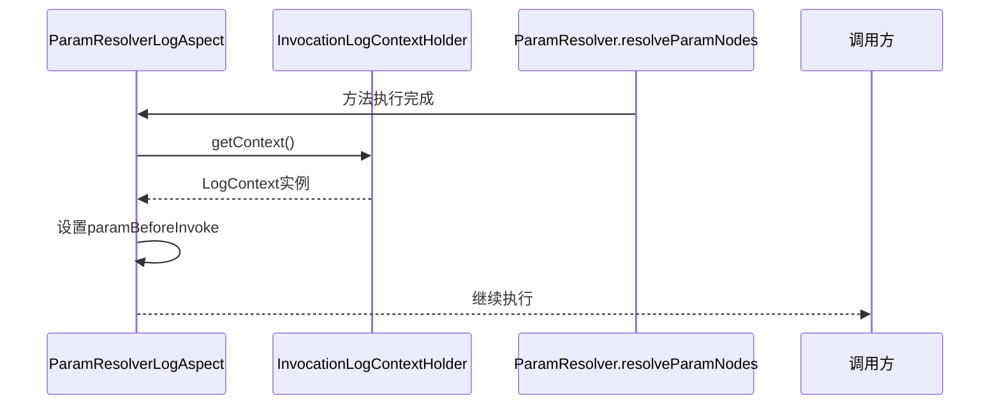
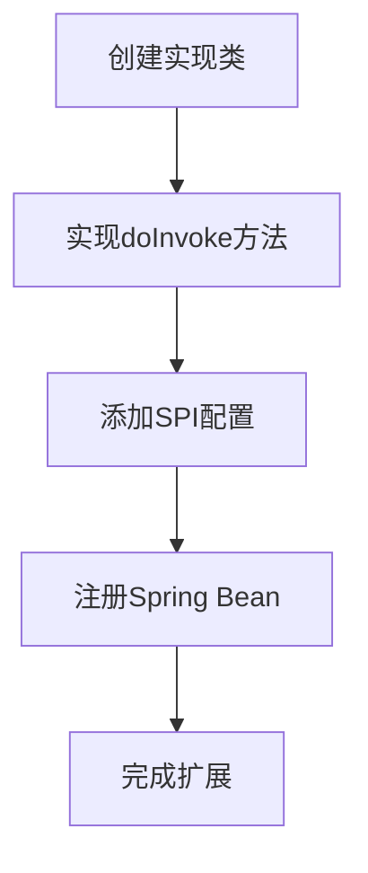

# agent-invocation 模块

<cite>
**本文档引用文件**  
- [InterfaceRemoteInvoker.java](file://agent-invocation/src/main/java/com/helianhealth/agent/invocation/remote/InterfaceRemoteInvoker.java)
- [DefaultInterfaceRemoteInvoker.java](file://agent-invocation/src/main/java/com/helianhealth/agent/invocation/remote/DefaultInterfaceRemoteInvoker.java)
- [HttpProtocolAdapter.java](file://agent-invocation/src/main/java/com/helianhealth/agent/invocation/remote/http/HttpProtocolAdapter.java)
- [DatabaseProtocolAdapter.java](file://agent-invocation/src/main/java/com/helianhealth/agent/invocation/remote/database/DatabaseProtocolAdapter.java)
- [WebServiceProtocolAdapter.java](file://agent-invocation/src/main/java/com/helianhealth/agent/invocation/remote/webService/WebServiceProtocolAdapter.java)
- [ParamTree.java](file://agent-invocation/src/main/java/com/helianhealth/agent/invocation/remote/ParamTree.java)
- [DefaultParamTreeBuilder.java](file://agent-invocation/src/main/java/com/helianhealth/agent/invocation/remote/DefaultParamTreeBuilder.java)
- [AbstractParamTreeBuilder.java](file://agent-invocation/src/main/java/com/helianhealth/agent/invocation/remote/AbstractParamTreeBuilder.java)
- [ValueResolverSelector.java](file://agent-invocation/src/main/java/com/helianhealth/agent/invocation/remote/resolver/ValueResolverSelector.java)
- [ValueResolver.java](file://agent-invocation/src/main/java/com/helianhealth/agent/invocation/remote/resolver/ValueResolver.java)
- [ConstantValueResolver.java](file://agent-invocation/src/main/java/com/helianhealth/agent/invocation/remote/resolver/ConstantValueResolver.java)
- [BeanExpressionValueResolver.java](file://agent-invocation/src/main/java/com/helianhealth/agent/invocation/remote/resolver/BeanExpressionValueResolver.java)
- [ExpressionValueResolver.java](file://agent-invocation/src/main/java/com/helianhealth/agent/invocation/remote/resolver/ExpressionValueResolver.java)
- [ParamResolverLogAspect.java](file://agent-invocation/src/main/java/com/helianhealth/agent/invocation/aspect/ParamResolverLogAspect.java)
- [ProxyConvertHelper.java](file://agent-invocation/src/main/java/com/helianhealth/agent/invocation/remote/ProxyConvertHelper.java)
</cite>

## 目录
1. [模块概述](#模块概述)
2. [核心接口设计](#核心接口设计)
3. [协议适配器实现](#协议适配器实现)
4. [参数树构建机制](#参数树构建机制)
5. [值解析器选择策略](#值解析器选择策略)
6. [调用日志AOP实现](#调用日志aop实现)
7. [自定义协议扩展指南](#自定义协议扩展指南)
8. [常见调用异常排查](#常见调用异常排查)

## 模块概述

agent-invocation模块作为远程调用引擎的核心组件，提供了统一的远程服务调用能力。该模块通过Dubbo SPI机制实现了可扩展的架构设计，支持HTTP、WebService、数据库等多种协议的远程调用。模块采用分层设计，将调用前处理、协议执行和调用后处理分离，确保了系统的灵活性和可维护性。

模块的核心设计理念是通过配置化的参数映射规则，实现业务数据到远程接口参数的自动转换。通过参数树（ParamTree）结构，支持复杂嵌套对象和数组的映射处理。同时，模块提供了丰富的值解析器，支持常量、SpEL表达式、Bean表达式等多种数据源的解析。

**Section sources**
- [InterfaceRemoteInvoker.java](file://agent-invocation/src/main/java/com/helianhealth/agent/invocation/remote/InterfaceRemoteInvoker.java#L1-L26)
- [DefaultInterfaceRemoteInvoker.java](file://agent-invocation/src/main/java/com/helianhealth/agent/invocation/remote/DefaultInterfaceRemoteInvoker.java#L1-L86)

## 核心接口设计

### InterfaceRemoteInvoker 接口

`InterfaceRemoteInvoker`接口是远程调用引擎的核心接口，定义了远程调用的统一契约。该接口采用Dubbo SPI机制，通过`@SPI("default")`注解标记，允许系统根据配置动态选择具体的实现类。

接口的核心方法`remoteInvoke`接收工作流节点信息和调用上下文，返回调用结果。方法通过`@Adaptive("remote")`注解实现自适应调用，根据节点配置的协议类型自动选择相应的协议适配器。



**Diagram sources**
- [InterfaceRemoteInvoker.java](file://agent-invocation/src/main/java/com/helianhealth/agent/invocation/remote/InterfaceRemoteInvoker.java#L15-L25)
- [DefaultInterfaceRemoteInvoker.java](file://agent-invocation/src/main/java/com/helianhealth/agent/invocation/remote/DefaultInterfaceRemoteInvoker.java#L16-L85)

### 调用执行流程

`DefaultInterfaceRemoteInvoker`作为`InterfaceRemoteInvoker`的默认实现，遵循三阶段调用流程：

1. **前置处理**：通过`preProcess`方法将业务数据转换为参数树结构
2. **协议调用**：通过`InterfaceClientProxy`代理执行具体的协议调用
3. **后置处理**：通过`postProcess`方法将响应数据转换为期望的格式

这种分层设计使得协议调用逻辑与数据转换逻辑解耦，提高了系统的可扩展性和可维护性。

**Section sources**
- [DefaultInterfaceRemoteInvoker.java](file://agent-invocation/src/main/java/com/helianhealth/agent/invocation/remote/DefaultInterfaceRemoteInvoker.java#L23-L32)

## 协议适配器实现

### HTTP协议适配

`HttpProtocolAdapter`实现了HTTP协议的远程调用，通过`HttpRequestHandler`封装底层HTTP通信细节。适配器从工作流节点的元信息中解析URL、请求方法和请求头等配置，构建HTTP请求。



**Diagram sources**
- [HttpProtocolAdapter.java](file://agent-invocation/src/main/java/com/helianhealth/agent/invocation/remote/http/HttpProtocolAdapter.java#L14-L48)
- [HttpRequestHandler.java](file://agent-invocation/src/main/java/com/helianhealth/agent/invocation/remote/http/HttpRequestHandler.java)

### 数据库协议适配

`DatabaseProtocolAdapter`实现了数据库协议的远程调用，通过`DatabaseSqlHandler`处理SQL语句的构建和执行。适配器将参数配置转换为SQL语句，并执行数据库查询。



**Diagram sources**
- [DatabaseProtocolAdapter.java](file://agent-invocation/src/main/java/com/helianhealth/agent/invocation/remote/database/DatabaseProtocolAdapter.java#L14-L32)
- [DatabaseSqlHandler.java](file://agent-invocation/src/main/java/com/helianhealth/agent/invocation/remote/database/DatabaseSqlHandler.java)

### WebService协议适配

`WebServiceProtocolAdapter`实现了WebService协议的远程调用，通过`SoapRequestHandler`处理SOAP消息的构建和解析。适配器支持SOAP 1.1和SOAP 1.2协议。



**Diagram sources**
- [WebServiceProtocolAdapter.java](file://agent-invocation/src/main/java/com/helianhealth/agent/invocation/remote/webService/WebServiceProtocolAdapter.java#L13-L29)
- [SoapRequestHandler.java](file://agent-invocation/src/main/java/com/helianhealth/agent/invocation/remote/webService/SoapRequestHandler.java)

## 参数树构建机制

### ParamTree 接口设计

`ParamTree`接口定义了参数树的构建契约，支持前置参数树（调用前）和后置参数树（调用后）的构建。接口采用Dubbo SPI机制，允许系统根据需要扩展不同的参数树构建策略。



**Diagram sources**
- [ParamTree.java](file://agent-invocation/src/main/java/com/helianhealth/agent/invocation/remote/ParamTree.java#L18-L47)
- [AbstractParamTreeBuilder.java](file://agent-invocation/src/main/java/com/helianhealth/agent/invocation/remote/AbstractParamTreeBuilder.java#L26-L217)
- [DefaultParamTreeBuilder.java](file://agent-invocation/src/main/java/com/helianhealth/agent/invocation/remote/DefaultParamTreeBuilder.java#L19-L275)

### 参数树构建流程

参数树的构建遵循以下流程：

1. **节点筛选**：根据父节点ID筛选当前层级的配置节点
2. **排序处理**：按照配置的排序字段对节点进行排序
3. **类型处理**：根据目标参数类型（对象、数组、基本类型）进行差异化处理
4. **递归构建**：对复杂类型进行递归构建，形成完整的参数树结构

对于对象类型，通过`processPreObjectNodeType`方法处理；对于数组类型，通过`processPreArrayNodeType`方法处理；对于基本类型，通过值解析器获取具体值。

**Section sources**
- [AbstractParamTreeBuilder.java](file://agent-invocation/src/main/java/com/helianhealth/agent/invocation/remote/AbstractParamTreeBuilder.java#L58-L78)
- [DefaultParamTreeBuilder.java](file://agent-invocation/src/main/java/com/helianhealth/agent/invocation/remote/DefaultParamTreeBuilder.java#L21-L275)

## 值解析器选择策略

### ValueResolver 接口设计

`ValueResolver`接口定义了值解析的统一契约，包含`resolveValue`和`supports`两个核心方法。系统通过策略模式实现不同类型的值解析。



**Diagram sources**
- [ValueResolver.java](file://agent-invocation/src/main/java/com/helianhealth/agent/invocation/remote/resolver/ValueResolver.java#L11-L19)
- [ConstantValueResolver.java](file://agent-invocation/src/main/java/com/helianhealth/agent/invocation/remote/resolver/ConstantValueResolver.java#L10-L21)
- [BeanExpressionValueResolver.java](file://agent-invocation/src/main/java/com/helianhealth/agent/invocation/remote/resolver/BeanExpressionValueResolver.java#L14-L28)
- [ExpressionValueResolver.java](file://agent-invocation/src/main/java/com/helianhealth/agent/invocation/remote/resolver/ExpressionValueResolver.java#L15-L38)

### ValueResolverSelector 实现

`ValueResolverSelector`作为值解析器的选择器，通过依赖注入获取所有`ValueResolver`实现，并根据配置的映射类型选择合适的解析器。

```mermaid
sequenceDiagram
participant Selector as ValueResolverSelector
participant Config as NodeParamConfig
participant Resolvers as List~ValueResolver~
Selector->>Resolvers : 获取所有ValueResolver实例
loop 遍历解析器
Resolvers->>Selector : resolver.supports(config.mappingType)
alt 支持该类型
Selector->>Resolvers : resolver.resolveValue(config, businessData, parentBusinessData, sourceBusinessData)
Resolvers-->>Selector : 解析结果
break 返回结果
end
end
Selector-->>调用方 : 解析结果或null
```

**Diagram sources**
- [ValueResolverSelector.java](file://agent-invocation/src/main/java/com/helianhealth/agent/invocation/remote/resolver/ValueResolverSelector.java#L13-L37)

## 调用日志AOP实现

### ParamResolverLogAspect 设计

`ParamResolverLogAspect`是参数解析过程的日志收集切面，通过AOP技术在参数预处理完成后自动收集处理结果，用于后续的日志记录。



**Diagram sources**
- [ParamResolverLogAspect.java](file://agent-invocation/src/main/java/com/helianhealth/agent/invocation/aspect/ParamResolverLogAspect.java#L17-L37)
- [InvocationLogContextHolder.java](file://agent-invocation/src/main/java/com/helianhealth/agent/invocation/context/InvocationLogContextHolder.java)
- [LogContext.java](file://agent-invocation/src/main/java/com/helianhealth/agent/invocation/context/LogContext.java)

### AOP执行流程

切面通过`@AfterReturning`注解监听`ParamResolver.resolveParamNodes`方法的返回结果，将参数预处理结果保存到日志上下文中。



**Section sources**
- [ParamResolverLogAspect.java](file://agent-invocation/src/main/java/com/helianhealth/agent/invocation/aspect/ParamResolverLogAspect.java#L23-L35)

## 自定义协议扩展指南

### 扩展接口定义

要实现自定义协议扩展，需要实现`InterfaceClientProxy`接口，并通过Dubbo SPI机制注册。

```java
public interface InterfaceClientProxy {
    Map<String, Object> doInvoke(InterfaceWorkflowNode flowNode, List<ParamTreeNode> params);
}
```

### 扩展实现步骤

1. **创建实现类**：实现`InterfaceClientProxy`接口
2. **添加SPI配置**：在`META-INF/dubbo/`目录下创建配置文件
3. **注册Bean**：通过Spring注解注册为Spring Bean



**Section sources**
- [InterfaceClientProxy.java](file://agent-invocation/src/main/java/com/helianhealth/agent/invocation/remote/InterfaceClientProxy.java)
- [HttpProtocolAdapter.java](file://agent-invocation/src/main/java/com/helianhealth/agent/invocation/remote/http/HttpProtocolAdapter.java)

## 常见调用异常排查

### HTTP调用异常

| 异常现象 | 可能原因 | 解决方案 |
|--------|--------|--------|
| 连接超时 | 网络问题或服务不可达 | 检查网络连接和服务状态 |
| 404错误 | URL配置错误 | 核对元信息中的URL配置 |
| 401错误 | 认证信息缺失 | 检查请求头中的认证信息 |

### 数据库调用异常

| 异常现象 | 可能原因 | 解决方案 |
|--------|--------|--------|
| SQL语法错误 | 参数映射配置错误 | 检查参数配置和SQL模板 |
| 连接失败 | 数据库连接配置错误 | 检查数据库连接信息 |
| 权限不足 | 数据库用户权限不足 | 检查数据库用户权限 |

### 通用排查方法

1. **检查日志**：查看调用日志中的详细信息
2. **验证配置**：核对工作流节点的配置信息
3. **测试连接**：使用工具测试底层服务的连通性
4. **逐步排查**：从参数构建到协议调用逐步排查问题

**Section sources**
- [HttpProtocolAdapter.java](file://agent-invocation/src/main/java/com/helianhealth/agent/invocation/remote/http/HttpProtocolAdapter.java#L40-L44)
- [DatabaseProtocolAdapter.java](file://agent-invocation/src/main/java/com/helianhealth/agent/invocation/remote/database/DatabaseProtocolAdapter.java#L26-L29)
- [WebServiceProtocolAdapter.java](file://agent-invocation/src/main/java/com/helianhealth/agent/invocation/remote/webService/WebServiceProtocolAdapter.java#L24-L27)