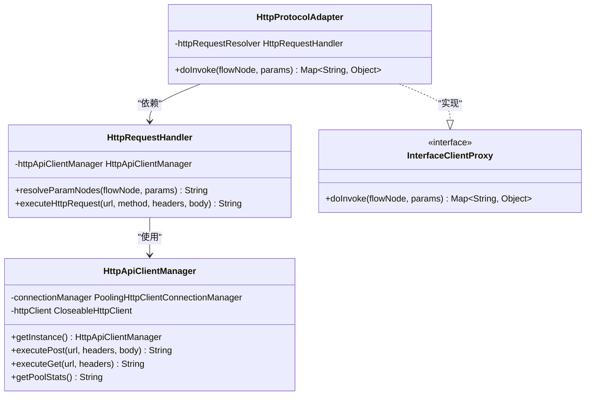
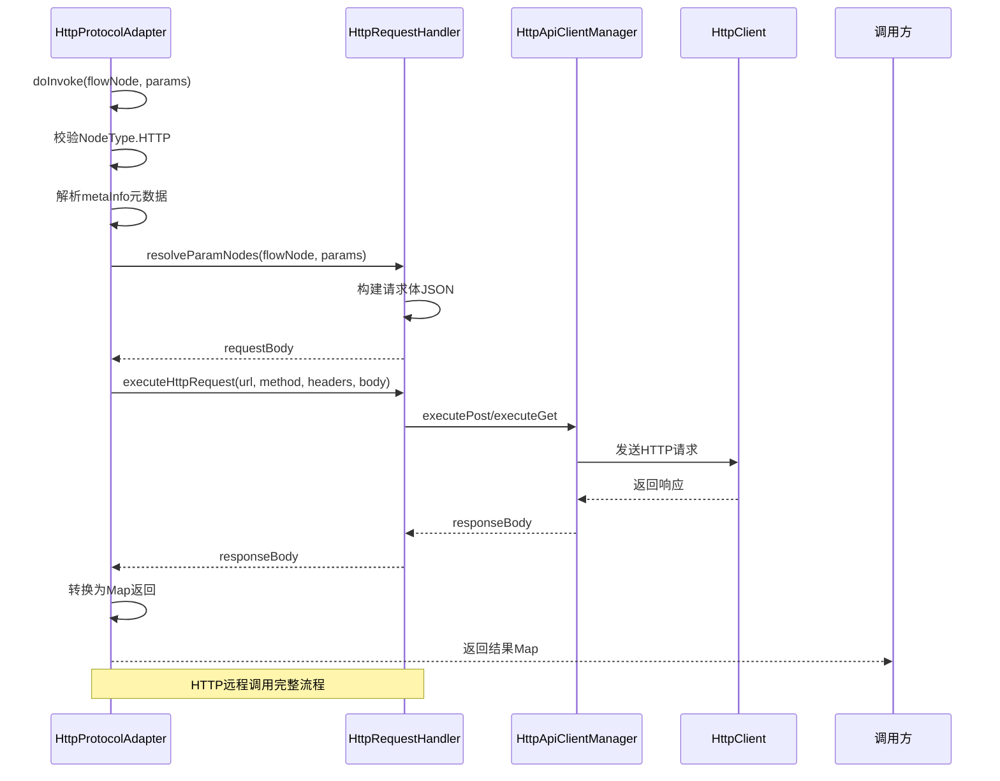
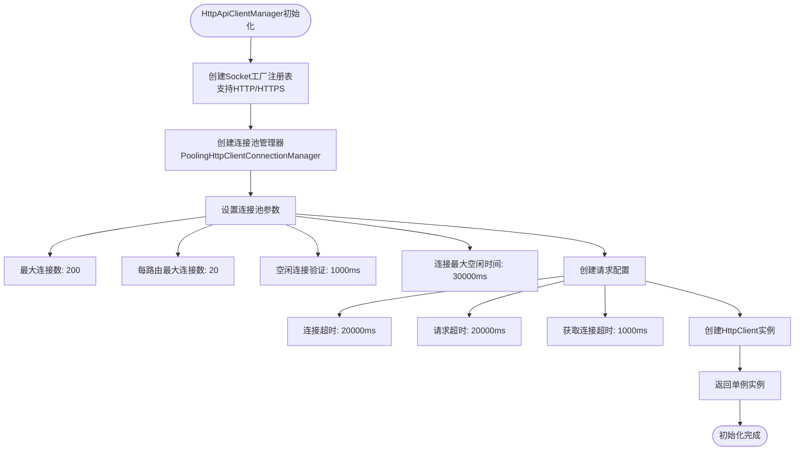

# HTTP协议支持

<cite>
**本文档引用文件**  
- [HttpProtocolAdapter.java](file://agent-invocation/src/main/java/com/helianhealth/agent/invocation/remote/http/HttpProtocolAdapter.java)
- [HttpRequestHandler.java](file://agent-invocation/src/main/java/com/helianhealth/agent/invocation/remote/http/HttpRequestHandler.java)
- [HttpApiClientManager.java](file://agent-invocation/src/main/java/com/helianhealth/agent/invocation/remote/manager/HttpApiClientManager.java)
- [InterfaceClientProxy.java](file://agent-invocation/src/main/java/com/helianhealth/agent/invocation/remote/InterfaceClientProxy.java)
- [InterfaceWorkflowNode.java](file://agent-invocation/src/main/java/com/helianhealth/agent/invocation/remote/model/InterfaceWorkflowNode.java)
- [NodeType.java](file://agent-common/src/main/java/com/helianhealth/agent/common/enums/NodeType.java)
- [NodeConfigIntro.vue](file://console-ui/src/views/NodeConfigIntro.vue)
- [QuickStart.vue](file://console-ui/src/views/QuickStart.vue)
</cite>

## 目录
1. [引言](#引言)
2. [核心组件分析](#核心组件分析)
3. [HTTP调用流程解析](#http调用流程解析)
4. [连接池管理与性能配置](#连接池管理与性能配置)
5. [请求配置与内容类型](#请求配置与内容类型)
6. [常见问题排查](#常见问题排查)
7. [性能优化建议](#性能优化建议)

## 引言
本文档详细解析了系统中HTTP协议支持的实现机制，重点阐述`HttpProtocolAdapter`如何通过实现`InterfaceClientProxy`接口完成HTTP远程调用。文档涵盖了从参数解析、请求执行到连接池管理的完整流程，并提供了配置示例和故障排查指南。

## 核心组件分析

`HttpProtocolAdapter`是HTTP远程调用的核心适配器，实现了`InterfaceClientProxy`接口，负责协调HTTP请求的整个生命周期。该组件依赖`HttpRequestHandler`进行参数解析与请求执行。

`HttpRequestHandler`作为参数解析器，负责将`ParamTreeNode`结构转换为HTTP请求所需的格式，并通过`HttpApiClientManager`执行实际的HTTP请求。`HttpApiClientManager`基于Apache HttpClient 5实现了高性能的连接池管理。



**图表来源**  
- [HttpProtocolAdapter.java](file://agent-invocation/src/main/java/com/helianhealth/agent/invocation/remote/http/HttpProtocolAdapter.java)
- [HttpRequestHandler.java](file://agent-invocation/src/main/java/com/helianhealth/agent/invocation/remote/http/HttpRequestHandler.java)
- [HttpApiClientManager.java](file://agent-invocation/src/main/java/com/helianhealth/agent/invocation/remote/manager/HttpApiClientManager.java)
- [InterfaceClientProxy.java](file://agent-invocation/src/main/java/com/helianhealth/agent/invocation/remote/InterfaceClientProxy.java)

**本节来源**  
- [HttpProtocolAdapter.java](file://agent-invocation/src/main/java/com/helianhealth/agent/invocation/remote/http/HttpProtocolAdapter.java#L14-L48)
- [HttpRequestHandler.java](file://agent-invocation/src/main/java/com/helianhealth/agent/invocation/remote/http/HttpRequestHandler.java#L26-L132)
- [HttpApiClientManager.java](file://agent-invocation/src/main/java/com/helianhealth/agent/invocation/remote/manager/HttpApiClientManager.java#L31-L174)

## HTTP调用流程解析

`HttpProtocolAdapter`的`doInvoke`方法是HTTP远程调用的入口点，其执行流程包含节点类型校验、元数据解析、请求执行和响应处理四个关键步骤。



**图表来源**  
- [HttpProtocolAdapter.java](file://agent-invocation/src/main/java/com/helianhealth/agent/invocation/remote/http/HttpProtocolAdapter.java#L21-L44)
- [HttpRequestHandler.java](file://agent-invocation/src/main/java/com/helianhealth/agent/invocation/remote/http/HttpRequestHandler.java#L37-L130)
- [HttpApiClientManager.java](file://agent-invocation/src/main/java/com/helianhealth/agent/invocation/remote/manager/HttpApiClientManager.java#L106-L153)

**本节来源**  
- [HttpProtocolAdapter.java](file://agent-invocation/src/main/java/com/helianhealth/agent/invocation/remote/http/HttpProtocolAdapter.java#L21-L44)
- [HttpRequestHandler.java](file://agent-invocation/src/main/java/com/helianhealth/agent/invocation/remote/http/HttpRequestHandler.java#L37-L130)

### 节点类型校验
在`doInvoke`方法执行之初，首先对`flowNode`的节点类型进行校验，确保其为`NodeType.HTTP`。这是保障调用正确性的第一道防线，防止非HTTP类型的节点被错误地传递到HTTP适配器中处理。

### 元数据解析
系统通过`metaInfo`字段传递HTTP请求的元数据信息，这些信息以JSON格式存储，包含以下关键属性：
- **url**: 目标接口的完整URL地址
- **method**: HTTP请求方法（GET、POST等，默认为POST）
- **headers**: 请求头信息，以键值对形式组织

当`metaInfo`中缺少必要信息（如URL）时，系统会抛出相应的异常，确保调用的完整性。

### 请求体构建
`HttpRequestHandler`负责将`ParamTreeNode`结构解析为最终的请求体。系统支持多种参数类型，包括字符串、整数、布尔值、数组和对象。对于数组类型，系统提供了特殊的处理逻辑，能够正确处理单元素数组和多元素数组的场景。

### 响应处理机制
HTTP响应以字符串形式返回，`HttpProtocolAdapter`会将其解析为`Map<String, Object>`类型返回给调用方。这种设计使得上层应用可以方便地处理JSON格式的响应数据，无需关心底层的序列化和反序列化细节。

## 连接池管理与性能配置

`HttpApiClientManager`基于Apache HttpClient 5的连接池机制实现了高性能的HTTP客户端管理，通过单例模式确保全局唯一的连接池实例。



**图表来源**  
- [HttpApiClientManager.java](file://agent-invocation/src/main/java/com/helianhealth/agent/invocation/remote/manager/HttpApiClientManager.java#L56-L85)

**本节来源**  
- [HttpApiClientManager.java](file://agent-invocation/src/main/java/com/helianhealth/agent/invocation/remote/manager/HttpApiClientManager.java#L38-L85)

### 连接超时配置
系统设置了多层次的超时机制来确保HTTP调用的可靠性：
- **连接超时**（20秒）：建立TCP连接的最大等待时间
- **请求超时**（20秒）：从服务器读取响应的最大等待时间
- **连接请求超时**（1秒）：从连接池获取连接的最大等待时间

这些超时配置平衡了性能和可靠性，避免了因网络问题导致的长时间阻塞。

### 连接池大小策略
连接池配置了合理的大小限制：
- **最大总连接数**：200个，控制全局资源使用
- **每路由最大连接数**：20个，防止对单一目标服务器的过度连接

这种配置既保证了高并发场景下的性能，又避免了对目标服务器造成过大压力。

## 请求配置与内容类型

系统提供了灵活的HTTP请求配置方式，支持常见的HTTP方法和请求头设置。

### POST/GET请求配置
根据前端配置界面的示例，HTTP节点支持以下配置项：

| 配置项 | 是否必填 | 说明 | 示例 |
|--------|----------|------|------|
| url | 是 | 目标接口的完整URL地址 | `http://10.192.50.204:8088/PACS/HssExmeReceive` |
| method | 否 | HTTP请求方法，默认为POST | GET, POST, PUT, DELETE |
| headers | 否 | 请求头信息，JSON对象格式 | {"Content-Type": "application/json", "Authorization": "Bearer token"} |

**本节来源**  
- [NodeConfigIntro.vue](file://console-ui/src/views/NodeConfigIntro.vue#L26-L51)
- [QuickStart.vue](file://console-ui/src/views/QuickStart.vue#L203-L209)

### 默认Content-Type设定
系统默认的Content-Type为`application/json`，这一配置在`HttpApiClientManager`的静态代码块中定义：

```java
private static final Map<String, String> DEFAULT_HEADERS = new HashMap<>();
static {
    DEFAULT_HEADERS.put("Content-Type", "application/json");
}
```

此默认值可以在请求时通过自定义headers覆盖，为不同类型的API调用提供了灵活性。

**本节来源**  
- [HttpApiClientManager.java](file://agent-invocation/src/main/java/com/helianhealth/agent/invocation/remote/manager/HttpApiClientManager.java#L50-L52)

## 常见问题排查

### 连接超时问题
当出现连接超时异常时，应按以下步骤排查：
1. 检查目标URL是否正确可达
2. 验证网络连通性，确认防火墙或安全组设置
3. 检查连接超时配置是否合理，必要时可适当增加超时时间
4. 查看连接池状态，确认是否有连接泄漏

可通过`HttpApiClientManager`的`getPoolStats()`方法获取连接池状态信息，辅助诊断连接问题。

### 4xx/5xx错误处理
对于HTTP状态码异常，系统会记录详细的错误日志，包括：
- 请求URL
- 请求方法
- 请求体内容
- 响应状态码
- 异常信息

建议的排查步骤：
1. 检查请求参数是否符合API文档要求
2. 验证认证信息（如token）是否有效
3. 确认请求头设置是否正确
4. 查看目标服务的日志获取更详细的错误原因

**本节来源**  
- [HttpApiClientManager.java](file://agent-invocation/src/main/java/com/helianhealth/agent/invocation/remote/manager/HttpApiClientManager.java#L122-L124)
- [HttpApiClientManager.java](file://agent-invocation/src/main/java/com/helianhealth/agent/invocation/remote/manager/HttpApiClientManager.java#L150-L152)

## 性能优化建议
1. **合理配置连接池**：根据实际并发需求调整最大连接数和每路由连接数
2. **优化超时设置**：根据网络环境和目标服务性能调整超时参数
3. **复用连接**：确保连接池配置正确，避免频繁创建和销毁连接
4. **监控连接池状态**：定期检查连接池使用情况，及时发现潜在问题
5. **批量处理**：对于大量相似请求，考虑合并为批量请求以减少网络开销