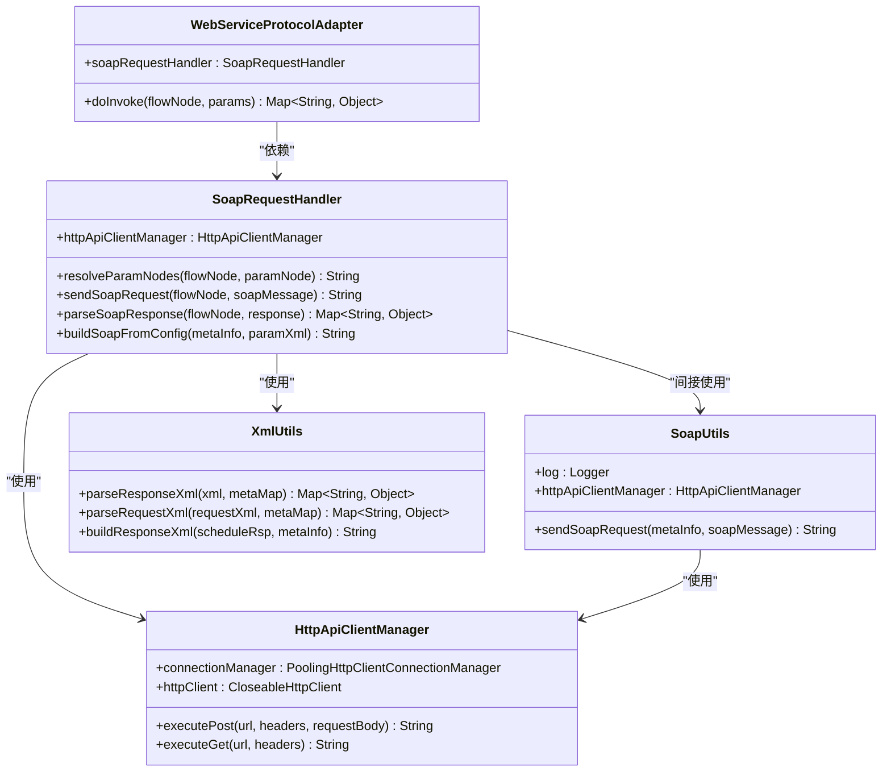
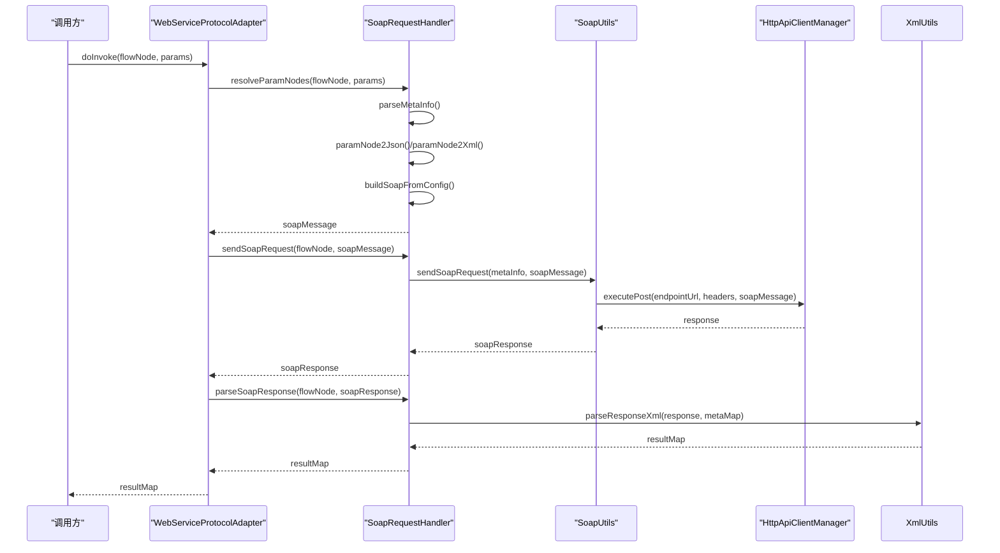
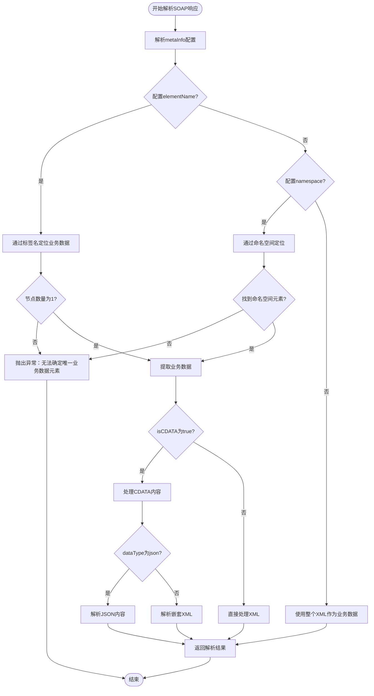
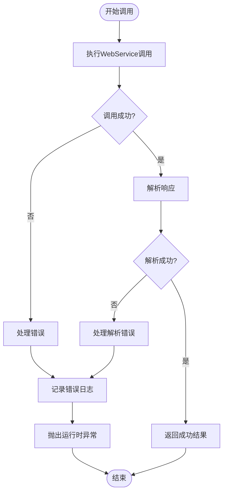

# WebService协议支持

<cite>
**本文档引用的文件**
- [WebServiceProtocolAdapter.java](file://agent-invocation/src/main/java/com/helianhealth/agent/invocation/remote/webService/WebServiceProtocolAdapter.java)
- [SoapRequestHandler.java](file://agent-invocation/src/main/java/com/helianhealth/agent/invocation/remote/webService/SoapRequestHandler.java)
- [SoapUtils.java](file://agent-invocation/src/main/java/com/helianhealth/agent/invocation/utils/SoapUtils.java)
- [HttpApiClientManager.java](file://agent-invocation/src/main/java/com/helianhealth/agent/invocation/remote/manager/HttpApiClientManager.java)
- [XmlUtils.java](file://agent-common/src/main/java/com/helianhealth/agent/common/utils/XmlUtils.java)
- [XmlConstants.java](file://agent-common/src/main/java/com/helianhealth/agent/common/base/XmlConstants.java)
- [application-dev-webservice.yml](file://agent-web/src/main/resources/application-dev-webservice.yml)
</cite>

## 目录
1. [WebService调用流程概述](#webservice调用流程概述)
2. [核心组件分析](#核心组件分析)
3. [SOAP请求处理流程](#soap请求处理流程)
4. [SOAP响应解析机制](#soap响应解析机制)
5. [SOAP消息发送实现](#soap消息发送实现)
6. [命名空间与复杂类型处理](#命名空间与复杂类型处理)
7. [配置示例](#配置示例)
8. [错误处理与诊断](#错误处理与诊断)

## WebService调用流程概述

WebService协议适配器（WebServiceProtocolAdapter）基于SOAP协议实现Web服务调用，通过SoapRequestHandler处理WSDL解析、SOAP信封生成与响应解析的完整流程。该系统支持SOAP 1.1和1.2协议，能够处理复杂的XML结构和命名空间，并提供灵活的配置选项来适应不同的WebService接口需求。

整个调用流程分为三个主要阶段：参数解析与SOAP消息构建、SOAP请求发送、响应解析。WebServiceProtocolAdapter作为入口点，协调SoapRequestHandler完成这些任务，最终将响应数据转换为标准的Map结构返回给调用方。

**Section sources**
- [WebServiceProtocolAdapter.java](file://agent-invocation/src/main/java/com/helianhealth/agent/invocation/remote/webService/WebServiceProtocolAdapter.java#L1-L29)

## 核心组件分析

WebService调用系统由多个核心组件构成，各组件职责明确，协同工作完成完整的SOAP调用流程。



**Diagram sources**
- [WebServiceProtocolAdapter.java](file://agent-invocation/src/main/java/com/helianhealth/agent/invocation/remote/webService/WebServiceProtocolAdapter.java#L1-L29)
- [SoapRequestHandler.java](file://agent-invocation/src/main/java/com/helianhealth/agent/invocation/remote/webService/SoapRequestHandler.java#L1-L134)
- [SoapUtils.java](file://agent-invocation/src/main/java/com/helianhealth/agent/invocation/utils/SoapUtils.java#L1-L84)
- [HttpApiClientManager.java](file://agent-invocation/src/main/java/com/helianhealth/agent/invocation/remote/manager/HttpApiClientManager.java#L1-L175)
- [XmlUtils.java](file://agent-common/src/main/java/com/helianhealth/agent/common/utils/XmlUtils.java#L1-L606)

**Section sources**
- [WebServiceProtocolAdapter.java](file://agent-invocation/src/main/java/com/helianhealth/agent/invocation/remote/webService/WebServiceProtocolAdapter.java#L1-L29)
- [SoapRequestHandler.java](file://agent-invocation/src/main/java/com/helianhealth/agent/invocation/remote/webService/SoapRequestHandler.java#L1-L134)
- [SoapUtils.java](file://agent-invocation/src/main/java/com/helianhealth/agent/invocation/utils/SoapUtils.java#L1-L84)

## SOAP请求处理流程

WebServiceProtocolAdapter通过SoapRequestHandler处理SOAP请求的完整流程，包括参数解析、SOAP信封生成等关键步骤。



**Diagram sources**
- [WebServiceProtocolAdapter.java](file://agent-invocation/src/main/java/com/helianhealth/agent/invocation/remote/webService/WebServiceProtocolAdapter.java#L1-L29)
- [SoapRequestHandler.java](file://agent-invocation/src/main/java/com/helianhealth/agent/invocation/remote/webService/SoapRequestHandler.java#L47-L133)
- [SoapUtils.java](file://agent-invocation/src/main/java/com/helianhealth/agent/invocation/utils/SoapUtils.java#L24-L82)
- [HttpApiClientManager.java](file://agent-invocation/src/main/java/com/helianhealth/agent/invocation/remote/manager/HttpApiClientManager.java#L106-L125)

**Section sources**
- [SoapRequestHandler.java](file://agent-invocation/src/main/java/com/helianhealth/agent/invocation/remote/webService/SoapRequestHandler.java#L47-L133)

## SOAP响应解析机制

SOAP响应解析是WebService调用的关键环节，系统通过XmlUtils工具类实现灵活的响应解析，支持多种定位方式和数据格式。



**Diagram sources**
- [SoapRequestHandler.java](file://agent-invocation/src/main/java/com/helianhealth/agent/invocation/remote/webService/SoapRequestHandler.java#L104-L118)
- [XmlUtils.java](file://agent-common/src/main/java/com/helianhealth/agent/common/utils/XmlUtils.java#L67-L147)

**Section sources**
- [SoapRequestHandler.java](file://agent-invocation/src/main/java/com/helianhealth/agent/invocation/remote/webService/SoapRequestHandler.java#L104-L118)
- [XmlUtils.java](file://agent-common/src/main/java/com/helianhealth/agent/common/utils/XmlUtils.java#L67-L147)

## SOAP消息发送实现

SoapUtils工具类负责SOAP消息的实际发送，根据metaInfo中的url和headers构建POST请求，并利用HttpApiClientManager发送原始SOAP消息。

```mermaid
sequenceDiagram
participant Handler as "SoapRequestHandler"
participant Utils as "SoapUtils"
participant HttpManager as "HttpApiClientManager"
participant HttpClient as "CloseableHttpClient"
Handler->>Utils : sendSoapRequest(metaInfo, soapMessage)
Utils->>Utils : 提取endpointUrl
Utils->>Utils : 验证url配置
Utils->>Utils : 构建请求头headers
Utils->>Utils : 检查Content-Type
Utils->>Utils : 设置默认Content-Type为text/xml;charset=UTF-8
Utils->>HttpManager : executePost(endpointUrl, headers, soapMessage)
HttpManager->>HttpClient : 创建HttpPost请求
HttpClient->>HttpClient : 设置请求头
HttpClient->>HttpClient : 设置请求体
HttpClient->>HttpClient : 执行POST请求
HttpClient-->>HttpManager : 获取响应
HttpManager-->>Utils : 返回响应内容
Utils-->>Handler : 返回SOAP响应
```

**Diagram sources**
- [SoapRequestHandler.java](file://agent-invocation/src/main/java/com/helianhealth/agent/invocation/remote/webService/SoapRequestHandler.java#L72-L98)
- [SoapUtils.java](file://agent-invocation/src/main/java/com/helianhealth/agent/invocation/utils/SoapUtils.java#L24-L48)
- [HttpApiClientManager.java](file://agent-invocation/src/main/java/com/helianhealth/agent/invocation/remote/manager/HttpApiClientManager.java#L106-L125)

**Section sources**
- [SoapUtils.java](file://agent-invocation/src/main/java/com/helianhealth/agent/invocation/utils/SoapUtils.java#L24-L82)
- [HttpApiClientManager.java](file://agent-invocation/src/main/java/com/helianhealth/agent/invocation/remote/manager/HttpApiClientManager.java#L106-L125)

## 命名空间与复杂类型处理

系统提供了完善的命名空间处理和复杂类型映射机制，通过metaInfo配置实现灵活的数据定位和转换。

```mermaid
erDiagram
METAINFO ||--o{ ELEMENT : "包含"
METAINFO ||--o{ NAMESPACE : "包含"
METAINFO ||--o{ DATA_TYPE : "包含"
class METAINFO {
+elementName : String
+namespace : String
+namespaceElementName : String
+namespaceDataElementName : String
+dataType : String
+isCDATA : Boolean
+useEscape : Boolean
+objectTag : List~String~
}
class ELEMENT {
+name : String
+attributes : Map~String, String~
+textContent : String
+childNodes : List~Node~
}
class NAMESPACE {
+uri : String
+prefix : String
}
class DATA_TYPE {
+JSON : "json"
+XML : "XML"
}
```

**Diagram sources**
- [XmlConstants.java](file://agent-common/src/main/java/com/helianhealth/agent/common/base/XmlConstants.java#L1-L22)
- [XmlUtils.java](file://agent-common/src/main/java/com/helianhealth/agent/common/utils/XmlUtils.java#L67-L147)
- [ContentTypeAdapterTest.java](file://agent-api/src/test/java/com/helianhealth/agent/api/ContentTypeAdapterTest.java#L89-L205)

**Section sources**
- [XmlConstants.java](file://agent-common/src/main/java/com/helianhealth/agent/common/base/XmlConstants.java#L1-L22)
- [XmlUtils.java](file://agent-common/src/main/java/com/helianhealth/agent/common/utils/XmlUtils.java#L67-L147)

## 配置示例

以下是WebService调用的典型配置示例，展示了如何通过metaInfo配置实现不同的调用场景。

### WSDL地址配置

```json
{
  "url": "http://example.com/service?wsdl",
  "headers": {
    "SOAPAction": "http://example.com/operation"
  }
}
```

### 命名空间处理配置

```json
{
  "url": "http://api.physicalv.ws.manager.cdxt.com/",
  "namespace": "http://api.physicalv.ws.manager.cdxt.com/",
  "namespaceElementName": "saveItem",
  "namespaceDataElementName": "param.request",
  "dataType": "json",
  "headers": {
    "Content-Type": "text/xml;charset=UTF-8",
    "SOAPAction": "saveItem"
  }
}
```

### 复杂类型映射配置

```json
{
  "url": "http://herenit.com/service",
  "elementName": "request",
  "dataType": "json",
  "isCDATA": true,
  "useEscape": true,
  "objectTag": ["PatientInfo", "OrderInfo"],
  "headers": {
    "Content-Type": "text/xml;charset=UTF-8"
  }
}
```

### SOAP信封模板配置

```json
{
  "url": "http://example.com/service",
  "soupTemplate": "<soapenv:Envelope xmlns:soapenv=\"http://schemas.xmlsoap.org/soap/envelope/\" xmlns:api=\"http://example.com/api\">\n   <soapenv:Header/>\n   <soapenv:Body>\n      <api:operation>${inputParam}</api:operation>\n   </soapenv:Body>\n</soapenv:Envelope>",
  "headers": {
    "Content-Type": "text/xml;charset=UTF-8",
    "SOAPAction": "operation"
  }
}
```

**Section sources**
- [SoapRequestHandler.java](file://agent-invocation/src/main/java/com/helianhealth/agent/invocation/remote/webService/SoapRequestHandler.java#L123-L132)
- [XmlUtils.java](file://agent-common/src/main/java/com/helianhealth/agent/common/utils/XmlUtils.java#L67-L147)
- [application-dev-webservice.yml](file://agent-web/src/main/resources/application-dev-webservice.yml#L1-L35)

## 错误处理与诊断

系统提供了完善的错误处理机制，能够有效诊断和处理WebService调用过程中的各种问题。

### SOAP Fault错误处理

当WebService返回SOAP Fault错误时，系统会捕获并转换为标准的异常信息。SOAP Fault通常包含以下信息：
- faultcode: 错误代码
- faultstring: 错误描述
- detail: 详细错误信息

系统通过解析这些信息，提供清晰的错误诊断。

### 常见问题诊断

#### WebService调用超时

**可能原因：**
- 网络连接不稳定
- 服务端处理时间过长
- 连接池配置不当

**解决方案：**
1. 检查网络连接状态
2. 调整HttpApiClientManager的超时配置
3. 优化服务端处理逻辑
4. 增加连接池大小

#### XML解析失败

**可能原因：**
- XML格式不正确
- 命名空间配置错误
- 业务数据定位失败

**解决方案：**
1. 验证XML格式的正确性
2. 检查metaInfo中的命名空间配置
3. 确认elementName或namespace配置正确
4. 使用CDATA包装复杂内容

#### 连接问题

**可能原因：**
- URL配置错误
- 服务端未启动
- 防火墙阻止连接

**解决方案：**
1. 验证URL的正确性
2. 检查服务端状态
3. 检查防火墙设置
4. 使用telnet测试端口连通性

### 错误处理流程



**Diagram sources**
- [WebServiceProtocolAdapter.java](file://agent-invocation/src/main/java/com/helianhealth/agent/invocation/remote/webService/WebServiceProtocolAdapter.java#L24-L27)
- [SoapRequestHandler.java](file://agent-invocation/src/main/java/com/helianhealth/agent/invocation/remote/webService/SoapRequestHandler.java#L63-L66)
- [SoapUtils.java](file://agent-invocation/src/main/java/com/helianhealth/agent/invocation/utils/SoapUtils.java#L45-L48)

**Section sources**
- [WebServiceProtocolAdapter.java](file://agent-invocation/src/main/java/com/helianhealth/agent/invocation/remote/webService/WebServiceProtocolAdapter.java#L24-L27)
- [SoapRequestHandler.java](file://agent-invocation/src/main/java/com/helianhealth/agent/invocation/remote/webService/SoapRequestHandler.java#L63-L66)
- [SoapUtils.java](file://agent-invocation/src/main/java/com/helianhealth/agent/invocation/utils/SoapUtils.java#L45-L48)