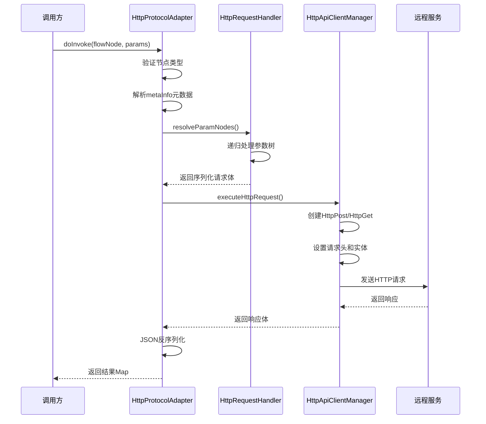
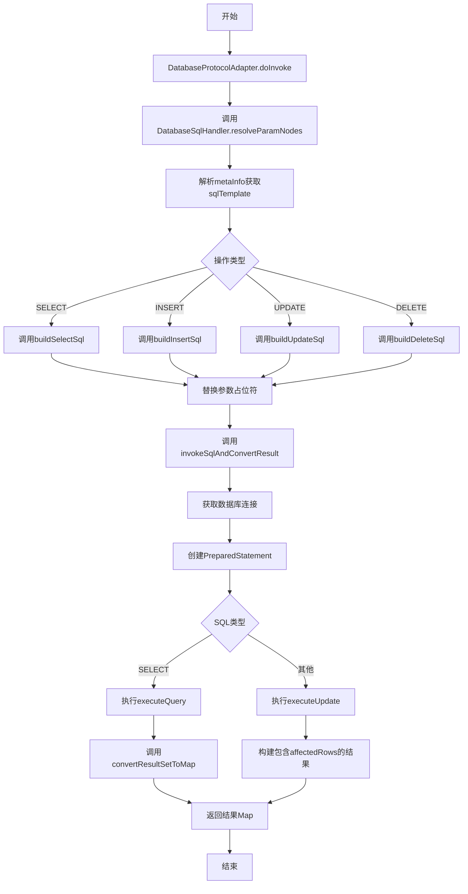
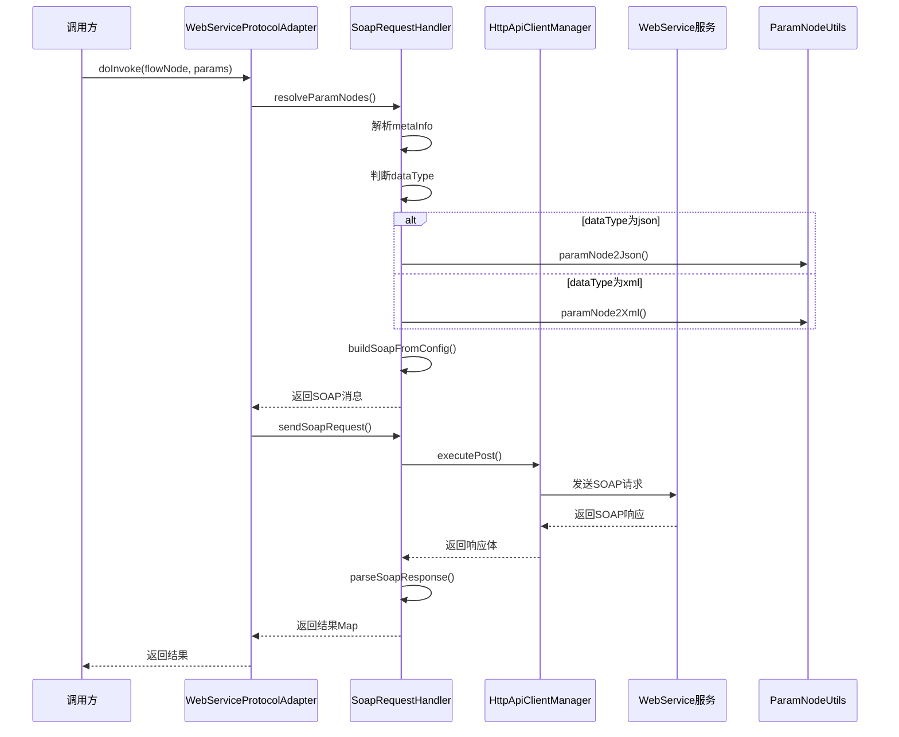
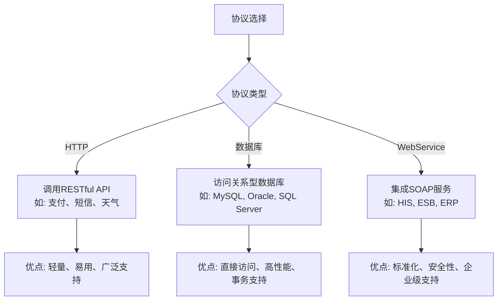
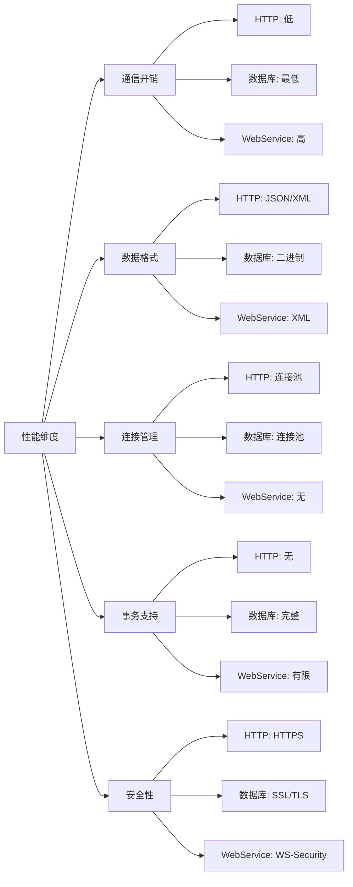

# 协议支持

<cite>
**本文档引用文件**  
- [HttpProtocolAdapter.java](file://agent-invocation/src/main/java/com/helianhealth/agent/invocation/remote/http/HttpProtocolAdapter.java)
- [HttpRequestHandler.java](file://agent-invocation/src/main/java/com/helianhealth/agent/invocation/remote/http/HttpRequestHandler.java)
- [HttpApiClientManager.java](file://agent-invocation/src/main/java/com/helianhealth/agent/invocation/remote/manager/HttpApiClientManager.java)
- [HttpUtils.java](file://agent-invocation/src/main/java/com/helianhealth/agent/invocation/utils/HttpUtils.java)
- [DatabaseProtocolAdapter.java](file://agent-invocation/src/main/java/com/helianhealth/agent/invocation/remote/database/DatabaseProtocolAdapter.java)
- [DatabaseSqlHandler.java](file://agent-invocation/src/main/java/com/helianhealth/agent/invocation/remote/database/DatabaseSqlHandler.java)
- [DatabaseApiClientManager.java](file://agent-invocation/src/main/java/com/helianhealth/agent/invocation/remote/manager/DatabaseApiClientManager.java)
- [WebServiceProtocolAdapter.java](file://agent-invocation/src/main/java/com/helianhealth/agent/invocation/remote/webService/WebServiceProtocolAdapter.java)
- [SoapRequestHandler.java](file://agent-invocation/src/main/java/com/helianhealth/agent/invocation/remote/webService/SoapRequestHandler.java)
- [SoapUtils.java](file://agent-invocation/src/main/java/com/helianhealth/agent/invocation/utils/SoapUtils.java)
- [application-dev-http.yml](file://agent-web/src/main/resources/application-dev-http.yml)
- [application-dev-webservice.yml](file://agent-web/src/main/resources/application-dev-webservice.yml)
- [application-dev-mysql.yml](file://agent-web/src/main/resources/application-dev-mysql.yml)
</cite>

## 目录
1. [HTTP协议支持机制](#http协议支持机制)
2. [数据库协议支持机制](#数据库协议支持机制)
3. [WebService协议支持机制](#webservice协议支持机制)
4. [协议配置与使用场景](#协议配置与使用场景)
5. [性能特点与适用范围对比](#性能特点与适用范围对比)
6. [常见连接异常排查方法](#常见连接异常排查方法)

## HTTP协议支持机制

`HttpProtocolAdapter`类实现了`InterfaceClientProxy`接口，负责处理HTTP协议的远程调用。该适配器通过`HttpRequestHandler`组件封装HTTP客户端功能，实现RESTful API调用。

在请求处理过程中，`HttpProtocolAdapter`首先验证节点类型为HTTP，然后从`metaInfo`元数据中解析URL、请求方法和请求头等信息。请求参数通过`HttpRequestHandler`的`resolveParamNodes`方法进行序列化处理，支持字符串、整数、布尔值、数组和对象等多种数据类型。参数序列化采用递归方式处理嵌套结构，确保复杂JSON对象能正确转换。

HTTP客户端由`HttpApiClientManager`单例管理，采用Apache HttpClient 5实现，配置了连接池（最大200连接，每路由20连接）和超时控制机制。默认连接超时和请求超时均为20秒，连接请求超时为1秒。客户端支持自定义请求头配置，若未指定则使用默认的`Content-Type: application/json`。



**图示来源**
- [HttpProtocolAdapter.java](file://agent-invocation/src/main/java/com/helianhealth/agent/invocation/remote/http/HttpProtocolAdapter.java#L14-L48)
- [HttpRequestHandler.java](file://agent-invocation/src/main/java/com/helianhealth/agent/invocation/remote/http/HttpRequestHandler.java#L26-L133)
- [HttpApiClientManager.java](file://agent-invocation/src/main/java/com/helianhealth/agent/invocation/remote/manager/HttpApiClientManager.java#L31-L175)

**本节来源**
- [HttpProtocolAdapter.java](file://agent-invocation/src/main/java/com/helianhealth/agent/invocation/remote/http/HttpProtocolAdapter.java#L14-L48)
- [HttpRequestHandler.java](file://agent-invocation/src/main/java/com/helianhealth/agent/invocation/remote/http/HttpRequestHandler.java#L26-L133)
- [HttpApiClientManager.java](file://agent-invocation/src/main/java/com/helianhealth/agent/invocation/remote/manager/HttpApiClientManager.java#L31-L175)

## 数据库协议支持机制

`DatabaseProtocolAdapter`类实现了`InterfaceClientProxy`接口，专门处理数据库协议的远程调用。该适配器通过`DatabaseSqlHandler`组件执行SQL语句，支持动态SQL构建与结果集映射。

SQL语句构建基于`metaInfo`中的`sqlTemplate`模板和`operation`操作类型（INSERT、UPDATE、DELETE、SELECT）。参数替换采用`{paramKey}`占位符机制，支持基本类型和数组类型参数。数组类型参数在IN语句中会自动转换为`('value1','value2')`格式，同时对字符串值进行单引号转义以防止SQL注入。

数据库连接由`DatabaseApiClientManager`单例管理，采用Druid连接池实现。连接池配置包括：初始化连接数5，最大活跃连接数20，最小空闲连接数5，最大等待时间60秒。连接池支持连接验证，Oracle数据库使用`SELECT 1 FROM DUAL`，其他数据库使用`SELECT 1`作为验证查询。

结果集映射通过`convertResultSetToMap`方法实现，将`ResultSet`转换为包含`data`列表和`total`计数的Map结构。对于INSERT、UPDATE、DELETE等更新操作，返回受影响行数。



**图示来源**
- [DatabaseProtocolAdapter.java](file://agent-invocation/src/main/java/com/helianhealth/agent/invocation/remote/database/DatabaseProtocolAdapter.java#L14-L32)
- [DatabaseSqlHandler.java](file://agent-invocation/src/main/java/com/helianhealth/agent/invocation/remote/database/DatabaseSqlHandler.java#L27-L327)
- [DatabaseApiClientManager.java](file://agent-invocation/src/main/java/com/helianhealth/agent/invocation/remote/manager/DatabaseApiClientManager.java#L13-L90)

**本节来源**
- [DatabaseProtocolAdapter.java](file://agent-invocation/src/main/java/com/helianhealth/agent/invocation/remote/database/DatabaseProtocolAdapter.java#L14-L32)
- [DatabaseSqlHandler.java](file://agent-invocation/src/main/java/com/helianhealth/agent/invocation/remote/database/DatabaseSqlHandler.java#L27-L327)
- [DatabaseApiClientManager.java](file://agent-invocation/src/main/java/com/helianhealth/agent/invocation/remote/manager/DatabaseApiClientManager.java#L13-L90)

## WebService协议支持机制

`WebServiceProtocolAdapter`类实现了`InterfaceClientProxy`接口，负责处理基于SOAP协议的WebService调用。该适配器通过`SoapRequestHandler`组件完成WSDL解析、SOAP信封生成和响应解析等全流程处理。

SOAP消息构建基于`metaInfo`中的`soupTemplate`模板，使用`${inputParam}`占位符表示业务数据位置。业务数据支持JSON和XML两种格式，通过`dataType`配置项指定。当`dataType`为"json"时，参数节点被转换为JSON字符串；否则转换为XML格式。

SOAP请求发送通过`HttpApiClientManager`的POST方法实现，请求头默认设置为`Content-Type: text/xml;charset=UTF-8`，支持自定义请求头配置。响应解析通过`XmlUtils.parseResponseXml`方法完成，将SOAP响应XML转换为Map结构。



**图示来源**
- [WebServiceProtocolAdapter.java](file://agent-invocation/src/main/java/com/helianhealth/agent/invocation/remote/webService/WebServiceProtocolAdapter.java#L13-L29)
- [SoapRequestHandler.java](file://agent-invocation/src/main/java/com/helianhealth/agent/invocation/remote/webService/SoapRequestHandler.java#L26-L134)
- [HttpApiClientManager.java](file://agent-invocation/src/main/java/com/helianhealth/agent/invocation/remote/manager/HttpApiClientManager.java#L31-L175)

**本节来源**
- [WebServiceProtocolAdapter.java](file://agent-invocation/src/main/java/com/helianhealth/agent/invocation/remote/webService/WebServiceProtocolAdapter.java#L13-L29)
- [SoapRequestHandler.java](file://agent-invocation/src/main/java/com/helianhealth/agent/invocation/remote/webService/SoapRequestHandler.java#L26-L134)
- [HttpApiClientManager.java](file://agent-invocation/src/main/java/com/helianhealth/agent/invocation/remote/manager/HttpApiClientManager.java#L31-L175)

## 协议配置与使用场景

不同协议的配置通过`META-INF/dubbo/com.helianhealth.agent.invocation.remote.InterfaceClientProxy`文件进行SPI注册，实现协议类型的动态选择：

```
http=com.helianhealth.agent.invocation.remote.http.HttpProtocolAdapter
webservice=com.helianhealth.agent.invocation.remote.webService.WebServiceProtocolAdapter
database=com.helianhealth.agent.invocation.remote.database.DatabaseProtocolAdapter
```

HTTP协议适用于RESTful API集成场景，如调用第三方支付接口、短信服务等。配置示例中通过`application-dev-http.yml`定义了服务端口和数据库连接，但HTTP调用本身不依赖这些配置。

数据库协议适用于直接访问关系型数据库的场景，如Oracle、MySQL、SQL Server等。配置中需要指定JDBC URL、用户名、密码和驱动类名。不同数据库的配置差异主要体现在JDBC连接字符串上，如MySQL使用`jdbc:mysql://`，SQL Server使用`jdbc:sqlserver://`。

WebService协议适用于传统SOAP服务集成，如医疗信息系统（HIS）、企业服务总线（ESB）等。配置中需要提供WSDL地址或SOAP端点URL，以及必要的认证信息。



**图示来源**
- [com.helianhealth.agent.invocation.remote.InterfaceClientProxy](file://agent-invocation/src/main/resources/META-INF/dubbo/com.helianhealth.agent.invocation.remote.InterfaceClientProxy)
- [application-dev-http.yml](file://agent-web/src/main/resources/application-dev-http.yml)
- [application-dev-mysql.yml](file://agent-web/src/main/resources/application-dev-mysql.yml)
- [application-dev-webservice.yml](file://agent-web/src/main/resources/application-dev-webservice.yml)

**本节来源**
- [com.helianhealth.agent.invocation.remote.InterfaceClientProxy](file://agent-invocation/src/main/resources/META-INF/dubbo/com.helianhealth.agent.invocation.remote.InterfaceClientProxy)
- [application-dev-http.yml](file://agent-web/src/main/resources/application-dev-http.yml)
- [application-dev-mysql.yml](file://agent-web/src/main/resources/application-dev-mysql.yml)
- [application-dev-webservice.yml](file://agent-web/src/main/resources/application-dev-webservice.yml)

## 性能特点与适用范围对比

三种协议在性能特点和适用范围上各有优势：

| 特性 | HTTP协议 | 数据库协议 | WebService协议 |
|------|---------|----------|--------------|
| **通信开销** | 低 | 最低 | 高 |
| **数据格式** | JSON/XML | 二进制 | XML |
| **连接管理** | 连接池 | 连接池 | 无连接池 |
| **事务支持** | 无 | 完整支持 | 有限支持 |
| **安全性** | HTTPS | SSL/TLS | WS-Security |
| **适用场景** | 微服务、API网关 | OLTP系统、数据同步 | 企业集成、B2B |

HTTP协议具有最低的通信开销和最广泛的支持，适合现代微服务架构。其基于JSON的数据格式轻量高效，连接池管理确保了高并发性能。适用于需要快速响应的API调用场景。

数据库协议具有最低的通信开销和最高的执行效率，直接通过JDBC访问数据库。完整的事务支持和连接池管理使其适合OLTP系统和数据同步场景。但需要暴露数据库连接信息，安全风险较高。

WebService协议通信开销最大，SOAP信封包含大量冗余信息。但其标准化程度高，支持WS-Security等企业级安全特性。适合需要严格契约定义和安全认证的企业集成场景。



**图示来源**
- [HttpApiClientManager.java](file://agent-invocation/src/main/java/com/helianhealth/agent/invocation/remote/manager/HttpApiClientManager.java#L31-L175)
- [DatabaseApiClientManager.java](file://agent-invocation/src/main/java/com/helianhealth/agent/invocation/remote/manager/DatabaseApiClientManager.java#L13-L90)
- [SoapRequestHandler.java](file://agent-invocation/src/main/java/com/helianhealth/agent/invocation/remote/webService/SoapRequestHandler.java#L26-L134)

**本节来源**
- [HttpApiClientManager.java](file://agent-invocation/src/main/java/com/helianhealth/agent/invocation/remote/manager/HttpApiClientManager.java#L31-L175)
- [DatabaseApiClientManager.java](file://agent-invocation/src/main/java/com/helianhealth/agent/invocation/remote/manager/DatabaseApiClientManager.java#L13-L90)
- [SoapRequestHandler.java](file://agent-invocation/src/main/java/com/helianhealth/agent/invocation/remote/webService/SoapRequestHandler.java#L26-L134)

## 常见连接异常排查方法

针对三种协议的常见连接异常，提供以下排查方法：

### HTTP协议异常排查
1. **连接超时**：检查目标URL是否可达，网络防火墙是否放行
2. **SSL握手失败**：验证证书有效性，检查JDK信任库
3. **401未授权**：确认认证信息（如API Key、Token）正确性
4. **404未找到**：验证API路径和版本号
5. **500服务器错误**：检查服务端日志，验证请求参数合法性

### 数据库协议异常排查
1. **连接拒绝**：确认数据库服务运行状态和端口监听
2. **认证失败**：验证用户名密码正确性
3. **驱动类找不到**：检查classpath中JDBC驱动jar包
4. **连接池耗尽**：监控连接使用情况，调整连接池参数
5. **SQL语法错误**：验证SQL模板和参数替换逻辑

### WebService协议异常排查
1. **WSDL解析失败**：验证WSDL URL可访问性
2. **SOAP Fault**：检查SOAP信封格式和命名空间
3. **编码错误**：确认字符集设置为UTF-8
4. **超时异常**：适当增加请求超时时间
5. **安全认证失败**：验证WS-Security头信息

通用排查步骤：
1. 检查`metaInfo`配置项的完整性和正确性
2. 验证网络连通性和防火墙设置
3. 查看应用日志中的详细错误信息
4. 使用工具（如Postman、SoapUI）进行独立测试
5. 逐步简化请求参数定位问题根源

**本节来源**
- [HttpProtocolAdapter.java](file://agent-invocation/src/main/java/com/helianhealth/agent/invocation/remote/http/HttpProtocolAdapter.java#L14-L48)
- [DatabaseProtocolAdapter.java](file://agent-invocation/src/main/java/com/helianhealth/agent/invocation/remote/database/DatabaseProtocolAdapter.java#L14-L32)
- [WebServiceProtocolAdapter.java](file://agent-invocation/src/main/java/com/helianhealth/agent/invocation/remote/webService/WebServiceProtocolAdapter.java#L13-L29)
- [HttpApiClientManager.java](file://agent-invocation/src/main/java/com/helianhealth/agent/invocation/remote/manager/HttpApiClientManager.java#L31-L175)
- [DatabaseApiClientManager.java](file://agent-invocation/src/main/java/com/helianhealth/agent/invocation/remote/manager/DatabaseApiClientManager.java#L13-L90)