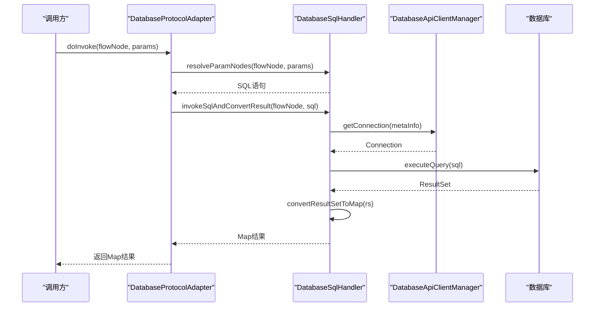
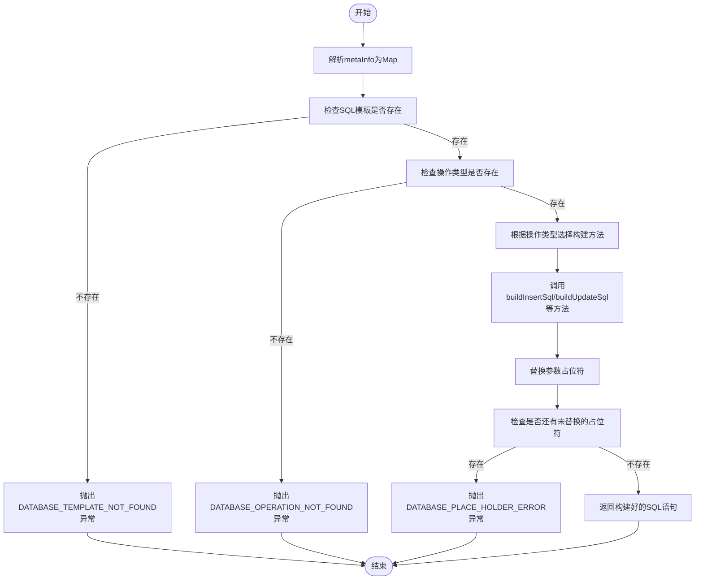
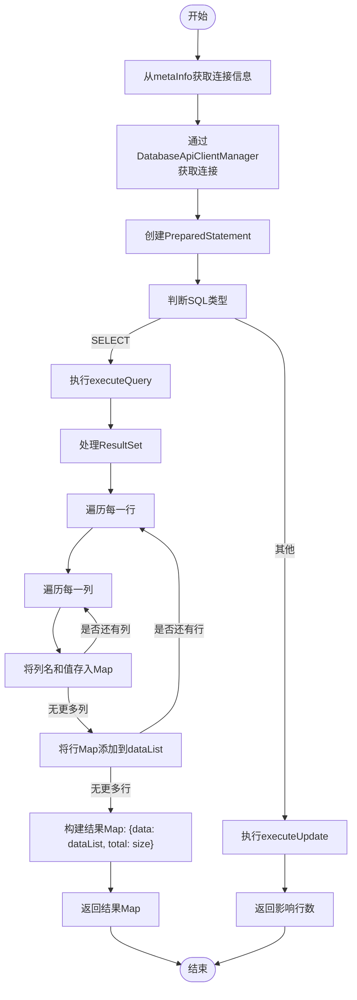
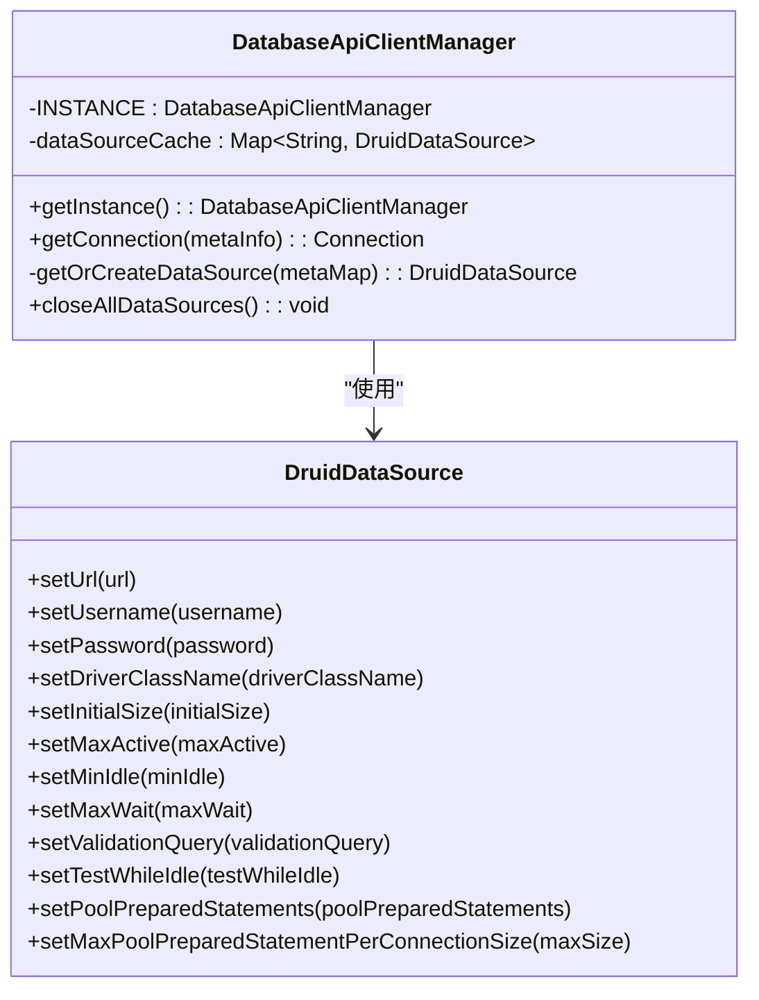
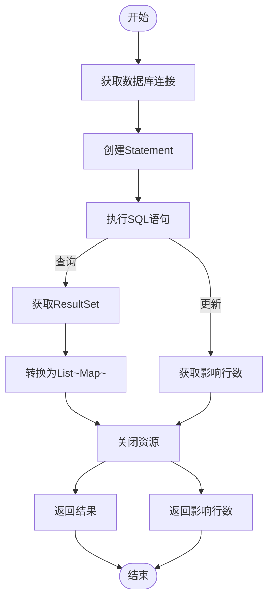

# 数据库协议支持

<cite>
**本文档引用文件**  
- [DatabaseProtocolAdapter.java](file://agent-invocation/src/main/java/com/helianhealth/agent/invocation/remote/database/DatabaseProtocolAdapter.java)
- [DatabaseSqlHandler.java](file://agent-invocation/src/main/java/com/helianhealth/agent/invocation/remote/database/DatabaseSqlHandler.java)
- [DatabaseApiClientManager.java](file://agent-invocation/src/main/java/com/helianhealth/agent/invocation/remote/manager/DatabaseApiClientManager.java)
- [DatabaseUtils.java](file://agent-invocation/src/main/java/com/helianhealth/agent/invocation/utils/DatabaseUtils.java)
- [JsonUtils.java](file://agent-common/src/main/java/com/helianhealth/agent/common/utils/JsonUtils.java)
- [application-dev-mysql.yml](file://agent-web/src/main/resources/application-dev-mysql.yml)
- [application-dev-gauss.yml](file://agent-web/src/main/resources/application-dev-gauss.yml)
</cite>

## 目录
1. [数据库协议适配器](#数据库协议适配器)  
2. [SQL语句构建与参数解析](#sql语句构建与参数解析)  
3. [SQL执行与结果集转换](#sql执行与结果集转换)  
4. [数据库连接池管理](#数据库连接池管理)  
5. [数据库工具类](#数据库工具类)  
6. [动态数据源配置](#动态数据源配置)  
7. [安全与故障排查](#安全与故障排查)

## 数据库协议适配器

`DatabaseProtocolAdapter` 是数据库远程调用的核心适配器，实现了 `InterfaceClientProxy` 接口，负责通过 JDBC 协议完成数据库的远程调用。该适配器通过依赖注入方式获取 `DatabaseSqlHandler` 实例，利用其完成 SQL 语句的构建与执行。

适配器的 `doInvoke` 方法是数据库调用的入口，接收工作流节点 `InterfaceWorkflowNode` 和参数树 `ParamTreeNode` 列表，首先调用 `resolveParamNodes` 构建 SQL 语句，然后调用 `invokeSqlAndConvertResult` 执行 SQL 并返回结果。整个过程封装了异常处理，确保调用失败时能够记录日志并抛出运行时异常。

**图示来源**  
- [DatabaseProtocolAdapter.java](file://agent-invocation/src/main/java/com/helianhealth/agent/invocation/remote/database/DatabaseProtocolAdapter.java#L20-L30)
- [DatabaseSqlHandler.java](file://agent-invocation/src/main/java/com/helianhealth/agent/invocation/remote/database/DatabaseSqlHandler.java#L35-L296)
- [DatabaseApiClientManager.java](file://agent-invocation/src/main/java/com/helianhealth/agent/invocation/remote/manager/DatabaseApiClientManager.java#L39-L45)

**本节来源**  
- [DatabaseProtocolAdapter.java](file://agent-invocation/src/main/java/com/helianhealth/agent/invocation/remote/database/DatabaseProtocolAdapter.java#L1-L32)

## SQL语句构建与参数解析

`DatabaseSqlHandler` 类负责 SQL 语句的构建与参数解析，实现了 `ParamResolver` 接口。其核心方法 `resolveParamNodes` 根据工作流节点的元信息 `metaInfo` 和参数树 `params` 构建 SQL 语句。

元信息 `metaInfo` 是一个 JSON 字符串，解析为 `Map<String, Object>` 后，提取 `sqlTemplate`（SQL 模板）和 `operation`（操作类型）。操作类型支持 `INSERT`、`UPDATE`、`DELETE` 和 `SELECT`，根据不同的操作类型调用相应的构建方法。

参数解析过程中，系统会检查 SQL 模板中是否存在未匹配的占位符，若存在则抛出 `DATABASE_PLACE_HOLDER_ERROR` 异常。对于数组类型参数，系统会将其转换为 SQL 的 `IN` 语句格式，如 `('117','102','94','87')`。

**图示来源**  
- [DatabaseSqlHandler.java](file://agent-invocation/src/main/java/com/helianhealth/agent/invocation/remote/database/DatabaseSqlHandler.java#L35-L59)
- [DatabaseSqlHandler.java](file://agent-invocation/src/main/java/com/helianhealth/agent/invocation/remote/database/DatabaseSqlHandler.java#L68-L85)
- [DatabaseSqlHandler.java](file://agent-invocation/src/main/java/com/helianhealth/agent/invocation/remote/database/DatabaseSqlHandler.java#L172-L193)

**本节来源**  
- [DatabaseSqlHandler.java](file://agent-invocation/src/main/java/com/helianhealth/agent/invocation/remote/database/DatabaseSqlHandler.java#L35-L59)

## SQL执行与结果集转换

`invokeSqlAndConvertResult` 方法负责执行 SQL 语句并转换结果集。该方法首先从 `metaInfo` 中获取数据库连接信息，通过 `DatabaseApiClientManager` 获取数据库连接，然后根据 SQL 语句的类型选择执行方法。

对于 `SELECT` 语句，调用 `executeQuery` 方法获取 `ResultSet`，然后通过 `convertResultSetToMap` 方法将结果集转换为 `Map<String, Object>`。对于 `INSERT`、`UPDATE`、`DELETE` 等更新操作，调用 `executeUpdate` 方法，返回影响的行数。

结果集转换过程中，系统会遍历 `ResultSet` 的每一行，将每列的列名和值存入 `Map`，最终将所有行的 `Map` 存入 `List`，并返回包含 `data` 和 `total` 的结果 `Map`。

**图示来源**  
- [DatabaseSqlHandler.java](file://agent-invocation/src/main/java/com/helianhealth/agent/invocation/remote/database/DatabaseSqlHandler.java#L251-L296)
- [DatabaseSqlHandler.java](file://agent-invocation/src/main/java/com/helianhealth/agent/invocation/remote/database/DatabaseSqlHandler.java#L302-L324)

**本节来源**  
- [DatabaseSqlHandler.java](file://agent-invocation/src/main/java/com/helianhealth/agent/invocation/remote/database/DatabaseSqlHandler.java#L251-L296)

## 数据库连接池管理

`DatabaseApiClientManager` 是数据库连接管理器，采用线程安全的单例模式实现。该管理器使用 Alibaba Druid 连接池，通过 `dataSourceCache` 缓存不同数据库的连接池，避免重复创建。

连接池的初始化参数包括：
- `initialSize`: 初始化连接数，设置为 5
- `maxActive`: 最大连接数，设置为 20
- `minIdle`: 最小空闲连接数，设置为 5
- `maxWait`: 最大等待时间（毫秒），设置为 60000

SQL 验证查询 `validationQuery` 根据数据库类型自动选择：Oracle 数据库使用 `SELECT 1 FROM DUAL`，其他数据库使用 `SELECT 1`。连接池还配置了空闲连接检测、预处理语句缓存等高级功能，确保连接的稳定性和性能。

**图示来源**  
- [DatabaseApiClientManager.java](file://agent-invocation/src/main/java/com/helianhealth/agent/invocation/remote/manager/DatabaseApiClientManager.java#L13-L90)

**本节来源**  
- [DatabaseApiClientManager.java](file://agent-invocation/src/main/java/com/helianhealth/agent/invocation/remote/manager/DatabaseApiClientManager.java#L34-L80)

## 数据库工具类

`DatabaseUtils` 工具类提供了 `executeQuery`、`executeUpdate`、`executeInsert`、`executeDelete` 等便捷方法，简化了数据库操作。这些方法封装了连接获取、语句执行和资源关闭的全过程，确保资源的自动释放。

`executeQuery` 方法用于执行查询语句，返回 `List<Map<String, Object>>` 结果列表。`executeUpdate` 方法用于执行更新语句，返回影响的行数。`executeInsert` 和 `executeDelete` 方法分别调用 `executeUpdate`，提供语义更明确的接口。

资源关闭通过 `closeResources` 方法实现，该方法在 `finally` 块中调用，确保即使发生异常也能正确关闭 `ResultSet`、`Statement` 和 `Connection`。

**图示来源**  
- [DatabaseUtils.java](file://agent-invocation/src/main/java/com/helianhealth/agent/invocation/utils/DatabaseUtils.java#L34-L46)
- [DatabaseUtils.java](file://agent-invocation/src/main/java/com/helianhealth/agent/invocation/utils/DatabaseUtils.java#L79-L91)

**本节来源**  
- [DatabaseUtils.java](file://agent-invocation/src/main/java/com/helianhealth/agent/invocation/utils/DatabaseUtils.java#L17-L149)

## 动态数据源配置

动态数据源配置通过 `metaInfo` 字段实现，该字段存储在 `interface_workflow_node` 表中，是一个 JSON 格式的字符串。`metaInfo` 包含数据库连接所需的所有信息，包括 `url`、`username`、`password`、`driverClassName` 等。

在 `DatabaseApiClientManager` 中，`getOrCreateDataSource` 方法从 `metaInfo` 中提取这些信息，创建或获取对应的 `DruidDataSource`。连接池以 `jdbcUrl` 为键进行缓存，确保相同数据库的连接池只创建一次。

例如，在 `application-dev-mysql.yml` 和 `application-dev-gauss.yml` 配置文件中，定义了不同环境下的数据库连接信息，系统根据配置文件中的 `spring.profiles` 激活相应的数据源。

**本节来源**  
- [DatabaseApiClientManager.java](file://agent-invocation/src/main/java/com/helianhealth/agent/invocation/remote/manager/DatabaseApiClientManager.java#L50-L79)
- [application-dev-mysql.yml](file://agent-web/src/main/resources/application-dev-mysql.yml#L6-L18)
- [application-dev-gauss.yml](file://agent-web/src/main/resources/application-dev-gauss.yml#L6-L18)

## 安全与故障排查

### SQL注入防护
系统通过 `formatValue` 方法对字符串类型的参数值进行转义，将单引号 `'` 替换为两个单引号 `''`，防止 SQL 注入攻击。对于数字类型，直接返回字符串表示，避免了类型转换带来的安全风险。

### 连接失败排查步骤
1. **检查连接信息**：确认 `metaInfo` 中的 `url`、`username`、`password`、`driverClassName` 是否正确。
2. **检查网络连接**：确认数据库服务器是否可达，端口是否开放。
3. **检查数据库状态**：确认数据库服务是否正常运行。
4. **检查连接池配置**：确认 `initialSize`、`maxActive` 等参数是否合理。
5. **查看日志信息**：检查系统日志，查找具体的错误信息。

**本节来源**  
- [DatabaseSqlHandler.java](file://agent-invocation/src/main/java/com/helianhealth/agent/invocation/remote/database/DatabaseSqlHandler.java#L220-L227)
- [DatabaseApiClientManager.java](file://agent-invocation/src/main/java/com/helianhealth/agent/invocation/remote/manager/DatabaseApiClientManager.java#L50-L79)