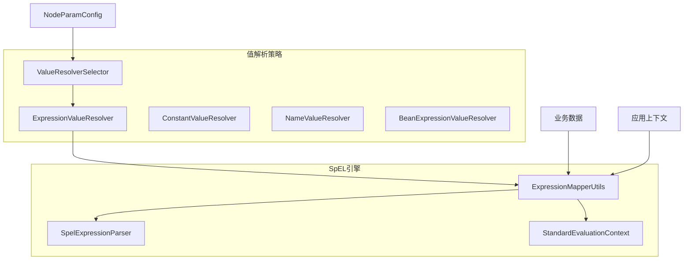
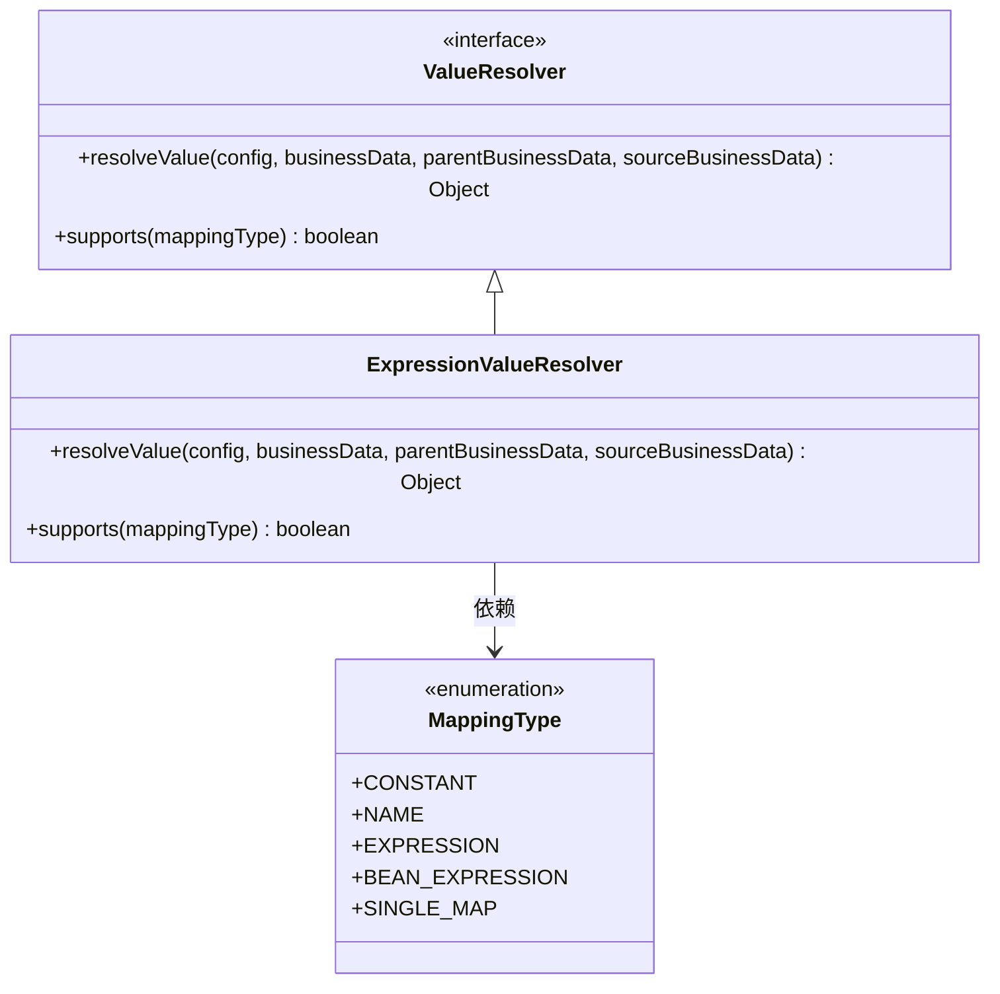
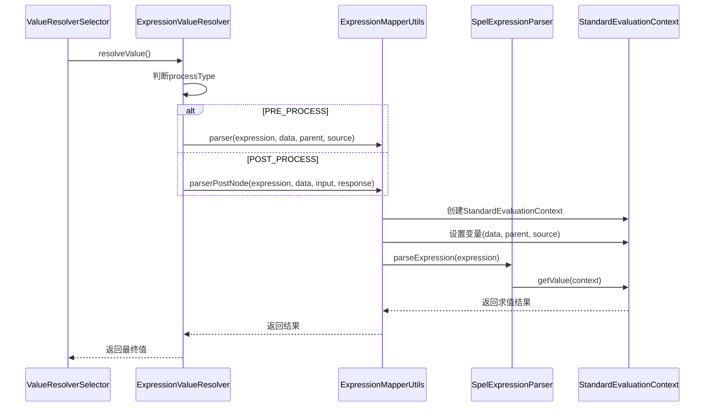
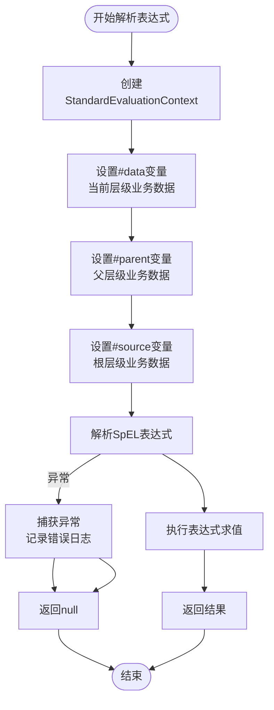
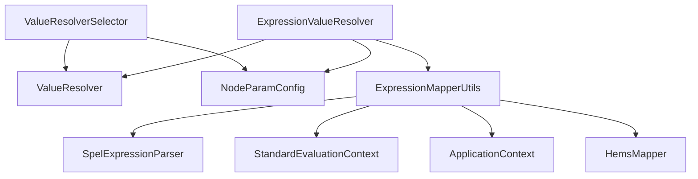

# SpEL表达式解析实现

<cite>
**本文档引用文件**  
- [ExpressionValueResolver.java](file://agent-invocation/src/main/java/com/helianhealth/agent/invocation/remote/resolver/ExpressionValueResolver.java)
- [ExpressionMapperUtils.java](file://agent-invocation/src/main/java/com/helianhealth/agent/invocation/utils/ExpressionMapperUtils.java)
- [MappingType.java](file://agent-common/src/main/java/com/helianhealth/agent/common/enums/MappingType.java)
- [ValueResolver.java](file://agent-invocation/src/main/java/com/helianhealth/agent/invocation/remote/resolver/ValueResolver.java)
- [ValueResolverSelector.java](file://agent-invocation/src/main/java/com/helianhealth/agent/invocation/remote/resolver/ValueResolverSelector.java)
- [NodeParamConfig.java](file://agent-invocation/src/main/java/com/helianhealth/agent/invocation/remote/model/NodeParamConfig.java)
- [create_archive.txt](file://agent-ai/src/main/resources/systemprompt/create_archive.txt)
</cite>

## 目录
1. [简介](#简介)
2. [核心组件](#核心组件)
3. [架构概述](#架构概述)
4. [详细组件分析](#详细组件分析)
5. [依赖分析](#依赖分析)
6. [性能考虑](#性能考虑)
7. [故障排除指南](#故障排除指南)
8. [结论](#结论)

## 简介
本文档深入剖析ExpressionValueResolver如何利用Spring的SpEL引擎实现动态参数计算，说明其supports方法对MappingType.EXPRESSION的识别机制。详细描述resolveValue方法中通过ExpressionMapperUtils创建EvaluationContext并执行表达式求值的全过程，包括rootObject、businessData等上下文变量的绑定方式。通过实际案例展示复杂表达式如'#root["data"]?.toUpperCase()'的解析过程，解释类型转换与空值安全处理策略。提供表达式语法错误、上下文变量缺失等常见问题的排查步骤与性能优化建议。

## 核心组件

ExpressionValueResolver是基于Spring SpEL（Spring Expression Language）实现的动态参数计算核心组件，负责处理配置为EXPRESSION类型的映射规则。该组件通过实现ValueResolver接口，参与值解析策略模式，根据NodeParamConfig中的mappingType判断是否支持当前参数的解析。当mappingType为EXPRESSION时，ExpressionValueResolver被ValueResolverSelector选中执行resolveValue方法，该方法根据processType（PRE_PROCESS或POST_PROCESS）调用ExpressionMapperUtils的不同解析方法，完成表达式求值。

**组件来源**
- [ExpressionValueResolver.java](file://agent-invocation/src/main/java/com/helianhealth/agent/invocation/remote/resolver/ExpressionValueResolver.java#L1-L39)
- [ExpressionMapperUtils.java](file://agent-invocation/src/main/java/com/helianhealth/agent/invocation/utils/ExpressionMapperUtils.java#L1-L147)

## 架构概述

**图表来源**  
- [ExpressionValueResolver.java](file://agent-invocation/src/main/java/com/helianhealth/agent/invocation/remote/resolver/ExpressionValueResolver.java#L1-L39)
- [ExpressionMapperUtils.java](file://agent-invocation/src/main/java/com/helianhealth/agent/invocation/utils/ExpressionMapperUtils.java#L1-L147)
- [ValueResolverSelector.java](file://agent-invocation/src/main/java/com/helianhealth/agent/invocation/remote/resolver/ValueResolverSelector.java#L1-L37)

## 详细组件分析

### ExpressionValueResolver分析

ExpressionValueResolver作为ValueResolver策略模式的具体实现，其核心功能是利用Spring的SpEL引擎对配置的表达式进行动态求值。该组件通过supports方法识别MappingType.EXPRESSION类型，确保仅处理表达式映射规则。

#### 支持类型识别机制

**图表来源**  
- [ExpressionValueResolver.java](file://agent-invocation/src/main/java/com/helianhealth/agent/invocation/remote/resolver/ExpressionValueResolver.java#L34-L37)
- [MappingType.java](file://agent-common/src/main/java/com/helianhealth/agent/common/enums/MappingType.java#L1-L36)

#### 表达式求值流程

**图表来源**  
- [ExpressionValueResolver.java](file://agent-invocation/src/main/java/com/helianhealth/agent/invocation/remote/resolver/ExpressionValueResolver.java#L18-L30)
- [ExpressionMapperUtils.java](file://agent-invocation/src/main/java/com/helianhealth/agent/invocation/utils/ExpressionMapperUtils.java#L39-L81)

### ExpressionMapperUtils分析

ExpressionMapperUtils是SpEL表达式解析的核心工具类，封装了Spring SpEL引擎的复杂性，提供简洁的静态方法供ExpressionValueResolver调用。该工具类负责创建EvaluationContext、绑定上下文变量并执行表达式求值。

#### 上下文变量绑定

**图表来源**  
- [ExpressionMapperUtils.java](file://agent-invocation/src/main/java/com/helianhealth/agent/invocation/utils/ExpressionMapperUtils.java#L45-L51)

## 依赖分析

**图表来源**  
- [ExpressionValueResolver.java](file://agent-invocation/src/main/java/com/helianhealth/agent/invocation/remote/resolver/ExpressionValueResolver.java#L1-L39)
- [ExpressionMapperUtils.java](file://agent-invocation/src/main/java/com/helianhealth/agent/invocation/utils/ExpressionMapperUtils.java#L1-L147)
- [ValueResolverSelector.java](file://agent-invocation/src/main/java/com/helianhealth/agent/invocation/remote/resolver/ValueResolverSelector.java#L1-L37)
- [NodeParamConfig.java](file://agent-invocation/src/main/java/com/helianhealth/agent/invocation/remote/model/NodeParamConfig.java#L1-L96)

## 性能考虑

ExpressionValueResolver和ExpressionMapperUtils的设计考虑了性能因素。SpEL解析器（SpelExpressionParser）被声明为静态常量，避免了每次解析都创建新实例的开销。表达式解析过程中的异常被捕获并记录，防止因单个表达式错误导致整个流程中断。对于复杂的业务逻辑，建议将频繁执行的表达式缓存其解析结果，避免重复解析。同时，应避免在表达式中执行耗时的数据库查询或网络调用，以保持系统的响应性。

## 故障排除指南

当表达式解析出现问题时，可按照以下步骤进行排查：
1. 检查表达式语法是否正确，可使用ExpressionMapperUtils.validateExpressionSyntax方法进行验证
2. 确认上下文变量是否存在，如#data、#parent、#source等
3. 检查业务数据是否为空或结构不符合预期
4. 查看日志中是否有"表达式[{}]解析异常"的错误信息
5. 确认processType与上下文变量的匹配性，PRE_PROCESS使用#data、#parent、#source，POST_PROCESS使用#data、#input、#response

**组件来源**
- [ExpressionMapperUtils.java](file://agent-invocation/src/main/java/com/helianhealth/agent/invocation/utils/ExpressionMapperUtils.java#L136-L145)

## 结论

ExpressionValueResolver通过集成Spring的SpEL引擎，实现了强大的动态参数计算能力。其设计遵循策略模式，通过supports方法精确识别EXPRESSION类型的映射规则，并利用ExpressionMapperUtils工具类完成复杂的表达式求值过程。上下文变量的合理绑定确保了表达式能够访问到所需的业务数据，而完善的异常处理机制保证了系统的稳定性。该实现为系统提供了灵活的参数映射能力，支持复杂的业务逻辑处理，是接口代理系统中不可或缺的核心组件。