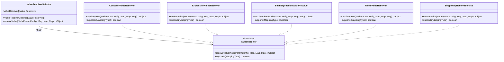
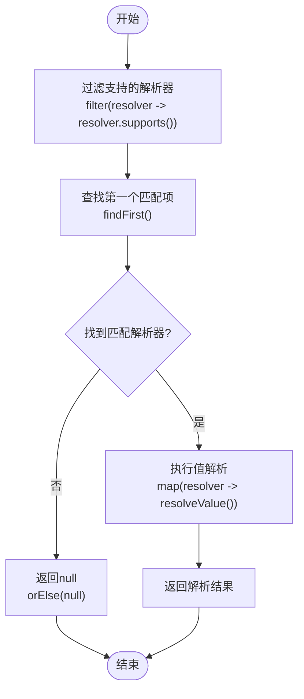
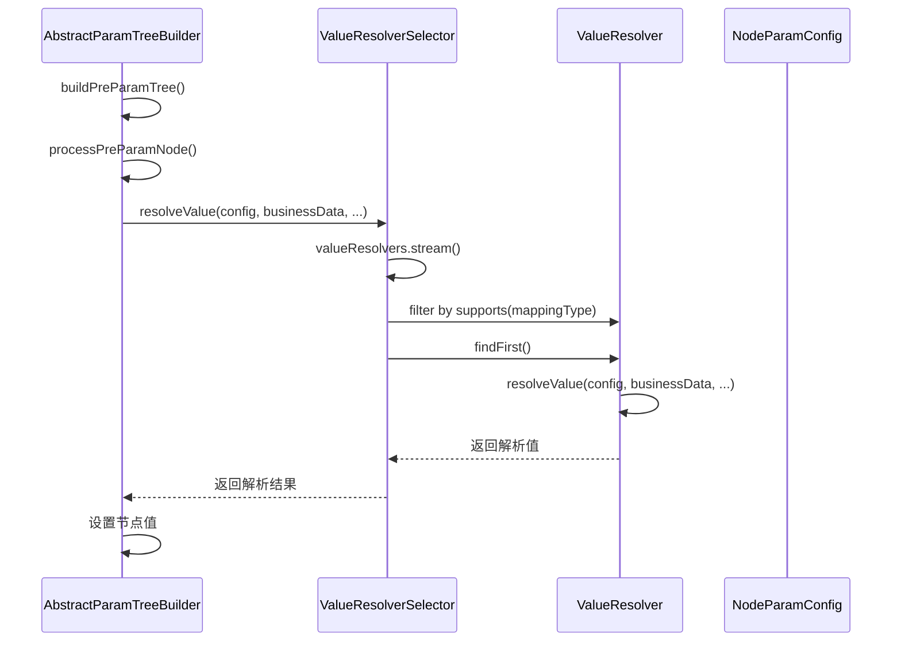

# 值解析器选择机制

<cite>
**本文档引用文件**   
- [ValueResolverSelector.java](file://agent-invocation/src/main/java/com/helianhealth/agent/invocation/remote/resolver/ValueResolverSelector.java)
- [ValueResolver.java](file://agent-invocation/src/main/java/com/helianhealth/agent/invocation/remote/resolver/ValueResolver.java)
- [ConstantValueResolver.java](file://agent-invocation/src/main/java/com/helianhealth/agent/invocation/remote/resolver/ConstantValueResolver.java)
- [ExpressionValueResolver.java](file://agent-invocation/src/main/java/com/helianhealth/agent/invocation/remote/resolver/ExpressionValueResolver.java)
- [BeanExpressionValueResolver.java](file://agent-invocation/src/main/java/com/helianhealth/agent/invocation/remote/resolver/BeanExpressionValueResolver.java)
- [NameValueResolver.java](file://agent-invocation/src/main/java/com/helianhealth/agent/invocation/remote/resolver/NameValueResolver.java)
- [SingleMapResolveService.java](file://agent-invocation/src/main/java/com/helianhealth/agent/invocation/remote/resolver/SingleMapResolveService.java)
- [AbstractParamTreeBuilder.java](file://agent-invocation/src/main/java/com/helianhealth/agent/invocation/remote/AbstractParamTreeBuilder.java)
- [NodeParamConfig.java](file://agent-invocation/src/main/java/com/helianhealth/agent/invocation/remote/model/NodeParamConfig.java)
- [MappingType.java](file://agent-common/src/main/java/com/helianhealth/agent/common/enums/MappingType.java)
</cite>

## 目录
1. [值解析器选择机制](#值解析器选择机制)
2. [Spring依赖注入与解析器管理](#spring依赖注入与解析器管理)
3. [解析器选择逻辑分析](#解析器选择逻辑分析)
4. [resolveValue方法执行流程](#resolvevalue方法执行流程)
5. [高并发场景下的线程安全性](#高并发场景下的线程安全性)
6. [执行链路分析](#执行链路分析)
7. [自定义扩展与SPI注册](#自定义扩展与spi注册)
8. [错误排查与日志定位](#错误排查与日志定位)

## Spring依赖注入与解析器管理

`ValueResolverSelector`通过Spring依赖注入机制管理所有`ValueResolver`实现类。在构造函数中，Spring容器自动注入所有实现了`ValueResolver`接口的Bean实例，形成一个解析器列表。

该机制基于Spring的组件扫描和自动装配功能，所有标记为`@Component`或`@Service`的解析器实现类都会被自动注册到Spring容器中，并在`ValueResolverSelector`初始化时注入。

**Section sources**
- [ValueResolverSelector.java](file://agent-invocation/src/main/java/com/helianhealth/agent/invocation/remote/resolver/ValueResolverSelector.java#L11-L19)

## 解析器选择逻辑分析

`ValueResolverSelector`通过`supports`方法判断`MappingType`匹配性来动态选择合适的解析器。系统定义了多种映射类型，每种类型对应特定的解析策略：

- **CONSTANT**: 固定值解析器
- **EXPRESSION**: SpEL表达式解析器
- **BEAN_EXPRESSION**: Bean表达式解析器
- **NAME**: 名称映射解析器
- **SINGLE_MAP**: 单个Map键值对解析器

每个`ValueResolver`实现类的`supports`方法会检查传入的`MappingType`是否与自身支持的类型匹配，从而实现精准的解析器选择。

**Diagram sources**
- [ValueResolver.java](file://agent-invocation/src/main/java/com/helianhealth/agent/invocation/remote/resolver/ValueResolver.java#L11-L20)
- [ValueResolverSelector.java](file://agent-invocation/src/main/java/com/helianhealth/agent/invocation/remote/resolver/ValueResolverSelector.java#L13-L37)
- [MappingType.java](file://agent-common/src/main/java/com/helianhealth/agent/common/enums/MappingType.java#L9-L35)

## resolveValue方法执行流程

`resolveValue`方法采用Stream操作实现解析器选择和值解析的链式处理，其核心流程如下：

1. **过滤阶段**: 通过`filter`操作筛选出支持当前`MappingType`的解析器
2. **短路查找**: 使用`findFirst()`实现短路逻辑，一旦找到匹配的解析器立即停止后续查找
3. **值解析**: 通过`map`操作调用选中解析器的`resolveValue`方法获取实际值
4. **默认处理**: 使用`orElse(null)`在无匹配解析器时返回null

该方法的短路逻辑确保了性能最优，避免了不必要的解析器遍历。

**Diagram sources**
- [ValueResolverSelector.java](file://agent-invocation/src/main/java/com/helianhealth/agent/invocation/remote/resolver/ValueResolverSelector.java#L27-L31)

## 高并发场景下的线程安全性

`ValueResolverSelector`在高并发场景下具有良好的线程安全性保障，主要体现在以下几个方面：

1. **不可变状态**: `valueResolvers`列表在构造函数初始化后即不可变，避免了并发修改问题
2. **无共享状态**: 各`ValueResolver`实现类均为无状态组件，不维护任何实例变量
3. **函数式编程**: Stream操作天然具有线程安全特性，各阶段操作相互独立
4. **异常隔离**: 异常捕获机制确保单个解析失败不会影响其他线程的执行

这些设计确保了在高并发环境下，多个线程同时调用`resolveValue`方法时不会产生竞态条件或数据不一致问题。

**Section sources**
- [ValueResolverSelector.java](file://agent-invocation/src/main/java/com/helianhealth/agent/invocation/remote/resolver/ValueResolverSelector.java#L15-L37)

## 执行链路分析

从`NodeParamConfig`配置到具体解析器的执行链路如下：

1. **配置获取**: `AbstractParamTreeBuilder`从数据库或配置中获取`NodeParamConfig`实例
2. **参数树构建**: 在构建参数树过程中，调用`resolveValue`方法解析每个节点的值
3. **解析器选择**: `ValueResolverSelector`根据`mappingType`选择合适的解析器
4. **值解析执行**: 具体解析器实现类根据`mappingRule`执行相应的解析逻辑

以`ConstantValueResolver`为例，当`mappingType`为`CONSTANT`时，直接返回`mappingRule`作为解析值；而`ExpressionValueResolver`则会解析SpEL表达式并计算结果。

**Diagram sources**
- [AbstractParamTreeBuilder.java](file://agent-invocation/src/main/java/com/helianhealth/agent/invocation/remote/AbstractParamTreeBuilder.java#L26-L218)
- [ValueResolverSelector.java](file://agent-invocation/src/main/java/com/helianhealth/agent/invocation/remote/resolver/ValueResolverSelector.java#L22-L37)
- [NodeParamConfig.java](file://agent-invocation/src/main/java/com/helianhealth/agent/invocation/remote/model/NodeParamConfig.java#L20-L96)

## 自定义扩展与SPI注册

当需要扩展新的`MappingType`时，需注意以下SPI注册与类型兼容性问题：

1. **SPI注册**: 新的解析器实现类必须使用`@Component`或`@Service`注解，确保被Spring容器管理
2. **类型兼容**: 新的`MappingType`枚举值必须在`MappingType`枚举中正确定义
3. **接口实现**: 必须完整实现`ValueResolver`接口的两个方法
4. **依赖注入**: 确保新的解析器能够被`ValueResolverSelector`正确注入

扩展时应遵循开闭原则，通过新增实现类而非修改现有代码来支持新功能。

**Section sources**
- [ValueResolver.java](file://agent-invocation/src/main/java/com/helianhealth/agent/invocation/remote/resolver/ValueResolver.java#L11-L20)
- [MappingType.java](file://agent-common/src/main/java/com/helianhealth/agent/common/enums/MappingType.java#L9-L35)

## 错误排查与日志定位

当解析器选择出现错误时，可通过以下方式进行日志定位：

1. **错误日志**: `ValueResolverSelector`在捕获异常时会记录详细的错误信息，包括目标参数键名和异常堆栈
2. **日志级别**: 使用`log.error`记录严重错误，便于在生产环境中快速定位问题
3. **上下文信息**: 日志中包含`config.getTargetParamKey()`，可精确定位到具体的配置项
4. **返回策略**: 异常情况下返回null，避免系统崩溃，同时便于问题排查

通过分析这些日志信息，可以快速确定是配置错误、类型不匹配还是解析逻辑异常等问题。

**Section sources**
- [ValueResolverSelector.java](file://agent-invocation/src/main/java/com/helianhealth/agent/invocation/remote/resolver/ValueResolverSelector.java#L32-L35)