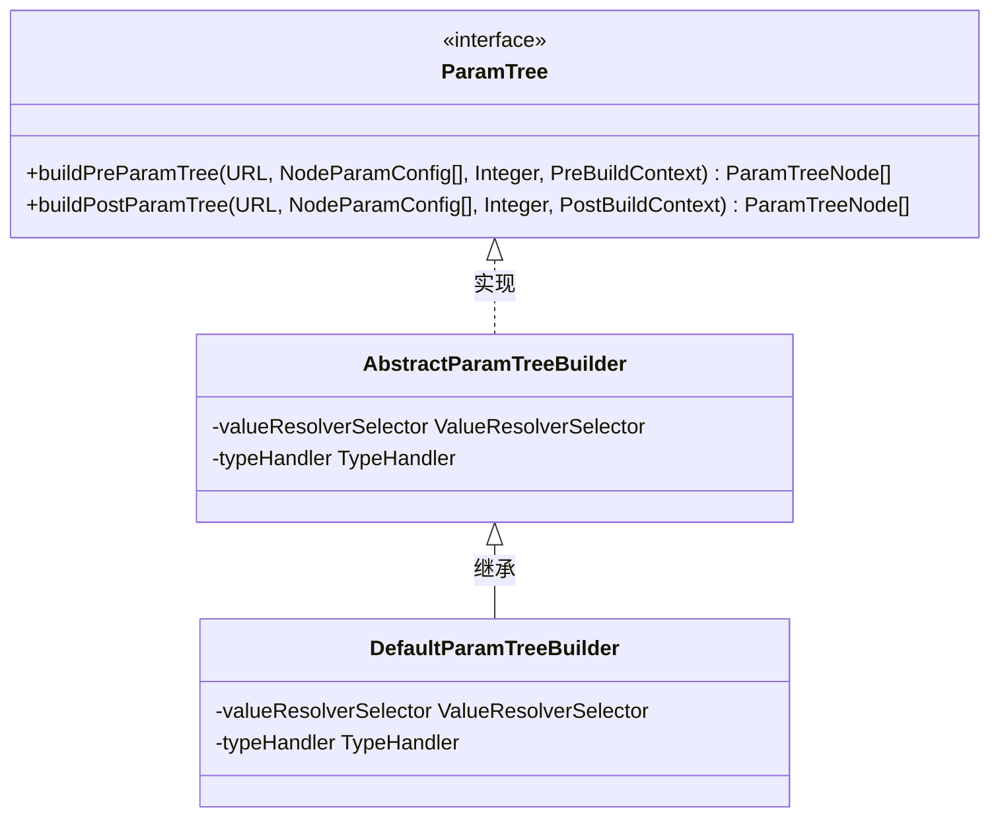
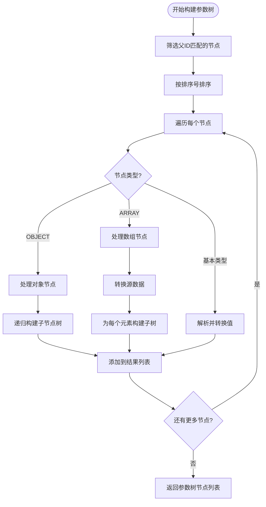
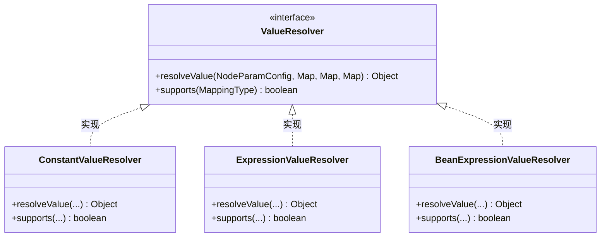

# 参数处理机制

<cite>
**本文档引用文件**  
- [ParamTree.java](file://agent-invocation/src/main/java/com/helianhealth/agent/invocation/remote/ParamTree.java)
- [DefaultParamTreeBuilder.java](file://agent-invocation/src/main/java/com/helianhealth/agent/invocation/remote/DefaultParamTreeBuilder.java)
- [AbstractParamTreeBuilder.java](file://agent-invocation/src/main/java/com/helianhealth/agent/invocation/remote/AbstractParamTreeBuilder.java)
- [ValueResolverSelector.java](file://agent-invocation/src/main/java/com/helianhealth/agent/invocation/remote/resolver/ValueResolverSelector.java)
- [NodeParamConfig.java](file://agent-invocation/src/main/java/com/helianhealth/agent/invocation/remote/model/NodeParamConfig.java)
- [ValueResolver.java](file://agent-invocation/src/main/java/com/helianhealth/agent/invocation/remote/resolver/ValueResolver.java)
- [ConstantValueResolver.java](file://agent-invocation/src/main/java/com/helianhealth/agent/invocation/remote/resolver/ConstantValueResolver.java)
- [ExpressionValueResolver.java](file://agent-invocation/src/main/java/com/helianhealth/agent/invocation/remote/resolver/ExpressionValueResolver.java)
- [BeanExpressionValueResolver.java](file://agent-invocation/src/main/java/com/helianhealth/agent/invocation/remote/resolver/BeanExpressionValueResolver.java)
- [PreBuildContext.java](file://agent-invocation/src/main/java/com/helianhealth/agent/invocation/remote/model/PreBuildContext.java)
- [PostBuildContext.java](file://agent-invocation/src/main/java/com/helianhealth/agent/invocation/remote/model/PostBuildContext.java)
- [ExpressionMapperUtils.java](file://agent-invocation/src/main/java/com/helianhealth/agent/invocation/utils/ExpressionMapperUtils.java)
</cite>

## 目录
1. [引言](#引言)
2. [参数树构建核心接口](#参数树构建核心接口)
3. [默认参数树构建器实现](#默认参数树构建器实现)
4. [值解析器选择机制](#值解析器选择机制)
5. [值解析器策略实现](#值解析器策略实现)
6. [上下文构建模型](#上下文构建模型)
7. [复杂嵌套参数结构处理](#复杂嵌套参数结构处理)
8. [前后置处理流程](#前后置处理流程)
9. [参数解析失败调试策略](#参数解析失败调试策略)
10. [总结](#总结)

## 引言

本文档深入解析 `agent-invocation` 模块中参数处理的核心机制，重点阐述 `ParamTree` 参数树的构建与解析过程。系统性地说明 `ParamTree` 接口如何定义参数树的构建规范，以及 `DefaultParamTreeBuilder` 的具体实现逻辑。详细分析 `ValueResolverSelector` 如何根据 `NodeParamConfig` 中的配置选择合适的值解析器（如 `ConstantValueResolver`、`ExpressionValueResolver`、`BeanExpressionValueResolver` 等），并结合 SpEL 表达式引擎实现动态参数计算。通过实际代码示例展示复杂嵌套参数结构的映射规则配置方法，解释 `PreBuildContext` 和 `PostBuildContext` 在前后置处理中的作用，并提供参数解析失败的调试策略。

## 参数树构建核心接口

`ParamTree` 接口是参数树构建的核心契约，定义了构建前置和后置参数树的规范。该接口采用 Dubbo 的 SPI 机制，允许扩展不同的构建策略，默认实现为 `default`。



**图示来源**
- [ParamTree.java](file://agent-invocation/src/main/java/com/helianhealth/agent/invocation/remote/ParamTree.java#L1-L48)
- [AbstractParamTreeBuilder.java](file://agent-invocation/src/main/java/com/helianhealth/agent/invocation/remote/AbstractParamTreeBuilder.java#L1-L218)
- [DefaultParamTreeBuilder.java](file://agent-invocation/src/main/java/com/helianhealth/agent/invocation/remote/DefaultParamTreeBuilder.java#L1-L276)

**本节来源**
- [ParamTree.java](file://agent-invocation/src/main/java/com/helianhealth/agent/invocation/remote/ParamTree.java#L1-L48)

## 默认参数树构建器实现

`DefaultParamTreeBuilder` 是 `ParamTree` 接口的默认实现类，继承自 `AbstractParamTreeBuilder`，负责处理对象和数组类型的复杂节点。其核心逻辑在于根据 `NodeParamConfig` 的配置，递归地构建参数树的子节点。

对于对象类型节点，`processPreObjectNodeType` 方法会根据源参数类型（NONE、OBJECT、ARRAY）进行不同的数据处理，并递归构建其子节点。对于数组类型节点，`doProcessPreArrayNodeType` 方法会将源数据（对象或数组）转换为一个包含多个子树的列表，实现了一对多的映射。



**图示来源**
- [DefaultParamTreeBuilder.java](file://agent-invocation/src/main/java/com/helianhealth/agent/invocation/remote/DefaultParamTreeBuilder.java#L1-L276)
- [AbstractParamTreeBuilder.java](file://agent-invocation/src/main/java/com/helianhealth/agent/invocation/remote/AbstractParamTreeBuilder.java#L1-L218)

**本节来源**
- [DefaultParamTreeBuilder.java](file://agent-invocation/src/main/java/com/helianhealth/agent/invocation/remote/DefaultParamTreeBuilder.java#L1-L276)

## 值解析器选择机制

`ValueResolverSelector` 是值解析的核心调度器，采用策略模式，根据 `NodeParamConfig` 中的 `mappingType` 配置，从多个 `ValueResolver` 实现中选择合适的解析器。

其构造函数通过 Spring 的依赖注入获取所有实现了 `ValueResolver` 接口的 Bean 列表。`resolveValue` 方法利用 Java 8 的 Stream API，遍历所有解析器，找到第一个支持当前 `mappingType` 的解析器，并委托其执行具体的值解析逻辑。如果解析过程中发生异常，会记录错误日志并返回 null。

```mermaid
sequenceDiagram
participant Selector as ValueResolverSelector
participant Config as NodeParamConfig
participant Resolvers as List~ValueResolver~
participant Resolver as ValueResolver
Selector->>Resolvers : 获取所有解析器
Selector->>Selector : 遍历解析器列表
loop 每个解析器
Resolver->>Resolver : supports(mappingType)
alt 支持该类型
Resolver->>Resolver : resolveValue(config, data)
Resolver-->>Selector : 返回解析结果
break
end
end
alt 找到解析器
Selector-->>调用方 : 返回解析结果
else 未找到
Selector-->>调用方 : 返回 null
end
```

**图示来源**
- [ValueResolverSelector.java](file://agent-invocation/src/main/java/com/helianhealth/agent/invocation/remote/resolver/ValueResolverSelector.java#L1-L38)
- [ValueResolver.java](file://agent-invocation/src/main/java/com/helianhealth/agent/invocation/remote/resolver/ValueResolver.java#L1-L20)

**本节来源**
- [ValueResolverSelector.java](file://agent-invocation/src/main/java/com/helianhealth/agent/invocation/remote/resolver/ValueResolverSelector.java#L1-L38)

## 值解析器策略实现

系统提供了多种 `ValueResolver` 实现，以满足不同的参数映射需求。

- **ConstantValueResolver**: 当 `mappingType` 为 `CONSTANT` 时使用，直接返回 `mappingRule` 字段的值作为参数值。
- **ExpressionValueResolver**: 当 `mappingType` 为 `EXPRESSION` 时使用，利用 `ExpressionMapperUtils` 工具类解析 SpEL 表达式。它会根据 `processType`（PRE_PROCESS 或 POST_PROCESS）调用不同的解析方法，并传入当前、父级和根级数据源。
- **BeanExpressionValueResolver**: 当 `mappingType` 为 `BEAN_EXPRESSION` 时使用，同样使用 `ExpressionMapperUtils`，但启用了对 Spring Bean 的访问权限，允许在表达式中调用服务方法。



**图示来源**
- [ValueResolver.java](file://agent-invocation/src/main/java/com/helianhealth/agent/invocation/remote/resolver/ValueResolver.java#L1-L20)
- [ConstantValueResolver.java](file://agent-invocation/src/main/java/com/helianhealth/agent/invocation/remote/resolver/ConstantValueResolver.java#L1-L22)
- [ExpressionValueResolver.java](file://agent-invocation/src/main/java/com/helianhealth/agent/invocation/remote/resolver/ExpressionValueResolver.java#L1-L39)
- [BeanExpressionValueResolver.java](file://agent-invocation/src/main/java/com/helianhealth/agent/invocation/remote/resolver/BeanExpressionValueResolver.java#L1-L29)

**本节来源**
- [ConstantValueResolver.java](file://agent-invocation/src/main/java/com/helianhealth/agent/invocation/remote/resolver/ConstantValueResolver.java#L1-L22)
- [ExpressionValueResolver.java](file://agent-invocation/src/main/java/com/helianhealth/agent/invocation/remote/resolver/ExpressionValueResolver.java#L1-L39)
- [BeanExpressionValueResolver.java](file://agent-invocation/src/main/java/com/helianhealth/agent/invocation/remote/resolver/BeanExpressionValueResolver.java#L1-L29)

## 上下文构建模型

为了支持复杂的参数映射，系统定义了两种上下文模型，用于在构建参数树时传递必要的数据。

- **PreBuildContext**: 用于前置处理（调用前）。包含 `currentData`（当前层业务数据）、`parentData`（父层业务数据，用于相对路径取值）和 `rootData`（根业务数据，用于绝对路径取值）。
- **PostBuildContext**: 用于后置处理（调用后）。包含 `currentInputData`、`currentResponseData`、`rootInputData` 和 `rootResponseData`，能够同时访问调用前后的数据，支持基于响应结果的复杂映射。

```mermaid
classDiagram
class PreBuildContext {
-currentData Map~String, Object~
-parentData Map~String, Object~
-rootData Map~String, Object~
}
class PostBuildContext {
-currentInputData Map~String, Object~
-currentResponseData Map~String, Object~
-rootInputData Map~String, Object~
-rootResponseData Map~String, Object~
}
note right of PreBuildContext
用于调用前的参数转换
支持从不同层级的数据源取值
end note
note right of PostBuildContext
用于调用后的响应转换
可同时访问输入和响应数据
end note
```

**图示来源**
- [PreBuildContext.java](file://agent-invocation/src/main/java/com/helianhealth/agent/invocation/remote/model/PreBuildContext.java#L1-L31)
- [PostBuildContext.java](file://agent-invocation/src/main/java/com/helianhealth/agent/invocation/remote/model/PostBuildContext.java#L1-L36)

**本节来源**
- [PreBuildContext.java](file://agent-invocation/src/main/java/com/helianhealth/agent/invocation/remote/model/PreBuildContext.java#L1-L31)
- [PostBuildContext.java](file://agent-invocation/src/main/java/com/helianhealth/agent/invocation/remote/model/PostBuildContext.java#L1-L36)

## 复杂嵌套参数结构处理

系统通过 `NodeParamConfig` 的 `parentId` 字段和递归构建机制，完美支持复杂嵌套的参数结构。例如，要构建一个形如 `{ "user": { "name": "张三", "orders": [ {"id": "001"}, {"id": "002"} ] } }` 的 JSON，可以配置如下：

1.  根节点（`parentId` 为 null）配置 `targetParamKey` 为 "user"，`targetParamType` 为 OBJECT。
2.  子节点1：`parentId` 指向根节点ID，`targetParamKey` 为 "name"，`sourceParamKey` 为 "userName"，`mappingType` 为 NAME。
3.  子节点2：`parentId` 指向根节点ID，`targetParamKey` 为 "orders"，`targetParamType` 为 ARRAY。
4.  子节点3：`parentId` 指向子节点2的ID，`targetParamKey` 为 "id"，`sourceParamKey` 为 "orderId"，`mappingType` 为 NAME。

`DefaultParamTreeBuilder` 会根据 `parentId` 的层级关系，递归地构建出完整的嵌套树结构。

**本节来源**
- [DefaultParamTreeBuilder.java](file://agent-invocation/src/main/java/com/helianhealth/agent/invocation/remote/DefaultParamTreeBuilder.java#L1-L276)
- [NodeParamConfig.java](file://agent-invocation/src/main/java/com/helianhealth/agent/invocation/remote/model/NodeParamConfig.java#L1-L96)

## 前后置处理流程

参数处理分为前置（Pre-Process）和后置（Post-Process）两个阶段。

- **前置处理**: 在调用外部接口之前执行。`AbstractParamTreeBuilder` 的 `buildPreParamTree` 方法接收 `PreBuildContext`，通过 `ValueResolverSelector` 解析出最终的调用参数。此阶段主要处理输入数据的转换和映射。
- **后置处理**: 在收到外部接口响应之后执行。`buildPostParamTree` 方法接收 `PostBuildContext`，可以同时访问原始输入和响应数据，用于构建返回给上游系统的响应体，或进行数据校验、日志记录等操作。

整个流程由 `DefaultInterfaceRemoteInvoker` 触发，确保了参数转换的完整性和一致性。

**本节来源**
- [AbstractParamTreeBuilder.java](file://agent-invocation/src/main/java/com/helianhealth/agent/invocation/remote/AbstractParamTreeBuilder.java#L1-L218)
- [ParamTree.java](file://agent-invocation/src/main/java/com/helianhealth/agent/invocation/remote/ParamTree.java#L1-L48)

## 参数解析失败调试策略

当参数解析失败时，可遵循以下策略进行调试：

1.  **检查日志**: `ValueResolverSelector` 和 `AbstractParamTreeBuilder` 都有详细的错误日志输出，记录了构建失败的节点和异常堆栈。
2.  **验证配置**: 检查 `NodeParamConfig` 的 `mappingType` 和 `mappingRule` 是否正确。对于 SpEL 表达式，确保语法正确且引用的字段存在。
3.  **数据源检查**: 确认 `PreBuildContext` 或 `PostBuildContext` 中的 `currentData`、`parentData` 等数据源是否包含预期的值。
4.  **断点调试**: 在 `ValueResolverSelector.resolveValue` 和具体的 `ValueResolver` 实现类中设置断点，观察解析器的选择过程和值解析的每一步。
5.  **单元测试**: 利用 `ParamTreeUtilsTest` 等测试类，编写针对特定配置的单元测试，快速验证解析逻辑。

**本节来源**
- [ValueResolverSelector.java](file://agent-invocation/src/main/java/com/helianhealth/agent/invocation/remote/resolver/ValueResolverSelector.java#L1-L38)
- [AbstractParamTreeBuilder.java](file://agent-invocation/src/main/java/com/helianhealth/agent/invocation/remote/AbstractParamTreeBuilder.java#L1-L218)
- [ParamTreeUtilsTest.java](file://agent-invocation/src/test/java/com/helianhealth/agent/invocation/utils/ParamTreeUtilsTest.java)

## 总结

`agent-invocation` 模块的参数处理机制设计精巧，通过 `ParamTree` 接口、`DefaultParamTreeBuilder` 实现、`ValueResolverSelector` 调度器和多种 `ValueResolver` 策略，构建了一个灵活、可扩展的参数映射框架。结合 `PreBuildContext` 和 `PostBuildContext` 上下文模型，能够高效处理复杂的嵌套参数结构和动态计算需求。该机制是整个接口代理系统的核心，确保了不同系统间数据格式的无缝转换。