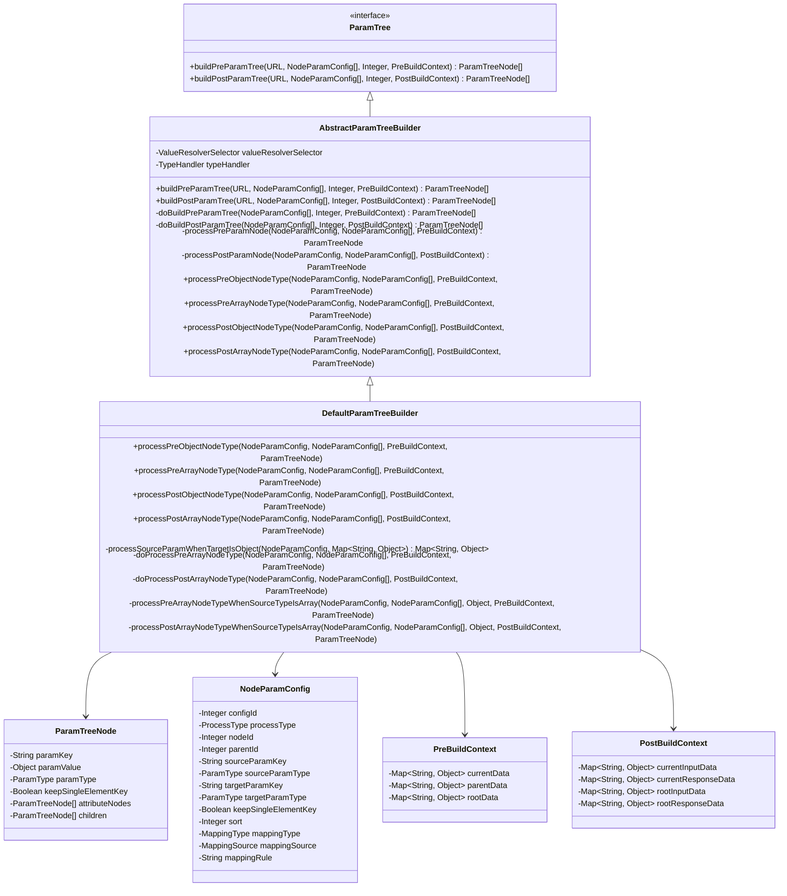
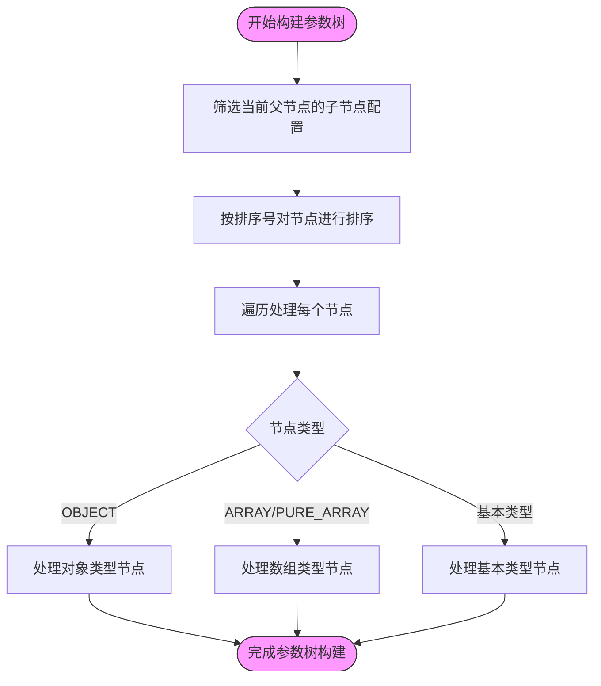
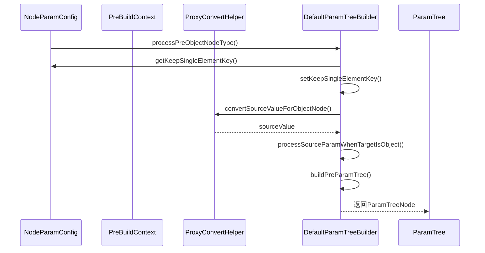
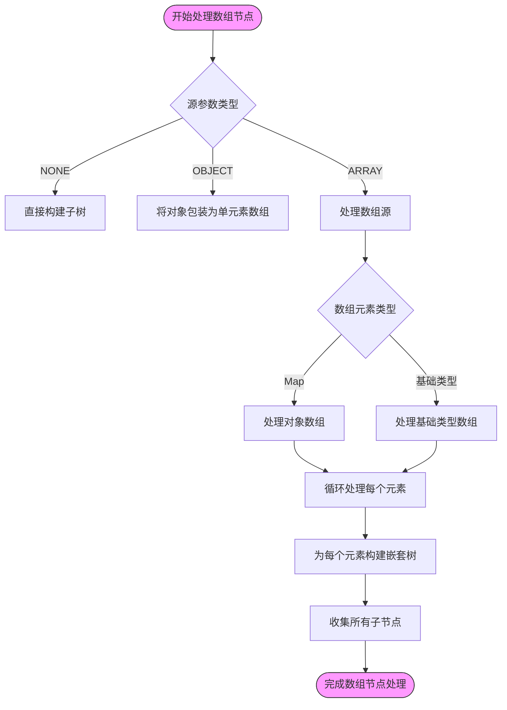
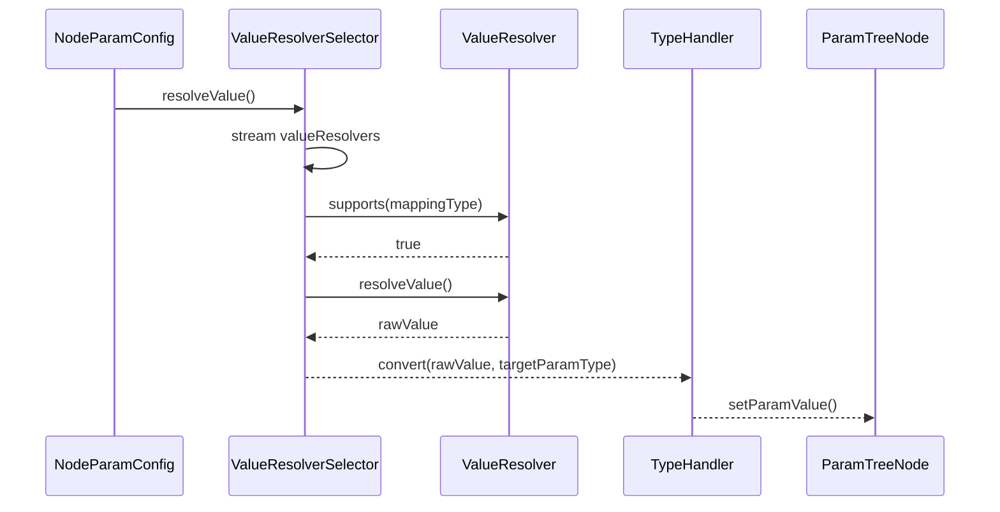
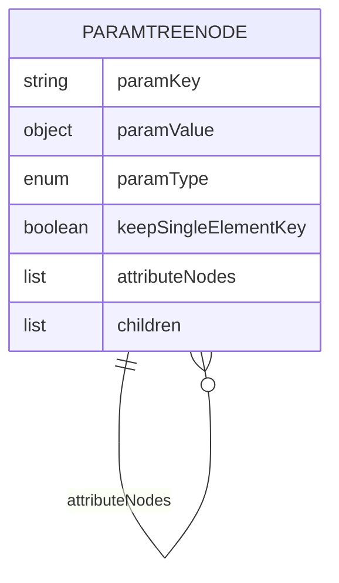
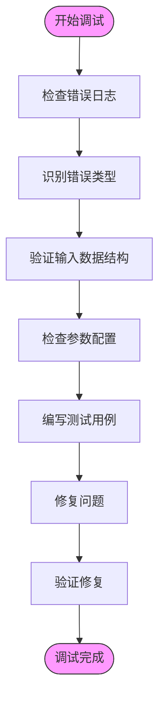

# 参数树构建机制

<cite>
**本文档引用的文件**
- [ParamTree.java](file://agent-invocation/src/main/java/com/helianhealth/agent/invocation/remote/ParamTree.java)
- [DefaultParamTreeBuilder.java](file://agent-invocation/src/main/java/com/helianhealth/agent/invocation/remote/DefaultParamTreeBuilder.java)
- [AbstractParamTreeBuilder.java](file://agent-invocation/src/main/java/com/helianhealth/agent/invocation/remote/AbstractParamTreeBuilder.java)
- [ParamTreeNode.java](file://agent-invocation/src/main/java/com/helianhealth/agent/invocation/remote/model/ParamTreeNode.java)
- [NodeParamConfig.java](file://agent-invocation/src/main/java/com/helianhealth/agent/invocation/remote/model/NodeParamConfig.java)
- [PreBuildContext.java](file://agent-invocation/src/main/java/com/helianhealth/agent/invocation/remote/model/PreBuildContext.java)
- [PostBuildContext.java](file://agent-invocation/src/main/java/com/helianhealth/agent/invocation/remote/model/PostBuildContext.java)
- [BasicTypeConversionHandler.java](file://agent-invocation/src/main/java/com/helianhealth/agent/invocation/remote/support/BasicTypeConversionHandler.java)
- [ValueResolverSelector.java](file://agent-invocation/src/main/java/com/helianhealth/agent/invocation/remote/resolver/ValueResolverSelector.java)
</cite>

## 目录
1. [引言](#引言)
2. [核心组件分析](#核心组件分析)
3. [参数树构建流程](#参数树构建流程)
4. [节点类型处理机制](#节点类型处理机制)
5. [上下文数据模型](#上下文数据模型)
6. [多叉树结构与数据映射](#多叉树结构与数据映射)
7. [构建失败原因分析与调试建议](#构建失败原因分析与调试建议)
8. [总结](#总结)

## 引言
参数树构建机制是接口代理系统中实现参数映射与转换的核心模块。该机制通过`ParamTree`接口和`DefaultParamTreeBuilder`实现类，将配置化的参数映射规则转换为实际的参数树结构，支持调用前（pre-process）和调用后（post-process）两个阶段的参数转换。本文档深入解析该机制的设计原理与实现逻辑。

## 核心组件分析

参数树构建体系由多个核心组件构成，形成清晰的职责分离架构。`ParamTree`作为SPI接口定义了参数树构建的基本契约，`AbstractParamTreeBuilder`提供通用构建流程的抽象实现，而`DefaultParamTreeBuilder`则实现了具体的节点处理逻辑。



**图示来源**
- [ParamTree.java](file://agent-invocation/src/main/java/com/helianhealth/agent/invocation/remote/ParamTree.java#L18-L47)
- [AbstractParamTreeBuilder.java](file://agent-invocation/src/main/java/com/helianhealth/agent/invocation/remote/AbstractParamTreeBuilder.java#L26-L218)
- [DefaultParamTreeBuilder.java](file://agent-invocation/src/main/java/com/helianhealth/agent/invocation/remote/DefaultParamTreeBuilder.java#L19-L276)
- [ParamTreeNode.java](file://agent-invocation/src/main/java/com/helianhealth/agent/invocation/remote/model/ParamTreeNode.java#L15-L48)
- [NodeParamConfig.java](file://agent-invocation/src/main/java/com/helianhealth/agent/invocation/remote/model/NodeParamConfig.java#L20-L96)
- [PreBuildContext.java](file://agent-invocation/src/main/java/com/helianhealth/agent/invocation/remote/model/PreBuildContext.java#L14-L31)
- [PostBuildContext.java](file://agent-invocation/src/main/java/com/helianhealth/agent/invocation/remote/model/PostBuildContext.java#L14-L36)

**本节来源**
- [ParamTree.java](file://agent-invocation/src/main/java/com/helianhealth/agent/invocation/remote/ParamTree.java)
- [DefaultParamTreeBuilder.java](file://agent-invocation/src/main/java/com/helianhealth/agent/invocation/remote/DefaultParamTreeBuilder.java)
- [AbstractParamTreeBuilder.java](file://agent-invocation/src/main/java/com/helianhealth/agent/invocation/remote/AbstractParamTreeBuilder.java)

## 参数树构建流程

参数树构建采用递归和流式处理相结合的机制，通过`buildPreParamTree`和`buildPostParamTree`方法分别构建调用前后的参数树结构。构建流程遵循统一的模式：首先筛选当前父节点的子节点配置，然后按排序顺序处理每个节点。



**图示来源**
- [AbstractParamTreeBuilder.java](file://agent-invocation/src/main/java/com/helianhealth/agent/invocation/remote/AbstractParamTreeBuilder.java#L58-L78)
- [AbstractParamTreeBuilder.java](file://agent-invocation/src/main/java/com/helianhealth/agent/invocation/remote/AbstractParamTreeBuilder.java#L154-L176)

**本节来源**
- [AbstractParamTreeBuilder.java](file://agent-invocation/src/main/java/com/helianhealth/agent/invocation/remote/AbstractParamTreeBuilder.java)

## 节点类型处理机制

### 对象类型节点处理

对于`OBJECT`类型的节点，系统通过`processPreObjectNodeType`和`processPostObjectNodeType`方法进行处理。核心逻辑包括设置`keepSingleElementKey`属性，并根据源参数类型进行数据转换。



**图示来源**
- [DefaultParamTreeBuilder.java](file://agent-invocation/src/main/java/com/helianhealth/agent/invocation/remote/DefaultParamTreeBuilder.java#L22-L35)
- [DefaultParamTreeBuilder.java](file://agent-invocation/src/main/java/com/helianhealth/agent/invocation/remote/DefaultParamTreeBuilder.java#L82-L109)

**本节来源**
- [DefaultParamTreeBuilder.java](file://agent-invocation/src/main/java/com/helianhealth/agent/invocation/remote/DefaultParamTreeBuilder.java)

### 数组类型节点处理

数组类型节点的处理更为复杂，需要考虑源参数类型（`NONE`、`OBJECT`、`ARRAY`）的不同情况。`doProcessPreArrayNodeType`和`doProcessPostArrayNodeType`方法实现了核心逻辑。



**图示来源**
- [DefaultParamTreeBuilder.java](file://agent-invocation/src/main/java/com/helianhealth/agent/invocation/remote/DefaultParamTreeBuilder.java#L202-L274)
- [DefaultParamTreeBuilder.java](file://agent-invocation/src/main/java/com/helianhealth/agent/invocation/remote/DefaultParamTreeBuilder.java#L119-L199)

**本节来源**
- [DefaultParamTreeBuilder.java](file://agent-invocation/src/main/java/com/helianhealth/agent/invocation/remote/DefaultParamTreeBuilder.java)

### 基本类型节点处理

基本类型节点的处理相对简单，主要通过`ValueResolverSelector`选择合适的`ValueResolver`来解析值，然后通过`TypeHandler`进行类型转换。



**图示来源**
- [AbstractParamTreeBuilder.java](file://agent-invocation/src/main/java/com/helianhealth/agent/invocation/remote/AbstractParamTreeBuilder.java#L102-L105)
- [ValueResolverSelector.java](file://agent-invocation/src/main/java/com/helianhealth/agent/invocation/remote/resolver/ValueResolverSelector.java#L22-L31)
- [BasicTypeConversionHandler.java](file://agent-invocation/src/main/java/com/helianhealth/agent/invocation/remote/support/BasicTypeConversionHandler.java#L13-L41)

**本节来源**
- [AbstractParamTreeBuilder.java](file://agent-invocation/src/main/java/com/helianhealth/agent/invocation/remote/AbstractParamTreeBuilder.java)
- [ValueResolverSelector.java](file://agent-invocation/src/main/java/com/helianhealth/agent/invocation/remote/resolver/ValueResolverSelector.java)
- [BasicTypeConversionHandler.java](file://agent-invocation/src/main/java/com/helianhealth/agent/invocation/remote/support/BasicTypeConversionHandler.java)

## 上下文数据模型

参数树构建依赖于精心设计的上下文数据模型，这些模型封装了构建过程中所需的所有数据源。

### 前置构建上下文

`PreBuildContext`用于封装调用前参数转换所需的数据源，包含三个层次的数据：

- **当前层业务数据**：当前处理层级的业务数据
- **父层业务数据**：用于嵌套对象/数组的相对路径取值
- **根业务数据**：用于绝对路径取值，通常是最顶层的输入数据

```mermaid
classDiagram
class PreBuildContext {
-Map~String, Object~ currentData
-Map~String, Object~ parentData
-Map~String, Object~ rootData
}
note right of PreBuildContext
前置参数树构建上下文
用于封装前置参数转换所需的所有数据源
end note
```

**图示来源**
- [PreBuildContext.java](file://agent-invocation/src/main/java/com/helianhealth/agent/invocation/remote/model/PreBuildContext.java#L14-L31)

**本节来源**
- [PreBuildContext.java](file://agent-invocation/src/main/java/com/helianhealth/agent/invocation/remote/model/PreBuildContext.java)

### 后置构建上下文

`PostBuildContext`用于封装调用后参数转换所需的数据源，同时持有输入和响应两份数据：

- **当前层输入数据**：当前层级的输入数据
- **当前层响应数据**：当前层级的响应数据
- **根输入数据**：原始输入数据的根节点
- **根响应数据**：响应结果的根节点

```mermaid
classDiagram
class PostBuildContext {
-Map~String, Object~ currentInputData
-Map~String, Object~ currentResponseData
-Map~String, Object~ rootInputData
-Map~String, Object~ rootResponseData
}
note right of PostBuildContext
后置参数树构建上下文
用于封装后置参数转换所需的所有数据源输入 + 响应
end note
```

**图示来源**
- [PostBuildContext.java](file://agent-invocation/src/main/java/com/helianhealth/agent/invocation/remote/model/PostBuildContext.java#L14-L36)

**本节来源**
- [PostBuildContext.java](file://agent-invocation/src/main/java/com/helianhealth/agent/invocation/remote/model/PostBuildContext.java)

## 多叉树结构与数据映射

### ParamTreeNode结构解析

`ParamTreeNode`作为多叉树节点，是参数树的基本组成单元，其结构设计充分考虑了XML/JSON数据结构的映射需求：

- **paramKey**：参数键名，对应JSON的key或XML的元素名
- **paramValue**：参数值，存储基本类型的值
- **paramType**：节点类型，区分`OBJECT`、`ARRAY`、基本类型等
- **keepSingleElementKey**：控制单个元素是否保留key，用于处理XML兼容性
- **attributeNodes**：XML属性节点列表，专门处理XML的属性
- **children**：子节点列表，实现树形结构



**图示来源**
- [ParamTreeNode.java](file://agent-invocation/src/main/java/com/helianhealth/agent/invocation/remote/model/ParamTreeNode.java#L15-L48)

**本节来源**
- [ParamTreeNode.java](file://agent-invocation/src/main/java/com/helianhealth/agent/invocation/remote/model/ParamTreeNode.java)

### 实际应用场景

#### keepSingleElementKey字段

`keepSingleElementKey`字段用于处理对象元素为单个时是否保留key的场景。在XML与JSON互转时，当数组只有一个元素时，XML可能需要保留元素的key，而JSON则不需要。该字段提供了灵活的控制能力。

#### attributeNodes字段

`attributeNodes`字段专门用于处理XML的属性节点。在XML中，元素可以同时拥有子元素和属性，而JSON中没有直接对应的概念。通过将XML属性映射为特殊的子节点，实现了XML/JSON之间的无缝转换。

## 构建失败原因分析与调试建议

### 常见构建失败原因

1. **源值为空**：当源参数类型为`ARRAY`时，源值为空会抛出`IllegalArgumentException`
2. **类型不匹配**：期望`List`类型但得到其他类型，或数组第一个元素不是`Map`类型
3. **配置缺失**：必要的配置项如`sourceParamKey`、`targetParamKey`等未设置
4. **映射规则错误**：`mappingRule`配置错误导致值解析失败

### 调试建议

1. **检查日志输出**：系统在构建失败时会记录详细的错误日志，应首先查看日志信息
2. **验证数据源**：确保输入数据的结构与配置的映射规则相匹配
3. **逐步调试**：从根节点开始，逐层检查每个节点的构建过程
4. **使用测试用例**：编写单元测试验证各种边界情况的处理



**本节来源**
- [DefaultParamTreeBuilder.java](file://agent-invocation/src/main/java/com/helianhealth/agent/invocation/remote/DefaultParamTreeBuilder.java)
- [AbstractParamTreeBuilder.java](file://agent-invocation/src/main/java/com/helianhealth/agent/invocation/remote/AbstractParamTreeBuilder.java)

## 总结

参数树构建机制通过`ParamTree`接口和`DefaultParamTreeBuilder`实现类，提供了一套完整的参数映射与转换解决方案。该机制采用递归和流式处理相结合的方式，支持调用前后的参数转换，能够处理`OBJECT`、`ARRAY`和基本类型等各种节点。通过精心设计的上下文数据模型和多叉树结构，实现了XML/JSON数据结构的灵活映射。系统还提供了详细的错误处理和调试支持，确保了参数转换的可靠性和可维护性。