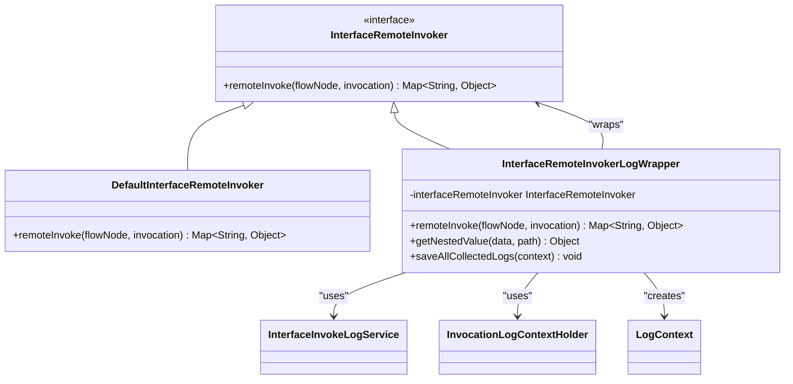
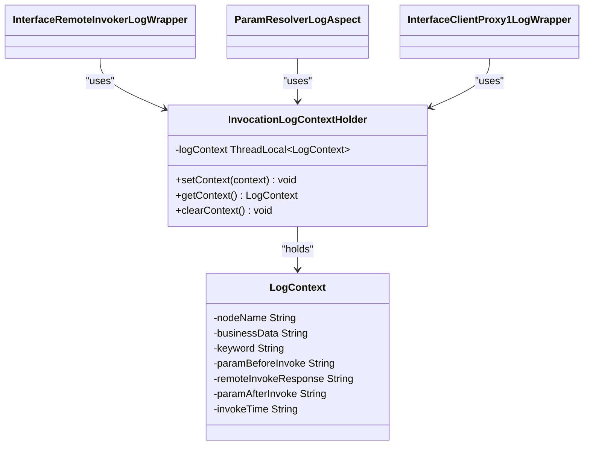
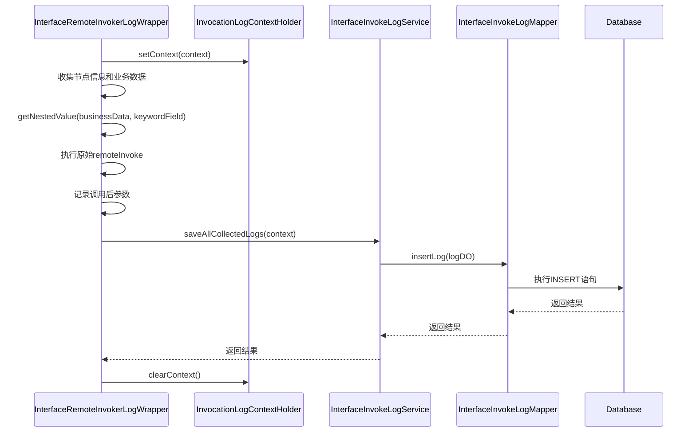
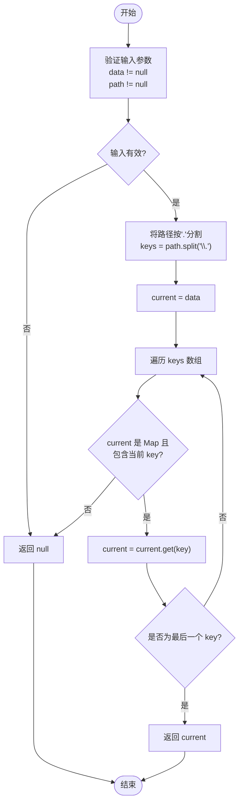
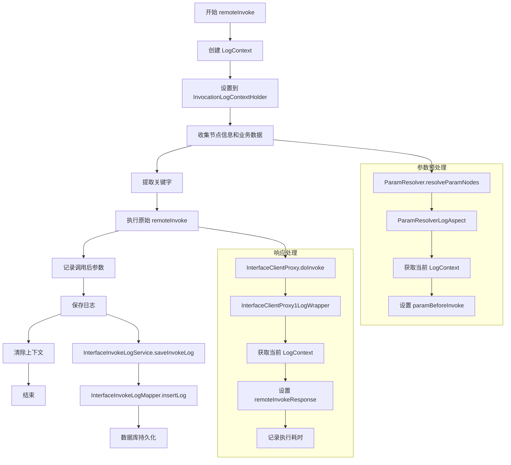

# 增强机制

<cite>
**本文档引用的文件**
- [InterfaceRemoteInvokerLogWrapper.java](file://agent-invocation/src/main/java/com/helianhealth/agent/invocation/remote/wrapper/InterfaceRemoteInvokerLogWrapper.java)
- [InvocationLogContextHolder.java](file://agent-invocation/src/main/java/com/helianhealth/agent/invocation/context/InvocationLogContextHolder.java)
- [LogContext.java](file://agent-invocation/src/main/java/com/helianhealth/agent/invocation/context/LogContext.java)
- [InterfaceInvokeLogService.java](file://agent-log/src/main/java/com/helianhealth/agent/log/service/InterfaceInvokeLogService.java)
- [InterfaceInvokeLogServiceImpl.java](file://agent-log/src/main/java/com/helianhealth/agent/log/service/impl/InterfaceInvokeLogServiceImpl.java)
- [ParamResolverLogAspect.java](file://agent-invocation/src/main/java/com/helianhealth/agent/invocation/aspect/ParamResolverLogAspect.java)
- [InterfaceWorkflowNode.java](file://agent-invocation/src/main/java/com/helianhealth/agent/invocation/remote/model/InterfaceWorkflowNode.java)
- [Invocation.java](file://agent-invocation/src/main/java/com/helianhealth/agent/invocation/remote/model/Invocation.java)
- [InterfaceInvokeLogDO.java](file://agent-log/src/main/java/com/helianhealth/agent/log/model/InterfaceInvokeLogDO.java)
</cite>

## 目录
1. [调用链增强机制概述](#调用链增强机制概述)
2. [装饰器模式实现：InterfaceRemoteInvokerLogWrapper](#装饰器模式实现interfaceremoteinvokerlogwrapper)
3. [上下文传递机制：InvocationLogContextHolder](#上下文传递机制invocationlogcontextholder)
4. [日志数据收集与持久化](#日志数据收集与持久化)
5. [嵌套路径解析技术](#嵌套路径解析技术)
6. [调用链增强机制整体流程](#调用链增强机制整体流程)
7. [内存泄漏防护机制](#内存泄漏防护机制)

## 调用链增强机制概述

该调用链增强机制通过装饰器模式和ThreadLocal上下文传递技术，实现了对远程接口调用过程的透明日志记录。系统在不修改原始业务逻辑的前提下，通过包装器动态注入日志收集功能，确保调用链路中的关键信息能够被完整捕获并持久化存储。

**Section sources**
- [InterfaceRemoteInvokerLogWrapper.java](file://agent-invocation/src/main/java/com/helianhealth/agent/invocation/remote/wrapper/InterfaceRemoteInvokerLogWrapper.java#L1-L124)
- [InvocationLogContextHolder.java](file://agent-invocation/src/main/java/com/helianhealth/agent/invocation/context/InvocationLogContextHolder.java#L1-L33)

## 装饰器模式实现：InterfaceRemoteInvokerLogWrapper

`InterfaceRemoteInvokerLogWrapper`类作为装饰器模式的具体实现，包装了原始的`InterfaceRemoteInvoker`实例。该装饰器在调用前后注入日志记录逻辑，实现了对远程调用过程的透明监控。

装饰器通过构造函数接收被包装的`InterfaceRemoteInvoker`实例，并在`remoteInvoke`方法中执行以下流程：
1. 创建`LogContext`对象并设置到`InvocationLogContextHolder`
2. 收集节点名称、业务数据、关键字等信息
3. 调用原始`remoteInvoke`方法执行业务逻辑
4. 记录调用结果参数
5. 在finally块中统一保存日志并清理上下文

**Diagram sources**
- [InterfaceRemoteInvokerLogWrapper.java](file://agent-invocation/src/main/java/com/helianhealth/agent/invocation/remote/wrapper/InterfaceRemoteInvokerLogWrapper.java#L16-L71)
- [InterfaceRemoteInvoker.java](file://agent-invocation/src/main/java/com/helianhealth/agent/invocation/remote/InterfaceRemoteInvoker.java#L15-L25)

**Section sources**
- [InterfaceRemoteInvokerLogWrapper.java](file://agent-invocation/src/main/java/com/helianhealth/agent/invocation/remote/wrapper/InterfaceRemoteInvokerLogWrapper.java#L16-L71)

## 上下文传递机制：InvocationLogContextHolder

`InvocationLogContextHolder`利用ThreadLocal机制在单线程调用链中传递`LogContext`上下文，避免了跨方法传递参数的繁琐。由于`remoteInvoke`为单线程处理，ThreadLocal是安全且高效的上下文传递方式。

该上下文管理器提供了三个核心方法：
- `setContext`: 设置当前线程的`LogContext`
- `getContext`: 获取当前线程的`LogContext`
- `clearContext`: 清除当前线程的`LogContext`，防止内存泄漏

**Diagram sources**
- [InvocationLogContextHolder.java](file://agent-invocation/src/main/java/com/helianhealth/agent/invocation/context/InvocationLogContextHolder.java#L8-L32)
- [LogContext.java](file://agent-invocation/src/main/java/com/helianhealth/agent/invocation/context/LogContext.java#L10-L46)

**Section sources**
- [InvocationLogContextHolder.java](file://agent-invocation/src/main/java/com/helianhealth/agent/invocation/context/InvocationLogContextHolder.java#L8-L32)
- [LogContext.java](file://agent-invocation/src/main/java/com/helianhealth/agent/invocation/context/LogContext.java#L10-L46)

## 日志数据收集与持久化

日志数据的收集与持久化流程涉及多个组件的协同工作。`LogContext`对象负责收集调用链中的关键信息，包括节点名称、业务数据、关键字、调用前后参数等，最终通过`InterfaceInvokeLogService`持久化到数据库。

### 数据收集流程
1. **节点信息收集**: 从`InterfaceWorkflowNode`获取节点名称和关键字字段配置
2. **业务数据提取**: 从`Invocation`中获取业务数据并转换为JSON字符串
3. **关键字提取**: 使用`getNestedValue`方法从嵌套的业务数据中提取关键字
4. **参数记录**: 记录调用前后的参数状态

### 持久化机制
`InterfaceInvokeLogService`接口定义了日志保存方法，其具体实现`InterfaceInvokeLogServiceImpl`将日志数据插入到`interface_invoke_log`表中。

**Diagram sources**
- [InterfaceRemoteInvokerLogWrapper.java](file://agent-invocation/src/main/java/com/helianhealth/agent/invocation/remote/wrapper/InterfaceRemoteInvokerLogWrapper.java#L30-L70)
- [InterfaceInvokeLogService.java](file://agent-log/src/main/java/com/helianhealth/agent/log/service/InterfaceInvokeLogService.java#L6-L42)
- [InterfaceInvokeLogServiceImpl.java](file://agent-log/src/main/java/com/helianhealth/agent/log/service/impl/InterfaceInvokeLogServiceImpl.java#L19-L68)

**Section sources**
- [InterfaceRemoteInvokerLogWrapper.java](file://agent-invocation/src/main/java/com/helianhealth/agent/invocation/remote/wrapper/InterfaceRemoteInvokerLogWrapper.java#L30-L70)
- [InterfaceInvokeLogService.java](file://agent-log/src/main/java/com/helianhealth/agent/log/service/InterfaceInvokeLogService.java#L6-L42)
- [InterfaceInvokeLogServiceImpl.java](file://agent-log/src/main/java/com/helianhealth/agent/log/service/impl/InterfaceInvokeLogServiceImpl.java#L19-L68)

## 嵌套路径解析技术

`getNestedValue`方法实现了对嵌套Map结构的递归访问，支持通过点号(.)分隔的路径表达式（如"patient.info.code"）来提取深层嵌套的数据值。

该方法的实现逻辑如下：
1. 检查输入参数的有效性
2. 将路径字符串按点号分割成多个键
3. 从根数据Map开始，逐级向下查找
4. 如果任何一级查找失败（非Map类型或键不存在），则返回null
5. 成功到达路径末端时返回最终的值

**Diagram sources**
- [InterfaceRemoteInvokerLogWrapper.java](file://agent-invocation/src/main/java/com/helianhealth/agent/invocation/remote/wrapper/InterfaceRemoteInvokerLogWrapper.java#L82-L102)

**Section sources**
- [InterfaceRemoteInvokerLogWrapper.java](file://agent-invocation/src/main/java/com/helianhealth/agent/invocation/remote/wrapper/InterfaceRemoteInvokerLogWrapper.java#L82-L102)

## 调用链增强机制整体流程

调用链增强机制的整体流程涉及多个组件的协同工作，形成了一个完整的日志记录闭环。

**Diagram sources**
- [InterfaceRemoteInvokerLogWrapper.java](file://agent-invocation/src/main/java/com/helianhealth/agent/invocation/remote/wrapper/InterfaceRemoteInvokerLogWrapper.java#L30-L70)
- [ParamResolverLogAspect.java](file://agent-invocation/src/main/java/com/helianhealth/agent/invocation/aspect/ParamResolverLogAspect.java#L17-L37)
- [InterfaceClientProxy1LogWrapper.java](file://agent-invocation/src/main/java/com/helianhealth/agent/invocation/remote/wrapper/InterfaceClientProxy1LogWrapper.java#L13-L43)

**Section sources**
- [InterfaceRemoteInvokerLogWrapper.java](file://agent-invocation/src/main/java/com/helianhealth/agent/invocation/remote/wrapper/InterfaceRemoteInvokerLogWrapper.java#L30-L70)
- [ParamResolverLogAspect.java](file://agent-invocation/src/main/java/com/helianhealth/agent/invocation/aspect/ParamResolverLogAspect.java#L17-L37)
- [InterfaceClientProxy1LogWrapper.java](file://agent-invocation/src/main/java/com/helianhealth/agent/invocation/remote/wrapper/InterfaceClientProxy1LogWrapper.java#L13-L43)

## 内存泄漏防护机制

系统通过在finally块中调用`InvocationLogContextHolder.clearContext()`来防止ThreadLocal导致的内存泄漏。这是至关重要的防护措施，因为：

1. **ThreadLocal特性**: ThreadLocal变量与线程生命周期绑定，如果不清除，可能导致线程池中的线程持有过期的上下文对象
2. **finally块保证**: 无论方法正常结束还是抛出异常，finally块中的清理代码都会执行
3. **资源释放**: 及时释放LogContext对象，避免内存占用持续增长

该机制确保了每个调用完成后，其上下文信息都会被彻底清理，维护了系统的稳定性和资源效率。

**Section sources**
- [InterfaceRemoteInvokerLogWrapper.java](file://agent-invocation/src/main/java/com/helianhealth/agent/invocation/remote/wrapper/InterfaceRemoteInvokerLogWrapper.java#L67-L69)
- [InvocationLogContextHolder.java](file://agent-invocation/src/main/java/com/helianhealth/agent/invocation/context/InvocationLogContextHolder.java#L29-L31)