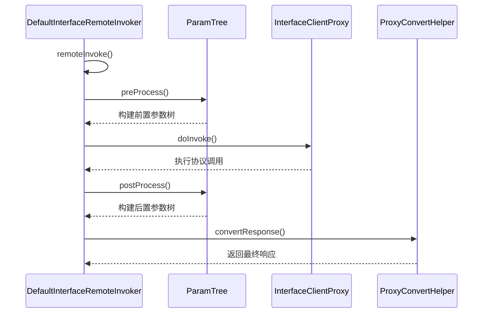
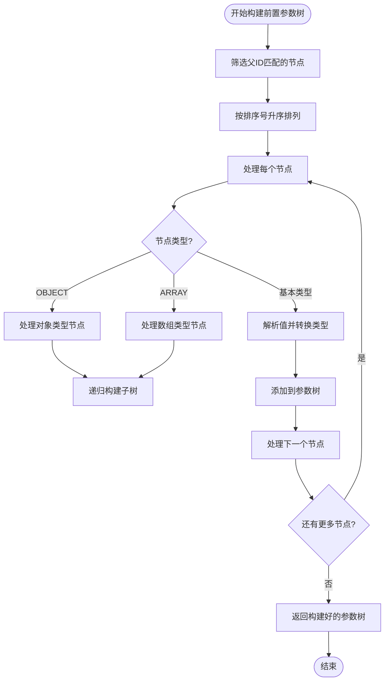
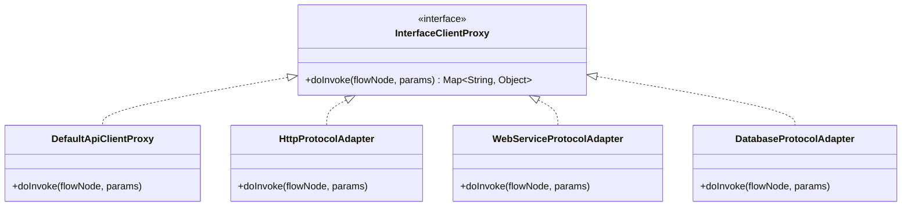
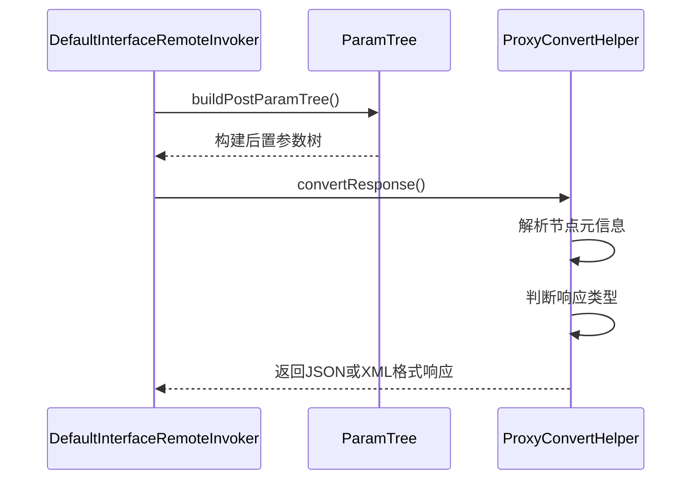
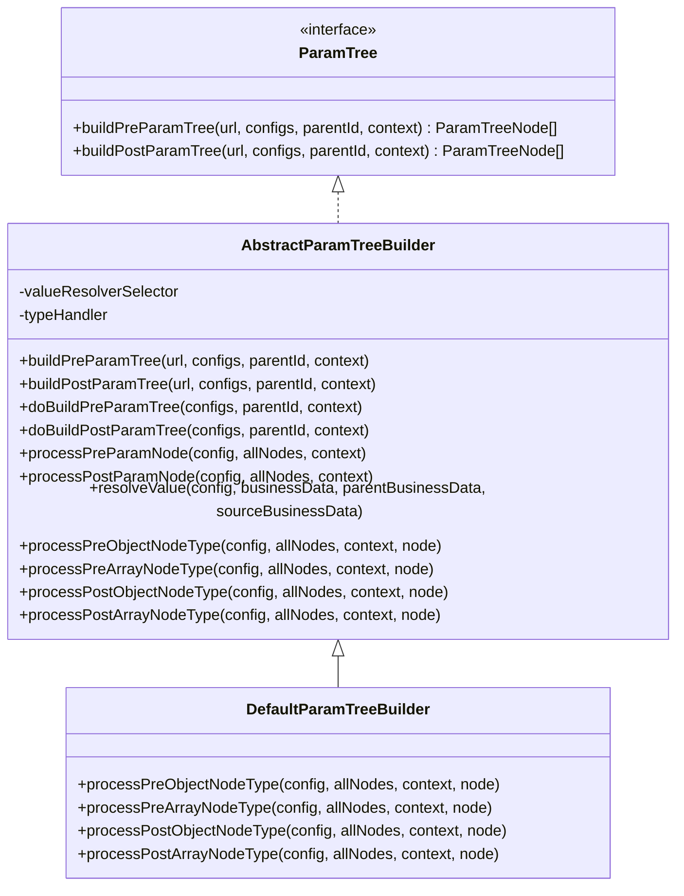
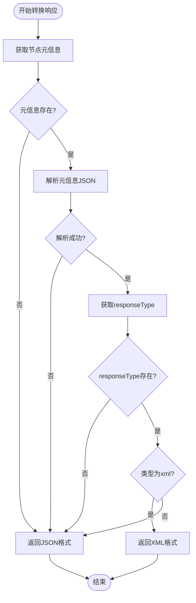
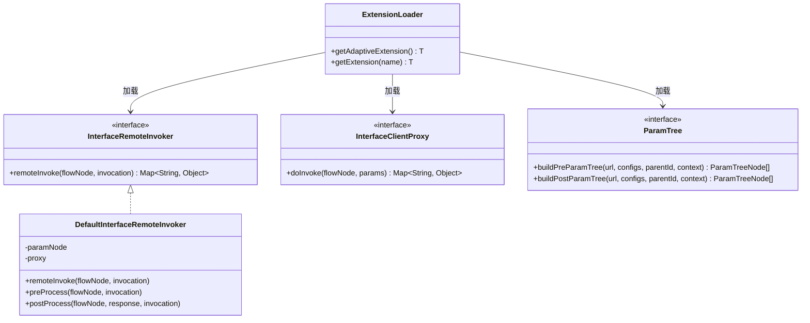

# 核心执行流程

<cite>
**本文档引用的文件**
- [DefaultInterfaceRemoteInvoker.java](file://agent-invocation/src/main/java/com/helianhealth/agent/invocation/remote/DefaultInterfaceRemoteInvoker.java)
- [InterfaceClientProxy.java](file://agent-invocation/src/main/java/com/helianhealth/agent/invocation/remote/InterfaceClientProxy.java)
- [ProxyConvertHelper.java](file://agent-invocation/src/main/java/com/helianhealth/agent/invocation/remote/ProxyConvertHelper.java)
- [ParamTree.java](file://agent-invocation/src/main/java/com/helianhealth/agent/invocation/remote/ParamTree.java)
- [DefaultParamTreeBuilder.java](file://agent-invocation/src/main/java/com/helianhealth/agent/invocation/remote/DefaultParamTreeBuilder.java)
- [AbstractParamTreeBuilder.java](file://agent-invocation/src/main/java/com/helianhealth/agent/invocation/remote/AbstractParamTreeBuilder.java)
- [ParamTreeNode.java](file://agent-invocation/src/main/java/com/helianhealth/agent/invocation/remote/model/ParamTreeNode.java)
- [NodeParamConfig.java](file://agent-invocation/src/main/java/com/helianhealth/agent/invocation/remote/model/NodeParamConfig.java)
- [ParamNodeUtils.java](file://agent-invocation/src/main/java/com/helianhealth/agent/invocation/utils/ParamNodeUtils.java)
- [BasicTypeConversionHandler.java](file://agent-invocation/src/main/java/com/helianhealth/agent/invocation/remote/support/BasicTypeConversionHandler.java)
- [com.helianhealth.agent.invocation.remote.InterfaceClientProxy](file://agent-invocation/src/main/resources/META-INF/dubbo/com.helianhealth.agent.invocation.remote.InterfaceClientProxy)
- [com.helianhealth.agent.invocation.remote.ParamTree](file://agent-invocation/src/main/resources/META-INF/dubbo/com.helianhealth.agent.invocation.remote.ParamTree)
- [com.helianhealth.agent.invocation.remote.InterfaceRemoteInvoker](file://agent-invocation/src/main/resources/META-INF/dubbo/com.helianhealth.agent.invocation.remote.InterfaceRemoteInvoker)
</cite>

## 目录
1. [三段式调用流程概述](#三段式调用流程概述)
2. [前置参数树构建](#前置参数树构建)
3. [协议调用执行](#协议调用执行)
4. [响应转换处理](#响应转换处理)
5. [参数映射树构建机制](#参数映射树构建机制)
6. [响应格式动态决定](#响应格式动态决定)
7. [可插拔扩展机制](#可插拔扩展机制)

## 三段式调用流程概述

`DefaultInterfaceRemoteInvoker` 类实现了接口调用的三段式核心流程，该流程分为三个阶段：前置处理（preProcess）、协议调用（doInvoke）和后置处理（postProcess）。整个流程通过 `remoteInvoke` 方法协调执行，确保了调用过程的模块化和可扩展性。



**图示来源**
- [DefaultInterfaceRemoteInvoker.java](file://agent-invocation/src/main/java/com/helianhealth/agent/invocation/remote/DefaultInterfaceRemoteInvoker.java#L24-L32)

**本节来源**
- [DefaultInterfaceRemoteInvoker.java](file://agent-invocation/src/main/java/com/helianhealth/agent/invocation/remote/DefaultInterfaceRemoteInvoker.java#L16-L33)

## 前置参数树构建

前置处理阶段通过 `preProcess` 方法构建调用前的参数映射树。该方法首先从调用上下文 `Invocation` 中获取前置参数配置列表，然后使用 `ParamTree` 的 `buildPreParamTree` 方法根据节点配置和业务数据构建参数树。

前置参数树的构建上下文（`PreBuildContext`）封装了当前数据、父级数据和根级数据，为参数解析提供了完整的数据源视图。构建过程从根节点开始，递归筛选子节点并按配置顺序排序，确保参数结构的正确性。



**图示来源**
- [AbstractParamTreeBuilder.java](file://agent-invocation/src/main/java/com/helianhealth/agent/invocation/remote/AbstractParamTreeBuilder.java#L58-L78)
- [DefaultParamTreeBuilder.java](file://agent-invocation/src/main/java/com/helianhealth/agent/invocation/remote/DefaultParamTreeBuilder.java#L21-L70)

**本节来源**
- [DefaultInterfaceRemoteInvoker.java](file://agent-invocation/src/main/java/com/helianhealth/agent/invocation/remote/DefaultInterfaceRemoteInvoker.java#L43-L56)
- [AbstractParamTreeBuilder.java](file://agent-invocation/src/main/java/com/helianhealth/agent/invocation/remote/AbstractParamTreeBuilder.java#L34-L57)

## 协议调用执行

协议调用阶段通过 `InterfaceClientProxy` 接口的 `doInvoke` 方法执行实际的远程调用。该接口使用 Dubbo SPI 机制实现自适应扩展，能够根据配置动态选择合适的协议适配器。

`InterfaceClientProxy` 是一个 SPI 接口，通过 `@Adaptive("proxy")` 注解实现自适应扩展。在 `DefaultInterfaceRemoteInvoker` 中，通过 `ExtensionLoader` 获取自适应扩展实例，从而实现协议的动态切换。



**图示来源**
- [InterfaceClientProxy.java](file://agent-invocation/src/main/java/com/helianhealth/agent/invocation/remote/InterfaceClientProxy.java#L15-L20)
- [com.helianhealth.agent.invocation.remote.InterfaceClientProxy](file://agent-invocation/src/main/resources/META-INF/dubbo/com.helianhealth.agent.invocation.remote.InterfaceClientProxy)

**本节来源**
- [DefaultInterfaceRemoteInvoker.java](file://agent-invocation/src/main/java/com/helianhealth/agent/invocation/remote/DefaultInterfaceRemoteInvoker.java#L29)
- [InterfaceClientProxy.java](file://agent-invocation/src/main/java/com/helianhealth/agent/invocation/remote/InterfaceClientProxy.java#L15-L20)

## 响应转换处理

后置处理阶段通过 `postProcess` 方法处理调用响应。该方法首先从调用上下文中获取后置参数配置，然后使用 `ParamTree` 的 `buildPostParamTree` 方法构建响应参数树，最后通过 `ProxyConvertHelper` 将参数树转换为最终的响应格式。

与前置处理不同，后置处理的上下文（`PostBuildContext`）同时持有输入数据和响应数据，这使得后置参数配置可以灵活地从输入或响应中映射数据。



**图示来源**
- [DefaultInterfaceRemoteInvoker.java](file://agent-invocation/src/main/java/com/helianhealth/agent/invocation/remote/DefaultInterfaceRemoteInvoker.java#L65-L82)
- [ProxyConvertHelper.java](file://agent-invocation/src/main/java/com/helianhealth/agent/invocation/remote/ProxyConvertHelper.java#L20-L45)

**本节来源**
- [DefaultInterfaceRemoteInvoker.java](file://agent-invocation/src/main/java/com/helianhealth/agent/invocation/remote/DefaultInterfaceRemoteInvoker.java#L65-L82)

## 参数映射树构建机制

参数映射树的构建由 `ParamTree` 接口定义，`DefaultParamTreeBuilder` 提供默认实现。构建过程分为前置和后置两种场景，分别对应 `buildPreParamTree` 和 `buildPostParamTree` 方法。

### 前置与后置参数树构建差异

| 特性 | buildPreParamTree | buildPostParamTree |
|------|-------------------|--------------------|
| 上下文数据源 | 仅业务数据 | 输入数据和响应数据 |
| 映射来源 | 固定从输入数据映射 | 可配置从输入或响应数据映射 |
| 主要用途 | 构建请求参数 | 构建响应结果 |
| 数据流向 | 业务数据 → 外部接口 | 外部接口响应 → 业务系统 |

前置参数树构建主要处理请求参数的组装，从当前业务数据中提取值并转换为目标格式。后置参数树构建则更复杂，需要处理响应数据的提取和转换，支持从输入或响应中选择数据源。



**图示来源**
- [ParamTree.java](file://agent-invocation/src/main/java/com/helianhealth/agent/invocation/remote/ParamTree.java#L18-L47)
- [AbstractParamTreeBuilder.java](file://agent-invocation/src/main/java/com/helianhealth/agent/invocation/remote/AbstractParamTreeBuilder.java#L26-L217)
- [DefaultParamTreeBuilder.java](file://agent-invocation/src/main/java/com/helianhealth/agent/invocation/remote/DefaultParamTreeBuilder.java#L19-L275)

**本节来源**
- [ParamTree.java](file://agent-invocation/src/main/java/com/helianhealth/agent/invocation/remote/ParamTree.java#L18-L47)
- [AbstractParamTreeBuilder.java](file://agent-invocation/src/main/java/com/helianhealth/agent/invocation/remote/AbstractParamTreeBuilder.java#L26-L217)
- [DefaultParamTreeBuilder.java](file://agent-invocation/src/main/java/com/helianhealth/agent/invocation/remote/DefaultParamTreeBuilder.java#L19-L275)

## 响应格式动态决定

`ProxyConvertHelper` 类负责根据节点元信息（metaInfo）动态决定响应格式。该类通过解析节点的元信息JSON，获取 `responseType` 配置项，从而决定返回JSON还是XML格式。

当节点元信息中未指定 `responseType` 或解析失败时，默认返回JSON格式。这种设计确保了系统的健壮性，即使配置不完整也能正常工作。



**图示来源**
- [ProxyConvertHelper.java](file://agent-invocation/src/main/java/com/helianhealth/agent/invocation/remote/ProxyConvertHelper.java#L20-L45)
- [ParamNodeUtils.java](file://agent-invocation/src/main/java/com/helianhealth/agent/invocation/utils/ParamNodeUtils.java#L264-L280)

**本节来源**
- [ProxyConvertHelper.java](file://agent-invocation/src/main/java/com/helianhealth/agent/invocation/remote/ProxyConvertHelper.java#L20-L45)

## 可插拔扩展机制

系统通过 Dubbo SPI 机制实现调用链的可插拔性。`ExtensionLoader` 是 Dubbo 提供的扩展加载器，能够根据配置文件动态加载和实例化扩展实现。

### SPI 配置示例

#### InterfaceClientProxy 配置
```
com.helianhealth.agent.invocation.remote.wrapper.InterfaceClientProxyLogWrapper
com.helianhealth.agent.invocation.remote.wrapper.InterfaceClientProxyFilterChainWrapper
default=com.helianhealth.agent.invocation.remote.DefaultApiClientProxy
http=com.helianhealth.agent.invocation.remote.http.HttpProtocolAdapter
webservice=com.helianhealth.agent.invocation.remote.webService.WebServiceProtocolAdapter
database=com.helianhealth.agent.invocation.remote.database.DatabaseProtocolAdapter
```

#### ParamTree 配置
```
default=com.helianhealth.agent.invocation.remote.DefaultParamTreeBuilder
```

#### InterfaceRemoteInvoker 配置
```
com.helianhealth.agent.invocation.remote.wrapper.InterfaceRemoteInvokerLogWrapper
default=com.helianhealth.agent.invocation.remote.DefaultInterfaceRemoteInvoker
```

这些配置文件位于 `META-INF/dubbo/` 目录下，定义了各个接口的可用扩展实现。通过 `@SPI("default")` 注解指定默认实现，通过 `@Adaptive` 注解实现自适应扩展。



**图示来源**
- [DefaultInterfaceRemoteInvoker.java](file://agent-invocation/src/main/java/com/helianhealth/agent/invocation/remote/DefaultInterfaceRemoteInvoker.java#L18-L20)
- [com.helianhealth.agent.invocation.remote.InterfaceClientProxy](file://agent-invocation/src/main/resources/META-INF/dubbo/com.helianhealth.agent.invocation.remote.InterfaceClientProxy)
- [com.helianhealth.agent.invocation.remote.ParamTree](file://agent-invocation/src/main/resources/META-INF/dubbo/com.helianhealth.agent.invocation.remote.ParamTree)
- [com.helianhealth.agent.invocation.remote.InterfaceRemoteInvoker](file://agent-invocation/src/main/resources/META-INF/dubbo/com.helianhealth.agent.invocation.remote.InterfaceRemoteInvoker)

**本节来源**
- [DefaultInterfaceRemoteInvoker.java](file://agent-invocation/src/main/java/com/helianhealth/agent/invocation/remote/DefaultInterfaceRemoteInvoker.java#L18-L20)
- [com.helianhealth.agent.invocation.remote.InterfaceClientProxy](file://agent-invocation/src/main/resources/META-INF/dubbo/com.helianhealth.agent.invocation.remote.InterfaceClientProxy)
- [com.helianhealth.agent.invocation.remote.ParamTree](file://agent-invocation/src/main/resources/META-INF/dubbo/com.helianhealth.agent.invocation.remote.ParamTree)
- [com.helianhealth.agent.invocation.remote.InterfaceRemoteInvoker](file://agent-invocation/src/main/resources/META-INF/dubbo/com.helianhealth.agent.invocation.remote.InterfaceRemoteInvoker)
