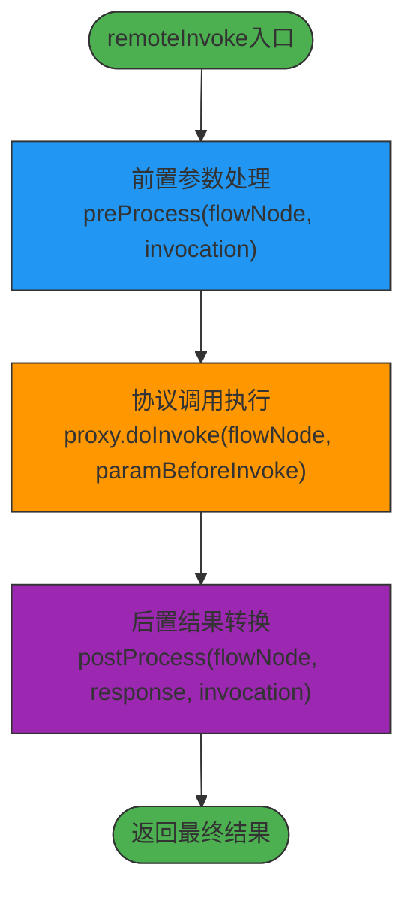
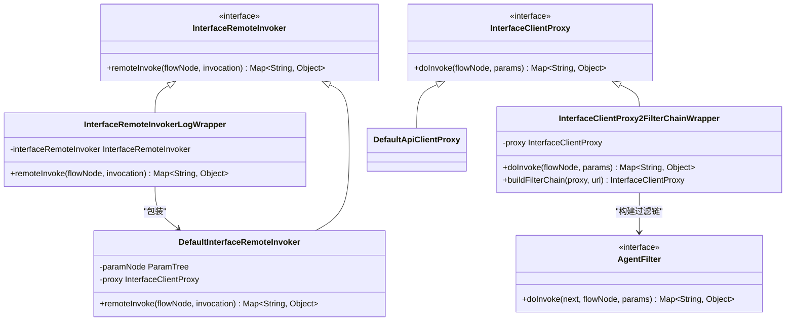
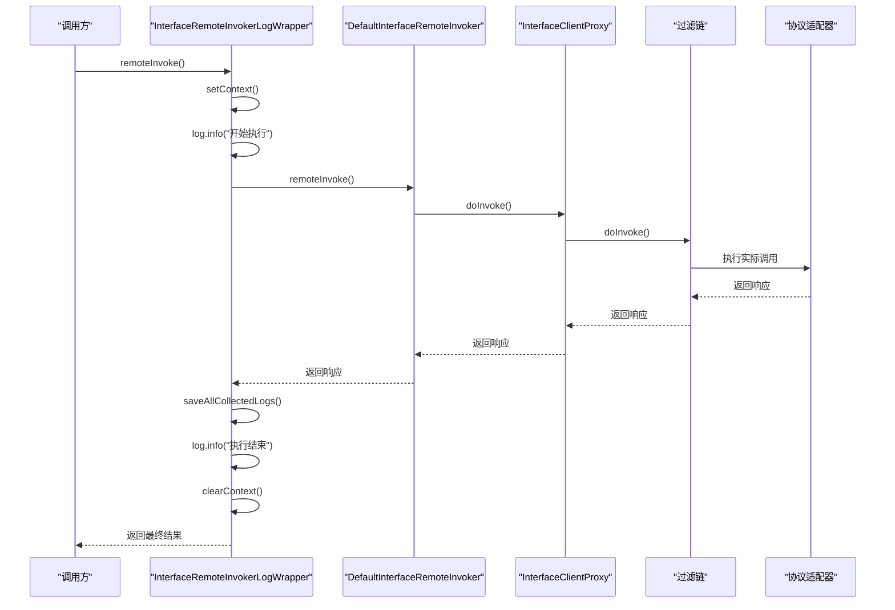
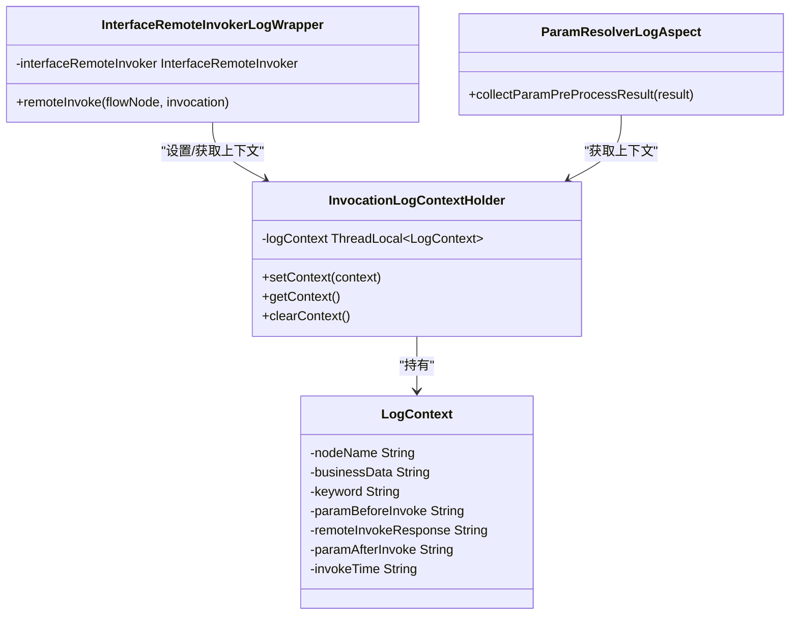
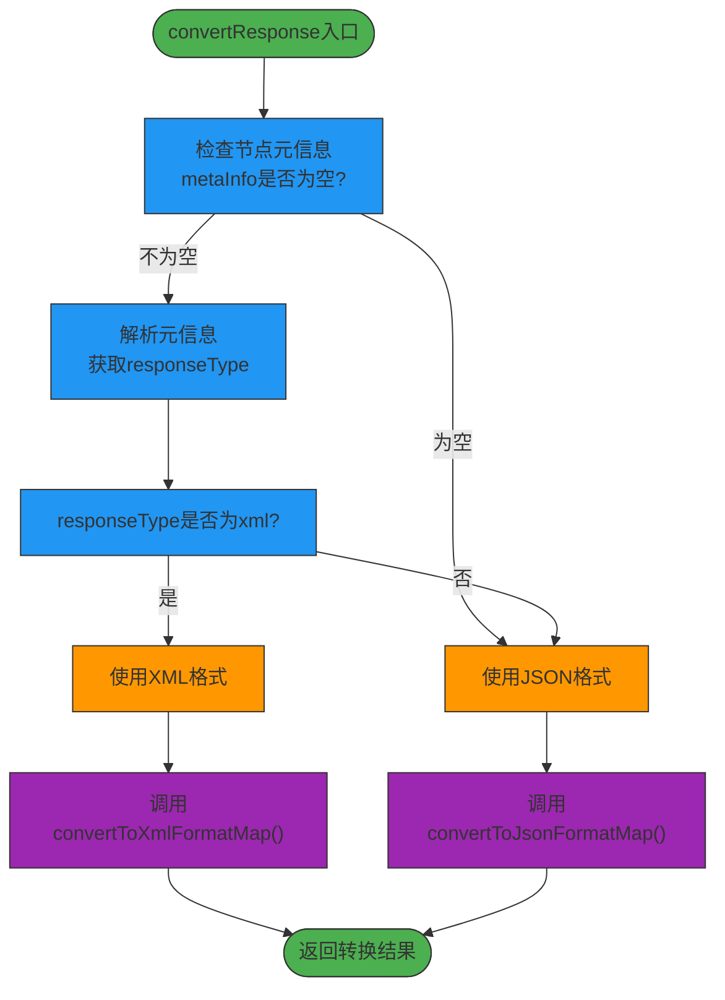

# 调用执行链

<cite>
**本文档引用文件**   
- [InterfaceRemoteInvoker.java](file://agent-invocation/src/main/java/com/helianhealth/agent/invocation/remote/InterfaceRemoteInvoker.java)
- [DefaultInterfaceRemoteInvoker.java](file://agent-invocation/src/main/java/com/helianhealth/agent/invocation/remote/DefaultInterfaceRemoteInvoker.java)
- [InterfaceRemoteInvokerLogWrapper.java](file://agent-invocation/src/main/java/com/helianhealth/agent/invocation/remote/wrapper/InterfaceRemoteInvokerLogWrapper.java)
- [InvocationLogContextHolder.java](file://agent-invocation/src/main/java/com/helianhealth/agent/invocation/context/InvocationLogContextHolder.java)
- [ProxyConvertHelper.java](file://agent-invocation/src/main/java/com/helianhealth/agent/invocation/remote/ProxyConvertHelper.java)
- [AgentFilter.java](file://agent-invocation/src/main/java/com/helianhealth/agent/invocation/remote/filter/AgentFilter.java)
- [InterfaceClientProxy2FilterChainWrapper.java](file://agent-invocation/src/main/java/com/helianhealth/agent/invocation/remote/wrapper/InterfaceClientProxy2FilterChainWrapper.java)
- [LogContext.java](file://agent-invocation/src/main/java/com/helianhealth/agent/invocation/context/LogContext.java)
- [Invocation.java](file://agent-invocation/src/main/java/com/helianhealth/agent/invocation/remote/model/Invocation.java)
- [InterfaceWorkflowNode.java](file://agent-invocation/src/main/java/com/helianhealth/agent/invocation/remote/model/InterfaceWorkflowNode.java)
- [ParamTree.java](file://agent-invocation/src/main/java/com/helianhealth/agent/invocation/remote/ParamTree.java)
- [InterfaceClientProxy.java](file://agent-invocation/src/main/java/com/helianhealth/agent/invocation/remote/InterfaceClientProxy.java)
</cite>

## 目录
1. [引言](#引言)
2. [核心组件](#核心组件)
3. [执行链路架构](#执行链路架构)
4. [三段式调用流程分析](#三段式调用流程分析)
5. [责任链模式应用](#责任链模式应用)
6. [上下文传递机制](#上下文传递机制)
7. [结果转换机制](#结果转换机制)
8. [扩展开发指南](#扩展开发指南)
9. [结论](#结论)

## 引言
本文档全面解析远程调用执行链路的设计，重点阐述从`InterfaceRemoteInvoker`接口的SPI扩展机制到具体实现的完整调用流程。系统分析了`DefaultInterfaceRemoteInvoker`如何实现三段式调用流程（前置参数处理、协议调用执行、后置结果转换），以及责任链模式在调用链中的应用。

## 核心组件

本文档分析的核心组件包括远程调用器接口、日志包装器、上下文管理器和结果转换工具等，这些组件共同构成了完整的远程调用执行链路。

**Section sources**
- [InterfaceRemoteInvoker.java](file://agent-invocation/src/main/java/com/helianhealth/agent/invocation/remote/InterfaceRemoteInvoker.java#L1-L26)
- [DefaultInterfaceRemoteInvoker.java](file://agent-invocation/src/main/java/com/helianhealth/agent/invocation/remote/DefaultInterfaceRemoteInvoker.java#L1-L86)
- [InterfaceRemoteInvokerLogWrapper.java](file://agent-invocation/src/main/java/com/helianhealth/agent/invocation/remote/wrapper/InterfaceRemoteInvokerLogWrapper.java#L1-L124)
- [InvocationLogContextHolder.java](file://agent-invocation/src/main/java/com/helianhealth/agent/invocation/context/InvocationLogContextHolder.java#L1-L33)
- [ProxyConvertHelper.java](file://agent-invocation/src/main/java/com/helianhealth/agent/invocation/remote/ProxyConvertHelper.java#L1-L103)

## 执行链路架构

远程调用执行链路采用SPI扩展机制和装饰器模式构建，形成了清晰的调用层次结构。通过Dubbo的SPI机制实现组件的可扩展性，同时利用装饰器模式在不修改原始调用器的情况下添加日志记录等功能。

```mermaid
graph TD
subgraph "调用入口"
A[InterfaceRemoteInvoker]:::interface
end
subgraph "装饰层"
B[InterfaceRemoteInvokerLogWrapper]:::class
end
subgraph "核心执行"
C[DefaultInterfaceRemoteInvoker]:::class
end
subgraph "协议代理"
D[InterfaceClientProxy]:::interface
E[InterfaceClientProxy2FilterChainWrapper]:::class
F[AgentFilter]:::interface
end
A --> B
B --> C
C --> D
D --> E
E --> F
style A fill:#f9f,stroke:#333
style B fill:#bbf,stroke:#333
style C fill:#f96,stroke:#333
style D fill:#f9f,stroke:#333
style E fill:#bbf,stroke:#333
style F fill:#f9f,stroke:#333
classDef interface fill:#f9f,stroke:#333,stroke-width:2px
classDef class fill:#bbf,stroke:#333,stroke-width:2px
```

**Diagram sources**
- [InterfaceRemoteInvoker.java](file://agent-invocation/src/main/java/com/helianhealth/agent/invocation/remote/InterfaceRemoteInvoker.java#L1-L26)
- [InterfaceRemoteInvokerLogWrapper.java](file://agent-invocation/src/main/java/com/helianhealth/agent/invocation/remote/wrapper/InterfaceRemoteInvokerLogWrapper.java#L1-L124)
- [DefaultInterfaceRemoteInvoker.java](file://agent-invocation/src/main/java/com/helianhealth/agent/invocation/remote/DefaultInterfaceRemoteInvoker.java#L1-L86)
- [InterfaceClientProxy.java](file://agent-invocation/src/main/java/com/helianhealth/agent/invocation/remote/InterfaceClientProxy.java#L1-L21)
- [InterfaceClientProxy2FilterChainWrapper.java](file://agent-invocation/src/main/java/com/helianhealth/agent/invocation/remote/wrapper/InterfaceClientProxy2FilterChainWrapper.java#L1-L40)
- [AgentFilter.java](file://agent-invocation/src/main/java/com/helianhealth/agent/invocation/remote/filter/AgentFilter.java#L1-L20)

## 三段式调用流程分析

`DefaultInterfaceRemoteInvoker`实现了典型的三段式调用流程，将远程调用过程分解为三个清晰的阶段：前置参数处理、协议调用执行和后置结果转换。



**Diagram sources**
- [DefaultInterfaceRemoteInvoker.java](file://agent-invocation/src/main/java/com/helianhealth/agent/invocation/remote/DefaultInterfaceRemoteInvoker.java#L23-L32)

### 前置参数处理

前置参数处理阶段负责将配置化的参数映射规则转换为实际的参数树结构，为后续的协议调用做准备。

**Section sources**
- [DefaultInterfaceRemoteInvoker.java](file://agent-invocation/src/main/java/com/helianhealth/agent/invocation/remote/DefaultInterfaceRemoteInvoker.java#L43-L56)
- [ParamTree.java](file://agent-invocation/src/main/java/com/helianhealth/agent/invocation/remote/ParamTree.java#L1-L48)
- [Invocation.java](file://agent-invocation/src/main/java/com/helianhealth/agent/invocation/remote/model/Invocation.java#L1-L31)

### 协议调用执行

协议调用执行阶段通过`InterfaceClientProxy`接口委托给具体的协议适配器（HTTP、数据库、WebService等）完成实际的远程调用。

**Section sources**
- [DefaultInterfaceRemoteInvoker.java](file://agent-invocation/src/main/java/com/helianhealth/agent/invocation/remote/DefaultInterfaceRemoteInvoker.java#L29-L29)
- [InterfaceClientProxy.java](file://agent-invocation/src/main/java/com/helianhealth/agent/invocation/remote/InterfaceClientProxy.java#L1-L21)

### 后置结果转换

后置结果转换阶段负责将远程调用的原始响应转换为符合业务需求的最终结果格式。

**Section sources**
- [DefaultInterfaceRemoteInvoker.java](file://agent-invocation/src/main/java/com/helianhealth/agent/invocation/remote/DefaultInterfaceRemoteInvoker.java#L65-L82)
- [ProxyConvertHelper.java](file://agent-invocation/src/main/java/com/helianhealth/agent/invocation/remote/ProxyConvertHelper.java#L1-L103)

## 责任链模式应用

系统通过装饰器模式和SPI过滤器机制实现了责任链模式的应用，允许在调用链路上动态添加各种处理逻辑。



**Diagram sources**
- [InterfaceRemoteInvoker.java](file://agent-invocation/src/main/java/com/helianhealth/agent/invocation/remote/InterfaceRemoteInvoker.java#L1-L26)
- [InterfaceRemoteInvokerLogWrapper.java](file://agent-invocation/src/main/java/com/helianhealth/agent/invocation/remote/wrapper/InterfaceRemoteInvokerLogWrapper.java#L1-L124)
- [DefaultInterfaceRemoteInvoker.java](file://agent-invocation/src/main/java/com/helianhealth/agent/invocation/remote/DefaultInterfaceRemoteInvoker.java#L1-L86)
- [InterfaceClientProxy.java](file://agent-invocation/src/main/java/com/helianhealth/agent/invocation/remote/InterfaceClientProxy.java#L1-L21)
- [InterfaceClientProxy2FilterChainWrapper.java](file://agent-invocation/src/main/java/com/helianhealth/agent/invocation/remote/wrapper/InterfaceClientProxy2FilterChainWrapper.java#L1-L40)
- [AgentFilter.java](file://agent-invocation/src/main/java/com/helianhealth/agent/invocation/remote/filter/AgentFilter.java#L1-L20)

### 日志记录装饰器

`InterfaceRemoteInvokerLogWrapper`作为装饰器包装原始调用器，实现了日志记录功能，同时通过`InvocationLogContextHolder`管理调用上下文。



**Diagram sources**
- [InterfaceRemoteInvokerLogWrapper.java](file://agent-invocation/src/main/java/com/helianhealth/agent/invocation/remote/wrapper/InterfaceRemoteInvokerLogWrapper.java#L1-L124)
- [InvocationLogContextHolder.java](file://agent-invocation/src/main/java/com/helianhealth/agent/invocation/context/InvocationLogContextHolder.java#L1-L33)
- [DefaultInterfaceRemoteInvoker.java](file://agent-invocation/src/main/java/com/helianhealth/agent/invocation/remote/DefaultInterfaceRemoteInvoker.java#L1-L86)

## 上下文传递机制

系统通过`ThreadLocal`机制实现调用上下文的传递，确保在单线程处理的调用链路中能够安全地共享上下文数据。



**Diagram sources**
- [InvocationLogContextHolder.java](file://agent-invocation/src/main/java/com/helianhealth/agent/invocation/context/InvocationLogContextHolder.java#L1-L33)
- [LogContext.java](file://agent-invocation/src/main/java/com/helianhealth/agent/invocation/context/LogContext.java#L1-L47)
- [InterfaceRemoteInvokerLogWrapper.java](file://agent-invocation/src/main/java/com/helianhealth/agent/invocation/remote/wrapper/InterfaceRemoteInvokerLogWrapper.java#L1-L124)

### ThreadLocal上下文管理

`InvocationLogContextHolder`利用`ThreadLocal`为每个线程维护独立的`LogContext`实例，避免了多线程环境下的数据竞争问题。

**Section sources**
- [InvocationLogContextHolder.java](file://agent-invocation/src/main/java/com/helianhealth/agent/invocation/context/InvocationLogContextHolder.java#L1-L33)
- [LogContext.java](file://agent-invocation/src/main/java/com/helianhealth/agent/invocation/context/LogContext.java#L1-L47)

## 结果转换机制

系统通过`ProxyConvertHelper`工具类实现响应结果的格式转换，支持根据配置将结果转换为JSON或XML格式。



**Diagram sources**
- [ProxyConvertHelper.java](file://agent-invocation/src/main/java/com/helianhealth/agent/invocation/remote/ProxyConvertHelper.java#L1-L103)

### 参数树转换

`ProxyConvertHelper`通过`ParamNodeUtils`工具将参数树转换为最终的响应结果，实现了灵活的数据结构转换。

**Section sources**
- [ProxyConvertHelper.java](file://agent-invocation/src/main/java/com/helianhealth/agent/invocation/remote/ProxyConvertHelper.java#L1-L103)
- [ParamNodeUtils.java](file://agent-invocation/src/main/java/com/helianhealth/agent/invocation/utils/ParamNodeUtils.java)

## 扩展开发指南

系统提供了丰富的SPI扩展点，开发者可以轻松实现自定义的过滤器或监控拦截器来扩展调用链功能。

### 自定义过滤器实现

要实现自定义过滤器，需要实现`AgentFilter`接口并使用`@Activate`注解声明激活条件。

**Section sources**
- [AgentFilter.java](file://agent-invocation/src/main/java/com/helianhealth/agent/invocation/remote/filter/AgentFilter.java#L1-L20)
- [MockAgentFilter.java](file://agent-invocation/src/main/java/com/helianhealth/agent/invocation/remote/filter/impl/MockAgentFilter.java#L1-L77)

### 监控拦截器开发

开发者可以创建新的装饰器类包装`InterfaceRemoteInvoker`，在调用前后添加监控逻辑，如性能统计、异常追踪等。

**Section sources**
- [InterfaceRemoteInvokerLogWrapper.java](file://agent-invocation/src/main/java/com/helianhealth/agent/invocation/remote/wrapper/InterfaceRemoteInvokerLogWrapper.java#L1-L124)
- [InterfaceRemoteInvoker.java](file://agent-invocation/src/main/java/com/helianhealth/agent/invocation/remote/InterfaceRemoteInvoker.java#L1-L26)

## 结论

本文档全面解析了远程调用执行链路的设计，展示了系统如何通过SPI扩展机制、装饰器模式和责任链模式构建灵活可扩展的调用架构。`DefaultInterfaceRemoteInvoker`的三段式调用流程设计清晰分离了关注点，而`InterfaceRemoteInvokerLogWrapper`等装饰器的使用则体现了开闭原则。通过`ThreadLocal`实现的上下文传递机制确保了调用链路中数据的安全共享，`ProxyConvertHelper`提供了灵活的结果转换能力。整个设计充分考虑了可扩展性，为开发者提供了清晰的扩展点来满足特定业务需求。