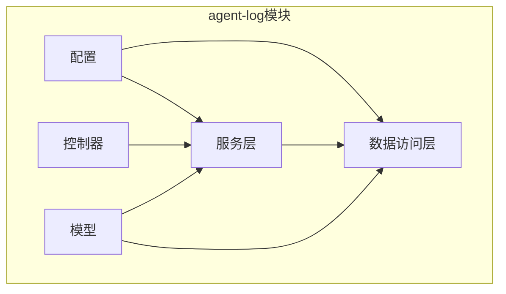
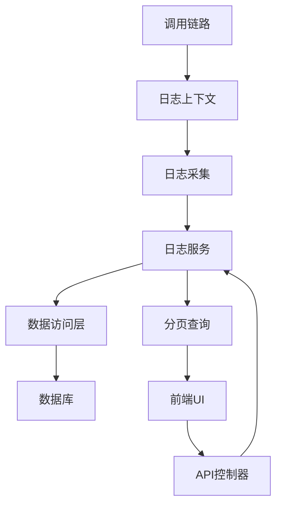
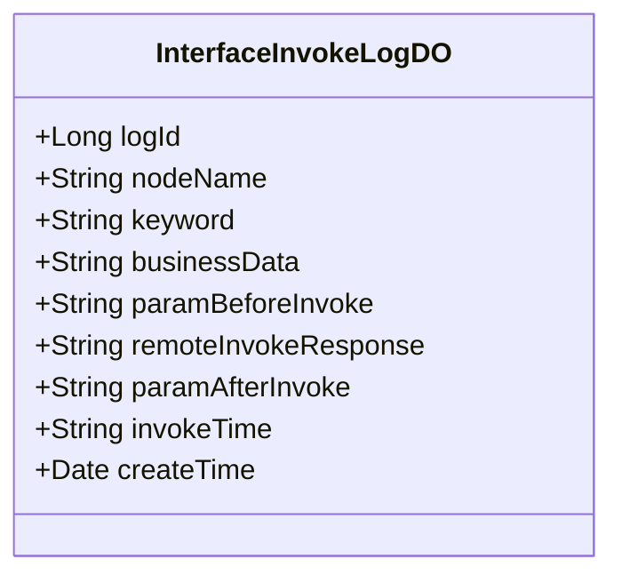
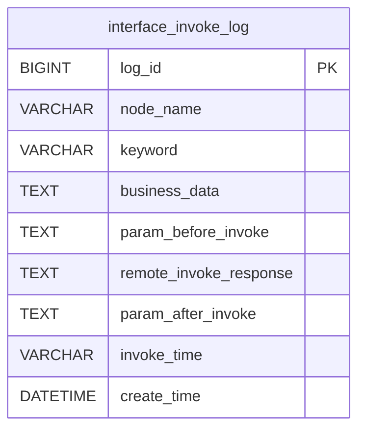
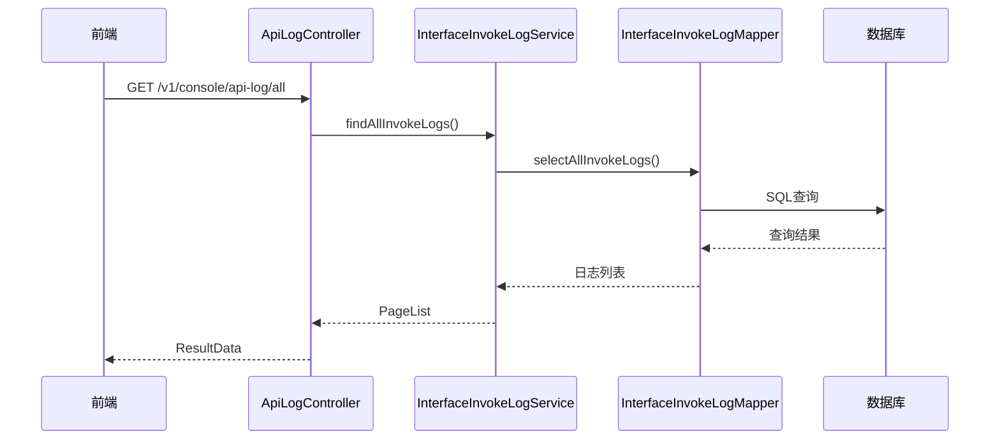
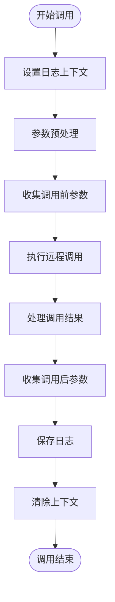
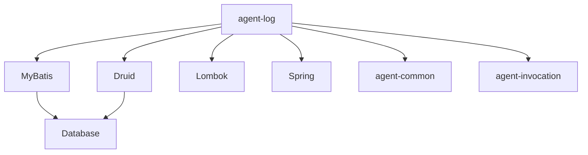

# agent-log 模块

<cite>
**本文档引用的文件**   
- [InterfaceInvokeLogDO.java](file://agent-log/src/main/java/com/helianhealth/agent/log/model/InterfaceInvokeLogDO.java)
- [InterfaceInvokeLogMapper.java](file://agent-log/src/main/java/com/helianhealth/agent/log/mapper/InterfaceInvokeLogMapper.java)
- [InterfaceInvokeLogMapper.xml](file://agent-log/src/main/resources/mapper/agent/InterfaceInvokeLogMapper.xml)
- [InterfaceInvokeLogService.java](file://agent-log/src/main/java/com/helianhealth/agent/log/service/InterfaceInvokeLogService.java)
- [InterfaceInvokeLogServiceImpl.java](file://agent-log/src/main/java/com/helianhealth/agent/log/service/impl/InterfaceInvokeLogServiceImpl.java)
- [ApiLogController.java](file://agent-log/src/main/java/com/helianhealth/agent/log/controller/ApiLogController.java)
- [LogDataSourceConfig.java](file://agent-log/src/main/java/com/helianhealth/agent/log/config/LogDataSourceConfig.java)
- [init_mysql.sql](file://doc/init_mysql.sql)
- [InvokeLog.vue](file://console-ui/src/views/InvokeLog.vue)
- [invokeLog.js](file://console-ui/src/api/invokeLog.js)
- [InvocationLogContextHolder.java](file://agent-invocation/src/main/java/com/helianhealth/agent/invocation/context/InvocationLogContextHolder.java)
- [LogContext.java](file://agent-invocation/src/main/java/com/helianhealth/agent/invocation/context/LogContext.java)
- [ParamResolverLogAspect.java](file://agent-invocation/src/main/java/com/helianhealth/agent/invocation/aspect/ParamResolverLogAspect.java)
- [InterfaceRemoteInvokerLogWrapper.java](file://agent-invocation/src/main/java/com/helianhealth/agent/invocation/remote/wrapper/InterfaceRemoteInvokerLogWrapper.java)
</cite>

## 目录
1. [简介](#简介)
2. [项目结构](#项目结构)
3. [核心组件](#核心组件)
4. [架构概述](#架构概述)
5. [详细组件分析](#详细组件分析)
6. [依赖分析](#依赖分析)
7. [性能考虑](#性能考虑)
8. [故障排除指南](#故障排除指南)
9. [结论](#结论)

## 简介
agent-log 模块是接口代理系统中的调用日志管理核心组件，负责记录和管理所有接口调用的详细日志信息。该模块提供了完整的调用日志生命周期管理功能，包括日志的采集、存储、查询和分析。通过该模块，系统能够追踪每个工作流节点的执行过程，记录调用前后的参数变化、响应结果以及性能指标，为系统监控、故障排查和业务审计提供重要支持。

## 项目结构
agent-log 模块采用标准的Spring Boot项目结构，包含配置、控制器、数据访问层、模型和服务层等核心组件。模块通过MyBatis实现数据持久化，使用Druid作为数据库连接池，并通过独立的数据源配置与主应用分离。日志数据存储在 `interface_invoke_log` 表中，支持基于节点名称和业务关键字的高效查询。

**图源**
- [LogDataSourceConfig.java](file://agent-log/src/main/java/com/helianhealth/agent/log/config/LogDataSourceConfig.java)
- [InterfaceInvokeLogMapper.java](file://agent-log/src/main/java/com/helianhealth/agent/log/mapper/InterfaceInvokeLogMapper.java)
- [InterfaceInvokeLogService.java](file://agent-log/src/main/java/com/helianhealth/agent/log/service/InterfaceInvokeLogService.java)

**本节来源**
- [LogDataSourceConfig.java](file://agent-log/src/main/java/com/helianhealth/agent/log/config/LogDataSourceConfig.java)
- [ApiLogController.java](file://agent-log/src/main/java/com/helianhealth/agent/log/controller/ApiLogController.java)
- [InterfaceInvokeLogService.java](file://agent-log/src/main/java/com/helianhealth/agent/log/service/InterfaceInvokeLogService.java)

## 核心组件
agent-log 模块的核心组件包括日志实体 `InterfaceInvokeLogDO`、日志服务 `InterfaceInvokeLogService`、日志控制器 `ApiLogController` 和日志数据访问组件。这些组件协同工作，实现了调用日志的完整管理功能。日志实体定义了日志数据的结构和与数据库表的映射关系，服务层提供了日志的保存和查询业务逻辑，控制器暴露了RESTful API供外部系统调用。

**本节来源**
- [InterfaceInvokeLogDO.java](file://agent-log/src/main/java/com/helianhealth/agent/log/model/InterfaceInvokeLogDO.java)
- [InterfaceInvokeLogService.java](file://agent-log/src/main/java/com/helianhealth/agent/log/service/InterfaceInvokeLogService.java)
- [ApiLogController.java](file://agent-log/src/main/java/com/helianhealth/agent/log/controller/ApiLogController.java)

## 架构概述
agent-log 模块采用分层架构设计，各层职责清晰，耦合度低。模块通过AOP切面和代理包装器从调用链路中采集日志数据，使用ThreadLocal存储日志上下文，确保线程安全。日志数据通过异步方式持久化到数据库，避免影响主业务流程性能。查询接口支持分页和条件过滤，满足不同场景下的日志检索需求。

**图源**
- [InvocationLogContextHolder.java](file://agent-invocation/src/main/java/com/helianhealth/agent/invocation/context/InvocationLogContextHolder.java)
- [InterfaceRemoteInvokerLogWrapper.java](file://agent-invocation/src/main/java/com/helianhealth/agent/invocation/remote/wrapper/InterfaceRemoteInvokerLogWrapper.java)
- [InterfaceInvokeLogService.java](file://agent-log/src/main/java/com/helianhealth/agent/log/service/InterfaceInvokeLogService.java)
- [ApiLogController.java](file://agent-log/src/main/java/com/helianhealth/agent/log/controller/ApiLogController.java)

## 详细组件分析

### InterfaceInvokeLogDO 实体分析
`InterfaceInvokeLogDO` 是调用日志的数据实体类，定义了日志记录的所有字段及其与数据库表的映射关系。该实体使用JPA注解进行ORM映射，确保Java对象与数据库表结构的一致性。

**图源**
- [InterfaceInvokeLogDO.java](file://agent-log/src/main/java/com/helianhealth/agent/log/model/InterfaceInvokeLogDO.java)

**本节来源**
- [InterfaceInvokeLogDO.java](file://agent-log/src/main/java/com/helianhealth/agent/log/model/InterfaceInvokeLogDO.java)

### 日志存储与数据库映射
日志数据存储在 `interface_invoke_log` 数据库表中，该表设计考虑了查询性能和数据完整性。关键字段包括日志ID、节点名称、业务关键字、调用前后参数、响应结果、调用耗时和创建时间。表结构通过SQL脚本定义，并与实体类通过MyBatis映射文件关联。

**图源**
- [init_mysql.sql](file://doc/init_mysql.sql)
- [InterfaceInvokeLogMapper.xml](file://agent-log/src/main/resources/mapper/agent/InterfaceInvokeLogMapper.xml)

**本节来源**
- [init_mysql.sql](file://doc/init_mysql.sql)
- [InterfaceInvokeLogMapper.xml](file://agent-log/src/main/resources/mapper/agent/InterfaceInvokeLogMapper.xml)

### ApiLogController 接口分析
`ApiLogController` 提供了调用日志的查询API接口，支持基于节点名称和业务关键字的条件查询，以及分页功能。接口返回标准化的响应数据结构，便于前端消费。

**图源**
- [ApiLogController.java](file://agent-log/src/main/java/com/helianhealth/agent/log/controller/ApiLogController.java)
- [InterfaceInvokeLogService.java](file://agent-log/src/main/java/com/helianhealth/agent/log/service/InterfaceInvokeLogService.java)
- [InterfaceInvokeLogMapper.java](file://agent-log/src/main/java/com/helianhealth/agent/log/mapper/InterfaceInvokeLogMapper.java)

**本节来源**
- [ApiLogController.java](file://agent-log/src/main/java/com/helianhealth/agent/log/controller/ApiLogController.java)
- [InterfaceInvokeLogService.java](file://agent-log/src/main/java/com/helianhealth/agent/log/service/InterfaceInvokeLogService.java)

### 日志采集时机与流程
日志采集发生在工作流节点执行过程中，通过AOP切面和代理包装器实现。`InterfaceRemoteInvokerLogWrapper` 在远程调用前后设置日志上下文，`ParamResolverLogAspect` 收集参数预处理结果，最终在调用完成后统一保存日志。

**图源**
- [InterfaceRemoteInvokerLogWrapper.java](file://agent-invocation/src/main/java/com/helianhealth/agent/invocation/remote/wrapper/InterfaceRemoteInvokerLogWrapper.java)
- [ParamResolverLogAspect.java](file://agent-invocation/src/main/java/com/helianhealth/agent/invocation/aspect/ParamResolverLogAspect.java)
- [InvocationLogContextHolder.java](file://agent-invocation/src/main/java/com/helianhealth/agent/invocation/context/InvocationLogContextHolder.java)

**本节来源**
- [InterfaceRemoteInvokerLogWrapper.java](file://agent-invocation/src/main/java/com/helianhealth/agent/invocation/remote/wrapper/InterfaceRemoteInvokerLogWrapper.java)
- [ParamResolverLogAspect.java](file://agent-invocation/src/main/java/com/helianhealth/agent/invocation/aspect/ParamResolverLogAspect.java)

## 依赖分析
agent-log 模块依赖于多个核心组件，包括MyBatis用于数据访问，Druid用于数据库连接池，Lombok用于代码简化，以及Spring框架的核心功能。模块还依赖于agent-common模块的基础类和工具类，以及agent-invocation模块的日志上下文组件。

**图源**
- [pom.xml](file://agent-log/pom.xml)
- [LogDataSourceConfig.java](file://agent-log/src/main/java/com/helianhealth/agent/log/config/LogDataSourceConfig.java)

**本节来源**
- [pom.xml](file://agent-log/pom.xml)
- [LogDataSourceConfig.java](file://agent-log/src/main/java/com/helianhealth/agent/log/config/LogDataSourceConfig.java)

## 性能考虑
agent-log 模块在设计时充分考虑了性能优化。日志写入采用同步方式但通过连接池优化数据库访问性能，查询操作使用PageHelper实现高效分页。日志上下文使用ThreadLocal存储，避免了线程安全问题和同步开销。数据库表设计合理，关键查询字段建立了适当的索引。

**本节来源**
- [InterfaceInvokeLogServiceImpl.java](file://agent-log/src/main/java/com/helianhealth/agent/log/service/impl/InterfaceInvokeLogServiceImpl.java)
- [LogDataSourceConfig.java](file://agent-log/src/main/java/com/helianhealth/agent/log/config/LogDataSourceConfig.java)

## 故障排除指南
当遇到日志功能异常时，可按照以下步骤进行排查：首先检查数据库连接是否正常，确认日志表是否存在且结构正确；其次查看日志服务是否正常注入，确认AOP切面是否生效；最后检查日志上下文是否正确传递，确保ThreadLocal数据未被意外清除。

**本节来源**
- [InterfaceInvokeLogServiceImpl.java](file://agent-log/src/main/java/com/helianhealth/agent/log/service/impl/InterfaceInvokeLogServiceImpl.java)
- [InterfaceRemoteInvokerLogWrapper.java](file://agent-invocation/src/main/java/com/helianhealth/agent/invocation/remote/wrapper/InterfaceRemoteInvokerLogWrapper.java)
- [InvocationLogContextHolder.java](file://agent-invocation/src/main/java/com/helianhealth/agent/invocation/context/InvocationLogContextHolder.java)

## 结论
agent-log 模块为接口代理系统提供了完善的调用日志管理功能。通过合理的架构设计和组件划分，模块实现了日志的自动采集、高效存储和灵活查询。日志数据不仅可用于故障排查和性能分析，还能支持业务审计和工作流追溯。模块的扩展性良好，可根据需要增加日志分析、监控告警等高级功能。