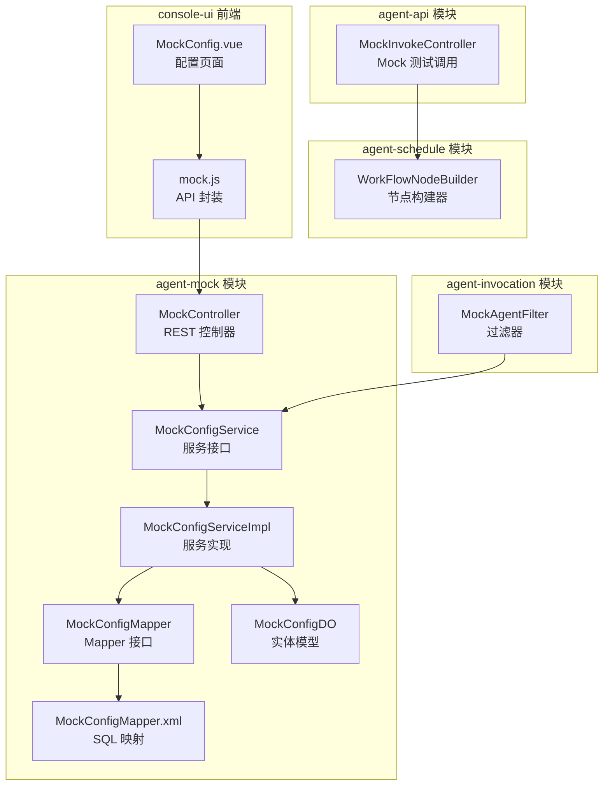
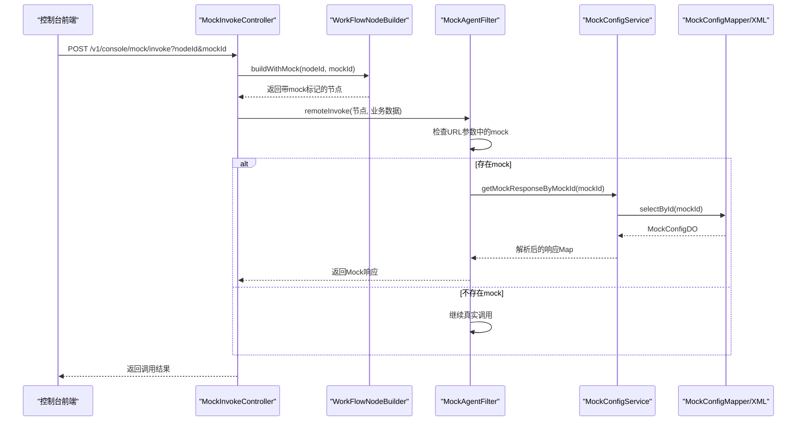
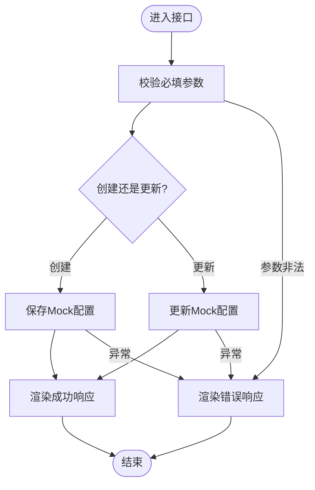
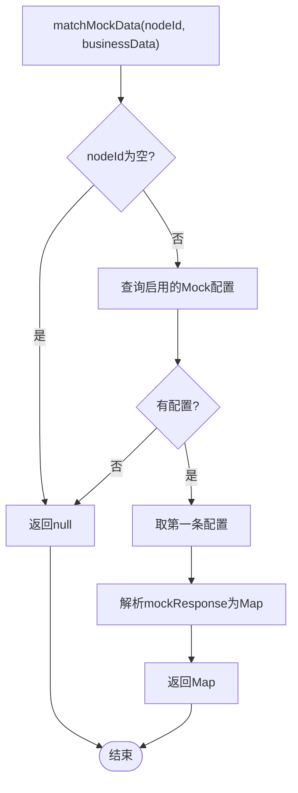
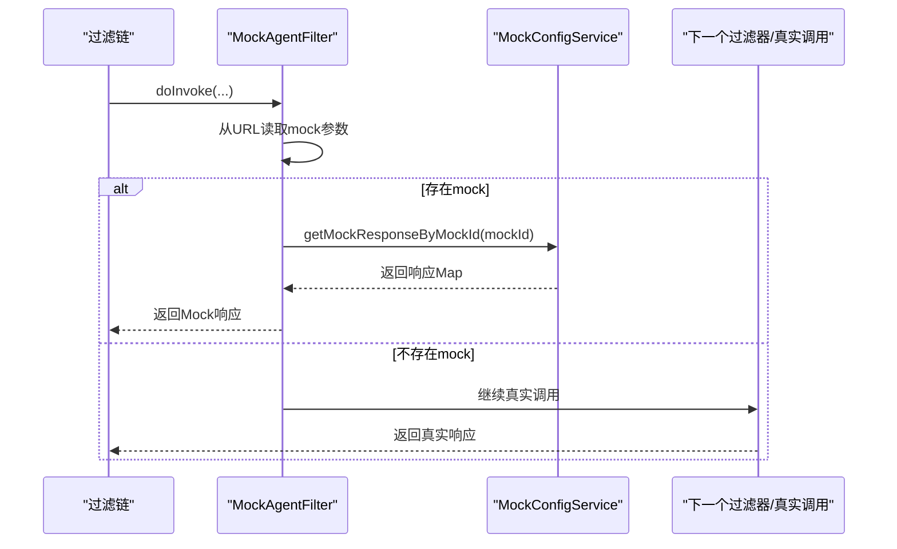
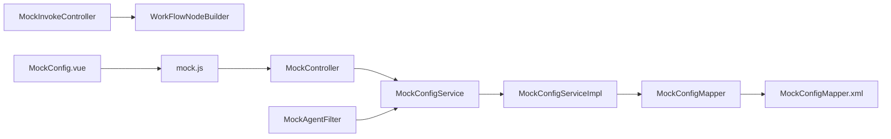

# agent-mock 模块

<cite>
**本文引用的文件**
- [MockController.java](file://agent-mock/src/main/java/com/helianhealth/agent/mock/controller/MockController.java)
- [MockConfigService.java](file://agent-mock/src/main/java/com/helianhealth/agent/mock/service/MockConfigService.java)
- [MockConfigServiceImpl.java](file://agent-mock/src/main/java/com/helianhealth/agent/mock/service/impl/MockConfigServiceImpl.java)
- [MockConfigMapper.java](file://agent-mock/src/main/java/com/helianhealth/agent/mock/mapper/MockConfigMapper.java)
- [MockConfigMapper.xml](file://agent-mock/src/main/resources/mapper/agent/MockConfigMapper.xml)
- [MockConfigDO.java](file://agent-mock/src/main/java/com/helianhealth/agent/mock/model/MockConfigDO.java)
- [MockAgentFilter.java](file://agent-invocation/src/main/java/com/helianhealth/agent/invocation/remote/filter/impl/MockAgentFilter.java)
- [MockInvokeController.java](file://agent-api/src/main/java/com/helianhealth/agent/api/controller/MockInvokeController.java)
- [WorkFlowNodeBuilder.java](file://agent-schedule/src/main/java/com/helianhealth/agent/schedule/builder/WorkFlowNodeBuilder.java)
- [MockConfig.vue](file://console-ui/src/views/MockConfig.vue)
- [mock.js](file://console-ui/src/api/mock.js)
- [init_mysql.sql](file://doc/init_mysql.sql)
</cite>

## 目录
1. [简介](#简介)
2. [项目结构](#项目结构)
3. [核心组件](#核心组件)
4. [架构总览](#架构总览)
5. [详细组件分析](#详细组件分析)
6. [依赖关系分析](#依赖关系分析)
7. [性能考量](#性能考量)
8. [故障排查指南](#故障排查指南)
9. [结论](#结论)
10. [附录](#附录)

## 简介
agent-mock 模块为接口代理系统提供测试桩（Mock）能力，允许开发者在开发与测试阶段使用预设的响应数据替代真实的远程调用，从而提升联调效率、降低对外部系统的依赖，并支持多场景的响应模拟。该模块通过控制台界面进行配置管理，结合过滤器拦截机制实现对真实调用的动态替换，并提供针对不同协议（HTTP、数据库、WebService）的参数解析与处理。

## 项目结构
agent-mock 模块采用分层架构：
- 控制器层：提供 REST API，负责 Mock 配置的增删改查与分页查询
- 服务层：封装业务逻辑，包括 Mock 配置匹配与响应解析
- 数据访问层：MyBatis 映射，提供数据库 CRUD 操作
- 实体模型：MockConfigDO 定义 Mock 配置的数据结构
- 过滤器集成：MockAgentFilter 在调用链中拦截并按需返回 Mock 响应
- 控制台集成：前端页面与 API 调用 Mock 配置管理与测试调用

图表来源
- [MockController.java](file://agent-mock/src/main/java/com/helianhealth/agent/mock/controller/MockController.java#L1-L148)
- [MockConfigService.java](file://agent-mock/src/main/java/com/helianhealth/agent/mock/service/MockConfigService.java#L1-L66)
- [MockConfigServiceImpl.java](file://agent-mock/src/main/java/com/helianhealth/agent/mock/service/impl/MockConfigServiceImpl.java#L1-L125)
- [MockConfigMapper.java](file://agent-mock/src/main/java/com/helianhealth/agent/mock/mapper/MockConfigMapper.java#L1-L60)
- [MockConfigMapper.xml](file://agent-mock/src/main/resources/mapper/agent/MockConfigMapper.xml#L1-L96)
- [MockConfigDO.java](file://agent-mock/src/main/java/com/helianhealth/agent/mock/model/MockConfigDO.java#L1-L50)
- [MockAgentFilter.java](file://agent-invocation/src/main/java/com/helianhealth/agent/invocation/remote/filter/impl/MockAgentFilter.java#L1-L77)
- [MockInvokeController.java](file://agent-api/src/main/java/com/helianhealth/agent/api/controller/MockInvokeController.java#L1-L71)
- [WorkFlowNodeBuilder.java](file://agent-schedule/src/main/java/com/helianhealth/agent/schedule/builder/WorkFlowNodeBuilder.java#L1-L101)
- [MockConfig.vue](file://console-ui/src/views/MockConfig.vue#L1-L407)
- [mock.js](file://console-ui/src/api/mock.js#L1-L90)

章节来源
- [MockController.java](file://agent-mock/src/main/java/com/helianhealth/agent/mock/controller/MockController.java#L1-L148)
- [MockConfigService.java](file://agent-mock/src/main/java/com/helianhealth/agent/mock/service/MockConfigService.java#L1-L66)
- [MockConfigServiceImpl.java](file://agent-mock/src/main/java/com/helianhealth/agent/mock/service/impl/MockConfigServiceImpl.java#L1-L125)
- [MockConfigMapper.java](file://agent-mock/src/main/java/com/helianhealth/agent/mock/mapper/MockConfigMapper.java#L1-L60)
- [MockConfigMapper.xml](file://agent-mock/src/main/resources/mapper/agent/MockConfigMapper.xml#L1-L96)
- [MockConfigDO.java](file://agent-mock/src/main/java/com/helianhealth/agent/mock/model/MockConfigDO.java#L1-L50)
- [MockAgentFilter.java](file://agent-invocation/src/main/java/com/helianhealth/agent/invocation/remote/filter/impl/MockAgentFilter.java#L1-L77)
- [MockInvokeController.java](file://agent-api/src/main/java/com/helianhealth/agent/api/controller/MockInvokeController.java#L1-L71)
- [WorkFlowNodeBuilder.java](file://agent-schedule/src/main/java/com/helianhealth/agent/schedule/builder/WorkFlowNodeBuilder.java#L1-L101)
- [MockConfig.vue](file://console-ui/src/views/MockConfig.vue#L1-L407)
- [mock.js](file://console-ui/src/api/mock.js#L1-L90)

## 核心组件
- MockController：提供 Mock 配置的 REST API，包括分页查询、按节点查询、按 ID 查询、创建、更新、删除等接口
- MockConfigService：定义 Mock 配置的业务接口，包括匹配 Mock 数据与按 ID 获取响应
- MockConfigServiceImpl：实现 Mock 配置的业务逻辑，包括分页查询、按节点查询、按 ID 查询、保存、更新、删除等
- MockConfigMapper：定义 MyBatis Mapper 接口，提供数据库操作
- MockConfigMapper.xml：定义 SQL 映射，包括查询、插入、更新、删除等
- MockConfigDO：Mock 配置实体，包含主键、节点 ID、场景名称、场景描述、响应数据、启用状态等字段
- MockAgentFilter：在调用链中拦截请求，根据 URL 参数中的 mock 标记决定是否返回 Mock 响应
- MockInvokeController：提供基于 nodeId 和 mockId 的 Mock 节点调用接口，便于测试
- WorkFlowNodeBuilder：构建带 Mock 标记的节点，通过 URL 传递 mockId
- 控制台前端：MockConfig.vue 与 mock.js 提供 Mock 配置的可视化管理与测试调用

章节来源
- [MockController.java](file://agent-mock/src/main/java/com/helianhealth/agent/mock/controller/MockController.java#L1-L148)
- [MockConfigService.java](file://agent-mock/src/main/java/com/helianhealth/agent/mock/service/MockConfigService.java#L1-L66)
- [MockConfigServiceImpl.java](file://agent-mock/src/main/java/com/helianhealth/agent/mock/service/impl/MockConfigServiceImpl.java#L1-L125)
- [MockConfigMapper.java](file://agent-mock/src/main/java/com/helianhealth/agent/mock/mapper/MockConfigMapper.java#L1-L60)
- [MockConfigMapper.xml](file://agent-mock/src/main/resources/mapper/agent/MockConfigMapper.xml#L1-L96)
- [MockConfigDO.java](file://agent-mock/src/main/java/com/helianhealth/agent/mock/model/MockConfigDO.java#L1-L50)
- [MockAgentFilter.java](file://agent-invocation/src/main/java/com/helianhealth/agent/invocation/remote/filter/impl/MockAgentFilter.java#L1-L77)
- [MockInvokeController.java](file://agent-api/src/main/java/com/helianhealth/agent/api/controller/MockInvokeController.java#L1-L71)
- [WorkFlowNodeBuilder.java](file://agent-schedule/src/main/java/com/helianhealth/agent/schedule/builder/WorkFlowNodeBuilder.java#L1-L101)
- [MockConfig.vue](file://console-ui/src/views/MockConfig.vue#L1-L407)
- [mock.js](file://console-ui/src/api/mock.js#L1-L90)

## 架构总览
agent-mock 的整体架构围绕“配置管理 + 调用拦截 + 动态替换”展开：
- 配置管理：通过 MockController 提供的 API 对 MockConfigDO 进行增删改查
- 调用拦截：MockAgentFilter 在调用链中检查 URL 参数中的 mock 标记，若存在则直接返回 Mock 响应
- 动态替换：当 URL 中包含 mock 参数时，MockAgentFilter 会解析参数并调用 MockConfigService 获取对应 Mock 响应；否则继续真实调用
- 测试调用：MockInvokeController 支持通过 nodeId 和 mockId 构建节点并执行远程调用，便于在控制台进行测试

图表来源
- [MockInvokeController.java](file://agent-api/src/main/java/com/helianhealth/agent/api/controller/MockInvokeController.java#L38-L69)
- [WorkFlowNodeBuilder.java](file://agent-schedule/src/main/java/com/helianhealth/agent/schedule/builder/WorkFlowNodeBuilder.java#L64-L99)
- [MockAgentFilter.java](file://agent-invocation/src/main/java/com/helianhealth/agent/invocation/remote/filter/impl/MockAgentFilter.java#L34-L58)
- [MockConfigService.java](file://agent-mock/src/main/java/com/helianhealth/agent/mock/service/MockConfigService.java#L28-L29)
- [MockConfigMapper.xml](file://agent-mock/src/main/resources/mapper/agent/MockConfigMapper.xml#L33-L39)

## 详细组件分析

### MockController：配置管理 API
- 分页查询：支持按节点 ID 过滤，返回 PageList 结果
- 按节点查询：返回该节点下所有 Mock 配置
- 按 ID 查询：返回指定 Mock 配置详情
- 创建：校验节点 ID、场景名称、响应数据非空后保存
- 更新：校验 Mock ID 后更新
- 删除：支持按 ID 删除与按节点批量删除

图表来源
- [MockController.java](file://agent-mock/src/main/java/com/helianhealth/agent/mock/controller/MockController.java#L77-L114)

章节来源
- [MockController.java](file://agent-mock/src/main/java/com/helianhealth/agent/mock/controller/MockController.java#L29-L146)

### MockConfigService / MockConfigServiceImpl：匹配与响应解析
- matchMockData：根据节点 ID 查询启用的 Mock 配置，取第一个并解析为 Map 返回
- getMockResponseByMockId：根据 Mock ID 查询并解析响应，若未启用则返回 null
- findByPage / findByNodeId / findById：分页与查询辅助方法
- save / update / deleteById / deleteByNodeId：持久化操作

图表来源
- [MockConfigServiceImpl.java](file://agent-mock/src/main/java/com/helianhealth/agent/mock/service/impl/MockConfigServiceImpl.java#L28-L52)

章节来源
- [MockConfigService.java](file://agent-mock/src/main/java/com/helianhealth/agent/mock/service/MockConfigService.java#L14-L65)
- [MockConfigServiceImpl.java](file://agent-mock/src/main/java/com/helianhealth/agent/mock/service/impl/MockConfigServiceImpl.java#L27-L124)

### MockConfigMapper / MockConfigMapper.xml：数据访问层
- Mapper 接口定义：按节点查询启用/全部配置、按 ID 查询、分页查询、计数、插入、更新、删除
- XML 映射：定义 SQL 语句，包括条件查询、排序、插入字段与更新字段集合

章节来源
- [MockConfigMapper.java](file://agent-mock/src/main/java/com/helianhealth/agent/mock/mapper/MockConfigMapper.java#L14-L59)
- [MockConfigMapper.xml](file://agent-mock/src/main/resources/mapper/agent/MockConfigMapper.xml#L15-L93)

### MockConfigDO：实体模型
- 字段：mockId、nodeId、caseName、caseDesc、mockResponse、enabled
- 作用：承载 Mock 配置的完整信息，用于数据库存储与 API 传输

章节来源
- [MockConfigDO.java](file://agent-mock/src/main/java/com/helianhealth/agent/mock/model/MockConfigDO.java#L17-L49)

### MockAgentFilter：拦截与优先级
- 优先级：通过 @Activate(order = 100) 设定在过滤链中的顺序
- 拦截逻辑：读取 URL 参数中的 mock，若存在则解析为 mockId，调用 MockConfigService 获取响应；否则继续真实调用
- 参数解析：根据节点类型（HTTP、DATABASE、WEBSERVICE）调用对应 Handler 解析参数节点

图表来源
- [MockAgentFilter.java](file://agent-invocation/src/main/java/com/helianhealth/agent/invocation/remote/filter/impl/MockAgentFilter.java#L34-L58)

章节来源
- [MockAgentFilter.java](file://agent-invocation/src/main/java/com/helianhealth/agent/invocation/remote/filter/impl/MockAgentFilter.java#L18-L77)

### MockInvokeController：测试调用入口
- 作用：接收 nodeId 与 mockId，构建带 Mock 标记的节点，执行远程调用并返回结果
- 适用场景：在控制台中快速验证 Mock 配置的有效性与响应格式

章节来源
- [MockInvokeController.java](file://agent-api/src/main/java/com/helianhealth/agent/api/controller/MockInvokeController.java#L34-L69)

### WorkFlowNodeBuilder：构建带 Mock 的节点
- 校验：确保 mockId 对应的 Mock 配置存在且属于该节点
- 构建：基于节点视图构建节点对象，并通过 URL 初始化设置 mock 标记

章节来源
- [WorkFlowNodeBuilder.java](file://agent-schedule/src/main/java/com/helianhealth/agent/schedule/builder/WorkFlowNodeBuilder.java#L64-L99)

### 控制台前端：MockConfig.vue 与 mock.js
- MockConfig.vue：提供 Mock 配置的增删改查、分页、节点筛选、JSON 预览与开关控制
- mock.js：封装 REST API 调用，包括分页查询、创建、更新、删除、按节点删除、调用 Mock

章节来源
- [MockConfig.vue](file://console-ui/src/views/MockConfig.vue#L1-L407)
- [mock.js](file://console-ui/src/api/mock.js#L1-L90)

## 依赖关系分析
- 控制器依赖服务接口，服务实现依赖 Mapper 接口与 XML 映射
- MockAgentFilter 依赖 MockConfigService 与多种 Handler（HTTP、DATABASE、WEBSERVICE）
- MockInvokeController 依赖 WorkFlowNodeBuilder 与远程调用器
- 前端通过 mock.js 调用 MockController 提供的 API

图表来源
- [MockController.java](file://agent-mock/src/main/java/com/helianhealth/agent/mock/controller/MockController.java#L24)
- [MockConfigService.java](file://agent-mock/src/main/java/com/helianhealth/agent/mock/service/MockConfigService.java#L12)
- [MockConfigServiceImpl.java](file://agent-mock/src/main/java/com/helianhealth/agent/mock/service/impl/MockConfigServiceImpl.java#L25)
- [MockConfigMapper.java](file://agent-mock/src/main/java/com/helianhealth/agent/mock/mapper/MockConfigMapper.java#L12)
- [MockConfigMapper.xml](file://agent-mock/src/main/resources/mapper/agent/MockConfigMapper.xml#L4)
- [MockAgentFilter.java](file://agent-invocation/src/main/java/com/helianhealth/agent/invocation/remote/filter/impl/MockAgentFilter.java#L22-L32)
- [MockInvokeController.java](file://agent-api/src/main/java/com/helianhealth/agent/api/controller/MockInvokeController.java#L31-L32)
- [WorkFlowNodeBuilder.java](file://agent-schedule/src/main/java/com/helianhealth/agent/schedule/builder/WorkFlowNodeBuilder.java#L18-L19)
- [MockConfig.vue](file://console-ui/src/views/MockConfig.vue#L179)
- [mock.js](file://console-ui/src/api/mock.js#L6-L89)

章节来源
- [MockController.java](file://agent-mock/src/main/java/com/helianhealth/agent/mock/controller/MockController.java#L24)
- [MockConfigService.java](file://agent-mock/src/main/java/com/helianhealth/agent/mock/service/MockConfigService.java#L12)
- [MockConfigServiceImpl.java](file://agent-mock/src/main/java/com/helianhealth/agent/mock/service/impl/MockConfigServiceImpl.java#L25)
- [MockConfigMapper.java](file://agent-mock/src/main/java/com/helianhealth/agent/mock/mapper/MockConfigMapper.java#L12)
- [MockConfigMapper.xml](file://agent-mock/src/main/resources/mapper/agent/MockConfigMapper.xml#L4)
- [MockAgentFilter.java](file://agent-invocation/src/main/java/com/helianhealth/agent/invocation/remote/filter/impl/MockAgentFilter.java#L22-L32)
- [MockInvokeController.java](file://agent-api/src/main/java/com/helianhealth/agent/api/controller/MockInvokeController.java#L31-L32)
- [WorkFlowNodeBuilder.java](file://agent-schedule/src/main/java/com/helianhealth/agent/schedule/builder/WorkFlowNodeBuilder.java#L18-L19)
- [MockConfig.vue](file://console-ui/src/views/MockConfig.vue#L179)
- [mock.js](file://console-ui/src/api/mock.js#L6-L89)

## 性能考量
- 分页查询：使用 PageHelper 实现分页，避免一次性加载大量数据
- 启用筛选：查询启用的 Mock 配置时仅筛选 enabled=1，减少无效数据处理
- 单条命中：匹配逻辑直接取第一条启用的配置，复杂度 O(1)，满足大多数场景
- JSON 解析：响应数据以 JSON 字符串存储，按需解析，避免重复序列化开销

[本节为通用性能建议，无需特定文件来源]

## 故障排查指南
- 创建/更新失败：检查必填字段（节点 ID、场景名称、响应数据），确认 JSON 格式正确
- 查询不到 Mock：确认节点已启用至少一条 Mock 配置，且 enabled=1
- Mock 不生效：检查 URL 是否包含 mock 参数，参数是否为有效整数
- 删除异常：确认 mockId 或 nodeId 存在且权限正确
- 控制台无法访问：确认前端 mock.js 与后端 MockController 路由一致

章节来源
- [MockController.java](file://agent-mock/src/main/java/com/helianhealth/agent/mock/controller/MockController.java#L77-L114)
- [MockConfigServiceImpl.java](file://agent-mock/src/main/java/com/helianhealth/agent/mock/service/impl/MockConfigServiceImpl.java#L28-L52)
- [MockAgentFilter.java](file://agent-invocation/src/main/java/com/helianhealth/agent/invocation/remote/filter/impl/MockAgentFilter.java#L34-L58)

## 结论
agent-mock 模块通过清晰的分层设计与完善的控制台集成，提供了灵活、易用的 Mock 能力。其核心优势在于：
- 简洁的 API 设计：支持标准的增删改查与分页查询
- 可控的拦截机制：通过 URL 参数实现精确的 Mock 触发
- 多协议支持：适配 HTTP、数据库、WebService 的参数解析
- 开发友好：控制台可视化管理与测试调用，便于快速迭代与问题定位

[本节为总结性内容，无需特定文件来源]

## 附录

### 数据库表结构（Mock 配置）
- 表名：mock_config
- 字段：mock_id（主键）、node_id（节点 ID）、case_name（场景名称）、case_desc（场景描述）、mock_response（JSON 响应）、enabled（启用状态）、create_time（创建时间）

章节来源
- [init_mysql.sql](file://doc/init_mysql.sql#L99-L116)

### 典型使用场景
- 开发联调：在本地或测试环境使用 Mock 响应替代真实接口，加速开发进度
- 场景覆盖：为不同业务分支准备多个 Mock 配置，模拟成功、失败、超时等场景
- 控制台测试：通过 MockInvokeController 快速验证 Mock 配置与参数解析效果
- 批量清理：通过按节点删除接口清理过期或无效的 Mock 配置

章节来源
- [MockInvokeController.java](file://agent-api/src/main/java/com/helianhealth/agent/api/controller/MockInvokeController.java#L34-L69)
- [MockConfigServiceImpl.java](file://agent-mock/src/main/java/com/helianhealth/agent/mock/service/impl/MockConfigServiceImpl.java#L120-L123)

### 切换策略与注意事项
- 切换策略：通过 URL 参数中的 mock 标记实现即时切换；未携带该参数时自动走真实调用
- 注意事项：确保 Mock 配置与目标节点匹配，避免跨节点误用；保持响应数据的 JSON 格式正确；合理设置启用状态，避免误触发

章节来源
- [MockAgentFilter.java](file://agent-invocation/src/main/java/com/helianhealth/agent/invocation/remote/filter/impl/MockAgentFilter.java#L34-L58)
- [WorkFlowNodeBuilder.java](file://agent-schedule/src/main/java/com/helianhealth/agent/schedule/builder/WorkFlowNodeBuilder.java#L64-L99)